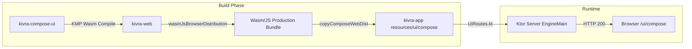

# Requirements

### Overview & Goals
Compose Multiplatform for Web のコード実装（`kivra-compose-ui`, `kivra-web`, 7画面のコンポーネント実装、`copyComposeWebDist` タスク）は完了しましたが、本番環境（`/ui/compose`）で 404 が発生しています。
主な原因は Docker ビルド時に Wasm 成果物が生成・同梱されていないこと、および `main` ブランチにおける DB マイグレーション（V40〜V43）とテストスイートの不整合により PR がマージできない状態にあることです。
本計画では、DB マイグレーションとテストの不整合を解消し、Docker ビルドおよび Wasm 成果物の同梱設定（PR #398）を修正・検証して、本番環境へのデプロイと `/ui/compose` の正常稼働を達成します。

### Scope
**In Scope:**
- DB マイグレーション（V40〜V43）の H2 / MariaDB 互換性修正とテスト Allowlist の更新
- `kivra-app` テストスイート（`SelfDevAssigneeRoutesTest`, `RolesCoverageArchitectureTest`, `DockerfileModuleCoverageTest` 等）の全パス化
- `Dockerfile` と `kivra-app/build.gradle.kts` の Wasm ビルド依存関係（`dependsOn(":kivra-web:wasmJsBrowserDistribution")`）と成果物コピー設定の修正
- PR 作成・CI パス・main ブランチへのマージ
- k8s マニフェスト更新と `https://kivra-dev.kigawa.net/ui/compose` での Wasm UI 稼働確認

**Out of Scope:**
- Compose UI 側の追加機能開発（既存画面のレイアウト追加等）
- モバイル（Android/iOS/Desktop）向けクライアントビルド

### Functional Requirements
- `kivra-app` の Gradle ビルド時に `:kivra-web:wasmJsBrowserDistribution` が自動実行され、Wasm/JS アセットが classpath の `ui/compose/` に同梱されること。
- Docker イメージビルド時に Wasm 成果物が正常にビルド・配置され、Docker 内で `/ui/compose` から index.html および `.wasm` ファイルが配信されること。
- `GET /ui/compose` および Wasm アセットへのリクエストが 404 ではなく HTTP 200 で返却され、ブラウザ上で Compose Multiplatform UI が初期化・表示されること。

# Technical Design

### Current Implementation
- `kivra-compose-ui` および `kivra-web` モジュールが作成され、Wasm 出力コードが実装済み。
- `UiRoutes.kt` に `/ui/compose` ルートおよび動的 `.wasm` / `.js` リソース配信エンドポイントが実装済み。
- `copyComposeWebDist` タスクが `build/dist/wasmJs/productionExecutable` をコピーするが、`:kivra-web:wasmJsBrowserDistribution` への明示的な `dependsOn` が不足していた。
- V40（Goal/Plan → Task 統合）、V41（Leader Lease）、V42（Project Scoped Orders/Assignees）、V43（Multiple Roots）のマイグレーションとテスト allowlist に不整合が存在。

### Key Decisions
1. **Gradle タスク依存の明示化**: `copyComposeWebDist` に `dependsOn(":kivra-web:wasmJsBrowserDistribution")` を追加し、ビルド順序を保証する。
2. **Dockerfile へのビルド依存追加**: `kotlin-js-store/` および新モジュール（`kivra-compose-ui`, `kivra-web`）を Docker ビルドコンテキストでコピーし、Wasm コンパイルをコンテナ内ビルドで完結させる。
3. **H2 / MariaDB マイグレーション整合性の確保**: V40 の FK DROP 順序、V42/V43 の制約名とインデックス作成構文を両 RDBMS で動作する標準形式に調整する。

### Proposed Changes

#### 1. DB マイグレーションとテストの修正
- `kivra-app/src/main/resources/db/migration/V42__project_scoped_orders_and_assignees.sql` と `V43__selfdev_multiple_roots.sql` の SQL 構文を H2 / MariaDB 双方でエラーなく動作するよう調整。
- `MigrationChainTest`, `MigrationExpandOnlyTest`, `MigrationRollingUpgradeTest` の allowlist を最新マイグレーション番号（V40〜V43）に追従。
- `RolesCoverageArchitectureTest` および `DockerfileModuleCoverageTest` のルート・モジュール定義を更新。

#### 2. ビルド設定と Dockerfile の修正
- `kivra-app/build.gradle.kts`:
  ```kotlin
  val copyComposeWebDist = tasks.register<Copy>("copyComposeWebDist") {
      dependsOn(":kivra-web:wasmJsBrowserDistribution")
      from(project(":kivra-web").layout.buildDirectory.dir("dist/wasmJs/productionExecutable"))
      into(layout.buildDirectory.dir("resources/main/ui/compose"))
  }
  tasks.named("processResources") {
      dependsOn(copyComposeWebDist)
  }
  ```
- `Dockerfile`:
  - `kotlin-js-store/` をコピー対象に追加。
  - `kivra-compose-ui` および `kivra-web` のビルド定義を網羅。

### Architecture Diagram


# Testing

### Validation Approach
- `./gradlew :kivra-app:compileKotlin :kivra-app:compileTestKotlin` でコンパイルエラーゼロを確認。
- `./gradlew :kivra-app:test` を実行し、全テスト（マイグレーション、アーキテクチャ、API ルート）のパスを確認。
- `./gradlew :kivra-app:copyComposeWebDist` で `kivra-app/build/resources/main/ui/compose` に Wasm/JS ファイル群が生成されることを確認。
- Docker ビルドローカル検証を実施し、イメージ内で静的アセットが存在することを確認。

### Key Scenarios
1. **テストスイートの全合格**: V40〜V43 適用後の H2 テスト環境で全ルートおよびマイグレーションテストがグリーンになること。
2. **Wasm 成果物の自動生成**: `kivra-app` ビルド時に Wasm 配信物が欠落せず配置されること。
3. **本番配信**: デプロイ環境の `/ui/compose` にアクセスした際、404 が解消され Compose Web UI が読み込まれること。

# Delivery Steps

### * Step 1: Fix Database Migrations (V40-V43) and Test Compatibility
Ensure all database migrations run cleanly across H2 and MariaDB, and all allowlists and unit tests in `kivra-app` pass.
- Adjust SQL syntax in `V42__project_scoped_orders_and_assignees.sql` and `V43__selfdev_multiple_roots.sql` for H2 compatibility.
- Update migration allowlists and assertions in `MigrationChainTest`, `MigrationExpandOnlyTest`, and `MigrationRollingUpgradeTest`.
- Fix route allowlists in `RolesCoverageArchitectureTest` and module lists in `DockerfileModuleCoverageTest`.
- Run `./gradlew :kivra-app:test` to verify all test suites pass.

###   Step 2: Fix Docker Build and Compose Web Distribution Packaging
Configure Gradle task dependencies and Dockerfile to reliably build and bundle Wasm artifacts into the application jar and container.
- Update `kivra-app/build.gradle.kts` so that `copyComposeWebDist` explicitly depends on `:kivra-web:wasmJsBrowserDistribution`.
- Update `Dockerfile` to copy `kotlin-js-store/` and all module files needed for Wasm compilation.
- Verify `DockerfileModuleCoverageTest` and local Gradle resource packaging.

###   Step 3: CI Test Verification and Main Branch Merge
Create/update the pull request with migration fixes and Compose Web packaging, verify CI pipeline checks, and merge to `main`.
- Commit changes and push branch to GitHub.
- Create/update PR, monitor CI workflow status (`test-h2`, `test-mariadb`, `boot`, `build`).
- Squash merge the PR into `main`.

###   Step 4: Kubernetes Deployment and Verification of Compose Web UI
Deploy the updated container image to Kubernetes and verify that Compose Web UI is accessible and functional at `/ui/compose`.
- Update/merge Kubernetes manifest PR in `kigawa-net-k8s` repository.
- Verify ArgoCD synchronization and pod rollout.
- Test `GET https://kivra-dev.kigawa.net/ui/compose` in browser and confirm HTTP 200 response and proper Compose UI rendering.