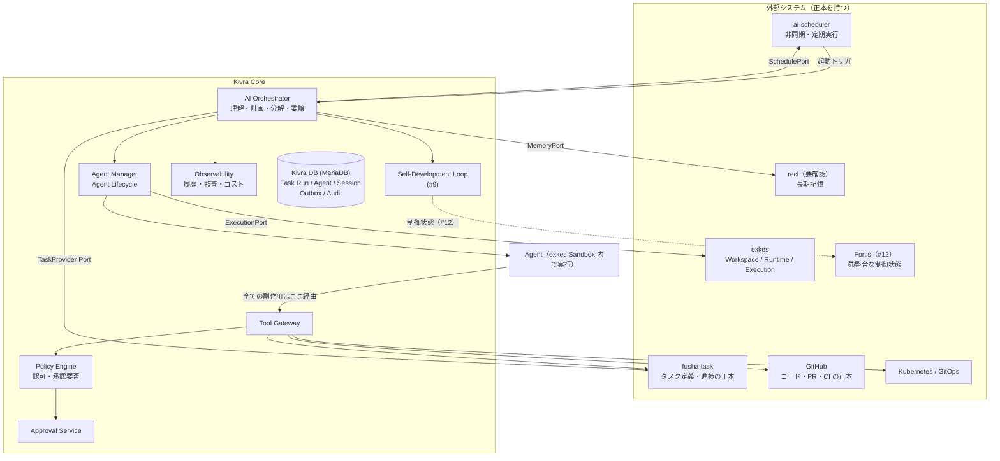
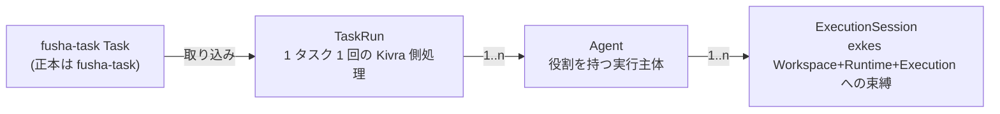
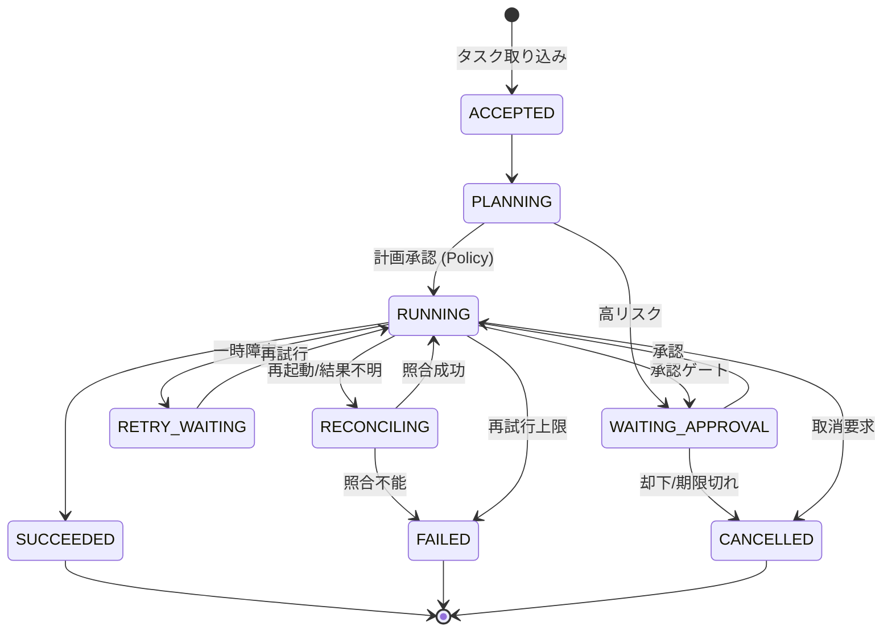
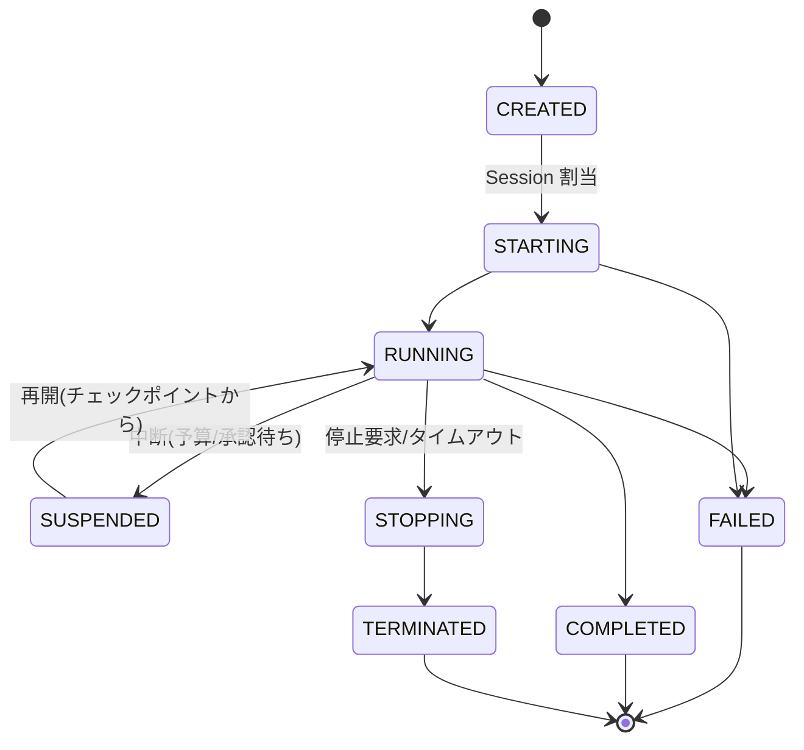
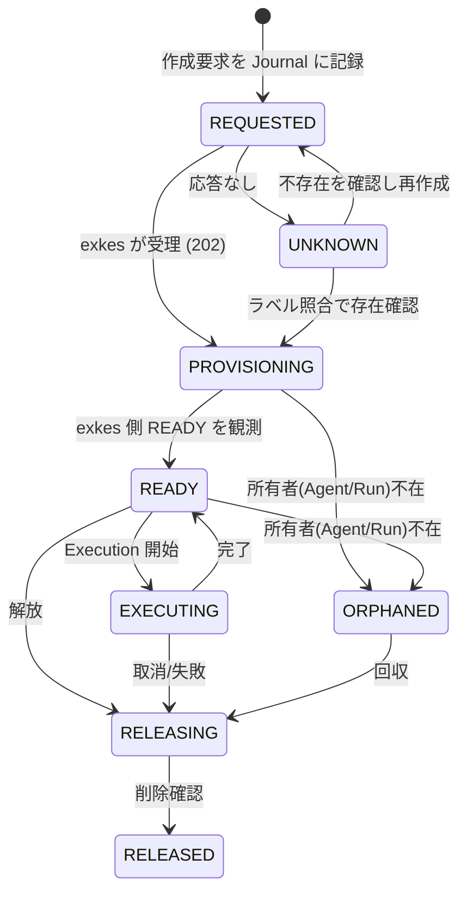
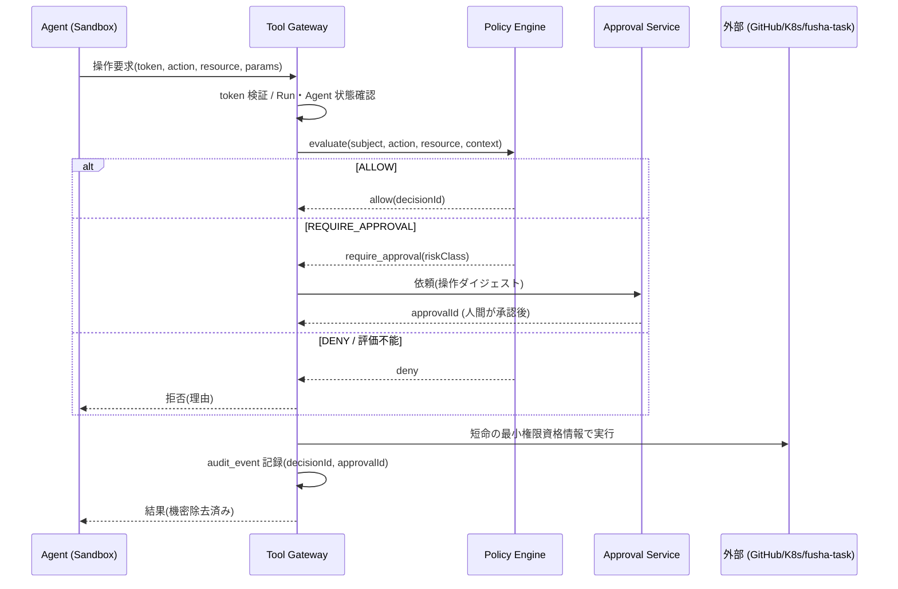
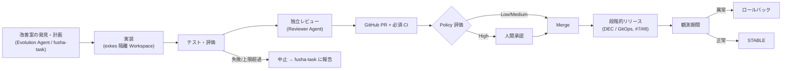

# 01. Kivra Core Architecture

- 対応 Issue: kigawa-net/kivra#1
- 状態: ドラフト（レビュー待ち）
- 日付: 2026-10-12

Kivra（自己開発型 kigawa 補助 AI）の Core Architecture を定義する。詳細は後続 Issue（#2〜#12）で設計するため、本書は
**境界・責務・状態遷移・信頼モデル・MVP 順序** に絞る。他 Issue の領域には踏み込まず、境界のみを置く。

## 0. 外部システムの確認状況（事実と要確認の区別）

本書で外部システムについて「事実」と書くのは、ローカル clone（`/home/kigawa/dev` 配下）のコードまたは README で確認できたものだけである。
確認できないものは「**要確認**」と明記する。

| システム | 確認元 | 確認できた事実 | 要確認 |
|---|---|---|---|
| fusha-task | `san/fusha-task`（README / `src/domain/entities/Task.ts`） | Cloudflare Workers + Hono + D1。REST: `/api/v1/tasks`（一覧・詳細・作成・更新・削除）, `custom-fields`, `views`, `groups` 等。認証は Keycloak（`project-fusha` realm）の OIDC、API は `Authorization: Bearer <ID token>` を JWKS で検証。Task は `id, title, description, assigneeId, reporterId, dueDate, customFields, relatedTaskIds, nextTaskIds, groupId, viewerGroupId, updatedAt` 等を持つ | Webhook / イベント通知はコード上で確認できなかった（Polling 前提とするが要確認）。専用の status 列は確認できず `customFields` で表現しているか要確認。機械（Kivra）向けの認証手段（サービスアカウント / client credentials）は要確認。依存関係は `relatedTaskIds`（双方向）と `nextTaskIds`（一方向）が確認できたが、「ブロックする」意味づけは要確認。楽観ロック / ETag の有無は要確認 |
| exkes | `kigawa-net/exkes`（README / docs / routes） | Kotlin/Ktor、Kubernetes 上の Execution Runtime Platform。`exkes-api` は desired state のみ書き、K8s 権限を持つのは `exkes-controller` のみ。Sandbox Plane は Control Plane と分離。実装済み API: `/v1/workspaces`（作成 202 / 一覧 / 取得 / 削除 202）, `/v1/workspaces/{id}/runtimes`（start / stop / delete）, `/v1/runtimes/{id}/executions`（`type` と `commandJson` / `agentConfigJson` を受理）。Workspace 状態: CREATING → READY → ARCHIVED → DELETING → DELETED / ERROR | 認証は未導入（README 上「Keycloak OIDC は MVP 後続フェーズ」）。Execution のログ取得・Artifact・checkout API は計画段階（第3〜4MS）で、実装状況は要確認。Idempotency-Key 対応は要確認。Execution の状態名の最終形は要確認 |
| ai-scheduler | `kigawa-net/ai-scheduler`（README / docs/decisions.md / routes） | Kotlin/Ktor 単一プロセス、MariaDB。Job / Execution / Attempt モデル。API: `/v1/jobs`（POST/GET/PATCH）, `/v1/jobs/{id}/executions`, `/v1/executions/{id}`, `.../cancel`, `.../retry`。Trigger は cron / once 実装済み。Execution 状態: SCHEDULED, QUEUED, WAITING_BATCH, SUBMITTED, RUNNING, WAITING, WAITING_APPROVAL, SUCCEEDED, FAILED, TIMED_OUT, EXPIRED, CANCELLED（設計書）。**認証なし**（Phase 1）。`feat/timeout` は README 上未マージ | 実行結果をどう呼び出し元へ返すか（Callback / Webhook / Polling）、Job が「exkes 実行」を起動する Provider 連携の有無は要確認 |
| recl | ローカルに clone が見つからなかった | なし | **API・データモデル・認証・検索方式のすべてが要確認**。本書は #6 の記述（長期記憶の既存基盤）のみを根拠とし、API は「Kivra 側の期待する抽象インターフェース」として定義する |
| Fortis | `kigawa-net/fortis`（docs/architecture.md） | Raft + MVCC + Range Sharding の強整合分散 KV。単一キー操作は linearizable、CP。トランザクション（`TxnCoordinator`）は**現状非本番のシミュレーション**、Meta / Rebalance も将来課題、エッジ対応は fortis#27 | Kivra から使うクライアント API / 認証 / Lease・CAS のプリミティブの有無は要確認 |
| GitHub / Kubernetes / GitOps | 一般仕様 | PR, CI, Ruleset, Required Checks が使える前提 | 対象リポジトリの Ruleset 実態、GitOps 配置は #7/#8 で確認 |

## 1. 目的と非目標

### 目的

- fusha-task のタスクを取り込み、計画・分解・Agent 委譲を行い、成果を GitHub PR で返す自律実行基盤を定義する。
- 隔離環境（exkes）での自己改善を、安全制御を Agent 自身が解除できない形で成立させる。

### 非目標（本 Issue では扱わない）

- fusha-task の連携詳細（#2）、Agent Profile・スケジューリング詳細（#3）、Agent 間メッセージ規約（#4）、LLM ルーティング（#5）、記憶モデル詳細（#6）、A/B 二系統・DEC（#7, #8）、パイプライン段階・Runtime スキーマ（#9, #10）、分散整合性（#11）、Fortis 連携（#12）。
- Kivra 内部でのタスク管理機能の再実装（タスクの正本は fusha-task）。

## 2. 設計原則

1. **疎結合**: Core は exkes / recl / ai-scheduler / fusha-task をすべて Port（インターフェース）越しに使い、Adapter を差し替え可能にする。外部の未実装機能を前提にしない。
2. **正本の分離**: 各データの Source of Truth を 1 箇所に決め、二重管理しない（§3.3）。
3. **権限昇格の禁止**: Agent は自分の権限・Policy・安全制御を変更できない。判定は常に Agent の外（Policy Engine）で行う。
4. **自己変更は隔離 + PR 経由**: 自己変更は exkes Workspace で検証し、原則 PR を経由する。本番反映は Policy 評価と必要な承認を要する。
5. **永続化と再実行可能性**: タスク実行状態を Kivra DB に永続化し、再起動後は「外部の観測可能な結果」を照合して再開する。
6. **Fail-closed**: 判定に必要な情報が欠落・不明・取得不能な場合は拒否 / 停止する。

## 3. コンポーネント構成と責務

### 3.1 構成図



### 3.2 責務表

| コンポーネント | 責務 | 持たないもの / 禁止事項 |
|---|---|---|
| AI Orchestrator | fusha-task のタスク取得、要求理解、計画、分解、依存関係評価、Agent への委譲、結果統合、再計画 | 外部への直接副作用。Agent 実行そのもの |
| Agent Manager | Agent の生成・実行・中断・再開・終了、exkes Workspace / Session の割当、並列数・予算・タイムアウト管理、孤立セッション回収（詳細 #3） | 権限の決定 |
| Tool Gateway | Agent が使う GitHub / Kubernetes / fusha-task 等へのアクセスの**唯一の出口**。呼び出しごとに Policy Engine を問い合わせ、認可された操作のみ代理実行し監査ログを出力する | Agent への長期資格情報の払い出し（短命・最小スコープのトークンのみ） |
| Policy Engine | `(subject, action, resource, context)` → `ALLOW / DENY / REQUIRE_APPROVAL` を返す。リスク分類、予算超過判定 | Agent / Orchestrator からの Policy 変更受付（Policy は Git 管理の別系統、§6.4） |
| Approval Service | 人間承認の依頼・取得・失効管理。承認を `approvalId`（操作ダイジェスト束縛）として発行 | Agent による承認の自己発行 |
| Self-Development Loop | 改善案 → 実装 → テスト → 評価 → PR → 承認 → 段階リリースの進行管理（段階の詳細は #9、リリース制御は #7/#8） | 自身の本番昇格の実行 |
| Observability | 実行履歴、監査ログ、トレース、コスト、品質指標の集約（§8） | |
| Kivra DB | Kivra 固有状態の正本（§3.3）。Outbox / Audit を同一トランザクションで書く | fusha-task / exkes / GitHub の状態の複製を正本として持つこと |

### 3.3 Source of Truth（正本）一覧

| 対象 | 正本 | Kivra が保持するもの |
|---|---|---|
| タスク定義・進捗・依存関係 | fusha-task | `taskId` 参照、取り込み時点の `updatedAt`、Kivra 固有メタ（実行 ID 等）|
| Workspace / Runtime / Execution（実行ログ・成果物） | exkes | `workspaceId` / `runtimeId` / `executionId` 参照 |
| 長期記憶 | recl（要確認） | 参照 ID・要約。Working Memory は Kivra 内 |
| 非同期・定期実行のスケジュール | ai-scheduler | `jobId` / スケジューラ側 `executionId` の参照 |
| コード・PR・CI・Merge | GitHub | PR 番号・head SHA・CI 結果参照 |
| Kivra の Task Run / Agent / Session 状態、Operation Journal、Outbox、監査 | **Kivra DB（MariaDB）** | 本体 |
| Release・リーダー所有権・Lease・Fencing Token | DEC / Fortis（#8, #12） | 参照のみ。Core MVP では単一インスタンス前提（§9） |

## 4. 外部 API 境界

Core は Port を定義し、各外部システムに Adapter を実装する。以下の API は**確認済みの実 API** と、**Kivra が要求する抽象契約**を分けて示す。

### 4.1 共通契約（全 Adapter）

- タイムアウト・指数バックオフ付き再試行は **冪等な操作のみ**に適用する。
- 副作用を伴う呼び出しは Operation Journal（#10, #11）に `operationId` を先に記録してから実行する。外部が冪等キーを受理しない場合は、再試行前に既存リソースを検索して照合する。結果が不明な場合は自動再試行せず `RECONCILIATION_REQUIRED` にする。
- Adapter が外部の未対応機能を呼ぶことは禁止し、機能は Capability として明示する（未対応なら `UNSUPPORTED` を返す）。
- 認証情報は Adapter 層のみが持ち、Orchestrator / Agent には渡さない。

### 4.2 exkes（ExecutionPort）

確認済み: REST `/v1/workspaces`, `/v1/workspaces/{id}/runtimes`（`start` / `stop` / `DELETE`）, `/v1/runtimes/{id}/executions`（`type`, `commandJson`, `agentConfigJson`）。作成系は `202 Accepted` の非同期、状態は GET で観測する。

```kotlin
interface ExecutionPort {
  suspend fun createWorkspace(spec: WorkspaceSpec, key: IdempotencyKey): WorkspaceRef
  suspend fun getWorkspace(ref: WorkspaceRef): WorkspaceStatus
  suspend fun createRuntime(ws: WorkspaceRef, spec: RuntimeSpec, key: IdempotencyKey): RuntimeRef
  suspend fun startExecution(rt: RuntimeRef, spec: ExecutionSpec, key: IdempotencyKey): ExecutionRef
  suspend fun getExecution(ref: ExecutionRef): ExecutionStatus
  suspend fun cancelExecution(ref: ExecutionRef)
  suspend fun readLogs(ref: ExecutionRef, cursor: LogCursor?): LogPage   // exkes 側 API は要確認
  suspend fun deleteWorkspace(ref: WorkspaceRef)
  suspend fun findByLabel(labels: Map<String, String>): List<ResourceRef> // 照合用。exkes 側対応は要確認
}
```

| 項目 | 方針 |
|---|---|
| 結果の受け取り | 現状 Polling（`GET`）。Push の有無は要確認 |
| 冪等性 | exkes の Idempotency-Key 対応は**要確認**。未対応の間は、Kivra が付与する識別子（`kivra.run-id` 等）を Workspace / Execution のラベルまたは名前に埋め込み、`findByLabel` で照合してから作成する。**exkes 側にラベル検索が無い場合、exkes への機能追加を後続 Issue とする** |
| 認証 | 現状未導入。導入後は Keycloak OIDC（予定）の client credentials を想定（**要確認**）。それまでは Network Policy / 内部ネットワーク限定で利用 |
| 隔離 | Agent は exkes Sandbox 内で動き、Control Plane・DB・K8s API・他 Runtime には直接到達しない（exkes 側の方針）。Kivra Core は Control Plane の外に置く |

### 4.3 recl（MemoryPort）— API は要確認

recl の API は未確認のため、Kivra が必要とする抽象契約のみ定義する。Adapter 確定は #6 で recl の仕様を確認してから行う。

```kotlin
interface MemoryPort {
  suspend fun write(entry: MemoryEntry, key: IdempotencyKey): MemoryId
  suspend fun search(q: MemoryQuery): List<MemoryHit>   // scope(tenant/user/project), 種別, sensitivity でフィルタ
  suspend fun get(id: MemoryId): MemoryEntry
  suspend fun supersede(id: MemoryId, by: MemoryEntry)
  suspend fun delete(id: MemoryId)
}
```

- recl 障害時の縮退動作: **読み取り失敗はコンテキスト無しで続行（低品質を許容）、書き込み失敗は Outbox に残して再送**。ただし Policy / 承認判断の根拠として記憶を使わない（記憶は助言であり認可の入力にしない）。
- Agent が記憶へ書く内容は provenance（taskId / executionId / 出典）を必須とし、記憶内の指示文を命令として扱わない（Prompt Injection 対策）。

### 4.4 ai-scheduler（SchedulePort）

確認済み: `POST/GET/PATCH /v1/jobs`, `POST /v1/jobs/{id}/executions`, `GET /v1/executions/{id}`, `POST .../cancel`, `POST .../retry`。Trigger は cron / once。認証なし。

```kotlin
interface SchedulePort {
  suspend fun upsertJob(spec: JobSpec, key: IdempotencyKey): JobRef
  suspend fun pauseJob(ref: JobRef)
  suspend fun triggerNow(ref: JobRef, key: IdempotencyKey): ScheduleExecutionRef
  suspend fun getExecution(ref: ScheduleExecutionRef): ScheduleExecutionStatus
  suspend fun cancel(ref: ScheduleExecutionRef)
}
```

役割分担（重要）:

- ai-scheduler は「**いつ起動するか**」の責務に限定する。Kivra の Task Run の正本は Kivra DB であり、ai-scheduler の Execution 状態を Task Run 状態にそのまま写さない。
- 起動方式: ai-scheduler の Job が Kivra の「起動エンドポイント」を呼ぶ（Job の実行内容の表現力と Callback 対応は**要確認**）。それが難しければ Kivra が `GET /v1/executions/{id}` を Polling する。どちらでも Kivra 側の起動は `(jobId, scheduledAt)` を冪等キーとして重複起動を抑止する（at-least-once 前提）。
- 現状 ai-scheduler は認証が無いため、Kivra が ai-scheduler を操作できる範囲はネットワークで限定し、認証導入を依存課題として挙げる（§11）。
- Kivra 内で「定期的に fusha-task をスキャンする」ような内部ループはまず Kivra 自身の軽量ポーラで実装し、ai-scheduler 依存を MVP の必須経路にしない（§10）。

### 4.5 fusha-task（TaskProvider）— 詳細は #2

Core は `TaskProvider` Port のみを知る。確認済み API は §0 のとおり。Core が依存する最小機能:

```kotlin
interface TaskProvider {
  suspend fun listRunnable(filter: TaskFilter): List<TaskSnapshot>
  suspend fun get(id: TaskId): TaskSnapshot
  suspend fun update(id: TaskId, patch: TaskPatch, expectedUpdatedAt: Instant?)  // 楽観ロック可否は要確認
  suspend fun comment(id: TaskId, body: String)                                  // 対応 API は要確認
}
```

- Kivra → fusha-task の書き込みは Tool Gateway 経由で、状態・コメント更新等に限定する。削除や担当者の変更等は `REQUIRE_APPROVAL`。
- Webhook が無い前提で Polling（`GET /api/v1/tasks` の `updatedAt` 差分）を基本とする。

## 5. 状態遷移

Kivra が持つ状態は Task Run / Agent / Execution Session の 3 階層。fusha-task のタスク状態とは**別管理**で、Kivra は fusha-task 側の状態を複製した正本を持たない（進捗は Adapter 経由でベストエフォートに反映する）。



### 5.1 TaskRun



### 5.2 Agent



### 5.3 ExecutionSession

Kivra 側の束縛レコード。exkes の状態（Workspace: CREATING/READY/ARCHIVED/DELETING/DELETED/ERROR）を**観測した結果**を併記するだけで、遷移は exkes が決める。



### 5.4 遷移の規約

- 全遷移は Kivra DB で**条件付き更新（version / 期待状態の CAS）**し、同一トランザクションで `audit_events` と `outbox_events` に書く。
- 終端状態からは遷移しない。やり直しは新しい `attempt` または新しい TaskRun として作る。
- 再試行回数・総時間・予算に上限を設け、超過時は `FAILED` または `WAITING_APPROVAL`。無限ループの停止条件を必ず持つ。

## 6. 認証・認可・承認・監査モデル

### 6.1 主体（Principal）

| 主体 | 例 | 認証 |
|---|---|---|
| Human | kigawa（承認者・操作者） | Keycloak OIDC（fusha-task が使う Keycloak と同系の IdP を想定。realm は**要確認**） |
| Kivra Core（サービス） | Orchestrator / Agent Manager | サービスアカウント。各外部 API が受け付ける方式は**要確認**（exkes・ai-scheduler は現状無認証、fusha-task は ID トークン Bearer） |
| Agent | Planner / Developer / Reviewer 等 | Kivra が発行する**短命・Run 単位**のトークン（`runId`, `agentId`, `scope`, `exp`）。Agent は外部サービスの資格情報を持たない |
| Approver | 人間 | Human と同一 IdP。承認操作は Agent / Core と別の経路 |

### 6.2 認可フロー



### 6.3 リスク分類と承認

| リスク | 例 | 扱い |
|---|---|---|
| Low | fusha-task コメント、自分の Workspace 内の操作、feature ブランチへの push | ALLOW（上限・レート内） |
| Medium | PR 作成、依存追加、設定変更を含まない本体コード変更の PR | ALLOW。Merge は Required Checks + 独立レビュー（Reviewer Agent）を満たす場合のみ |
| High | Policy / 認証認可 / Secret / CI 設定 / Kivra Core 自身 / 共通基盤・DB スキーマ / 本番 K8s 変更 / 破壊的操作 | `REQUIRE_APPROVAL`（人間）。承認は操作ダイジェストに束縛し、期限付き・1 回限り |
| Forbidden | Policy・安全制御の変更、自身への本番昇格、Agent による承認の発行、監査ログの改変 | DENY（承認でも不可。変更は人間が Policy リポジトリの PR で行う） |

### 6.4 権限昇格防止

- **Policy は Agent のアクセスできない別リポジトリ / 別 Deployment**に置く。Agent は変更提案（PR）のみ可能で、マージ権限を持たない。
- 承認者は提案者と別主体であること（four-eyes）。承認 UI / API は Agent に到達不能にする。
- Agent トークンは Run / Agent / scope に束縛し、Gateway 以外のサービスは受け付けない。
- 評価に必要なデータが不明・取得不能なら DENY（fail-closed）。
- Agent の出力・読み取った外部テキスト（Issue 本文、記憶、ログ）は**信頼しない入力**として扱い、そこに含まれる指示で権限・Policy を変えない。

### 6.5 監査ログ

- 追記専用の `audit_events`（`eventId, ts, actor, runId, agentId, action, resource, decisionId, approvalId, result, traceId, prevHash`）。ハッシュ連鎖で改竄検知する。
- 記録対象: 全 Tool Gateway 呼び出し（許可・拒否とも）、承認の依頼・結果、状態遷移、Policy 変更、資格情報払い出し。機密値は記録しない（参照のみ）。
- 書き込みは Core / Gateway の権限のみ。Agent と Orchestrator に更新・削除権限は無い。保管期間は要決定（§11）。

## 7. 自己開発サイクルとロールバック

詳細な段階・Runtime は #9 / #10、A/B と DEC は #7 / #8。ここでは Core から見た境界と**ロールバック設計の原則**を定める。



境界:

- Core（Self-Development Loop）は **PR までを自分の責務**とし、本番リリースは独立した Deployment Controller（DEC）に委譲する。Core / Agent が本番リリースを直接実行する経路は設けない。
- 自己変更を行う Agent の Workspace は、変更対象のサービスとは別（対象の本番 Secret・DB に到達不可）。

ロールバック設計:

| 段階 | 失敗時の動作 |
|---|---|
| 実装 / テスト | Workspace を破棄し TaskRun を FAILED（または再計画）。本番に影響なし |
| PR / CI | PR を Close。Merge 前の変更は残らない |
| Merge 後・リリース前 | 変更の Revert PR を自動作成（Revert は Low リスクとして扱い、CI 通過で Merge。ただし Revert 対象が High リスク領域ならば承認を要する） |
| リリース中 / 観測中 | DEC が直前の安定版（digest 固定）へ GitOps で巻き戻す。Core は Rollback の**要求と結果確認**のみ |
| ロールバック不能な変更（DB スキーマ等） | 事前に検出して拒否または High 扱い（expand–migrate–contract を必須。詳細 #8） |
| Core 自身の障害 | 新規の昇格を停止し、既存サービスを維持（fail-safe）。復旧後に Run を照合して再開 |

- 自動停止条件（Kill switch）: 連続失敗数、Rollback 回数、コスト上限、更新頻度上限のいずれかを超えたら自己開発を一時停止し、人間に通知する。再開は人間のみ。

## 8. Observability

| 種類 | 内容 | 保存先（方針） |
|---|---|---|
| 実行履歴 | TaskRun / Agent / Session の遷移、`attempt`、チェックポイント | Kivra DB（`run_events`）。exkes のログ本体は exkes の正本を参照 |
| 監査ログ | §6.5 | Kivra DB（追記専用） |
| トレース | `traceId` を fusha-task の taskId → TaskRun → Agent → exkes Execution → GitHub PR まで伝播（W3C Trace Context を基本とし、伝播できない外部には ID を名称/ラベルで埋める） | OpenTelemetry（収集基盤は**要確認**） |
| コスト | LLM トークン・実コスト（#5）、exkes 実行時間、Run / Agent / ユーザー単位の累計と上限 | Kivra DB + メトリクス |
| 品質指標 | タスク成功率、再試行率、CI 初回成功率、レビュー指摘数、Rollback 率、承認待ち時間、所要時間 | メトリクス（Prometheus 等は要確認） |

## 9. 永続化と復旧

### 9.1 データ（MariaDB を想定）

`task_runs`, `agents`, `execution_sessions`, `operation_journal`（`operationId`, 種別, 冪等キー, 外部参照, 状態 PREPARED/IN_FLIGHT/CONFIRMED/UNKNOWN…）, `checkpoints`, `outbox_events`, `inbox_events`（重複排除）, `audit_events`, `approvals`。スキーマ詳細は #10 に委ねる。DB 選定は ai-scheduler / exkes と同じ MariaDB に揃える（運用基盤の既存実績に基づく。最終確定は #10）。

### 9.2 復旧手順（Orchestrator 再起動時）

1. Run の Lease（世代番号付き）を取得。古い世代の Worker は CAS で更新を拒否される。
2. `RUNNING` / `RECONCILING` の Run について、Journal の `IN_FLIGHT / UNKNOWN` 操作を外部（exkes / GitHub / fusha-task）の観測結果と照合して確定する。
3. 照合不能な副作用は自動再試行せず `RECONCILING → FAILED` または人間通知。
4. exkes に存在するが Kivra に所有者が無いセッションを `ORPHANED` として回収する。

### 9.3 MVP での整合性方針

- MVP は **単一 Core インスタンス + DB 上の Lease（行ロック / CAS）**とする。Fortis による強整合なリーダー選出・グローバル Lease は #11 / #12 の対象で、Fortis の本番利用可否（トランザクションは現状シミュレーション、エッジ対応は fortis#27 待ち）が未確定のため、Core MVP の前提にしない。
- 外部 API との分散トランザクションは行わず、Outbox / Journal + 照合で整合させる。全世界 Exactly Once は主張しない。

## 10. MVP の実装順序と後続 Issue への分割

方針: 先に**縦に薄い 1 本の経路**（fusha-task のタスク → exkes で実行 → PR 作成 → 結果を fusha-task へ報告）を通し、自己改善とリリース制御は後段にする。各段階で Policy / 監査を最初から通す（後付けにしない）。

| 段階 | 内容 | 関連する設計 Issue | 依存する未確認事項 |
|---|---|---|---|
| M0 | リポジトリ骨格、Kivra DB スキーマ（task_runs / audit / journal / outbox）、設定、観測の土台 | #10, #1 | なし |
| M1 | Port 定義 + TaskProvider（fusha-task Adapter、Polling、読み取り専用 → 状態更新）。Kivra 用の認証方式確定 | #2 | fusha-task の機械認証・status 表現（要確認） |
| M2 | ExecutionPort（exkes Adapter）+ Agent Manager 最小（1 Agent / 1 Workspace / 逐次）。孤立回収と照合（ラベル規約） | #3, #11 | exkes の冪等 / ラベル検索 / ログ API（要確認） |
| M3 | Tool Gateway + Policy Engine（静的ルール）+ Approval + 監査。GitHub 連携（ブランチ / PR まで、Merge は人間） | #1(本書 §6) | GitHub App / Token 方式 |
| M4 | Orchestrator（計画・分解・結果統合）、Model Gateway 最小（単一 Provider） | #3, #5 | なし |
| M5 | MemoryPort（recl Adapter）+ Working Memory。recl 無しでも動く縮退を維持 | #6 | **recl の API 全般（要確認）** |
| M6 | SchedulePort（ai-scheduler）連携による定期・非同期起動 | 本書 §4.4 | ai-scheduler の起動方式・認証（要確認） |
| M7 | 複数 Agent 協調・並列・Lease / Fencing | #4, #11 | |
| M8 | Self-Development Loop（Kivra 単系統、PR まで + 人間 Merge）、Kill switch | #9, #10 | |
| M9 | A/B 二系統、DEC、段階リリース、Fortis 連携 | #7, #8, #12 | Fortis の成熟度（要確認） |

後続 Issue 案（#2〜#12 は設計 Issue。以下は**実装 Issue の候補**で、起票は別途）:

1. Core 骨格と DB スキーマ（M0）
2. TaskProvider / FushaTaskAdapter 実装（M1）
3. ExecutionPort / ExkesAdapter 実装と exkes 側要望の整理（M2）
4. Agent Manager 最小実装（M2）
5. Tool Gateway + Policy Engine + Approval + Audit（M3）
6. GitHub Adapter（M3）
7. Orchestrator 最小実装と Model Gateway 最小実装（M4）
8. MemoryPort / ReclAdapter（M5）
9. SchedulePort / AiSchedulerAdapter（M6）
10. Observability（Trace / Cost / 指標）（M0 から段階導入）

## 11. 要確認事項・未解決の論点

要確認（外部の事実が確認できていないもの）:

1. recl の API・認証・データモデル・検索方式・保存先（ローカルに clone なし）。
2. fusha-task: Webhook の有無、機械向け認証、status の表現、楽観ロック、依存関係の「ブロック」意味、コメント API。
3. exkes: 認証導入時期、Idempotency-Key、ラベル / 名前による検索、ログ・成果物 API の実装状況、Execution 状態名の最終形。
4. ai-scheduler: 認証導入時期、Job から外部エンドポイントを呼ぶ手段（Callback）、Execution 結果の通知方式、`feat/timeout` のマージ状況。
5. Fortis: クライアント API と Lease / CAS 相当のプリミティブ、エッジ対応（fortis#27）の見通し。
6. GitHub 側: Ruleset / Required Checks の実態、Kivra 用 GitHub App の発行方法。

未解決の論点（設計判断が必要）:

1. Kivra Core の実装言語・フレームワーク（同系統の他プロジェクトは Kotlin/Ktor + Exposed + Flyway + MariaDB。踏襲するか）。
2. Agent の実体: exkes Execution の `type`（agent 系）で Claude Code 等を直接動かすのか、Kivra の LLM ループを Sandbox に置くのか（#5 の「Agent Runtime 境界」と整合させる）。
3. Policy Engine の記述方式（静的 YAML / OPA 等）と配置（別リポジトリ・別 Deployment）。
4. 承認 UI / 通知経路（GitHub PR レビュー、fusha-task、専用 UI のいずれか）。
5. 監査ログの保管期間と改竄検知の強度（ハッシュ連鎖のみで十分か、外部への署名・転送が必要か）。
6. fusha-task のタスクを Kivra が拾う条件（担当者 `kivra`、特定ラベル等）と、Kivra が更新してよい項目の範囲（#2 で確定）。
7. Core MVP の単一インスタンス前提を、いつどの条件で Fortis ベースの HA に移行するか（#11 / #12）。
