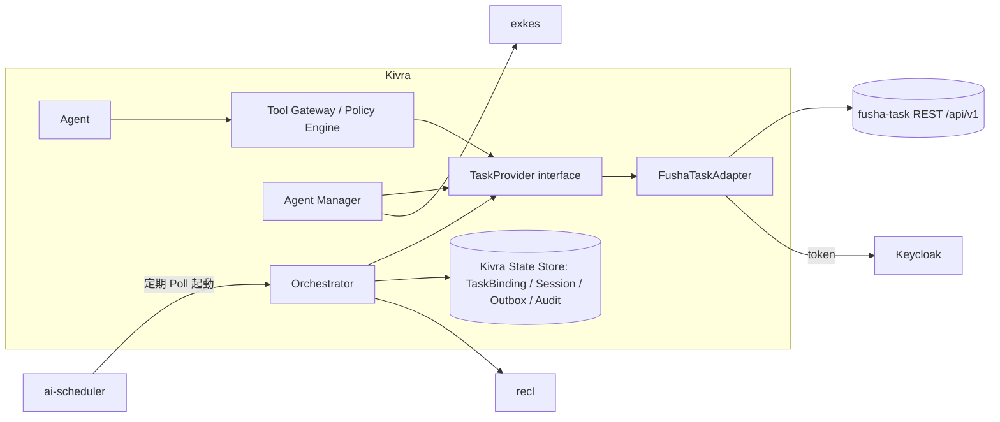
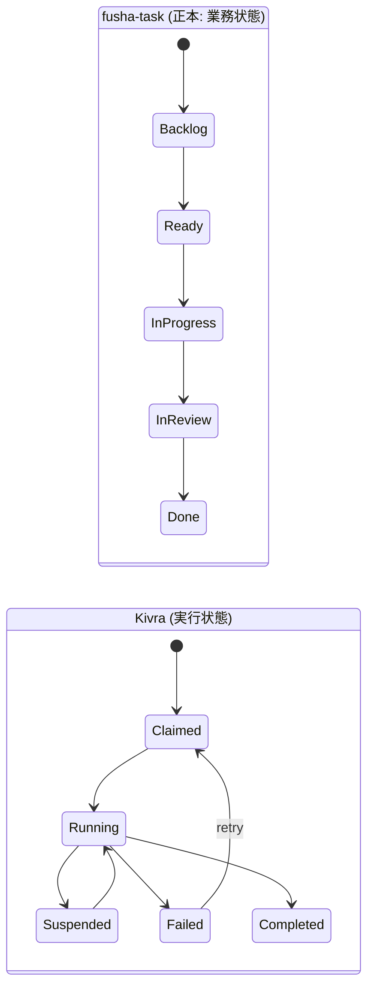
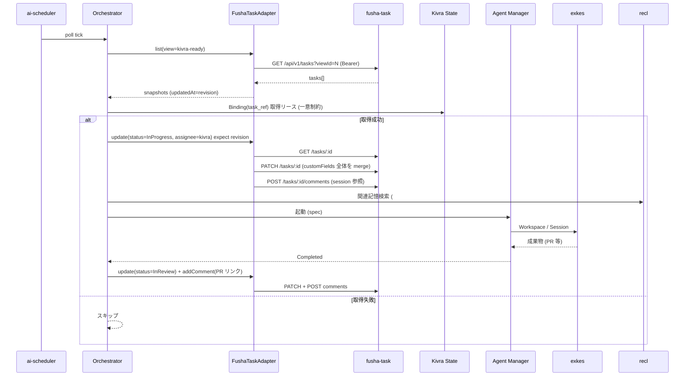
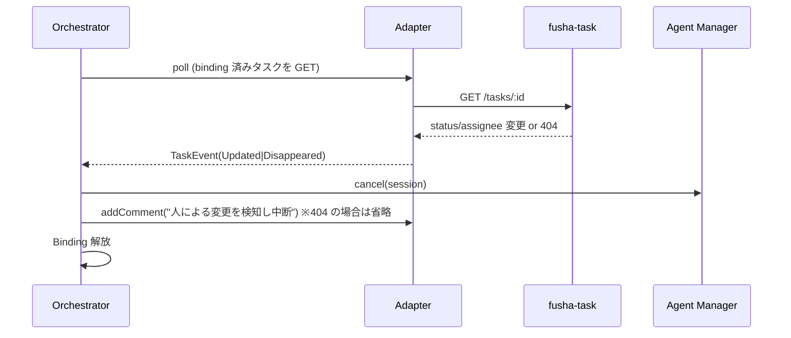

# 02. fusha-task Integration 設計

- 対象 Issue: kigawa-net/kivra #2
- 関連: #1 (Core), #3 (Agent Manager), #6 (Memory / recl)
- ステータス: Draft
- 調査対象: `project-fusha/fusha-task` (ローカル `/home/kigawa/dev/san/fusha-task`, HEAD `dfbfe5c`)。
  `fusha-task-front` / `fusha-task-mcp` は本調査では未読 (後述「要確認」)

## 1. 目的と原則

Kivra のタスク定義・進捗の正本 (Source of Truth) は fusha-task とする。Kivra はタスク管理を再実装せず、
Orchestrator / Agent が `TaskProvider` 経由で fusha-task を操作する。

- タスク定義・進捗・依存関係: fusha-task が正本
- Agent の実行セッション・ライフサイクル・exkes の状態: Kivra 固有状態として別管理 (fusha-task に載せない)
- fusha-task に存在しない機能を前提にしない (§2 で確認した範囲のみ Adapter に載せる)
- 更新は最小権限、破壊的操作は承認を要求

## 2. fusha-task 調査結果 (根拠付き)

### 2.1 API (`src/index.ts`, `src/presentation/controllers/tasks.ts`)

Hono (TypeScript) 製 REST。ベースは `/api/v1`。`/tasks/*` 等は `authMiddleware` 必須。

| メソッド | パス | 概要 / 備考 |
|---|---|---|
| GET | `/tasks` | 一覧。クエリは `assigneeId`, `viewId` のみ。呼び出しユーザーが閲覧可能なタスクだけ返る。ページングなし |
| GET | `/tasks/:id` | 詳細 (閲覧権限なしは 404) |
| POST | `/tasks` | 作成。`title` 必須 (空文字可)。`reporterId` は常に認証ユーザー |
| PATCH | `/tasks/:id` | 部分更新。編集権限なし 403、閲覧不可 404 |
| DELETE | `/tasks/:id` | reporter 本人のみ (他は 403) |
| GET/POST | `/tasks/:id/comments` | コメント一覧/投稿 (閲覧権限で可)。編集・削除 API なし |
| GET/POST/PATCH/DELETE | `/custom-fields`, `/views`, `/groups`, `/teams`, `/users`, `/categories`, `/require-next-task-rules`, `/user-preferences` | 管理系 |
| GET | `/health`, `/ready` | liveness / DB readiness |

`viewId` 指定時は、ビューの `filterExpression` をサーバー側でメモリ上評価して絞り込む
(`matchesFilterExpression`)。DB クエリでの絞り込みではない。

### 2.2 データモデル (`src/domain/entities/Task.ts`, `src/infrastructure/database/schema.ts`)

`Task`: `id`(int, auto), `title`, `description`, `assigneeId`(Keycloak sub), `reporterId`, `reporterName`,
`dueDate`(text), `customFields`(JSON オブジェクト), `sortOrder`, `relatedTaskIds`(双方向の関連),
`groupId`(編集グループ), `viewerGroupId`(閲覧グループ), `nextTaskIds`(一方向「次のタスク」),
`createdAt` / `updatedAt`(ISO 文字列)。DB は MariaDB (Drizzle)。

重要な事実:

1. **`status` カラムも `priority` カラムも存在しない** (`0002_drop_task_status.sql`, `0006_drop_task_priority.sql` で廃止済み、CLAUDE.md 記載)。
   状態・優先度が必要なら `custom_field_definitions` (`type`: `text|number|boolean|select|view|multi_select`) で表現する想定。
   どのキーが実運用の「状態」かは fusha-task 側運用次第 → **要確認**。
2. **依存関係**は `nextTaskIds` (順序付き一方向、「このタスクの次」) と `relatedTaskIds` (対等な関連)。
   「ブロック中 (blocked by)」の専用表現はない。逆引き (前のタスク) は一覧から導出する (専用カラムなし)。
   値は JSON 配列で保存されるため FK 整合性は DB でなくアプリ層 (`validateNextTaskIds`) が見ている。
3. 条件付き必須ルール: select カラムの特定値 / `require_next_task_rules` により、`nextTaskIds` が 1 件以上必須になる場合がある
   (満たさない PATCH は 400)。Agent が「完了」にしようとして 400 になり得る。
4. **楽観ロック (version/ETag/If-Match) はない**。`MariaDbTaskRepository.update` は read → write で、
   `customFields` は**キー単位でなくオブジェクト全体を置換** (`input.customFields ?? existing.customFields`)。
   同時更新は last-write-wins で、他者の別キー更新を巻き戻し得る。`updatedAt` のみが比較に使える。
5. 削除は物理削除 (`delete`)。論理削除・履歴テーブルなし。コメントは追加のみ (`author_id`, `body`, `created_at`)。
6. タスクは単一リスト (プロジェクト区分カラムなし)。区分は group / view / customField で行う。

### 2.3 認証 (`middleware/auth.ts`, `infrastructure/auth/verifyIdToken.ts`, CLAUDE.md「認証フロー」)

- Keycloak (OIDC, realm `project-fusha`)。`Authorization: Bearer <ID token>` を毎回 JWKS で検証する (ステートレス)。
- 検証条件: `issuer == KEYCLOAK_ISSUER` かつ **`audience == KEYCLOAK_CLIENT_ID`**。ID トークンをそのまま Bearer に使う設計。
- 認証成功ごとに `users` を `sub` で UPSERT。認可は `sub` を基にしたアプリ内ロジック
  (reporter / group メンバー / viewerGroup メンバー)。OAuth scope やロールによる API 単位の制御はない。
- 人間向け: PKCE ログイン (`/auth/login`, `/auth/callback`), `/auth/refresh`, `offline_access` で長期 refresh_token。
- **サービスアカウント / API キー / client_credentials 用の経路はコード上存在しない**。client_credentials の
  トークンを使うには、aud が fusha-task の client_id になる Keycloak 側マッパー設定と、`users` UPSERT 時の
  `name`/`email` 欠落への対応が要る可能性がある (コードからは未検証) → **要確認**。
- 結論: fusha-task は「ユーザー 1 人 = 1 権限境界」。Kivra 専用の最小権限は、Kivra 用ユーザー (サービスアカウント) を作り、
  group / viewerGroup のメンバーシップで可視・編集範囲を絞ることでしか実現できない。API 単位 (read-only 等) の絞り込みはできない。

### 2.4 イベント通知

調査範囲 (src, README, CLAUDE.md) に **Webhook / SSE / WebSocket / イベント配信は見当たらない**。
変更検知は Polling (`GET /tasks` と `updatedAt` 比較) しか確実な手段がない。
`updatedAt` 以降の差分取得 API (`updatedSince`) もない (クエリは `assigneeId`, `viewId` のみ)。

### 2.5 既存の外部クライアント

CLAUDE.md に MCP サーバー `fusha-task-mcp` の存在が記されている (ビュー単位の一覧取得を要望として追加した経緯)。
リポジトリは `/home/kigawa/dev/san` 配下に無く未調査。Kivra が MCP 経由か REST 直接かは §3 で決める。

## 3. 方針: REST 直接 + Adapter

| 案 | 長所 | 短所 |
|---|---|---|
| A. REST を直接呼ぶ Adapter (採用) | 型・エラーを Kivra が制御、Policy / 監査を Adapter に集約 | 認証経路 (§2.3) を整備する必要 |
| B. fusha-task-mcp 経由 | 既存資産 | MCP の公開ツール範囲・認証方式が未確認。Kivra Tool Gateway と二重ゲートになる |

採用: **A**。ただし MCP の仕様確認後に B を再評価する余地を残す (要確認)。
Agent に fusha-task の資格情報は渡さず、Agent は Tool Gateway (#1) 経由で `TaskProvider` を呼ぶ。

## 4. コンポーネント境界



## 5. TaskProvider / FushaTaskAdapter インターフェース

言語は Kivra Core 実装言語に従う (#1 で未確定)。以下は Kotlin 風の擬似定義。
Provider 抽象は fusha-task の制約 (§2) を隠さず、**能力 (capabilities) を宣言**して上位が分岐できるようにする。

```kotlin
interface TaskProvider {
  val capabilities: Capabilities   // supportsVersionCheck, supportsEvents, supportsBlockedBy など
  suspend fun get(id: TaskRef): TaskSnapshot?            // 404 は null
  suspend fun list(q: TaskQuery): Page<TaskSnapshot>     // assignee / view / updatedSince(クライアント側)
  suspend fun create(cmd: CreateTask, idem: IdempotencyKey): TaskSnapshot
  suspend fun update(ref: TaskRef, patch: TaskPatch, expect: Revision): UpdateResult
  suspend fun addComment(ref: TaskRef, body: String, idem: IdempotencyKey): CommentRef
  suspend fun setNext(ref: TaskRef, next: List<TaskRef>, expect: Revision): UpdateResult
  suspend fun delete(ref: TaskRef, approval: ApprovalToken): Unit  // 破壊的: 承認必須
}

data class TaskSnapshot(
  val ref: TaskRef, val title: String, val description: String?,
  val assignee: UserRef?, val due: Instant?,
  val fields: Map<String, JsonElement>,   // customFields そのまま
  val next: List<TaskRef>, val related: List<TaskRef>,
  val revision: Revision,                 // fusha-task では updatedAt (§6.3)
  val fetchedAt: Instant
)
sealed interface UpdateResult { Ok(TaskSnapshot); Conflict(current: TaskSnapshot); Rejected(reason, httpStatus) }
```

### 5.1 データ対応表

| Kivra 概念 | fusha-task | 備考 |
|---|---|---|
| TaskRef | `tasks.id` (int) を文字列化。`fusha:{env}:{id}` | 環境 (dev/staging/prod) を含める。要確認: 環境ごとの URL |
| title / description | `title` / `description` | 1:1 |
| 担当 (人間) | `assigneeId` (Keycloak sub) | |
| 担当 Agent | 対応なし | **Kivra 側 TaskBinding に保持**。fusha-task には人間 or Kivra サービスアカウントの assignee のみ |
| 状態 (todo/doing/done 等) | `customFields[<statusKey>]` (select) | `status` カラムは廃止済み。キー名・選択肢は **要確認**。Adapter 設定で写像 (`StatusMapping`) |
| 優先度 | `customFields[<priorityKey>]` | カラム廃止済み。同上 |
| 期限 | `dueDate` (text) | 形式 (ISO 日付/日時) 要確認 |
| 依存: 後続 | `nextTaskIds` | 一方向。Kivra の「blocks」に対応 |
| 依存: 先行 | 他タスクの `nextTaskIds` から逆引き | 全件走査 (専用カラムなし) |
| 関連 | `relatedTaskIds` | 依存ではなく参照扱い |
| 可視/編集範囲 | `groupId` / `viewerGroupId` + `group_members` | Kivra 用ユーザーを所属させる |
| 進捗メモ / Agent 報告 | `POST /tasks/:id/comments` | 追記のみ・編集不可。投稿者は認証ユーザー |
| 実行セッション ID / exkes workspace / 成果物 | 対応なし (Kivra 側) | コメントに参照 (URL/ID) を書くのは可 |
| revision | `updatedAt` | 厳密な version ではない |

`TaskBinding` (Kivra 側テーブル): `task_ref`, `agent_id`, `session_id`, `exkes_workspace`, `lease_expires_at`,
`last_synced_revision`, `last_synced_at`, `repo/ai-scheduler job/recl scope` 関連 (§10)。

## 6. 操作設計

### 6.1 作成・取得・検索・更新・依存

- 取得: `GET /tasks/:id`。404 は「存在しない or 権限なし」を区別できない (§2.2) → Adapter は `null` を返し、
  TaskBinding があるのに 404 の場合は「アクセス喪失」アラートにする。
- 検索: サーバー側は `assigneeId` / `viewId` のみ。Kivra 用に **専用 View (例 `kivra-ready`)** を fusha-task 側に作り、
  `filterExpression` で「Kivra 対象ラベル かつ 状態=ready」を表現する運用を推奨 (View 作成権限は人間が持つ)。それ以外の検索は全件取得後クライアント側で絞る。
- 更新: PATCH は部分更新だが `customFields` は全置換 (§2.2-4)。Adapter は**必ず直前に GET し、
  merge 済みの `customFields` 全体を送る** (read-modify-write)。
- 依存: `nextTaskIds` を設定。ループ/自己参照は fusha-task が自己参照のみ拒否 (`a task cannot be its own next task`)、
  循環は未検出 → Orchestrator 側で DAG 検証する。
- 完了時の必須ルール (`requireNextTask`) による 400 は `Rejected(reason)` として扱い、Agent は人間へエスカレーション (コメント + 状態を「要確認」系に)。

### 6.2 状態の責務分離



(F の状態名は例示。実際の select 選択肢は要確認。)

- fusha-task: 「人にとってタスクがどこまで進んだか」(業務状態、担当、期限、依存)。
- Kivra: 「Agent が今何をしているか」(Claimed / Running / Suspended / Failed / Completed、リース、再試行回数、exkes セッション)。
- 反映規則 (Kivra → fusha-task は最小限):
  - Claim 成功 → 状態を InProgress、assignee を Kivra サービスアカウント、コメントに session 参照
  - Completed (成果物 PR あり) → InReview (**Done にはしない**。Done は人間 or 承認ゲート後。Issue #3 の Reviewer/承認ゲートと整合)
  - Failed (再試行上限) → 状態は戻さず、コメントで失敗報告。状態を Ready に戻すかは要確認
  - 一時的な Running ⇄ Suspended の遷移は fusha-task に書かない (ノイズ・競合回避)
- fusha-task 側で人が状態を変更 (例: Backlog に戻す/キャンセル) した場合は **fusha-task を優先**し、Kivra は Agent を停止 (§7.3)。

### 6.3 Agent 割当・優先度・同時更新

- Claim (タスク取得の排他): fusha-task に CAS が無いため、**Kivra 側 TaskBinding の一意制約 (task_ref に対する単一リース)** を
  一次の排他とし、fusha-task への書き込み (assignee/状態) は Binding 確立後に行う。Kivra が複数インスタンスの場合は
  Binding 用 DB 側のトランザクション/ロックで排他 (#11 Execution Recovery と整合)。
- fusha-task へ書く前に GET → `updatedAt` を保持 → PATCH 直前に再 GET して `updatedAt` が一致しなければ
  merge をやり直す (最大 N 回)。これは**ベストエフォート**で、GET と PATCH の間の競合 (TOCTOU) は残る → 要確認: fusha-task 側に
  `If-Unmodified-Since` / version 導入の PR を出すか (推奨、§11 の実装タスクに含める)。
- 同一 `customFields` キーを人間と Agent が同時編集するケースは、Kivra が書くキーを限定する
  (状態キーと Kivra 用メタキーのみ)。他キーは読んだ値をそのまま書き戻す。
- 優先度: カラムは無いため customField 由来。Orchestrator のスケジューリング (#3) 入力として読むのみ。Kivra が優先度を書き換えるのは禁止 (人間の意思決定)。

## 7. 変更検知 (Webhook / Event / Polling の選定)

| 方式 | 現状 | 判断 |
|---|---|---|
| Webhook / SSE | fusha-task に存在しない (§2.4) | 前提にしない。将来案として fusha-task へ Outbox 型 Webhook を提案 (長期) |
| Polling | `GET /tasks` (+`viewId`) で可能 | **MVP 採用** |

### 7.1 Polling 設計

- 間隔: 既定 30 秒 + jitter (設定可)。ai-scheduler (または Kivra 内タイマー) が起動。要確認: ai-scheduler が秒単位周期に対応するか。
- 対象: Kivra 専用 View (`viewId`) ＋ TaskBinding のある ID の個別 GET (View から外れたタスクの変化を逃さないため)。
- 差分検出: 前回の `last_synced_revision` (= `updatedAt`) と比較。`updatedAt` が変わったもの、
  および前回あって今回無いもの (View から外れた / 削除 / 権限喪失) を検出。
- コスト: `GET /tasks` はページングが無く全件返る。件数増大時に問題 → 専用 View で絞る、肥大したら fusha-task に `updatedSince` を追加提案。
- `updatedAt` は ISO 文字列・ミリ秒精度のため、同一ミリ秒更新の取りこぼしを避けるよう **「前回値以上」を再取得し、内容ハッシュで重複排除**する。

### 7.2 内部イベント

Poll 結果は Kivra 内部で `TaskEvent{type: Created|Updated|Disappeared, ref, revision, dedupKey}` に正規化。
`dedupKey = ref + revision + hash(fields)`。ハンドラは冪等。

### 7.3 外部変更への追従

| 検出イベント | Kivra の対応 |
|---|---|
| 状態が実行対象外に変更 / assignee が他者に変更 | Agent を中断 (#3 のキャンセル) し Binding を解放、コメントで通知 |
| 説明/期限の変更 | 実行中 Agent に再コンテキスト通知 (Agent 間プロトコルは #4) |
| 404 (削除 or 権限喪失) | Agent 停止、Binding を `orphaned` に。人間に通知。削除は物理削除のため復元不能 |

## 8. 連携シーケンス

### 8.1 取得 → Claim → 実行 → 完了報告



### 8.2 外部変更によるキャンセル



## 9. 冪等性・再試行・障害復旧

### 9.1 書き込みの冪等性

fusha-task は Idempotency-Key を**サポートしない** (POST は毎回新規作成/追加)。したがって:

- Kivra 側 **Outbox** (`pending_writes`: id, op, task_ref, payload, idempotency_key, state, attempts) に先に書き、
  送信後に完了マークする (at-least-once)。
- 重複防止:
  - `create`: タイトル/説明に Kivra 生成の隠しマーカー (例: `kivra-key:<uuid>`) を customField または description 末尾に持たせ、
    リトライ前に検索 (全件 GET) で存在確認。マーカー用 customField を置けるかは要確認 (description 末尾で代替可)。
  - `addComment`: 本文末尾に `kivra-key:<uuid>` を付与し、再試行前に `GET /comments` で重複確認。
  - `update` (PATCH): 目標状態を書くだけなので自然に冪等 (同値の再書き込み)。ただし customFields 全置換の競合に注意 (§6.3)。
  - `delete`: 既に 404 なら成功扱い。
- タイムアウトで結果不明の POST は「確認してから再送」の 2 相で扱う。

### 9.2 再試行

| 応答 | 扱い |
|---|---|
| ネットワーク / 5xx / 503 (`/ready` 失敗) | 指数バックオフ + jitter (上限回数)、サーキットブレーカー |
| 401 | トークン再取得して 1 回だけ再試行。失敗で認証障害アラート (自動再試行ループ禁止) |
| 400 (検証エラー、必須ルール等) | 再試行しない。`Rejected` として人間へエスカレーション |
| 403 / 404 | 再試行しない。権限問題として扱う (404 は存在隠蔽のため権限喪失も含む) |

### 9.3 障害復旧

- fusha-task 停止中: Poll 停止、既存 Agent は継続可能 (コンテキスト取得済み)。書き込みは Outbox に滞留し復旧後に flush。
  滞留が閾値超過なら新規 Claim を停止。
- Kivra 再起動: Binding + Outbox + `last_synced_revision` から再開。リース期限切れの Binding は
  孤立セッション回収 (#3 / #11) と協調して解放し、タスク状態は fusha-task を再 GET して再評価する。
- fusha-task 側のデータ巻き戻し (バックアップ復元等): `updatedAt` が過去に戻る → 「revision が後退」を異常として検出し、
  自動書き込みを停止して人間に確認。
- 突き合わせ (reconciliation): 定期 (例 1 時間) に Binding と fusha-task を全件比較し、不一致をレポート。

## 10. 認可・監査・AI 操作制限

### 10.1 認証

- Kivra 専用 Keycloak ユーザー (サービスアカウント) を用意し、人間と区別可能な `sub` で `reporter` / `assignee` / コメント投稿者として記録される。
- 実現方式 (**要確認**、Keycloak/fusha-task 担当と合意要): (a) client_credentials + aud マッパー、(b) 専用ユーザーの offline refresh_token。
  (b) は既存 `/auth/refresh` がそのまま使えるが、refresh_token が長期秘密となる。いずれも fusha-task にコード変更が不要か未検証。
- 資格情報は Kivra の Secret ストアにのみ保持し、Agent・exkes・recl・ログには渡さない (#1 の方針)。

### 10.2 最小権限

fusha-task は API 単位の権限を持たないため、Kivra 側で次の二層で制限する。

1. **fusha-task 側 (データ範囲)**: Kivra ユーザーを対象 group (編集) / viewerGroup (閲覧のみ) に限定して所属させる。
   機微プロジェクトは viewerGroup だけ、または非所属。
2. **Kivra 側 (操作範囲)**: Tool Gateway / Policy Engine で操作を許可リスト化。

| 操作 | Agent からの可否 |
|---|---|
| get / list / comment 追加 | 許可 (対象範囲内) |
| 状態更新 (Claim/InReview) | Orchestrator のみ。Agent は不可 (Agent の自己申告を鵜呑みにしない) |
| title/description/期限/優先度の変更 | 原則不可 (人間の意思決定)。許可する場合 Policy で明示 |
| 子タスク作成 (create) | Planner Profile のみ、件数上限あり |
| `nextTaskIds` 変更 | Planner のみ、DAG 検証後 |
| delete | **禁止** (Kivra ユーザーは reporter なら技術的には可能のため、reporter にならないタスクのみ扱う運用 + Adapter で delete を無効化。必要時のみ承認トークン付き) |
| Group / View / カスタムフィールド定義の変更 | 禁止 |

注意: Kivra が `create` したタスクは Kivra ユーザーが `reporter` となり、fusha-task 仕様上 **削除権限を持つ**。
Adapter で `delete` を既定無効にし、Policy で多重に防ぐ。

### 10.3 プロンプトインジェクション対策

タスクの title / description / comments は信頼できない入力。命令として解釈せず、データとして Agent に渡す。
タスク本文に由来するツール実行 (外部送信・権限変更等) は Policy Engine の承認対象にする。

### 10.4 監査ログ

Kivra 側に追記専用ログを持つ (fusha-task は更新履歴・更新者を保持しない: `updatedAt` のみ、コメントに author のみ)。

`audit(ts, actor{agent_id/session/orchestrator}, on_behalf_of(user), op, task_ref, request_digest, before_revision, after_revision, http_status, policy_decision, approval_id)`

- 書き込み前後のスナップショット差分を保存 (fusha-task に履歴が無いため Kivra が唯一の変更履歴)。
- 保存するのは差分とハッシュ。タスク本文の機微情報を過剰に複製しない (保持期間は #1 / #6 の方針に従う)。
- fusha-task 側の可視化として、Kivra が行った状態変更には必ずコメントを 1 件残す。

## 11. exkes / ai-scheduler / recl との関連付け

| 連携先 | 関連付け | 備考 |
|---|---|---|
| exkes | `TaskBinding.exkes_workspace / session_id` に保持。fusha-task のコメントに参照 (ID/URL) のみ記載 | 実行ログ本体は exkes。fusha-task に貼らない |
| ai-scheduler | Poll tick と、期限・定期タスクの起動に利用。job 名に `task_ref` を含める (`kivra:fusha:{env}:{id}`) | 既存 ai-scheduler の API (周期、冪等性) は **要確認**。本 Issue では呼び出し側契約のみ定義 |
| recl | recl のエントリには `source_ref = fusha:{env}:{id}` を付与。タスク内容そのもの (正本) は複製せず参照と要約のみ | #6 の「タスク記憶として二重管理しない」と一致 |
| GitHub | PR リンクをコメントへ、Binding にも保存 | |

## 12. 実装タスクへの分割 (案)

1. [Kivra] `TaskProvider` インターフェース + `TaskSnapshot` / `TaskEvent` 型定義 + Fake 実装 (テスト用)
2. [Kivra] `FushaTaskAdapter` (REST クライアント: get/list/create/update/comment、エラー分類、read-modify-write)
3. [Kivra] 認証: Kivra サービスアカウントのトークン取得・更新 (§10.1 の方式確定後)
4. [Kivra] TaskBinding / Outbox / Audit テーブルとリース (排他)
5. [Kivra] Poller + 差分検出 + 内部イベント正規化 + 外部変更追従 (§7)
6. [Kivra] 状態マッピング設定 (`StatusMapping`) と Orchestrator への状態書き込みルール (§6.2)
7. [Kivra] Policy Engine ルール (操作許可リスト、delete 無効化、承認フロー)
8. [Kivra] 再試行 / サーキットブレーカー / reconciliation ジョブ
9. [fusha-task] (提案) `updatedSince` クエリ、`If-Unmodified-Since`/version による楽観ロック、customFields のキー単位 PATCH (別リポジトリ Issue)
10. [fusha-task] (提案/長期) Webhook または SSE
11. [運用] Kivra 専用 Keycloak ユーザー / View (`kivra-ready`) / group の作成手順書

1〜8 は fusha-task 変更なしで着手可能 (9, 10 は MVP の前提にしない)。

## 13. 要確認事項

1. 「状態」を表す customField のキー名・選択肢 (実運用)。優先度も同様。**この確認までは StatusMapping を確定しない**
2. Kivra 専用ユーザー (サービスアカウント) の認証方式。client_credentials のトークンが `verifyIdToken` (aud=client_id) を通るか、
   `name`/`email` 欠落での UPSERT に問題が無いか (コード上は `name ?? preferred_username ?? sub`、`email ?? ""` で通る見込みだが実トークンで未検証)
3. `fusha-task-mcp` の公開ツール範囲と認証。本設計は REST 直接採用だが、MCP 経由が望ましいか
4. 環境 (dev/staging/prod) ごとの API URL。prod k8s は構築待ちとの記述 (CLAUDE.md「prod専用k8sクラスタ」) があり、現時点で prod に接続できるか
5. 件数規模 (タスク数) と `GET /tasks` の応答時間。Polling 間隔の妥当性
6. ai-scheduler の周期粒度・冪等性・API、および reclの source_ref 検索 API
7. fusha-task 側に変更 (楽観ロック等) を提案できるか (fusha-task チームの方針)
8. 終了状態 (Failed 時にタスクを Ready に戻すか) の運用ルール

## 14. 未解決論点

- fusha-task に楽観ロックが無い状態での同時更新は完全には防げない (ベストエフォート)。MVP で許容するか、fusha-task 改修を先行させるか
- 依存関係の表現が `nextTaskIds` (後続の指定) であり「ブロック中」の意味論と完全一致しない。先行完了待ち判定を Kivra が導出するコストと正確性
- 削除が物理削除・履歴なしのため、誤操作の復元手段が無い。Kivra の監査ログが唯一の記録になる点
- Polling で検知遅延 (最大 30 秒程度) が許容されるか
- fusha-task の ID トークン方式 (人間用 PKCE 前提) と機械認証の整合 (§10.1)
- #3 / #11 との責務境界 (リース・孤立回収・再試行の所有者)。本書は Binding の排他を Kivra 側と定めたが、#3 の確定結果に合わせて調整が必要
