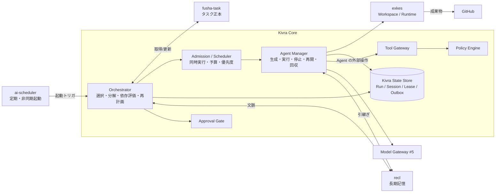
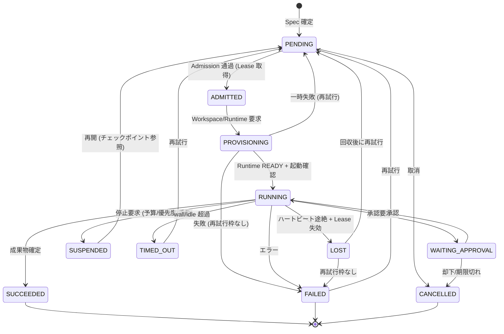
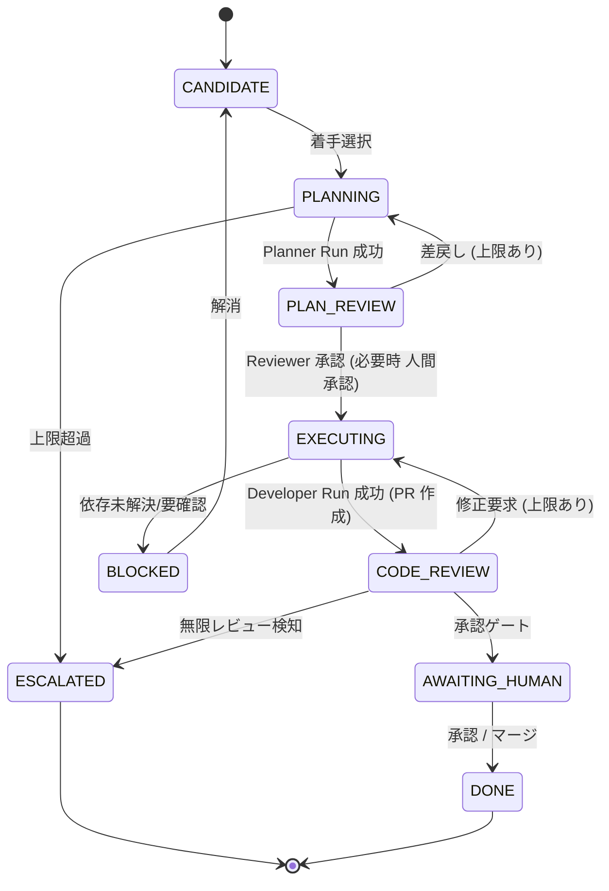
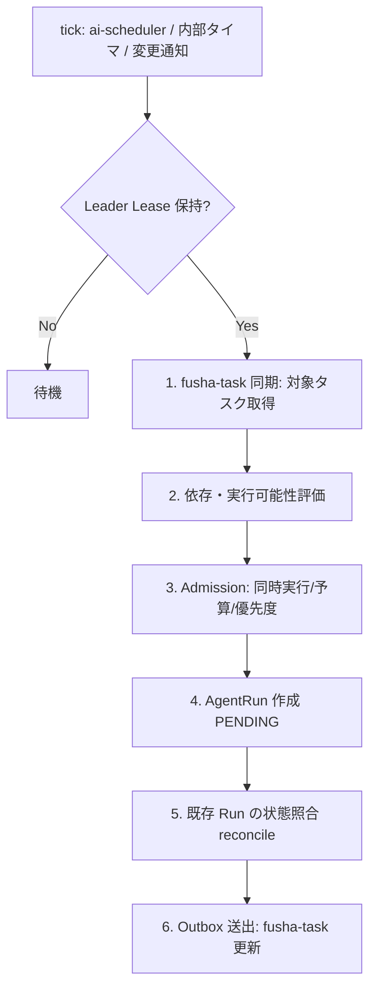
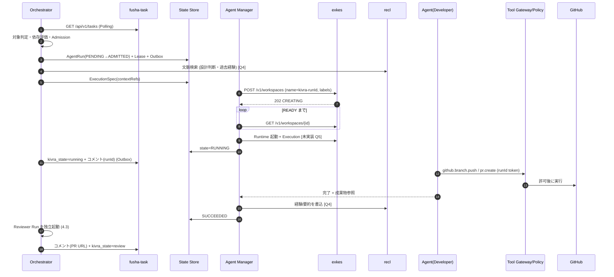
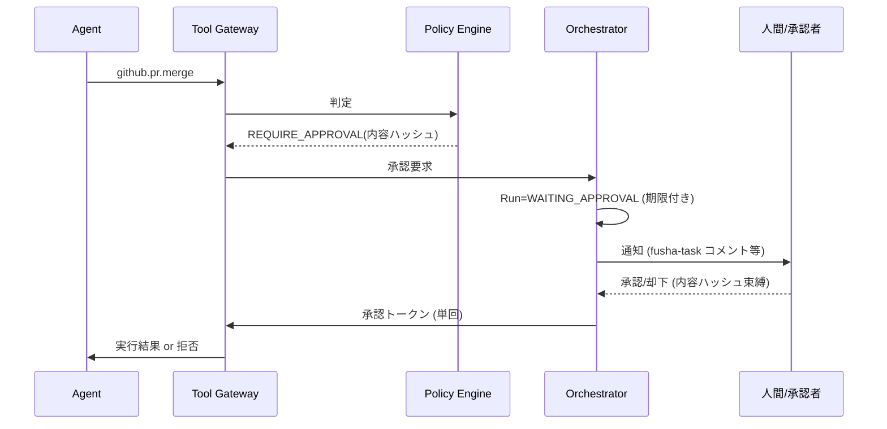

# 03. Agent Manager / Orchestrator 詳細設計

- 対象 Issue: kigawa-net/kivra#3
- 関連 Issue: #1 (Core), #2 (fusha-task), #4 (協調プロトコル), #5 (Model Gateway), #6 (Memory), #7-#9 (Dual Evolution / Self-Development), #11 (Recovery), #12 (Fortis/HA)
- ステータス: Draft (設計案)

## 0. 前提と調査結果の扱い

本書は「確認済みの事実」と「設計案」と「要確認」を分けて記す。

### 0.1 確認済みの事実 (ローカル clone / GitHub で確認)

| 対象 | 確認内容 | 出典 |
|---|---|---|
| fusha-task | Cloudflare Workers + Hono + MariaDB(Drizzle) の REST API。`/api/v1/tasks` の GET/POST/PATCH/DELETE、`/custom-fields`、`/views`、`/groups` がある | `san/fusha-task/README.md`, `CLAUDE.md` |
| fusha-task | 認証は Keycloak(`project-fusha` realm) の ID トークンを `Authorization: Bearer` で検証。**Machine-to-machine (client credentials / サービスアカウント) の記載は見つからない** | 同上 |
| fusha-task | tasks に `status` / `priority` 列は**無い** (廃止済み)。状態・優先度は `customFields`(JSON、`select` 型等) で表現する | `CLAUDE.md`, `schema.ts` |
| fusha-task | 依存関係に相当するのは `relatedTaskIds`(双方向・順序なし) と `nextTaskIds`(一方向「次のタスク」、配列)。「ブロックされている」を表す専用の関係は無い | `schema.ts` |
| fusha-task | Webhook / イベント配信の実装は grep で見つからない。楽観ロック (If-Match / version) も確認できない (`updatedAt` 列はある) | `src/` grep |
| fusha-task | PATCH は customFields をフロントが全量マージして送る前提のコメントがあり、同時更新で上書きされ得る | `tasks.ts` |
| exkes | 現在実装済みは **Workspace のみ** (`POST/GET/DELETE /v1/workspaces`、状態 CREATING/READY/ERROR/ARCHIVED/DELETING/DELETED、非同期 202)。Runtime / Execution / Terminal / Artifact API、認証 (Keycloak OIDC) は**未実装 (計画のみ)** | `kigawa-net/exkes/docs/implementation-plan.md` 6.1, 7.1, 10.3 |
| exkes | 計画上の API: `/v1/runtimes`, `/v1/executions`, `/v1/artifacts`, `POST /v1/workspaces/{id}/checkout`。DB の行が正で K8s リソースは正としない。ID は UUID 文字列 | 同 5.1, 6.1 |
| exkes | Control Plane と Sandbox Plane は分離。Sandbox から Control Plane / K8s API / 他 Runtime への直接アクセス不可 | `README.md` |
| ai-scheduler | Job / Workflow / Execution モデル。Execution 状態 (SCHEDULED..CANCELLED, WAITING_APPROVAL 含む)、`/v1/jobs`, `/v1/executions/{id}/cancel|retry`, `/v1/approvals/{id}/approve|reject`。Event/Condition Trigger、Idempotency Key、分散ロック、Human-in-the-loop の設計がある。Phase 1 実装済み | `kigawa-net/ai-scheduler/README.md`, `docs/design.md` |
| recl | GitHub `kigawa-net/recl` は存在するが**リポジトリが空**。ローカル clone も無い | `gh api` |

### 0.2 要確認 (本書では仮定を置く)

- Q1: fusha-task に Kivra 用の非対話クライアント (client credentials 等) を発行できるか。発行不可なら Kivra 専用ユーザーのトークン運用になる。
- Q2: fusha-task に Webhook / 変更イベント、条件付き更新 (version) を追加できるか (project-fusha 側へ要望 Issue)。当面は Polling + 読み戻し検証で設計する。
- Q3: fusha-task で「Kivra が着手してよいタスク」を識別する方法。customField (例 `kivra_state`, `kivra_executor`) を追加できる前提。カスタムフィールドの作成権限が要る。
- Q4: recl の API / データモデル。未公開のため本書では抽象 `MemoryProvider` (`put/get/search` + 参照 ID) としてのみ扱う。
- Q5: exkes に Runtime Session 相当 (#2 Runtime / #3 Execution 計画) がいつ入るか。MVP は exkes の Workspace + 将来の Runtime/Execution に依存する (後述の MVP 段階分け参照)。
- Q6: Coordination Bus (#4: NATS JetStream 候補) の採否。本書は Bus 非依存 (DB の Outbox + Polling でも成立) に書く。
- Q7: 本 Orchestrator の実装言語・DB。Kivra の他 Issue (#1) 未確定。本書では永続ストアを「RDB (トランザクション可)」とのみ仮定する。

## 1. 目的とスコープ

fusha-task のタスクを取得し、複数 Agent を動的に起動・協調・停止・再開する Orchestrator と Agent Manager の詳細を定義する。

スコープ外 (他 Issue で扱う): メッセージスキーマ詳細・Lease の通信仕様 (#4)、LLM ルーティング (#5)、記憶の内部設計 (#6)、A/B 二系統の相互開発 (#7-#9)、全体 HA (#11, #12)。本書はそれらとの**境界と接続点**のみ定める。

### 設計原則

1. タスク定義・進捗の正本は fusha-task。Kivra は Agent 実行状態 (Run/Session) を別管理し、二重管理しない (#2)。
2. Orchestrator / Agent Manager は **desired state を DB に書き、reconcile ループで収束**させる (exkes と同じ流儀)。外部 (K8s / exkes / fusha-task) の観測値は正としない。
3. 少なくとも 1 回配送・再起動を前提に、全操作を冪等にする。
4. Agent の出力・メッセージは信頼しない。副作用は Tool Gateway と Policy Engine を必ず経由する。
5. Agent 自身による権限昇格・安全制御の解除は禁止 (#1)。

## 2. コンポーネントと責務



| コンポーネント | 責務 | 持たないもの |
|---|---|---|
| Orchestrator | fusha-task の同期、実行可能タスクの選択、分解 (Plan 生成の依頼)、依存関係評価、再計画、Reviewer 割当、承認ゲートの要求 | Agent プロセスの直接操作、タスク正本 |
| Agent Manager | AgentRun の生成、exkes Workspace/Runtime の割当、起動・停止・再開、ハートビート監視、孤立回収 | タスク選択の判断 |
| Admission / Scheduler | 同時実行数・予算・リソース・優先度による起動可否判定 (Orchestrator 内モジュール) | - |
| Policy Engine | Agent Profile と Tool 呼び出しの許可判定 (default deny)。承認要否の判定 | 実行 |
| Tool Gateway | GitHub / K8s / fusha-task 等への最小権限アクセス。Agent は資格情報を持たず Gateway 経由のみ | - |
| Approval Gate | 人間 / 独立 Reviewer 承認の要求・記録 (ai-scheduler の WAITING_APPROVAL / approvals と同概念。再利用か自前かは要確認) | - |
| Kivra State Store | AgentRun, Session 割当, Lease, Outbox, 監査ログの正本 | タスク内容 |
| exkes | 隔離 Workspace (PVC) と Runtime Pod での実行 | スケジューリング判断 |
| recl | 長期記憶 (設計判断・過去経験)。Kivra は参照 ID と要約のみ保持 | Working Memory |
| ai-scheduler | 定期/イベント起動 (「N 分ごとに Orchestrator tick」「期限付き再開」) | Agent 実行の詳細 |

Orchestrator と Agent Manager は同一プロセス内の別モジュールで開始してよいが、インターフェース (State Store 経由) は分離しておく (後に別 Deployment 化可能にする)。Leader は 1 つ (後述 7.3)。

## 3. Agent Profile と Execution Spec

### 3.1 Agent Profile (静的な型・権限の定義)

| Profile | 役割 | Workspace | 書込権限の目安 | 備考 |
|---|---|---|---|---|
| Planner | 要求理解、タスク分解案、依存・見積り | 読取専用 (任意) | fusha-task へ子タスク「提案」のみ | 計画は Reviewer の独立評価対象 |
| Developer | 実装・テスト | 専用 RW Workspace | 作業ブランチへの push、PR 作成 | main 直 push 禁止 |
| Reviewer | PR / 計画の独立評価 | 読取専用 | PR コメント、承認/却下の意見 | **Planner/Developer と別 Run・別コンテキスト**、成果物の作成者と同一 Run 禁止 |
| Researcher | 調査・情報収集 | 読取専用 | recl への書込提案のみ | 外部ネットワーク範囲は Policy で限定 |
| Operator | K8s / 運用作業 | 原則なし | Tool Gateway 経由の限定操作 | 破壊的操作は必ず承認 |
| Evolution | Kivra 自身の改善案 (#7-#9) | 専用 Workspace | PR 作成のみ。自系統への昇格不可 | 詳細は #8 |

```yaml
# AgentProfile (宣言的。バージョン管理し、変更は PR 経由)
apiVersion: kivra/v1
kind: AgentProfile
name: developer
version: 3
runtime:
  kind: cli-agent            # cli-agent | direct-llm (#5 の境界)
  template: dev-default      # exkes runtime_template (要確認: exkes 第2MS)
  workspaceMode: rw          # none | ro | rw
capabilities: [code.edit, git.push.branch, github.pr.create]
tools:                       # Tool Gateway の許可リスト (default deny)
  allow: [github.read, github.branch.push, github.pr.create, fusha.task.comment]
  deny:  [github.merge, k8s.*, fusha.task.delete]
limits:
  maxWallClockSec: 7200
  maxIdleSec: 600
  maxRetries: 2
  budget: { tokensMax: 2000000, costUsdMax: 10 }
approval:
  required: [github.pr.merge, secret.read]   # Policy Engine が最終判定
review: { reviewerProfile: reviewer, independent: true }
```

Profile 自体を Agent が書き換えられない (Policy Engine が管理)。Profile は不変バージョンで、Run は起動時のバージョンを固定参照する。

### 3.2 Execution Spec (1 回の実行を表す不変仕様)

Orchestrator が AgentRun 作成時に確定し、以降は変更しない (変更は新 Run)。

```yaml
kind: ExecutionSpec
runId: <uuid>                 # Kivra が採番。冪等キー兼用
idempotencyKey: "task:{taskId}:attempt:{n}:profile:{profile}"
taskRef: { provider: fusha-task, taskId: 123, observedUpdatedAt: "..." }
profile: { name: developer, version: 3 }
parentRunId: <uuid|null>      # 分解元 / 引継ぎ元
inputs:
  goal: "..."                 # タスクから導出した目的 (正本はタスク)
  contextRefs:                # 本文を埋め込まず参照 (#4)
    - { kind: recl,   id: "..." }
    - { kind: github, ref: "owner/repo#PR または commit SHA" }
    - { kind: run,    id: "<上流 runId>", artifact: "summary" }
workspace:
  mode: rw
  exkesWorkspaceId: <uuid|null>   # 既存再利用 or 新規
  repo: { url: ..., baseRef: main, workBranch: "kivra/task-123-<runId8>" }
limits: { wallClockSec, idleSec, maxRetries, budget }
priority: <int>               # 3.3 参照
lease: { ttlSec, fencingToken }   # 8 章
trace: { traceId, correlationId }
```

### 3.3 優先度

fusha-task に priority 列は無い (確認済み)。優先度は (a) fusha-task の customField `priority` (select) を採用するか、(b) `dueDate` + Kivra 内部の重み付けのどちらか。**要確認 (Q3)**。本設計は `PriorityResolver` インタフェースで吸収し、MVP は (b) `dueDate` 昇順 + 先着で開始する。

## 4. 状態モデル

状態は 3 層に分離する (#1 の「タスク・Agent・実行セッション」に対応)。

| 層 | 正本 | 状態の例 |
|---|---|---|
| Task | fusha-task | customField 等 (Kivra は読む。更新は 4.4 の最小範囲) |
| AgentRun | Kivra State Store | 下記 4.1 |
| Runtime Session | exkes (Kivra は参照 ID を保持) | exkes の Runtime/Execution 状態 (未実装。要確認 Q5) |

### 4.1 AgentRun 状態遷移



- 終端: SUCCEEDED / FAILED(再試行枠なし) / CANCELLED。`TIMED_OUT`/`LOST` は再試行判定後に PENDING か FAILED へ。
- 遷移は `UPDATE ... WHERE id=? AND state=? AND fencing_token=?` の条件付きで行い、0 行更新なら再読込して再判断する (exkes Workspace と同方式)。
- 同一タスクに複数 Run が存在し得る (再試行、Developer と Reviewer)。再試行は **新しい attempt** として Run を作り、旧 Run は終端のまま残す (監査性)。

### 4.2 タスク単位のフェーズ (Orchestrator が管理)

タスク 1 件の進行は AgentRun の集合から導出する。



小さなタスクは PLANNING / PLAN_REVIEW を省略可 (Profile ポリシーで決定)。ESCALATED は人間に fusha-task 上でコメントして停止する状態。

### 4.3 PlannerとReviewerの独立評価

- Reviewer は Planner/Developer と**別 Run、別 Workspace、別コンテキスト**。入力は成果物への参照 (PR/計画) と要件 (タスク本文) のみで、作成者の思考過程・自己評価は渡さない。
- 可能なら Model Gateway (#5) で異なるモデル/プロバイダを選択 (独立性の強化。要 #5 調整)。
- Reviewer の出力は構造化 (`verdict: approve|request_changes|reject`, `findings[]`, severity)。Orchestrator が機械的に遷移を決める。
- 修正往復の上限 (既定 3 回) を超えたら ESCALATED。同一 findings の再出現は検知して停止。

### 4.4 fusha-task への進捗反映 (最小権限)

fusha-task の Task 状態は status 列が無いため customField で表現する (Q3)。Kivra が書くのは次に限定する。

| 反映内容 | 方法 | 備考 |
|---|---|---|
| 着手/進行状況 | customField `kivra_state` (select: queued/running/review/blocked/done/escalated) | 要: フィールド作成権限 (Q1/Q3) |
| 担当 Agent | customField `kivra_executor` または担当者 | 人間の担当者 (`assigneeId`) は上書きしない |
| 進捗・成果物リンク | コメント (`comments` テーブルは作成+一覧のみ・編集削除不可) | PR URL、Run ID、要約。冪等のため本文に `runId` マーカーを含め重複投稿を検知 |
| 子タスク | Planner 提案を Reviewer 承認後に Orchestrator が作成 | 作成元は Orchestrator のみ。Agent 直接作成は不可 |
| 完了 | 人間承認後のみ `kivra_state=done` (またはタスク側の完了表現) | 破壊的操作 (DELETE) は禁止 |

PATCH が customFields 全量送信の仕様 (確認済み) のため、**更新は read-modify-write + 直後の読み戻し検証**とし、`updatedAt` が観測値と異なる場合は再読込してマージ (他者の変更を消さない)。楽観ロックが fusha-task に入れば切替 (Q2)。

## 5. Orchestrator の設計

### 5.1 主ループ (Reconcile)



- 全ステップは冪等。途中クラッシュしても次 tick で収束する (State Store が正)。
- トリガは**Polling を基本**、fusha-task に Webhook が入れば補助 (Q2)。Polling 間隔の既定は 30-60 秒、差分は `updatedAt` で判定 (差分取得 API が無い場合は全件取得 + 自前ハッシュ比較。件数が増えた場合の負荷は要確認)。
- ai-scheduler は「Orchestrator tick の定期起動」「承認待ち期限での再開」「時刻指定タスクの起動」に使う。**常駐ループ自体は Orchestrator が持ち、ai-scheduler に必須依存しない** (ai-scheduler 停止時も動く = 疎結合)。

### 5.2 タスク選択と対象の判定

Kivra が着手してよいタスクの条件 (全て満たす):

1. Kivra 対象を示すマーカーがある (customField `kivra_target=true` 等。Q3)、または専用グループ/ビューに属する。マーカー無しのタスクには触れない。
2. 担当者が人間に固定されていない、または Kivra へ明示割当されている。
3. 依存解決済み (5.3)。
4. 既に非終端の AgentRun が無い (二重起動防止。5.5)。
5. Policy が許可 (対象リポジトリ、Profile の適用可否)。

### 5.3 依存関係の処理

fusha-task に「ブロックされている」関係は無い。`nextTaskIds` (A の次に B) を「B は A 完了後」と解釈し、`relatedTaskIds` は依存扱いしない (確認済み仕様に基づく)。

- 先行タスク = 自タスクの id を `nextTaskIds` に含むタスク (逆引きは全件走査で導出。fusha-task も同様の導出を想定)。
- 先行が全て完了 (Q3 で定める完了表現) なら実行可能。循環はグラフ検出して BLOCKED + コメント。
- Kivra 内の分解 (親タスク → 子タスク) は子を fusha-task タスクとして作り、`nextTaskIds` で順序を表す。並列可能な子は順序を付けない。
- 親の完了は**全ての子が完了**で判定し、Orchestrator が合流 (Join) 処理を行う: 子 Run の成果物参照を集約して Reviewer Run に渡す。
- 外部要因 (人間待ち、他リポジトリの PR 待ち) は BLOCKED とし、`blockedReason` を Kivra 側とコメントへ記録。

### 5.4 分解 (Decomposition)

1. Planner Run が「子タスク案 + 依存 + 見積り + 受入基準」を構造化出力で返す。
2. Reviewer Run が独立評価 (4.3)。
3. 承認済み案を Orchestrator が fusha-task に作成 (冪等キー: `planId + index` を customField / コメントに保持し、再実行時に既存を検出)。
4. 分解の深さ・子数に上限 (既定: 深さ 2、子 10)。超過は ESCALATED。

### 5.5 スケジューリング / Admission

| 制御 | 内容 |
|---|---|
| 全体同時実行 | `maxConcurrentRuns` (全体)。Profile ごと・リポジトリごとの上限も併用 |
| リポジトリ競合 | 同一 repo の同一ブランチ/同一パスへの並列 Developer Run は禁止または Lease で直列化 (8 章)。別ブランチの並列は許可 |
| 予算 | タスク・Run・日次の token/コスト上限。Model Gateway (#5) の Budget Controller と二重ではなく、Orchestrator は「起動前の見積りチェック」、#5 は「実行中の強制」と分担 |
| リソース | exkes の Workspace 数・PVC 容量 (CephFS) を Admission で参照。exkes の quota は未実装 (確認済み) のため Kivra 側に暫定上限を持つ |
| 優先度 | 3.3。starvation 防止のため待機時間でエイジング加算 |
| 公平性 | 1 タスク/1 リポジトリが枠を占有しないよう最大占有率を設ける |
| 背圧 | 失敗率が閾値超ならサーキットブレーカで新規起動を停止 (Fortis/#12 とは別、ローカル保護) |

## 6. Agent Manager の設計

### 6.1 生成・実行

1. ADMITTED になった Run について、Workspace を決定: Developer は専用 Workspace を新規作成 (`POST /v1/workspaces`、202 → READY をポーリング。確認済み API)、Reviewer/Researcher は読取専用で既存 Workspace を共有または新規 RO。
2. Runtime 起動: exkes `POST /v1/runtimes` + Execution 実行 (**未実装・計画のみ。要確認 Q5**)。それまでの暫定: Workspace のみを使い、Agent 実行は Kivra 側の別手段 (要確認) とする。
3. 起動確認 (最初のハートビート) で RUNNING。
4. Credentials は Agent に直接渡さない。Agent が必要とする外部操作は Tool Gateway のエンドポイントを経由し、Run 固有の短命トークン (runId にスコープ) で認可する。

### 6.2 停止・再開

- 停止 (SUSPENDED / CANCELLED): まず協調停止 (Agent へ停止要求、チェックポイント保存猶予 N 秒)、猶予超過で強制終了 (exkes Runtime 停止)。
- 再開: 同じ Workspace を再 attach (PVC は永続。exkes の「Runtime 再 attach」は #6/#7 領分で現状未実装。Q5)。Working Memory のチェックポイント (最後の構造化進捗、未コミット差分の有無、次の手順) を新 Run の contextRefs に渡す。「再開」は新 Run (attempt+1) で `parentRunId` を保持し、Agent 内部状態の完全復元は前提にしない。
- チェックポイントは Run の節目 (ツール実行ごとではなく、フェーズ完了時) で Kivra State Store に要約を保存。大きな成果物は参照 ID のみ。

### 6.3 ハートビートと孤立回収 (Reaper)

- 実行中 Run は Lease (8 章) を一定間隔で更新。Reaper は Lease 失効 + exkes 側 Runtime の状態を確認して LOST と判定する。
- **孤立セッション**: exkes に存在するが Kivra の Run に紐づかない Workspace/Runtime (`labels.kivraRunId` で突合。exkes Workspace は labels を持つ: 確認済み) を定期スキャンし、終端 Run のものは猶予後に削除要求。逆に Run が RUNNING なのに exkes 側が存在しない場合は LOST。
- Workspace の保持期間: 成功 Run は成果物 (PR) 確定後 N 日、失敗 Run は調査用に M 日 (値は要決定)。削除前に未 push の差分有無を確認。

### 6.4 失敗時の扱い

| 事象 | 判定 | 動作 |
|---|---|---|
| exkes API 一時エラー / Workspace CREATING タイムアウト | 一時 | 指数バックオフ + ジッターで再試行 (最大 3)。超過で FAILED |
| Agent プロセス異常終了 | 一時または恒久 | 同 Run の再試行 (attempt+1)。同一エラーが 2 回続けば ESCALATED |
| wall/idle タイムアウト | TIMED_OUT | 1 回だけ再試行 (予算内)。以降 ESCALATED |
| Policy 拒否 | 恒久 | 再試行しない。承認要求か BLOCKED |
| 予算超過 | 恒久 | SUSPENDED + 人間通知 |
| Reviewer reject の往復上限 | 論理 | ESCALATED |
| CI 失敗 | 論理 | Developer 修正 Run (上限 3)。同一失敗の繰返しは停止 |

再試行は最大回数・累計コスト・累計時間の三重上限。すべて Execution Spec の `limits` に記録し、Run 間で累積する (attempt をまたいで合算)。

## 7. 永続化・復旧・冪等性

### 7.1 State Store の主なテーブル (論理)

| テーブル | 主な列 |
|---|---|
| `agent_runs` | run_id, task_ref, profile, attempt, state, fencing_token, parent_run_id, spec(JSON), started_at, ended_at, last_heartbeat_at, error |
| `run_sessions` | run_id, exkes_workspace_id, exkes_runtime_id, exkes_execution_id, observed_state, observed_at |
| `leases` | resource_key, holder, fencing_token, expires_at |
| `outbox` | id, target(fusha-task/github/exkes), op, idempotency_key, payload, status, attempts, next_attempt_at |
| `checkpoints` | run_id, seq, summary, refs |
| `audit_log` | id, trace_id, actor(run/system/human), action, resource, decision(policy), at |

### 7.2 Outbox と冪等性

- fusha-task への更新・コメント、exkes への作成要求は**まず Outbox に書き、同一トランザクションで AgentRun 状態を更新**。送出ワーカが冪等キーで外部に適用する。
- fusha-task は冪等キーを受け付けない (確認できず) ため、(a) 事前に検索して既存を確認、(b) コメント本文/customField に `kivra:runId:opId` を含め重複を検出、(c) 更新は読戻し検証、で擬似冪等化する。
- exkes Workspace 作成は `name` 一意制約 (409 CONFLICT: 確認済み) を冪等キーとして利用: name = `kivra-{runId}`。409 の場合は GET で既存を採用。
- 受信イベント (Webhook/Polling 差分) は eventId / `(taskId, updatedAt)` で重複排除。

### 7.3 Orchestrator 再起動・複数レプリカ

- Leader は Lease (DB 行 or Kubernetes Lease。#11/#12 と整合させる。要確認) で 1 つに限定。Lease には Fencing Token を付け、旧 Leader の遅延書込は State Store 側で拒否する。
- 起動時リコンサイル: (1) 非終端 Run を全件読む (2) exkes で突合 (3) fusha-task の現状と突合 (4) 不整合は 6.3 の規則で LOST / 孤立として処理。**State Store が欠損した場合**は fusha-task の `kivra_state` とexkes labels から再構築可能にしておく (best effort。詳細は #11)。
- 全 Run の状態変更はイベントとして `audit_log` に残す。

## 8. 競合制御 (#4 との境界)

詳細プロトコルは #4。本書が必要とする前提を示す。

- Lease キー: `task:{taskId}` (同一タスクの二重処理防止)、`repo:{repo}:branch:{branch}` (ブランチ書込)、`workspace:{id}`。
- TTL 付き Lease + 単調増加 Fencing Token。Run の書込 (State Store、Tool Gateway 経由の push/コメント) は token を検証し、失効 token は拒否。
- 同一ファイル変更の衝突は Git 上で検出 (rebase/merge 失敗 → Developer 再実行)。CI 検証を必須ゲートとする。
- 少なくとも 1 回配送前提で、Agent 側の副作用も `runId + opId` を Tool Gateway が記録して重複実行を抑止。
- Lease 失効時: Reaper が Run を LOST 化し、Workspace の差分を保全 (push 済みブランチの確認、未 push は PVC に残存) してから回収。

## 9. 安全制御

| 項目 | 設計 |
|---|---|
| 権限 | Agent は資格情報を持たない。全外部操作は Tool Gateway → Policy Engine (default deny)。許可は Profile ∩ 組織ポリシー ∩ タスク固有制約の積集合 |
| 権限昇格禁止 | Agent は Profile / Policy / Tool Gateway 設定 / 自分の Lease / 予算を変更する API を持たない。それらの変更経路は人間承認付き PR のみ |
| 承認ゲート | Policy が要承認と判定した操作 (マージ、Secret 参照、K8s 変更、タスク削除、本番反映) は WAITING_APPROVAL。承認者は Agent と別主体 (人間または別系統)。承認は操作の内容ハッシュに束縛 (承認後に内容差し替え不可) |
| 独立評価 | 4.3。さらに、Reviewer が Developer と同一の Policy 緩和を受けないこと |
| Sandbox | Runtime は exkes の Sandbox Plane。Control Plane / K8s API / 他 Runtime へ直接到達不可 (確認済み方針)。外部へは Tool Gateway のみ |
| プロンプトインジェクション対策 | タスク本文・PR・Web 取得内容は信頼しない入力としてコンテキストにタグ付けし、Policy 判定は Agent の発話でなく構造化 Tool 呼び出しに対して行う |
| 自己変更 | Evolution Run の昇格は #7-#9 に従い、Orchestrator は自系統の本番昇格を許可しない |
| 監査 | すべての Tool 呼び出し・Policy 判定・承認・状態遷移に traceId を付与し改ざん困難な追記専用ログへ (保存先は #1 の監査モデルに従う) |
| 暴走防止 | グローバル Kill Switch (新規起動停止・全 Run 停止) を人間のみ操作可能にする。Agent 起動数・再試行・コストの自動停止閾値 |

## 10. 連携シーケンス

### 10.1 タスク着手から PR まで



### 10.2 承認ゲート



### 10.3 Agent 間の成果物・コンテキスト引継ぎ (recl 連携)

- Agent 間で本文を直接渡さず、**参照 (GitHub PR/commit、exkes artifact/workspace、recl メモリ ID、上流 Run の checkpoint)** のみを `contextRefs` で渡す (#4)。
- 取得権限は Run スコープのトークンで制限し、下流 Run は自分の Spec に列挙された参照だけ読める (コンテキスト最小化)。
- Run 完了時に Agent Manager が要約 (目的・結果・判断理由・失敗原因) を作成し recl へ書込 (`MemoryProvider.put`)。Working Memory は Kivra 内に置き、長期化する価値のあるもののみ recl へ (#6 の Episodic/Procedural に対応)。
- recl 不通でも Run 続行できるよう、読み取りは best-effort (タイムアウト付き)、書込は Outbox で再送。
- recl の実 API は未公開のため、本書の `MemoryProvider` 契約 (put/get/search/参照 ID) は暫定 (Q4)。

## 11. ai-scheduler との連携

| ユースケース | 方法 |
|---|---|
| Orchestrator tick | ai-scheduler の cron Job が Orchestrator のエンドポイントを呼ぶ (確認済み: Job/Trigger/Execution)。自前タイマと併用し、片方停止でも継続 |
| 承認待ち期限 | once Trigger で期限時に Orchestrator を起動し期限切れ処理 |
| 定期的な Reaper / 孤立スキャン | cron Job |
| 注意 | ai-scheduler の Execution と Kivra の AgentRun は別概念。二重管理を避けるため、ai-scheduler は「いつ起こすか」だけを担い、Run の状態は Kivra State Store が正 |

ai-scheduler の Event/Condition Trigger 実装状況・Orchestrator 呼出し用の認証方式は**要確認**。

## 12. 観測性

メトリクス: Run 数 (状態別)、待ち時間、成功率、再試行回数、コスト/トークン、Admission 拒否理由、Lease 失効数、孤立回収数、fusha-task 同期遅延。ログ/トレースは traceId で fusha-task タスク・Run・exkes Execution・Tool 呼び出しを関連付ける (#1 Observability に集約)。

## 13. 他 Issue との整合

| Issue | 整合点 |
|---|---|
| #1 | Lifecycle 状態 (3 層) と Tool Gateway / 承認 / 監査を本書で具体化 |
| #2 | タスク正本は fusha-task。Adapter 経由でのみアクセス。本書 4.4 / 5.3 は #2 の調査結果 (status 無し、Webhook 無し) と矛盾しない前提で書いた。#2 の結論が違えば 4.4 を更新 |
| #4 | Lease/Fencing/参照渡しは #4 に従う。本書は利用側。Coordination Bus が無くても Outbox/Polling で成立 |
| #5 | Direct LLM と exkes の CLI Agent を区別。Profile の `runtime.kind` で選択。予算は起動前チェック (本書) と実行中強制 (#5) に分担 |
| #6 | Working Memory は Kivra、長期は recl。タスク情報は recl に二重保存しない |
| #7-#9 | Evolution Profile は自系統への昇格不可。Orchestrator 自体の更新は Deployment Controller の責務で、Orchestrator が自己更新しない |
| #11/#12 | Leader Lease・State Store の可用性は #11/#12 で確定。本書は Fencing Token 前提で書く |

## 14. 未解決論点

1. fusha-task の非対話認証 (Q1)、Webhook / 条件付き更新 (Q2)、Kivra 用 customField と完了表現 (Q3)。
2. recl の API とデータモデル (Q4)。リポジトリは現在空。
3. exkes の Runtime / Execution / 認証 API の時期 (Q5)。MVP の Agent 実行手段が決まらない最大のリスク。
4. 優先度の取得方法 (3.3)。
5. State Store の DB 製品と Leader Lease の実装 (Q7, #11)。
6. Approval Gate を自前実装するか ai-scheduler の approvals を再利用するか。
7. Reviewer の独立性をどこまで強制するか (モデル/プロバイダ分離の可否。#5)。
8. Workspace 保持期間とコスト (CephFS 容量)。
9. fusha-task の全件 Polling がスケールするか (差分 API の有無)。

## 15. MVP 実装 Issue への分割

段階は exkes の実装状況に依存するため 3 段階に分ける。各 Issue は実装時に起票する。

### Phase A: exkes Runtime 未実装でも進められる部分

| # | Issue 案 | 内容 | 依存 |
|---|---|---|---|
| A1 | State Store 基盤 | `agent_runs` / `leases` / `outbox` / `audit_log` スキーマ、条件付き遷移、Fencing | Q7 |
| A2 | TaskProvider / FushaTaskAdapter 読取 | タスク取得・差分検出・依存 (nextTaskIds) 評価 | #2 |
| A3 | Orchestrator 主ループ + Leader Lease | tick、起動時リコンサイル、対象判定 | A1, A2 |
| A4 | Admission / Scheduler | 同時実行・予算(見積り)・優先度 (暫定 dueDate) | A3 |
| A5 | AgentProfile / ExecutionSpec 定義とローダ | 宣言的 Profile、バージョン固定 | A1 |
| A6 | fusha-task 書込 (Outbox) | customField 更新・コメント、擬似冪等、読戻し検証 | A1, A2, Q1/Q3 |

### Phase B: exkes Workspace (実装済み) の利用

| # | Issue 案 | 内容 | 依存 |
|---|---|---|---|
| B1 | Agent Manager 骨格 | Run 状態機械、Workspace 作成/待機/削除、labels 突合 | A1, exkes Workspace |
| B2 | Reaper / 孤立回収 | ハートビート、LOST、孤立 Workspace 検出 | B1 |
| B3 | 再試行・タイムアウト・取消 | 6.4 の規則、上限の累積管理 | B1 |
| B4 | Policy Engine / Tool Gateway 最小版 | default deny、GitHub 限定、Run スコープトークン | #1 |
| B5 | Approval Gate | 内容ハッシュ束縛の承認、期限 | B4 |

### Phase C: exkes Runtime/Execution と recl が使えるようになってから

| # | Issue 案 | 内容 | 依存 |
|---|---|---|---|
| C1 | Runtime/Execution 連携 | 起動・停止・再開・ログ/成果物取得 | exkes #7/#11 |
| C2 | Developer → Reviewer パイプライン | PR 作成、独立 Reviewer、差戻し上限 | B1, B4, C1 |
| C3 | Planner と分解 | 子タスク作成、合流、深さ/数の上限 | C2, A6 |
| C4 | recl 連携 (MemoryProvider) | 文脈検索・要約書込・参照規約 | Q4 |
| C5 | ai-scheduler 連携 | tick/期限/Reaper の cron Job | ai-scheduler |
| C6 | 観測性・Kill Switch | メトリクス、監査ビュー、緊急停止 | 全般 |

### MVP の最小縦切り

「1 タスク → Developer Run 1 件 → PR 作成 → 人間が確認して fusha-task を更新」を A1-A3, A5, A6, B1, B4 + C1 の最小実装で通し、Reviewer・分解・並列は後続とする。C1 が遅れる場合のフォールバックは要確認 (Q5)。

## 16. 完了条件との対応

| 完了条件 | 本書の節 |
|---|---|
| コンポーネントと責務の定義 | 2 |
| Agent Profile と Execution Spec の定義 | 3 |
| Agent ライフサイクル・状態遷移の定義 | 4, 6 |
| Orchestrator のスケジューリング・依存関係処理設計 | 5 |
| exkes / fusha-task / recl とのシーケンス設計 | 10 (+11) |
| 並列実行、競合、再試行、復旧、安全制御の設計 | 5.5, 6.3-6.4, 7, 8, 9 |
| MVP 実装 Issue への分割 | 15 |
