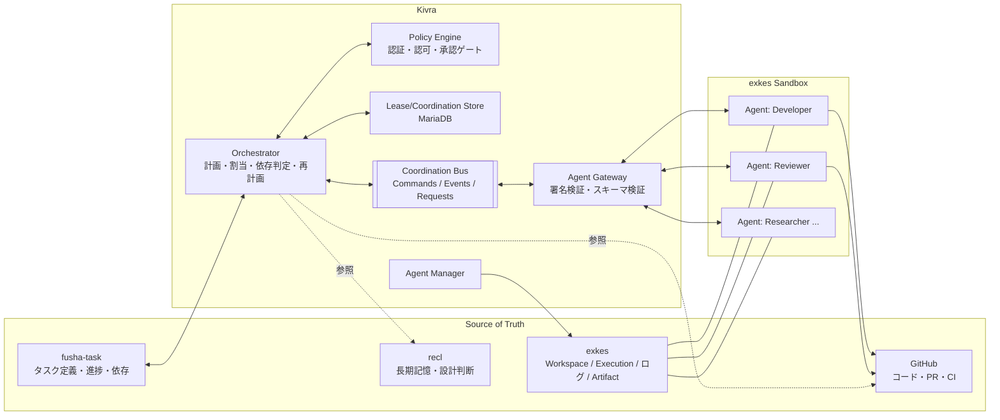
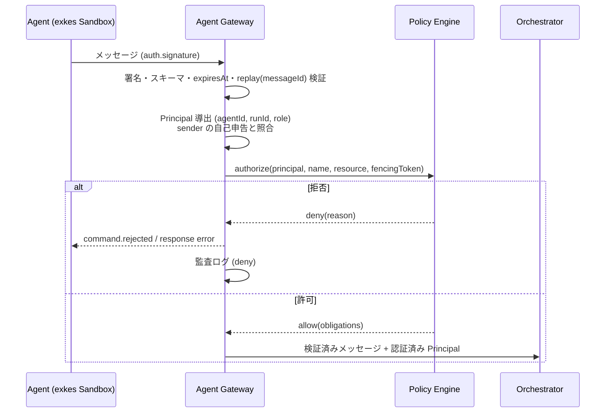
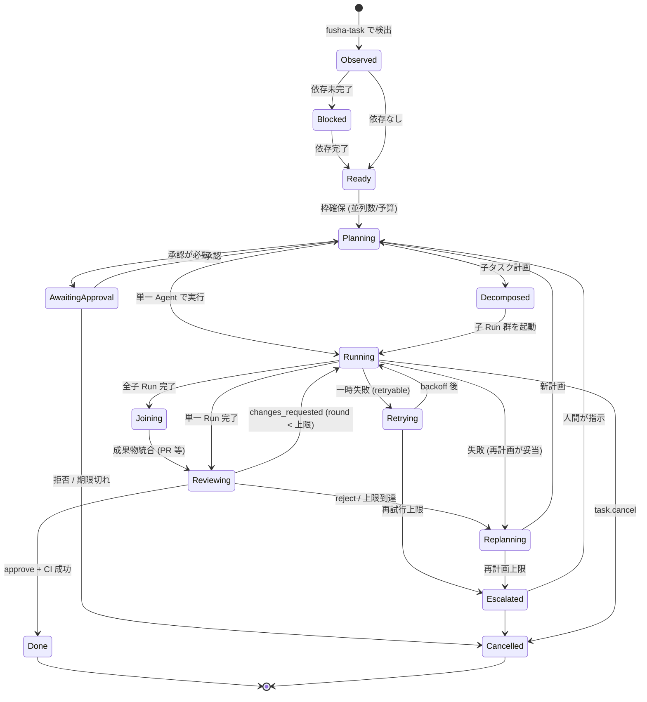
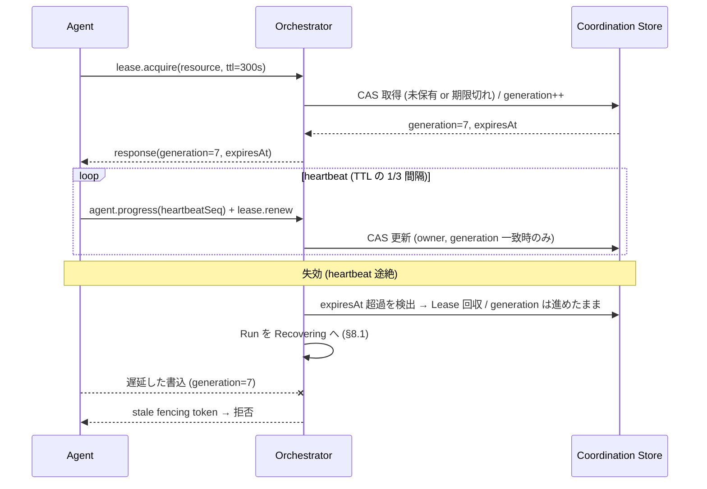
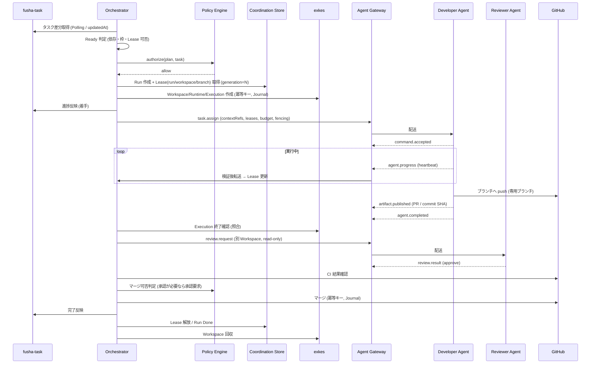
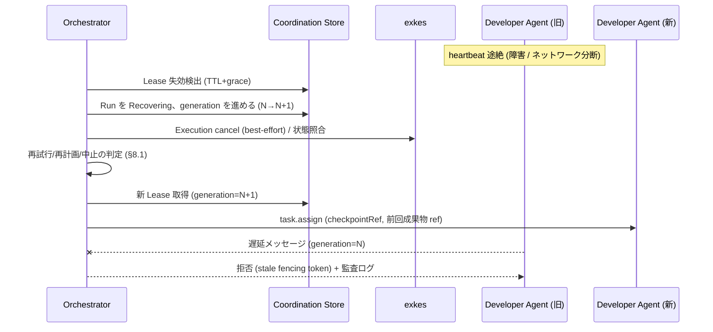

# 04. Agent間協調プロトコル設計

- 対象 Issue: kigawa-net/kivra #4
- 関連 Issue: #1 (Core), #2 (fusha-task 連携), #3 (Agent Manager / Orchestrator), #5 (Model Gateway), #6 (Memory / recl), #7-#10 (Dual Evolution / Self-Development), #11 (Recovery & Distributed Consistency)
- ステータス: ドラフト (設計段階。実装なし)
- 日付: 2026-10-12

## 0. 位置づけとスコープ

本書は Kivra の複数 Agent が fusha-task のタスクに協調して取り組むための **Agent 間通信・依存関係・競合制御・成果物共有・レビュー・再計画のプロトコル** を定義する。

他 Issue との責務分担 (矛盾を避けるための境界):

| 論点 | 本書 (#4) | 詳細を持つ Issue |
|---|---|---|
| メッセージ型・スキーマ・配送セマンティクス | 定義する | - |
| Agent Profile / Execution Spec / Agent ライフサイクル | 参照のみ (Agent 状態は協調視点で再掲) | #3 |
| fusha-task の Adapter・状態同期の詳細 | 協調上必要な要件のみ | #2 |
| 成果物・文脈の参照規約 | 定義する (recl の保存モデル自体は #6) | #6 |
| Lease / Fencing / Operation Journal / Outbox / Recovery Coordinator の DB モデル・疑似コード | 協調プロトコルが要求するインターフェースと方針を定義 | **#11** |
| Model/LLM 選択・予算の実体 | 予算を制御対象として扱うのみ | #5 |
| 二系統 (A/B) の本番昇格排他 | 対象外 | #7-#11 |

原則:

1. **Agent のメッセージは信用しない**。すべて Orchestrator と Policy Engine を経由して認証・認可し、Agent 間の直接通信は許可しない (スター型)。
2. **正本を二重管理しない**。タスク定義・進捗は fusha-task、コードは GitHub、実行ログ・成果物実体は exkes、長期記憶は recl が持つ。Coordination 層は「参照」と「協調状態」のみ持つ。
3. **Exactly Once を主張しない**。配送は at-least-once、処理は冪等 + Fencing で実効的に一回とする。曖昧な外部副作用は自動再試行より照合・停止を優先する (#11 の方針と一致)。
4. **Fail-closed**。認可・Lease・Fencing のいずれかが確認できない場合は副作用を実行しない。

## 1. 確認できた事実と要確認事項

ローカル clone (`/home/kigawa/dev` 配下) を確認した結果と、未確認事項を分けて記す。

### 1.1 確認できた事実

| 対象 | 確認元 | 事実 |
|---|---|---|
| fusha-task | `san/fusha-task` (README, `src/domain/entities/Task.ts`) | Cloudflare Workers + Hono + D1。REST `/api/v1/tasks` (一覧・詳細・作成・PATCH・削除)、`custom-fields`、`views`、`groups`。認証は Keycloak OIDC の ID トークンを Bearer で検証 |
| fusha-task Task | 同 `Task.ts` | `id:number`, `title`, `description`, `assigneeId`, `reporterId`, `dueDate`, `customFields: Record<string, unknown>`, `relatedTaskIds:number[]` (双方向・対等), `nextTaskIds:number[]` (一方向の「次のタスク」), `groupId`, `viewerGroupId`, `createdAt`, `updatedAt` |
| fusha-task の制約 | 同上 + README | 専用の status / 依存 (blockedBy) フィールドは **Task 型に存在しない** (状態はおそらく `customFields` 経由。未確認)。Webhook / イベント配信の API は README に記載なし。`/tasks/:id` の PATCH に楽観ロック (If-Match / version) があるかは未確認 (`updatedAt` はあるが CAS 用途かは不明) |
| exkes | `kigawa-net/exkes` (README, `docs/implementation-plan.md`, `docs/issue-1-body.md`) | Kotlin 製 Execution Runtime Platform。`exkes-api` (desired state を書く、K8s を呼ばない) と `exkes-controller` (reconciliation、K8s 権限を持つ唯一のプロセス)。MariaDB が Source of Truth。実装済みは Workspace (`/v1/workspaces`) と Runtime lifecycle (Phase 2 commit) まで。Execution / Artifact / Terminal は計画のみ |
| exkes 計画 | `docs/issue-1-body.md` | Execution type は `COMMAND`/`AGENT`/`SYSTEM`、状態 `QUEUED/STARTING/RUNNING/SUCCEEDED/FAILED/CANCELLED/TIMED_OUT`。計画 API: `POST /runtimes/{id}/executions`, `GET /executions/{id}`, `POST /executions/{id}/cancel`, `GET /executions/{id}/logs`, `GET /executions/{id}/artifacts`。Agent Execution は MVP で同一 Runtime あたり同時 1 件。Sandbox から Control Plane・MariaDB・K8s API へ直接アクセス不可 |
| ai-scheduler | `kigawa-net/ai-scheduler` (`docs/decisions.md`) | Kotlin / Ktor / MariaDB / Exposed / Flyway。単一プロセス、キューは未導入でポーリング + `executions.status` 列。API / Web UI とも無認証 (Phase 1 時点) |

### 1.2 要確認事項

| # | 内容 | 影響 |
|---|---|---|
| Q1 | **recl の実装・API が `/home/kigawa/dev` 配下に見つからない** (`find -iname '*recl*'` でヒットなし)。#6 も「現行実装・API の存在は未確認」としている | 参照 URI 規約 (§6) の `recl:` スキームは暫定。Adapter 契約は #6 確定後に合わせる |
| Q2 | fusha-task に status / 依存の正式フィールド、タスク更新の楽観ロック (version/ETag)、Webhook があるか | 依存判定 (§4)・状態同期の方式が変わる。無い場合は `nextTaskIds` + `customFields` + Polling で代替 (§4.2)。#2 で確定 |
| Q3 | exkes の Execution API (未実装) に冪等キー・世代番号 (Fencing) の受け口があるか | §5.5 の Fencing の外部適用範囲。無い場合は「既存オブジェクト検索 + 識別子安定化」で対処 (#11 と同方針) |
| Q4 | Coordination Bus に NATS JetStream を採用するか | §3.6 に評価基準を記載。**本書では採用を決定しない** (Issue 記載どおり評価して決定) |
| Q5 | Orchestrator / Agent / Policy Engine の実装言語とプロセス構成 (#1 / #3 で確定) | メッセージスキーマの表現 (JSON Schema か Protobuf か) |
| Q6 | exkes の Agent Runtime から Bus に直接接続させるか、runtime-agent 経由か | §3.5 の認証経路。Sandbox 分離方針上は **Orchestrator 側の Gateway 経由 (Sandbox から Bus へ直接接続しない)** を推奨案とする |
| Q7 | GitHub の認証方式 (App / PAT / WIF broker) と branch protection の設定 | §5.3 の Git 競合制御の強制力 |

## 2. 全体アーキテクチャ



- **スター型**: Agent は互いに直接送信せず、必ず Orchestrator (Policy Engine) 経由で宛先に配送される。Agent が他 Agent へ依頼したい場合は `Request` を Orchestrator 宛てに出し、Orchestrator が新規 Command として発行するかを判断する。
- **Coordination Store** は協調に必要な Kivra 固有状態 (Lease、Fencing generation、メッセージ Inbox、Operation Journal) を保持する。#11 の方針どおり MariaDB を想定する (詳細モデルは #11)。fusha-task の内容は複製せず、参照 (taskId) と観測した版 (`observedUpdatedAt`) のみ保持する。

## 3. メッセージプロトコル

### 3.1 メッセージ種別

| 種別 | 方向 | 意味 | 応答 | 配送保証 |
|---|---|---|---|---|
| **Command** | Orchestrator → Agent | 実行指示 (例: `task.assign`, `task.cancel`, `review.request`) | Event で結果通知 (ack は `command.accepted` / `command.rejected` Event) | at-least-once、受信側は冪等 |
| **Event** | Agent / Orchestrator / 外部 Adapter → 購読者 | 事実の通知 (例: `agent.progress`, `artifact.published`, `execution.finished`) | なし | at-least-once、順序は `subject` (taskId/runId) 内のみ `sequence` で検査 |
| **Request / Response** | Agent → Orchestrator (逆も可) | 同期的な問い合わせ・許可要求 (例: `lease.acquire`, `permission.request`, `context.fetch`) | Response (`correlationId` で対応づけ)、`expiresAt` 超過でタイムアウト | Request は冪等キー必須、Response は再送可 |

Agent → Agent の直送種別は **存在しない**。

### 3.2 共通エンベロープ

すべてのメッセージは次のエンベロープを持つ。

```jsonc
{
  "schemaVersion": "1.0",          // "major.minor"。major 不一致は拒否
  "type": "command|event|request|response",
  "name": "task.assign",           // 名前空間付きメッセージ名 (§3.3)
  "messageId": "uuid-v7",          // 一意。受信側 Inbox の重複排除キー
  "correlationId": "uuid-v7",      // Request/Response・Command/Event の対応づけ
  "causationId": "uuid-v7|null",   // このメッセージを引き起こしたメッセージ
  "traceId": "w3c-trace-id",       // W3C Trace Context。全メッセージで伝播
  "idempotencyKey": "string",      // 副作用を持つ Command/Request で必須 (§3.4)
  "taskId": "fusha-task:123|null", // fusha-task のタスク ID (正本の参照)
  "runId": "string|null",          // Kivra 側の実行単位 (#11 の DevelopmentRun 相当)
  "executionId": "exkes:exec-...|null",
  "sender":    { "kind": "orchestrator|agent|adapter", "id": "...", "agentProfile": "Developer|..." },
  "recipient": { "kind": "agent|orchestrator|topic", "id": "..." },
  "fencingToken": { "scope": "run:...", "generation": 7 } , // 副作用 Command/書込系 Request で必須 (§5.5)
  "sequence": 12,                  // subject 内の単調増加 (Event)
  "issuedAt": "RFC3339",
  "expiresAt": "RFC3339",          // 超過メッセージは処理せず破棄 (Command は expired Event を返す)
  "auth": { "keyId": "...", "signature": "..." }, // §3.5
  "payload": { }                   // メッセージ名ごとのスキーマ (§3.3)
}
```

設計規則:

- `payload` は **小さく保つ** (目安 64 KiB 以下)。大きな成果物は `ArtifactRef` (§6.1) を渡す。
- `sender` はエンベロープ上の自己申告であり **信用しない**。Gateway が `auth` から導出した認証済み Principal で上書き・検証する。不一致は `security.sender_mismatch` として拒否し監査ログに記録する。
- `schemaVersion` は minor 追加 (任意フィールド追加) のみ後方互換。受信側は未知フィールドを無視する。major 変更時は旧・新を併走させる期間を設ける (Bus の subject にも major を含める: `kivra.v1.*`)。
- スキーマ定義は JSON Schema を正とする暫定案 (Q5 で Protobuf 等と比較して確定)。CI で破壊的変更を検出する。

### 3.3 メッセージ名一覧 (初期セット)

| name | type | 方向 | payload 主要フィールド | 備考 |
|---|---|---|---|---|
| `task.assign` | command | O→A | `taskId`, `role`, `executionSpecRef`, `contextRefs[]`, `leases[]`, `budget`, `deadline` | `executionSpecRef` の中身は #3 |
| `task.cancel` | command | O→A | `reason`, `graceSeconds` | |
| `task.resume` | command | O→A | `checkpointRef` | |
| `review.request` | command | O→A(Reviewer) | `subjectRef` (PR/差分), `criteria`, `round` | §4.5 |
| `command.accepted` / `command.rejected` | event | A→O | `ackOf: messageId`, `reasonCode` | 受理の ack。rejected は再送しない |
| `agent.progress` | event | A→O | `phase`, `percent?`, `note`, `heartbeatSeq` | heartbeat を兼ねる (§5.4) |
| `artifact.published` | event | A→O | `ArtifactRef` | |
| `agent.completed` / `agent.failed` | event | A→O | `resultRefs[]` / `errorCode`, `retryable`, `detailRef` | |
| `review.result` | event | A(Reviewer)→O | `verdict: approve\|changes_requested\|reject`, `findings[]`, `round` | findings は優先度付き |
| `lease.acquire` / `lease.renew` / `lease.release` | request | A→O | `resource` (§5.2), `ttlSeconds` | Response に `generation` |
| `permission.request` | request | A→O | `action`, `resource`, `justification` | Policy Engine が判定。承認が必要なら人間承認へ |
| `context.fetch` | request | A→O | `refs[]`, `purpose` | 最小権限で Orchestrator が取得し ref/抜粋を返す (§6.4) |
| `replan.request` | request | A→O | `reason`, `proposal?` | Agent は提案のみ。確定は Orchestrator |
| `plan.updated` / `task.state_changed` | event | O→購読者 | 差分 | fusha-task 反映後に発行 |
| `execution.status` | event | Adapter(exkes)→O | `executionId`, `state` | exkes 状態の正規化 |

### 3.4 冪等キーと重複排除

- **冪等キーの構成**: `idempotencyKey = hash(runId, stepId, operationName, attempt-independent-inputs)`。**再試行しても同じ値**になるよう attempt 番号は含めない。新規の意図的な再実行は stepId を変える。
- **受信側 Inbox**: 受信者 (Orchestrator / Gateway / Agent) は `messageId` を Inbox テーブル/KV に記録し、処理済みなら **前回の結果を返す** (副作用は再実行しない)。保持期間は `expiresAt` + 余裕 (既定 7 日)。
- **Command の冪等**: Agent は `task.assign` を `(taskId, runId, stepId)` で冪等に扱う。同一キーでパラメータ差異があれば `command.rejected(reason=idempotency_conflict)`。
- **順序**: 全体順序は保証しない。`subject` (= runId) 内で `sequence` を検査し、欠番・逆順は一定時間バッファして待つ。古い `sequence` は破棄 (状態は上書きしない)。
- **Outbox**: Orchestrator の状態更新とメッセージ送信は同一 DB トランザクションで Outbox に書き、Publisher が配送する (Publisher は重複配送を許容)。詳細は #11。

### 3.5 認証・認可



- **Agent 認証**: Orchestrator が Execution 起動時に **Run 単位・短命 (TTL は Execution の期限以内)** の資格情報を発行し、Agent は署名付きトークン (または Gateway 発行の短命 mTLS 証明書) で送信する。資格情報は `(agentId, runId, role, allowed message names, allowed resource scopes)` に束縛される。長期 credential は Agent に渡さない。
- **経路**: Sandbox から Control Plane・Bus・MariaDB へ直接到達させない (exkes の分離方針)。Agent は runtime-agent / Gateway 経由の単一エンドポイントのみを使う (Q6。exkes 側の runtime-agent は現時点スケルトンで、Agent ↔ Orchestrator 経路の実装は要確認)。
- **認可 (Policy Engine)**: 判定入力は `(principal, message name, resource, taskId, role, 現在の Run 状態, Lease/Fencing 検証結果, 予算)`。ルール例:
  - Developer は自 Run が保持する Lease の範囲のブランチにのみ書込系 Request を出せる。
  - Reviewer は対象 Run の成果物に対し `review.result` のみ出せ、コード書込は不可 (Planner/Reviewer 独立評価、#3)。
  - 権限昇格・Policy 変更・安全制御解除は **どの Agent にも許可しない** (#1)。
  - 本番影響・破壊的操作・Policy が定める閾値超過は `approval.required` となり人間承認ゲートを通す (§5.6)。
- **Replay 対策**: `messageId` の Inbox、`expiresAt`、`issuedAt` の時計ずれ許容 (±60 秒)。

### 3.6 Coordination Bus の要件と NATS JetStream の評価観点

**採用は本書では決定しない。** Bus は Orchestrator ↔ Gateway ↔ Adapter 間の配送抽象 (`BusPort`) の背後に置き、実装を差し替え可能にする。

必須要件:

1. at-least-once 配送 + 明示 ack + 再配送 (最大配送回数と DLQ)
2. subject/stream 単位の順序 (runId 単位パーティション)
3. 永続化 (Orchestrator 再起動後も未 ack を再取得できる) と保持期間設定
4. Consumer ごとの購読位置管理、バックプレッシャ
5. Principal 単位の publish/subscribe 認可 (subject ACL)
6. 運用性 (既存クラスタ k8s への導入・監視・バックアップ)

評価候補:

| 候補 | 利点 | 懸念 |
|---|---|---|
| NATS JetStream | 永続 Stream、ack/再配送、subject ACL、軽量 | クラスタ内の既存導入有無・運用負荷は未確認。順序・冪等は Inbox 側で担保が必要 (JetStream の Msg-Id 重複排除窓は補助) |
| MariaDB Outbox + ポーリング (ai-scheduler 方式) | 追加基盤不要、#11 の Outbox と一体、トランザクション整合 | ポーリング遅延、スループット上限、購読者拡張時の負荷 |
| 併用 (DB Outbox → JetStream) | 整合と配信性能の両立 | 構成要素が増える |

評価タスク: 上記要件のスパイク (再起動・重複・DLQ・ACL) を行い ADR で決定する (§12 Issue D-1)。**MVP は DB Outbox + ポーリングで開始し、JetStream は評価後に差し替える** ことを暫定推奨とする (最小構成で #11 の整合モデルと一致させるため。ただし最終決定は評価後)。

## 4. 並列実行と依存関係

### 4.1 実行可能タスクの判定

fusha-task はタスク定義・進捗・優先度・依存の正本であり、Orchestrator は読み取り専用の観測結果から「実行可能 (Ready)」を **導出** する。Ready 判定結果そのものは fusha-task にも Kivra にも正本として保存しない (毎回再計算可能にする)。

Ready 条件 (すべて満たす):

1. タスクが fusha-task 上で Kivra の実行対象 (対象 group / 担当属性 / 状態が未着手系) である
2. 依存元のタスクがすべて完了状態である (§4.2)
3. 対象タスクに有効な Run が存在しない、または既存 Run が失効済み (二重起動防止。Run の一意性は Coordination Store の制約で担保)
4. 必要な Lease (§5.2) を取得できる見込みがある (取得は割当時)
5. 同時実行数・予算・優先度の枠に収まる (§4.4)
6. 承認が必要なタスクは承認済み (§5.6)

### 4.2 fusha-task からの依存取得 (現状制約と方針)

確認済み事実 (§1.1): Task は `nextTaskIds` (一方向の「次のタスク」)、`relatedTaskIds` (双方向・関連のみ)、`customFields` を持つが、専用の status / blockedBy は無い。したがって:

- **依存の意味づけ案**: `A.nextTaskIds ∋ B` を「A 完了後に B」(B は A に依存) と解釈する。逆引きは Orchestrator が全件/差分取得して構築する (fusha-task 側に逆引き API があるかは要確認)。`relatedTaskIds` は依存として扱わない。
- 完了判定: status が `customFields` のどのキーか、完了値は何か、は Q2 / #2 で確定する。**確定するまで Orchestrator は「状態フィールド名と完了値」を設定値 (`FushaTaskMapping`) として外出しし、コードに埋め込まない。**
- 依存に循環があれば Ready にせず `plan.invalid(cycle)` として人間に通知する。
- 変更検知: Webhook は未確認 (Q2)。当面は Polling (`updatedAt` による差分取得) を前提とし、Webhook が使えるなら置換する。取得結果は `observedUpdatedAt` と共に保持し、書込時に古い観測に基づく更新を避ける (版比較が API でできない場合は直前の再読込で近似し、Lost Update の余地を既知リスクとして #2 で扱う)。

### 4.3 タスク分解・合流・レビュー・再計画の状態遷移 (協調視点)

fusha-task のタスク状態と、Kivra 固有の協調状態 (Run) は別物として扱う (#2 の原則)。Run は Orchestrator が所有し、fusha-task へは「人間に見えるべき進捗」だけを反映する。



- **Decomposed**: 子タスクは fusha-task に作成するか (人間に見える)、Kivra 内部の子 Run に留めるかを Orchestrator が判断する。「人間が追跡すべき単位」は fusha-task に作成し、細かい実装ステップは子 Run として内部に保持する (二重管理を避ける)。作成する場合も作成は冪等キー付きで行う (#2)。
- **Joining**: 子 Run の成果物 (ブランチ/PR) を統合する Run を新規に起動する。統合は Git 競合検出 (§5.3) の対象。部分失敗時は成功済み子 Run の成果物を保持したまま、失敗分のみ再計画する。
- **Reviewing**: 独立性のため Reviewer は Developer とは別 Run・別 Workspace・別 Agent Profile とし、Reviewer は書込権限を持たない (#3)。ラウンド数の上限は §8.3。

### 4.4 同時実行数・予算・タイムアウト

| 制御 | 単位 | 方針 |
|---|---|---|
| 同時実行数 | グローバル / Agent Profile 別 / リポジトリ別 / Runtime 別 | セマフォ (Coordination Store 上のカウンタ + Lease で保持。Orchestrator 再起動後に再構築できる)。exkes の制約 (Runtime あたり Agent Execution 同時 1 件) を上限として尊重する |
| 予算 | Run / タスク / ユーザー・期間 | トークン・実コスト・実行時間・再試行回数。**予算は Command に `budget` として明示的に添付**し、超過見込みは Agent が `permission.request(budget.extend)` で申請。Model/LLM 側の実測は #5 の Budget Controller が持つ。Orchestrator は枠の予約と回収を行う |
| タイムアウト | 受理 (accept) / 進捗 (heartbeat) / Run 全体 / レビュー待ち / 承認待ち | 各フェーズで独立に設定し、超過時は §8.1 の判定へ。`task.assign.deadline` と `expiresAt` を必ず持つ |
| 優先度 | fusha-task の優先度 + 飢餓防止の加齢 | Ready 集合を優先度で並べ、枠が空き次第割当。優先度の逆転・飢餓は待ち時間による加点で緩和 |

数値の既定値 (並列数・タイムアウト秒等) は運用データなしには決められないため、本書では項目と制御点のみ定義し、既定値は §12 の実装 Issue で設定ファイル化して調整する。

### 4.5 Workspace 分離

- **Agent ごとに独立した exkes Workspace** (PVC) を割り当てる。Workspace は Run 内で共有しない (Agent 間でファイル直接共有をしない。引き継ぎは成果物参照 §6)。
- 例外: Reviewer は対象の PR/コミットを新規 Workspace に **読み取り専用で checkout** する。Developer の Workspace を直接マウントしない。
- Workspace / Execution の作成は Operation Journal に記録して冪等に行い、孤立 Workspace はスイーパーで回収する (§8.2、#11)。

## 5. 競合・重複処理

### 5.1 競合の種類と方針

| 競合 | 例 | 方針 |
|---|---|---|
| 同一タスクの二重実行 | Orchestrator 2 重起動、重複イベント | Run の一意制約 (taskId 単位のアクティブ Run は 1 つ) + Run Lease |
| 同一リソースの同時変更 | 同じブランチ/ファイルを 2 Agent が編集 | リソース Lease (§5.2) |
| 古い Worker の復帰 | Lease 失効後に復帰した Agent が書き込む | Fencing Token (§5.5) |
| Git 競合 | 同一ファイルへの別ブランチ変更 | §5.3 |
| 重複メッセージ | at-least-once の再配送 | Inbox + 冪等キー (§3.4) |

### 5.2 Lease のリソース階層

Lease は取得対象の粒度を分け、**粗い順に取得して細かい順に取得・解放しない (取得順序を固定してデッドロックを防ぐ)**。

| スコープ | resource 例 | 排他モード | 目的 |
|---|---|---|---|
| `run` | `run:{taskId}` | 排他 | タスクの二重実行防止 |
| `branch` | `repo:{owner/name}#branch:{name}` | 排他 | ブランチへの push 単一化 |
| `path` | `repo:{owner/name}#path:{glob}` (ブランチ基点) | 共有 (読) / 排他 (書) | 変更単位の競合を事前に回避 (計画段階で変更予定範囲を宣言) |
| `workspace` | `exkes:workspace:{id}` | 排他 | Workspace の単一所有 |
| `release` | `release:{env}` | 排他 | 本番リリース直列化 (#11 / DEC が所有。本書では参照のみ) |

- 取得順序: `run → workspace → branch → path`。複数取得は全か無か (取得途中で失敗したら全解放)。
- `path` Lease は **計画時の宣言値** であり、実際の変更が宣言を超えたら Agent は `lease.acquire` を追加で出す。超過の push は Git 側の競合検出 (§5.3) と CI で最終防衛する (宣言はヒントであって安全装置の唯一の根拠にしない)。

### 5.3 Git 競合検出と CI 検証

- Agent は **専用ブランチ** (例: `kivra/{taskId}-{role}-{runShort}`) にのみ push する。デフォルトブランチ・保護ブランチへの直接 push は Policy で禁止し、GitHub 側の branch protection でも強制する (Q7。強制の実設定は要確認)。
- push 前に `base` コミット SHA を Command / Lease に束縛する (`baseSha`)。統合 Run が `baseSha` と現行デフォルトブランチ先頭の乖離を検出し、乖離時は rebase/merge を試行し、機械的に解決不能な競合は `conflict.detected` Event → 再計画 (§4.3 Replanning) または人間へエスカレーション。
- 変更の統合は PR 経由のみ。CI 成功と Reviewer の `approve` (必要なら人間承認) を満たさない限りマージしない。**Agent 自身によるマージは不可** (Orchestrator が Policy 評価の上で実行、または人間)。マージ操作自体も冪等キー付き Operation Journal で記録する (#11)。
- PR の識別子は決定的にする (ブランチ名から導出) ことで、タイムアウト後の「PR は作成されたか」を既存 PR 検索で照合できるようにする。

### 5.4 TTL 付き Lease とハートビート



- 失効判定は **Orchestrator (Coordination Store) の時計のみ** で行う。Agent の時計は信用しない。clock skew は猶予 (grace) を TTL に上乗せして吸収する。
- 失効した Lease の回収 = 次の取得時に generation を増分する。以降、旧 generation のメッセージ/書込はすべて拒否される。
- 失効後に Agent が実際にまだ動いている可能性があるため、**回収時は exkes の Execution を cancel する (best-effort)** とともに、Workspace の成果物 (未 push 変更) を新 Run が引き継ぐか破棄するかを §8.1 で判定する。

### 5.5 Fencing Token

- トークン = `(scope, generation)`。generation は resource ごとの単調増加整数で、Lease 取得のたびに増える (#11 の「Run 単位のLease・世代番号・CAS」と同一概念)。
- **検証箇所**: (1) Gateway/Orchestrator の書込系 Request・Event の受理時、(2) Orchestrator 自身の Coordination Store 更新 (CAS の条件に generation)、(3) 外部 API 呼び出し前の再確認。
- **外部システムの対応状況**: GitHub と fusha-task は Fencing Token を受け取れないことを前提とする (専用フィールドは確認できていない)。したがって Orchestrator が外部副作用の直前に自身の Lease を再確認し (check-then-act の窓は残る)、残余リスクは **冪等キー・既存オブジェクト検索・識別子の安定化・不明状態の隔離** で対処する (#11 と同じ)。exkes は Execution API が未実装のため、`executionId` と `runId`/`generation` を Execution メタデータ (ラベル) に刻み、照合に使えるかを #3/exkes で要確認 (Q3)。

### 5.6 承認ゲート

- Policy Engine が `approval.required` と判定した操作は、実行前に人間承認を要求する。承認要求は fusha-task 上の確認用タスク (担当: 人間) と Kivra 内の `ApprovalRequest` (対象操作・差分要約・期限・承認者) の両方に反映 (人間の既存導線を使う。具体的なフィールド規約は #2)。
- 承認は特定の `(runId, generation, 操作内容のハッシュ)` に束縛し、計画や差分が変わったら無効 (承認の流用を防ぐ)。承認待ちには期限があり、超過で `Cancelled` または `Escalated`。
- 承認が必要な操作の例 (Policy で設定。本書は枠組みのみ): 本番影響、破壊的操作 (削除・force push)、権限・Policy 変更、予算の大幅超過、セキュリティ関連ファイル変更。

## 6. 成果物とコンテキスト

### 6.1 参照規約 (ArtifactRef)

大きな成果物・ログ・差分はメッセージに埋め込まず、**参照 (ArtifactRef)** で渡す。

```jsonc
{
  "refId": "uuid-v7",
  "kind": "git.commit|git.pr|git.diff|exkes.artifact|exkes.log|recl.entry|fusha.task|summary",
  "uri": "github://kigawa-net/kivra/pull/12 | github://owner/repo@<sha>:path | exkes://artifacts/{id} | exkes://executions/{id}/logs | recl://{id} | fusha-task://tasks/{id}",
  "digest": "sha256:... | commit sha",     // 内容の固定 (不変参照) 。可変参照は禁止
  "size": 12345,
  "mediaType": "text/x-diff",
  "producedBy": { "runId": "...", "executionId": "...", "agentId": "..." },
  "sensitivity": "public|internal|confidential|secret-forbidden",
  "retention": { "expiresAt": "RFC3339" },
  "access": { "grantTo": ["runId:..."], "scopes": ["read"] }
}
```

- **不変参照**: Git は commit SHA、exkes Artifact は digest (計画上 Artifact に checksum を持つ。exkes 計画 §5.1 の `artifacts` テーブル) で固定する。ブランチ名のような可変参照は成果物参照として渡さない (読む側が別内容を見るのを防ぐ)。
- 受け取り側は参照を解決する際、`digest` を検証する。

### 6.2 保存先と正本

| 成果物 | 正本 | 参照方法 | 保存期間 (案) |
|---|---|---|---|
| コード差分・PR・レビュー結果・CI | GitHub | `github://` (commit SHA 固定) | GitHub の保持に従う |
| 実行ログ・生成ファイル | exkes (Ceph RGW、第4MS以降の計画) | `exkes://` | Run 終了後の既定保持 (例 30 日、要確認) → 期限後は削除。重要なものは要約のみ recl へ |
| 設計判断・学習・再利用知識 | recl | `recl://` (暫定。Q1) | recl / #6 のポリシーに従う |
| タスク定義・進捗 | fusha-task | `fusha-task://tasks/{id}` | fusha-task に従う |

保存期間・削除伝播の具体値は #6 (Retention) と exkes の Artifact 設計に合わせる。本書は「正本は 1 箇所のみ、他は参照」という規約を定める。

### 6.3 アクセス制御

- 参照の解決は **Orchestrator (Tool Gateway) が代理で行う**か、Run 限定の短命・スコープ付きアクセストークンを発行して行う。Agent に各システムの長期 credential は渡さない。
- アクセス権は `(runId, ref, scope)` に束縛し、Run 終了または Lease 失効で無効化する。Reviewer には対象 Run の成果物の read のみ付与。
- Agent が作る成果物には `sensitivity` を付与する (自己申告を信用せず、Policy Engine が検査・上書きする)。秘密情報・Credential は **成果物・メッセージ・recl に載せない** (参照 (secret ref) のみ許可、#6)。

### 6.4 入力コンテキストの最小化

- Agent に渡すのは `task.assign.contextRefs[]` に列挙された参照だけ。Orchestrator が (1) タスクの内容、(2) 親/依存タスクの成果物要約、(3) recl の関連記憶 (#6 の読み出しパイプラインを通した出典付き抜粋)、(4) 対象リポジトリの該当範囲 を選び、**目的 (purpose) ごとに必要最小限** にする。
- Agent が追加情報を要求する場合は `context.fetch` Request (理由付き)。Orchestrator が認可・最小化して返す。全文取得は拒否しうる。
- recl / 外部から取得したテキストは **データであり指示ではない** (Prompt Injection 対策)。Command のペイロードと区別して `contextRefs` として渡し、Agent の system 指示に混ぜない (#6)。
- Agent 間の引き継ぎは「前段 Agent の成果物要約 + ArtifactRef」とし、前段の会話全体は渡さない。

## 7. シーケンス

### 7.1 正常系: タスク取得から完了まで



### 7.2 異常系: Agent 無応答 (Lease 失効)



### 7.3 重複 Command / 重複 Event

Agent が同一 `messageId` の `task.assign` を 2 回受けた場合、2 回目は Inbox で検出し前回の ack を再送するのみ (起動を重ねない)。Orchestrator が同一 `agent.completed` を 2 回受けた場合も、Inbox の記録済み結果を返して状態遷移を再適用しない (遷移は `sequence` と現在状態で検査し、非合法遷移は無視して監査ログへ)。

## 8. 障害復旧と監査

### 8.1 再試行 / 再計画 / 承認要求 / 中止の判定

Run が失敗または失効したとき、Orchestrator は次の表で判定する (上から順に評価)。

| 条件 | 判定 | 備考 |
|---|---|---|
| 安全違反 (権限逸脱、Policy 違反、機密流出の疑い) | **中止** + 人間通知 + 資格情報失効 | 自動再試行しない |
| 外部副作用の結果が不明 (UNKNOWN) | **照合** (既存 PR 検索、exkes 状態確認等)。照合不能なら **隔離 + 承認要求** | 自動再試行より優先 (#11) |
| 一時的エラー (`retryable=true`、タイムアウト、exkes 一時障害) かつ再試行上限未満・予算内 | **再試行** (指数バックオフ + ジッタ、同一 stepId / 同一冪等キー) | |
| 計画・前提の誤り (Reviewer の reject、競合の機械解決不能、依存変更) かつ再計画上限未満 | **再計画** | 新しい stepId、前回成果物は参照として引継ぎ |
| 破壊的/本番影響のある次手、予算超過、上限到達 | **承認要求** (または Escalated) | 人間が続行・変更・中止を選ぶ |
| 上記いずれにも該当しない / 回復不能 | **中止** + Issue/タスク化 | |

### 8.2 Orchestrator 再起動時の照合

詳細手順は #11 の Recovery Coordinator に従う。本書が要求する協調上の手順:

1. Coordination Store から未完了 Run を列挙し、Run Lease を CAS で取得 (複数 Orchestrator でも一つだけが回復を担当)。
2. **fusha-task と照合**: Run に紐づくタスクの現状態を取得し、(a) 人間により完了/キャンセルされていれば Run を終了、(b) 依存・内容が変わっていれば Replanning、(c) 一致なら継続。
3. **exkes と照合**: Run の Execution/Workspace/Runtime を exkes で列挙して Journal と突合し、(a) 実行中なら heartbeat Lease を再取得して監視継続、(b) 終了済みなら結果を取り込み、(c) Journal に無い孤立 Workspace/Execution は **回収候補** として一定猶予後に削除 (即時削除しない)、(d) Journal にあるが exkes に無いものは UNKNOWN として照合・隔離。
4. **GitHub と照合**: 決定的ブランチ名・PR の存在、CI 状態を確認して Journal を更新。
5. 未配送 Outbox の再配送 (重複許容)、Inbox による重複排除を再開。
6. 不明なものは自動再開せず `RECONCILIATION_REQUIRED` として隔離し通知する。

### 8.3 無限ループの停止条件

次のカウンタ・上限をすべて Run (または親タスク) 単位で持ち、**Orchestrator のみが更新** する (Agent は変更できない)。

| ループ | 指標 | 停止条件 (値は設定、初期案を括弧に示すが要調整) |
|---|---|---|
| レビュー ↔ 修正 | `reviewRound` | 上限 (例 3) 到達で Escalated。**同一 findings の再発** (指摘の指紋が前ラウンドと同一) を検出したら上限前でも Escalated |
| 再試行 | `attempt` (stepId 単位) | 上限 (例 3) + 累積バックオフ上限 |
| 再計画 | `replanCount` | 上限 (例 2)。計画が前回と実質同一 (差分なし) ならカウントせず即 Escalated |
| 子タスク生成 | 深さ・総数 | 深さ上限・Run あたり子 Run 数上限 (計画爆発の防止) |
| 全体 | 累積予算 (トークン/コスト/実時間) | 予算到達で自動停止し承認要求 |
| Agent 起因の再帰 | Agent が出す Request の頻度 | レート制限 + 異常頻度は Run 中止 |

### 8.4 Trace と監査ログ

- **Trace**: `traceId` (W3C Trace Context) を fusha-task 起点のタスク処理開始時に発行し、全メッセージ・exkes Execution (ラベル/環境変数)・GitHub PR 本文/コミットトレーラ・recl エントリに埋め込む。これにより「タスク → Run → メッセージ → Execution → PR」を 1 つのキーで辿れる。
- **監査ログ**: Append-only。記録対象: 認証・認可の判定 (許可/拒否と理由、Policy バージョン)、Lease/Fencing の取得・更新・失効・拒否、承認要求と結果 (承認者・対象ハッシュ)、外部副作用 (Journal の状態遷移)、状態遷移、予算消費、再試行/再計画/中止の判定根拠。
- 監査レコードの主キー関連: `traceId`, `runId`, `taskId`, `executionId`, `messageId`, `principal`, `generation`, `policyDecisionId`。**ペイロード本文は保存せず参照 (ArtifactRef) とハッシュのみ** (機密の二重保管を避ける)。改ざん耐性 (ハッシュチェーン等) と保持期間は #1 の監査モデルに合わせる。
- 観測指標: Lease 失効数、重複配送数、拒否数、レビューラウンド分布、再試行率、Escalated 率、Ready→Running 待ち時間、予算消費。

## 9. 脅威モデル (抜粋)

| 脅威 | 対策 |
|---|---|
| Agent が別 Agent/タスクになりすます | Run 束縛の短命資格情報、Gateway の Principal 導出、`sender` 自己申告の不信用 |
| Agent が権限昇格・Policy 変更を要求 | Policy で恒久拒否 (§3.5)、Request 種別に存在しない |
| 他 Agent / 外部データ経由の Prompt Injection | 取得データは `contextRefs` (データ) として分離、命令チャネルは Orchestrator の Command のみ |
| メッセージの再送・改竄 | 署名、messageId Inbox、expiresAt |
| 旧 Worker による書込 (split-brain) | Fencing Token、外部副作用前の Lease 再確認 |
| 巨大ペイロード/大量メッセージで DoS | ペイロード上限、Principal ごとのレート制限、予算 |
| 成果物経由の機密漏えい | sensitivity 検査、秘密は参照のみ、アクセスは Run 束縛 |

## 10. テスト観点

- 重複 Command / Event 配送で副作用が 1 回のみ (Inbox / 冪等キー)
- Lease 失効後に旧 Agent が書込 → 拒否 (stale generation)
- 2 Orchestrator 同時起動で同一タスクの Run が 1 つだけ
- 同一ブランチへ 2 Agent が同時に Lease 取得 → 片方のみ成功
- 依存の循環・依存元が再オープンされたときの Ready 再判定
- exkes 起動タイムアウト後の再試行で Workspace が二重作成されない (Journal + 照合)
- Orchestrator 再起動で孤立 Execution/Workspace を回収し、実行中のものは継続監視
- Reviewer の同一指摘ループ・再試行ループが上限で停止し Escalated になる
- 認可バイパス試験 (Agent が他 Run の ref を `context.fetch`、書込 Lease なしで push 要求)
- clock skew・ネットワーク分断・Bus 重複配送の障害注入 (#11 の障害注入テストと共有)

## 11. 他 Issue との整合メモ・未解決論点

1. **#11 との境界**: Lease/Fencing/Operation Journal/Outbox/Inbox/Recovery の DB モデルは #11 が正。本書の Lease スコープ (§5.2) と Fencing 検証点 (§5.5) が #11 のモデルに収まるか、#11 確定時にスコープ一覧 (特に `path` 共有/排他モード) を突き合わせる。
2. **#3 との境界**: Agent Profile 名 (Planner/Developer/Reviewer/Researcher/Operator/Evolution) は #3 に従う。`executionSpecRef` の内容、Agent 状態遷移の正式定義は #3。本書 §4.3 は協調視点の Run 状態であり、Agent 個体の状態 (起動・実行・中断) とは別。両者の名称衝突を避けるため #3 確定時に整理する。
3. **#2 との境界**: fusha-task の status/依存/楽観ロック/Webhook の有無 (Q2) が確定するまで §4.2 は暫定。確定後に `FushaTaskMapping` と変更検知方式を更新する。依存の意味づけ (`nextTaskIds` = 依存の向き) は #2 の人間運用ルールと合意が必要。
4. **#6 との境界**: `recl://` URI、Retention、削除伝播は #6 確定後に更新 (Q1)。recl 実装が確認できないため、recl 無しでも成立するよう「記憶参照が空でも Run が進行できる」ことを必須とする。
5. **#5 との境界**: 予算の実測・LLM 呼び出し単位の制御は #5。本書は Run 単位の予算の予約/回収/超過時の挙動のみ。
6. **#7-#10 (二系統・DEC)**: 本書は単一系統内の協調。A/B 間の協調・本番昇格排他は対象外。`release` Lease は #11/DEC が所有。A/B で Bus を共有する場合の subject 分離と ACL は別途検討 (未解決)。
7. **未解決**: (a) メッセージスキーマの表現形式 (JSON Schema vs Protobuf) (Q5)、(b) Bus 採用 (Q4)、(c) Agent ↔ Gateway の経路 (Q6)、(d) 成果物保持期間の具体値、(e) `path` Lease の粒度が実運用で細かすぎ/粗すぎにならないか、(f) 子タスクを fusha-task に作る/内部 Run に留める基準の具体化、(g) 同時実行数・タイムアウト・上限値の初期値、(h) レビュー findings の指紋化方式。

## 12. 実装 Issue への分割案

依存関係を括弧に示す。優先度順 (MVP は A→B→C の最小経路)。

| ID | タイトル案 | 内容 | 依存 |
|---|---|---|---|
| A-1 | 協調メッセージスキーマと検証ライブラリ | エンベロープ・メッセージ名一覧の JSON Schema (形式は Q5 で決定)、バージョニング、破壊的変更検出 CI、バリデータ | #1 |
| A-2 | Inbox / 冪等キー処理基盤 | messageId 重複排除、冪等キー生成規約、結果キャッシュ、保持期間 | A-1, #11 |
| A-3 | Agent Gateway と Agent 認証 | 短命資格情報の発行・署名検証・Principal 導出・sender 検証・リプレイ防止 (Q6 を解決) | A-1, #3 |
| A-4 | Policy Engine 協調ルール | 認可ルール (メッセージ名×Role×リソース)、承認ゲート判定、恒久拒否ルール | A-3, #1 |
| B-1 | Ready 判定とスケジューラ | fusha-task からの Ready 導出、依存・循環検出、優先度/加齢、枠制御 | #2, #3 |
| B-2 | 同時実行数・予算・タイムアウト制御 | セマフォ、予算予約/回収、各フェーズのタイムアウト | B-1, #5 |
| B-3 | Run 状態機械と fusha-task 反映 | §4.3 の遷移実装、分解/合流/レビュー/再計画、進捗反映 | B-1, #2 |
| C-1 | Lease / Fencing 適用層 | §5.2 のスコープ、取得順序、heartbeat 更新、Gateway/Store での generation 検証 (モデルは #11) | #11 |
| C-2 | Git 競合検出と統合 Run | 専用ブランチ規約、baseSha 検査、競合検出、CI 検証、マージの Journal 化 | C-1, Q7 |
| C-3 | Workspace 分離と孤立回収 | Agent 別 Workspace、Reviewer read-only checkout、スイーパー | #3, exkes Execution API |
| D-1 | Coordination Bus 評価と採用判断 (ADR) | §3.6 の要件でスパイク (JetStream / DB Outbox / 併用)、`BusPort` の定義 | A-1 |
| D-2 | Outbox Publisher と Bus アダプタ | D-1 の結果に基づく実装 | D-1, #11 |
| E-1 | 成果物参照 (ArtifactRef) と解決ゲートウェイ | URI 規約、digest 検証、Run 束縛アクセス、sensitivity 検査 | #6, exkes Artifact API |
| E-2 | コンテキスト選別と最小化 | `contextRefs` 構築、`context.fetch`、recl 連携 (Adapter 確定後) | #6 |
| F-1 | 失敗時の判定エンジン | §8.1 の判定表、再試行/再計画/承認/中止、停止条件カウンタ (§8.3) | B-3, A-4 |
| F-2 | 再起動時の状態照合 | §8.2 の fusha-task / exkes / GitHub 照合 | #11, F-1 |
| F-3 | Trace と監査ログ | traceId 伝播規約、監査レコード、メトリクス | A-1 |
| G-1 | 協調プロトコル障害注入・統合テスト | §10 の項目 (重複・split-brain・分断・再起動) | 上記全般, #11 |

MVP の推奨最小範囲: A-1, A-2, A-3, A-4(最小), B-1, B-3(単一 Agent + Reviewer のみ), C-1, C-2, D-1 (評価のみ; 実装は DB Outbox), F-1(最小), F-3(最小)。分解・合流 (複数 Developer 並列)、Researcher/Operator/Evolution の協調は MVP 後。
