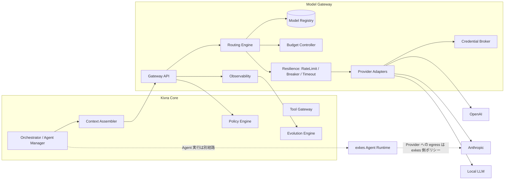
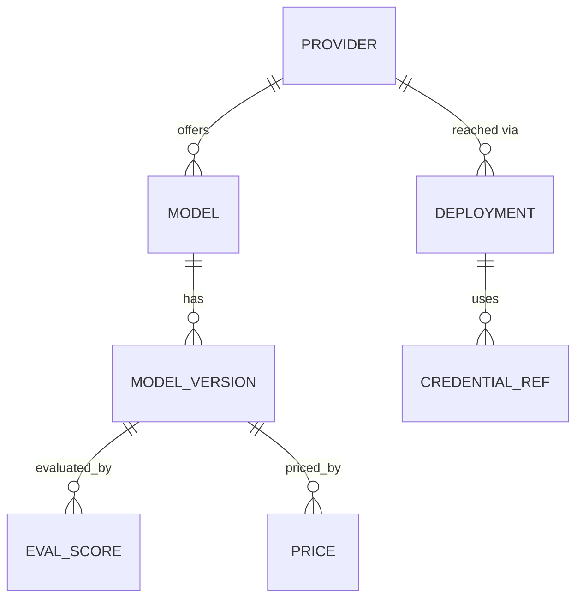
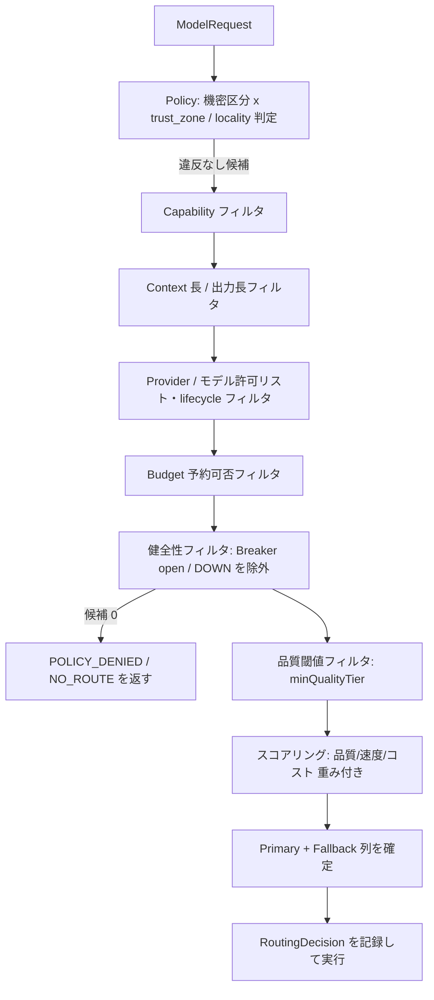

# 05. Model Gateway と LLM ルーティングの設計

- 対象 Issue: kigawa-net/kivra #5
- 関連 Issue: #1 (Core), #3 (Agent Manager), #4 (協調プロトコル), #6 (Memory / recl), #7-#9 (Dual Evolution / Self-Development), #10 (外部 API 契約), #11 (Execution Recovery)
- ステータス: 設計案 (Draft)
- 表記: **要確認** = 外部システムの実装・仕様をこの文書の作成時点で確認できていない事項。確認できたものだけを「確認済み事実」として記す。

## 0. 確認済み事実と前提

### 0.1 確認済み事実 (ローカル clone を読んだもの)

| 対象 | 事実 | 出典 |
|---|---|---|
| exkes | AI Agent や任意コマンドを Kubernetes 上の隔離環境で実行する Execution Runtime Platform。`ExecutionType` は `COMMAND` / `AGENT`(例: Claude Code) / `SYSTEM`。 | `kigawa-net/exkes/README.md`, `exkes-common/.../domain/Execution.kt` |
| exkes | Execution の状態は `QUEUED -> STARTING -> RUNNING -> SUCCEEDED / FAILED / CANCELLED / TIMED_OUT`。 | 同上 |
| exkes | Sandbox Plane は NetworkPolicy default-deny。外部 API (GitHub / Anthropic 等) の egress 許可リストは第3マイルストーン(計画)。Claude Code Agent Provider は第5マイルストーン(計画)。 | `docs/implementation-plan.md` 7.3 章、10 章 |
| exkes | 一時 credential のメタデータは `credentials` テーブル(第4MS 計画)、本体は K8s Secret / BWS。Sandbox から Control Plane・DB・K8s API への直接アクセスは禁止。 | 同上 |
| exkes | runtime-agent / Execution API / Agent Provider は現時点でスケルトンまたは未実装(README の状態欄)。 | `README.md` |
| 他 Issue | #6: Model Gateway は「取得したコンテキストをモデルの能力・予算・情報区分に合わせて構築」する側、Memory は recl を長期記憶に使う。#10: 外部 API 契約は Kivra 内部の抽象であり現行 API ではない。冪等キーを受け付けない API は Operation Journal で対処。 | Issue 本文 |

### 0.2 未確認 (要確認)

- **recl**: ローカルに clone が見つからなかった。API・データモデルは未確認。本設計は recl を「Memory Adapter (#6) の向こう側」として扱い、Model Gateway は recl に直接依存しない。
- **ai-scheduler**: ローカルに存在するが本 Issue の範囲外のため未精査。
- **exkes の Agent Provider が Claude Code の認証情報をどう扱うか**(OAuth / API Key / 組織課金)は未確認。
- 各 LLM Provider の現行 API 仕様・価格・レート制限は変動するため、本書は特定の数値を事実として記さない。Registry のデータとして実装時に取得・検証する。

## 1. 目的とスコープ

Kivra が「タスクの能力要件・品質・コスト・応答速度・データ取扱ポリシー」に基づき LLM の Provider / Model を選択し、呼び出す層 (Model Gateway) を定義する。

スコープ内: Direct LLM 呼び出し、Registry、Routing、Adapter、Budget、Observability、認証情報分離、Fallback、評価。
スコープ外: Agent の実行環境(exkes、#3/#1)、長期記憶の保存(#6)、タスク管理(#2)、メッセージ配送(#4)。

### 設計原則

1. **二つの実行経路を混ぜない**: Direct LLM(Model Gateway 経由)と Agent Runtime(exkes 経由)は別経路。
2. **必須制約は最適化より先**: 能力・機密・予算は「フィルタ(満たさなければ候補から除外)」であり、スコアで相殺しない。
3. **Fail closed**: 機密区分が不明、Registry が不明、ポリシー評価失敗の場合は外部送信しない。
4. **Gateway は副作用を持たない**: LLM は提案(Tool Call)を返すだけで、外部副作用の実行は Tool Gateway(#1)が担う。
5. **Agent 自身はルーティング制約・予算・Credential を変更できない**(#1 の権限昇格禁止と整合)。

## 2. コンポーネント構成



| コンポーネント | 責務 |
|---|---|
| Gateway API | ModelRequest 受付、検証、認可、ModelResponse / ModelEvent の返却、キャンセル。 |
| Model Registry | Provider / Model のメタデータ(§5)。 |
| Routing Engine | 制約フィルタ -> スコアリング -> 選択 -> Fallback 計画(§6)。 |
| Provider Adapter | Provider 固有 API と統一契約(§3)の変換。能力差の吸収と未対応の明示。 |
| Budget Controller | 予約・確定・解放方式の予算管理(§7)。 |
| Resilience | Rate Limit、Backoff、Circuit Breaker、タイムアウト(§8)。 |
| Credential Broker | Provider 別 Credential の保持と署名/注入(§9)。 |
| Observability | Tokens / コスト / Latency / Error / 選択根拠の記録(§10)。 |
| Context Assembler | #6 の Memory から取得したコンテキストを予算と区分に合わせて組み立てる。Gateway の外側(呼び出し側)。 |

## 3. 型と契約 (完了条件 1)

言語非依存の擬似 IDL(Kotlin 風)で示す。実装言語は #1 に従う(要確認: Kivra Core の言語)。

### 3.1 ModelProvider

```kotlin
interface ModelProvider {
    val providerId: ProviderId
    /** 利用可否・認証・クォータの軽量確認。課金を伴わない。 */
    suspend fun health(): ProviderHealth
    /** 取得可能なモデル一覧(Registry 同期用)。 */
    suspend fun listModels(): List<ProviderModelInfo>
    /** 一括応答。 */
    suspend fun invoke(req: ProviderRequest, ctx: CallContext): ModelResponse
    /** ストリーミング応答。キャンセルは Flow の cancel で伝播する。 */
    fun stream(req: ProviderRequest, ctx: CallContext): Flow<ModelEvent>
    /** 入力トークン概算(厳密でなくてよい。予算予約に使う)。 */
    fun estimateInputTokens(req: ProviderRequest): TokenEstimate
}
```

`ProviderRequest` は Routing 後に Adapter 用へ変換したもの。呼び出し側は Provider を意識せず `ModelRequest` だけを使う。

### 3.2 ModelRequest

```kotlin
data class ModelRequest(
    val requestId: String,          // 冪等キー兼トレース単位(§11)
    val taskId: String?,            // fusha-task / Kivra Task 参照
    val executionId: String?,       // #11 の実行世代識別
    val agentId: String?,
    val principal: Principal,       // ユーザー / Agent / システム。認可と予算の帰属先
    val purpose: Purpose,           // PLANNING / CODING / REVIEW / SUMMARIZE / CLASSIFY / EMBED ...
    val messages: List<Message>,    // role = system | user | assistant | tool
    val tools: List<ToolSpec> = emptyList(),
    val toolChoice: ToolChoice = Auto,
    val responseFormat: ResponseFormat = Text,   // Text | JsonSchema(schema)
    val generation: GenerationParams,            // maxOutputTokens, temperature, stopSequences ...
    val requirements: Requirements,              // 必須能力・最大レイテンシ等(§3.6)
    val dataClass: DataClass,                    // 機密区分(§9.1)。必須。省略不可
    val budget: BudgetRef,                       // 予算スコープ(§7)
    val preference: RoutingPreference,           // quality / speed / cost の重み。必須制約ではない
    val stream: Boolean,
    val deadline: Instant,                       // 絶対期限
    val cachePolicy: CachePolicy,                // §9.4
    val trace: TraceContext
)
data class Message(val role: Role, val parts: List<Part>)   // Part = Text | Image | ToolCall | ToolResult | ContextRef
```

- `dataClass` は呼び出し側が付与し、**Gateway は引き下げ(より緩い区分への変更)を行わない**。Context Assembler が混在コンテキストを組み立てる場合は最も厳しい区分を採用する。
- `ContextRef` は recl / GitHub / exkes 成果物への参照。Gateway は参照解決を行わず、解決済みのテキストのみを受け取る(参照解決は Context Assembler と権限チェックの責務。#4, #6 と整合)。

### 3.3 ModelResponse

```kotlin
data class ModelResponse(
    val requestId: String,
    val attemptId: String,                 // Fallback 時は試行ごとに異なる
    val selected: ModelRef,                // providerId + modelId + modelVersion(実際に応答したもの)
    val message: Message,                  // Text / ToolCall を含みうる
    val structured: JsonElement?,          // responseFormat=JsonSchema かつ検証成功時のみ
    val finishReason: FinishReason,        // STOP | LENGTH | TOOL_CALL | CONTENT_FILTER | CANCELLED | ERROR
    val usage: Usage,                      // inputTokens, outputTokens, cachedTokens, reasoningTokens?
    val cost: Cost,                        // amount + currency + basis(ACTUAL | ESTIMATED)
    val latency: Latency,                  // ttfb, total
    val routing: RoutingDecisionRef,       // 選択根拠の記録 ID(§6.6)
    val warnings: List<GatewayWarning>     // 未対応パラメータの無視、Fallback 発生等
)
```

### 3.4 ModelEvent (ストリーミング)

```kotlin
sealed interface ModelEvent {
    val requestId: String; val attemptId: String; val seq: Long   // 単調増加、欠落検出用
    data class Started(val selected: ModelRef, val routing: RoutingDecisionRef) : ModelEvent
    data class TextDelta(val text: String) : ModelEvent
    data class ToolCallDelta(val callId: String, val name: String?, val argsJsonDelta: String) : ModelEvent
    data class ToolCallCompleted(val callId: String, val name: String, val args: JsonElement) : ModelEvent
    data class UsageUpdate(val usage: Usage) : ModelEvent
    data class Warning(val warning: GatewayWarning) : ModelEvent
    /** Fallback で別 attempt に切り替わる。それまでの部分出力は破棄対象(§8.4)。 */
    data class AttemptReset(val reason: String, val nextAttemptId: String) : ModelEvent
    data class Completed(val response: ModelResponse) : ModelEvent
    data class Failed(val error: GatewayError) : ModelEvent
}
```

### 3.5 エラー分類

`GatewayError.kind` は Fallback 可否を決めるため分類必須。

| kind | 例 | 同一モデル再試行 | Fallback | 備考 |
|---|---|---|---|---|
| `RATE_LIMITED` | 429 | Retry-After に従う | 可 | Breaker に計上しない(別枠) |
| `TRANSIENT` | 5xx、接続断 | 可(Backoff) | 可 | |
| `TIMEOUT` | 期限超過 | 条件付き(§8.3) | 可 | 副作用なしの呼び出しのみ |
| `INVALID_REQUEST` | スキーマ違反、Context 超過 | 不可 | 不可(Context 超過のみ大窓モデルへ可) | 呼び出し側のバグ |
| `AUTH` | 認証失敗 | 不可 | 可(別 Provider) | アラート対象。Credential 疑義 |
| `CONTENT_FILTER` | 安全フィルタ | 不可 | 原則不可 | 回避目的の Fallback 禁止 |
| `POLICY_DENIED` | 機密・予算違反 | 不可 | 不可 | Gateway 内で発生 |
| `CAPABILITY_UNSUPPORTED` | 要求機能未対応 | 不可 | 能力を満たす別モデルのみ | §4 |
| `CANCELLED` | 呼び出し側の中止 | 不可 | 不可 | |
| `OUTPUT_INVALID` | 構造化出力が検証失敗 | 限定 1 回 | 可 | §3.7 |

### 3.6 Requirements

```kotlin
data class Requirements(
    val requiredCapabilities: Set<Capability>,   // 必須。欠けるモデルは除外
    val minContextTokens: Int?,                  // 入力+出力見込み
    val maxLatencyMs: Long?,                     // ttfb もしくは total を指定
    val minQualityTier: QualityTier?,            // purpose 別評価スコアの下限(§12)
    val allowedProviders: Set<ProviderId>?,      // 明示許可リスト(null = ポリシーに従う)
    val deniedProviders: Set<ProviderId> = emptySet(),
    val locality: Locality = ANY                 // ANY | LOCAL_ONLY | REGION(set)
)
```

### 3.7 構造化出力・Tool Call・キャンセルの契約

- **構造化出力**: `JsonSchema` を指定。ネイティブ対応モデルは Provider 機能を使い、未対応モデルは「スキーマ付きプロンプト + Gateway 側検証」にフォールバックし `GatewayWarning(EMULATED_STRUCTURED_OUTPUT)` を付ける。検証失敗は `OUTPUT_INVALID`。自動修復の再試行は最大 1 回(修復プロンプトは新 attempt、コストは同じ予算に計上)。
- **Tool Call**: Gateway は Tool を**実行しない**。モデルが返した ToolCall をそのまま返却する。引数は JSON Schema 検証し、不正なら `OUTPUT_INVALID`。実行は Tool Gateway(#1)が Policy Engine を通して行い、結果を次の ModelRequest に `ToolResult` として渡す。Tool の副作用の冪等性は §11。
- **ストリーミング**: `seq` 付き ModelEvent。ToolCall は `ToolCallCompleted` を受け取るまで実行してはならない(部分引数での実行禁止)。
- **キャンセル**: `cancel(requestId)` と呼び出し側 Flow の cancel の両方を提供。Gateway は Provider への HTTP 接続を閉じ、予約済み予算を解放し、実消費トークン(取得できた範囲)を確定する。キャンセル確認は at-least-once で冪等。Provider 側で課金が継続しうる点は Cost の basis を `ESTIMATED` とすることで表現する。

## 4. ModelCapabilities と未対応機能の扱い

```kotlin
enum class Capability {
    TEXT, VISION_INPUT, TOOL_CALLING, PARALLEL_TOOL_CALLS, STRUCTURED_OUTPUT_NATIVE,
    STREAMING, SYSTEM_PROMPT, LONG_CONTEXT, REASONING, PROMPT_CACHING, EMBEDDINGS, FILE_INPUT
}
data class ModelCapabilities(
    val supported: Set<Capability>,
    val contextWindowTokens: Int,
    val maxOutputTokens: Int,
    val limits: Map<String, Long>          // 画像枚数など Provider 固有上限
)
```

方針:

1. **必須能力が欠けるモデルは候補から除外**する。黙って機能を落とさない。
2. **任意機能(preference 扱い)**は、未対応なら無視し `GatewayWarning` を付ける。
3. **エミュレーション**(例: 構造化出力のプロンプト化)は Adapter が行ってよいが、必ず Warning と Registry 上の `emulated` フラグで明示し、ルーティング時に品質スコアを減点する。
4. Tool Calling を必須とするタスクを Tool 非対応(多くの Local LLM を想定)に流さない。能力は静的宣言だけでなく §12 の**能力プローブ**(定期テスト)で実測値により更新する。宣言と実測が食い違う場合は実測を採用。
5. 呼び出し結果が能力外の機能を要求した場合は `CAPABILITY_UNSUPPORTED`。

## 5. Model Registry (完了条件 3)

### 5.1 スキーマ



| テーブル | 主な列 |
|---|---|
| `provider` | `provider_id`, `kind`(`HOSTED_API` / `LOCAL`), `adapter`, `trust_zone`(`EXTERNAL` / `INTERNAL` / `LOCAL`), `data_handling`(学習利用有無・保持期間・地域などの**確認済み**条件と確認日・根拠 URL), `enabled` |
| `deployment` | `deployment_id`, `provider_id`, `endpoint`, `region`, `network_path`(直接 / egress プロキシ / クラスタ内), `credential_ref`, `status` |
| `model` | `model_id`(Kivra 内論理 ID), `provider_id`, `family`, `lifecycle`(`PREVIEW` / `ACTIVE` / `DEPRECATED` / `RETIRED`), `retire_at` |
| `model_version` | `provider_model_name`(Provider 側識別子), `snapshot_pinned`(bool), `capabilities`, `context_window`, `max_output`, `observed_at`, `source`(`MANUAL` / `PROVIDER_API` / `PROBE`) |
| `price` | `model_version_id`, `input_per_mtok`, `output_per_mtok`, `cached_input_per_mtok?`, `currency`, `valid_from`, `source_ref`(価格は時点付きで履歴保持) |
| `eval_score` | `model_version_id`, `purpose`, `suite_id`, `score`, `n`, `ci`, `measured_at`, `harness_version`(§12) |
| `availability` | `deployment_id`, `state`(`UP` / `DEGRADED` / `DOWN` / `UNKNOWN`), `observed_at`。Breaker 状態と同期 |
| `route_policy` | §6.2 |

`data_handling` と `price` は手入力が混ざるため、**Provider の契約・規約の確認者と確認日を必須列**にする(未確認の項目は `UNKNOWN`。`UNKNOWN` は機密 `INTERNAL` 以上のデータに対して不可として扱う)。

### 5.2 Provider 更新方針

- **Registry は Git 管理の宣言(YAML)を正本**とし、DB はそのキャッシュ + 動的状態(availability, probe 結果)とする。変更は PR 経由(#1 の「自己変更は原則 PR」と整合)。Evolution Engine(#7/#8)が提案しても、`data_handling`・`trust_zone`・`allowedProviders` の緩和は**人間承認必須**で自動マージ不可。
- **同期ジョブ**(定期): `listModels()` で新モデル・廃止を検出 -> 差分を Issue / PR として起票。新モデルは `PREVIEW` かつ **ルーティング対象外**で登録し、評価(§12)合格後に `ACTIVE` へ昇格(段階導入: カナリア比率 -> 全量)。
- **バージョン固定**: 本番ルートは可能な限りスナップショット固定の識別子を指す。エイリアス(`latest` 相当)は評価用に限定。固定できない Provider はエイリアス追従を検知するため、probe で挙動差分(§12.3)を監視する。
- **廃止追従**: `retire_at` の 30 日前(値は要調整)に警告、期日後は自動で候補除外。代替モデルへの移行は route_policy の差分 PR で行う。
- **価格変更**: `price` に `valid_from` 付きで追記。実コストが Registry 価格から乖離(例 >10%)したらアラート(Provider の請求/usage との照合は要確認: 各 Provider の API による)。
- **能力差分**: probe で宣言と実測が乖離したら `capabilities` を実測へ更新し差分を通知。

## 6. ルーティング・Fallback (完了条件 4)

### 6.1 決定手順



**B-G は必須制約(ハードフィルタ)**。H の品質閾値も未達は除外。スコアが効くのは I のみ。

### 6.2 ポリシーの優先順位

上位が下位を常に上書きする(下位は上位が許した範囲内でのみ有効)。

1. **セキュリティ・機密ポリシー**(組織固定。`dataClass` x `trust_zone`、`LOCAL_ONLY`)
2. **ユーザー/テナント明示ポリシー**(許可・拒否 Provider、地域)
3. **予算ポリシー**(hard limit)
4. **タスク要件**(`Requirements`)
5. **purpose 既定ルート**(`route_policy`)
6. **Evolution Engine による最適化**(重み・既定ルートの調整。1-4 は変更不可)
7. **呼び出し側の preference**(品質/速度/コスト重み)

競合時は同順位内で「より制限的な方」を採用する。評価結果が空集合ならエラーにし、制約を緩めて再試行することを**Gateway はしない**(緩和が必要なら呼び出し側がユーザー承認を得て新規リクエストを出す)。

### 6.3 route_policy の例

```yaml
policies:
  - id: coding-default
    match: { purpose: [CODING, REVIEW] }
    requires: [TOOL_CALLING, STRUCTURED_OUTPUT_NATIVE]
    min_quality: { suite: coding-v1, tier: A }
    weights: { quality: 0.6, latency: 0.1, cost: 0.3 }
    fallback: { max_attempts: 3, same_trust_zone_only: true }
  - id: secret-local-only
    match: { data_class: [RESTRICTED] }
    locality: LOCAL_ONLY
    fallback: { cross_provider: false }
```

### 6.4 スコアリング

`score = wq * norm(quality[purpose]) - wc * norm(expected_cost) - wl * norm(expected_latency)`。`quality` は §12 の purpose 別評価(信頼区間の下限を使い、サンプル不足のモデルは減点)。`expected_cost` は入力トークン概算 + `maxOutputTokens` 見込みで算出。同点は決定的に(安定ソート: コスト -> モデル ID)選ぶ。探索(新モデルへの少量割当)は Evolution Engine が `PREVIEW` カナリアとして管理し、機密 `INTERNAL` 以上のリクエストには適用しない。

### 6.5 Fallback 条件

- 発動: §3.5 表で「Fallback 可」のエラー、または Breaker open。
- **Fallback 先も同じハードフィルタを再評価**する(機密・予算・能力は緩和しない)。Primary 選定時に Fallback 列を確定し、`same_trust_zone_only` が既定。より外部寄りの `trust_zone` への Fallback は禁止(Local -> External は不可、External -> Local は可)。
- 最大試行回数(既定 3)と総 deadline を共有。残り時間が当該モデルの p95 レイテンシ未満なら試行しない。
- 品質が下がる Fallback は `warnings` に記録し、purpose によっては拒否(`fallback.min_quality`)。
- ストリーミング中の失敗: テキスト出力が既に呼び出し側へ出ている場合、既定では**Fallback せず Failed を返す**(`AttemptReset` で破棄できるのは呼び出し側が「部分出力を確定扱いしない」と宣言した場合のみ)。ToolCall が既に完了通知済みなら Fallback しない(§11)。

### 6.6 選択根拠の記録 (RoutingDecision)

```kotlin
data class RoutingDecision(
    val decisionId: String, val requestId: String, val policyVersion: String, val registryVersion: String,
    val candidates: List<CandidateTrace>,    // 各候補: 通過 or 除外理由(コード) / スコア内訳
    val selected: List<ModelRef>,            // Primary + Fallback 順
    val inputsHash: String                   // 機密本文は含めない。要件・区分・重みのみ
)
```

再現性のため `policyVersion` と `registryVersion` を固定参照する。

## 7. 予算制御 (Budget Controller)

### 7.1 スコープ

階層: `組織 > ユーザー > プロジェクト > タスク > Agent(executionId)`。各階層に `soft` / `hard` 上限と期間(日/月/タスク単位)を持つ。下位は上位の残枠内でのみ有効。単位は金額を基本とし、トークン上限・リクエスト数上限を併用可。

### 7.2 予約・確定・解放

1. 呼び出し前に**予約**(入力概算 + maxOutputTokens x 単価の上限見積もり)を全階層で原子的に取る。失敗なら `POLICY_DENIED(BUDGET)`。
2. 完了時に実績で**確定**、差額を解放。キャンセル・失敗時も取得できた usage で確定、不明なら予約額を保守的に確定し `ESTIMATED` と記録。
3. `soft` 超過: 警告イベントを発行し、ルーティングで「低コスト優先」へ重みを寄せる(必須制約は変えない)。`hard` 超過: 拒否。
4. 予約は TTL 付き(Gateway クラッシュ時に自動解放)。二重確定は `requestId` / `attemptId` で冪等(#11 の方針)。
5. Agent 起因の暴走(ループ)対策として、`executionId` あたりのリクエスト数/分とコスト/時間の上限を別途設ける。Agent が自分の上限を引き上げる手段は提供しない。

### 7.3 Direct LLM と exkes の予算関係

exkes 上の Agent(Claude Code 等)が消費する LLM コストは Model Gateway を経由しないため、Gateway の Budget Controller では**直接は計測できない**。扱い:

- Agent 実行に対し、Orchestrator(#3)が「実行時間・回数」ベースの上限を課す。
- Agent が使う Credential が Kivra 管理なら、Provider 側の usage を取り込む `AgentUsageReport` を Observability に加える(要確認: exkes の Agent Provider が usage を返せるか、Provider 側 usage API の有無)。
- 取り込めない間は「Agent 実行 1 回あたりの推定上限」を予約として計上する。

## 8. Rate Limit・Backoff・Circuit Breaker・タイムアウト

### 8.1 Rate Limit

- 二層: (a) **Provider/Deployment 単位**(Provider のレート上限を超えないための client 側トークンバケット。RPM/TPM。値は Registry に持つ、数値は要確認)、(b) **Principal 単位**(公平性。1 Agent が全枠を占有しない)。
- 429 を受けたら `Retry-After` を尊重し、該当 Deployment の送出レートを一時的に下げる(AIMD)。枠不足は即時エラーではなくキュー待機(deadline 内、優先度: ユーザー対話 > 実行中タスク > バッチ/評価)。

### 8.2 Backoff

指数 Backoff + Full Jitter。初期 〜500ms、上限 〜20s、同一モデル再試行は最大 2 回(値は初期案)。総 deadline を超える待機はしない。

### 8.3 タイムアウト

- `connect`、`ttfb`(最初のトークンまで)、`idle`(ストリーム無通信)、`total`(deadline)を別々に持つ。
- タイムアウト時の再試行は、**課金済み・処理継続中の可能性**があるため、副作用のない(Tool を実行しない)呼び出しに限る。ストリーミングで ToolCall 完了通知後のタイムアウトは再試行しない。

### 8.4 Circuit Breaker

Deployment 単位。`CLOSED -> OPEN -> HALF_OPEN`。直近窓の失敗率/連続失敗(`TRANSIENT`・`TIMEOUT`・`AUTH`。`RATE_LIMITED` と `INVALID_REQUEST` は除く)で OPEN、一定時間後 HALF_OPEN で少数の probe 要求のみ通す。状態は Registry の `availability` に反映。複数 Gateway インスタンス間の状態共有方式は要確認(MVP は各インスタンス独立 + 共有ストアでの緩やかな集約)。

## 9. セキュリティ・権限・監査 (完了条件 5)

### 9.1 機密区分と送信ルール

区分は #1/#6 の情報区分と合わせる(**要確認**: #1/#6 で区分の正式名称が確定したら置換)。本書の暫定:

| dataClass | 例 | 送信可能な trust_zone | 備考 |
|---|---|---|---|
| `PUBLIC` | 公開 OSS コード、公開文書 | EXTERNAL / INTERNAL / LOCAL | |
| `INTERNAL` | 非公開リポジトリ、設計文書、タスク内容 | `data_handling` が確認済みの EXTERNAL、INTERNAL、LOCAL | `data_handling=UNKNOWN` の Provider は不可 |
| `RESTRICTED` | 個人情報、顧客データ、顧客固有の機密 | LOCAL のみ(`LOCAL_ONLY`) | Fallback でも外部不可 |
| `SECRET` | 認証情報・鍵・トークン | **どの Provider にも送信しない** | 検出時はブロックし監査 |

- 区分の付与は Context Assembler が**参照元の区分から機械的に伝播**する(最大値)。Agent やモデル出力が区分を下げることはできない。
- **送信前スキャン**: Gateway 側で Secret 検出(既知トークン形式・高エントロピー文字列・Kivra が管理する Credential 値との一致)を行い、検出時は `POLICY_DENIED`。検出器は誤検知より見逃しを重く見て保守的に設定する。ただし検出は多層防御の一つであり、主防御は区分伝播と最小化。
- **最小化**: Context Assembler(#6)が取得したコンテキストのうち、タスクに必要な部分のみを渡す。ファイル全体ではなく該当箇所、機密値のマスキング(`[REDACTED:ref]`)。Gateway は `ContextRef` の解決をしないため、参照を実体化する層で権限チェックされる。
- **プロンプトインジェクション**: Retrieval / Tool 結果は `data` として明確に区切って渡す(命令との混同防止)。モデル出力の Tool Call は Policy Engine の再認可を必ず通す(Gateway は Tool 実行権限を持たない)。

### 9.2 認証情報管理と権限分離

- Provider Credential は **Credential Broker のみ**が保持(保管先は Kivra の Secret 基盤。本ワークスペースでは Bitwarden Secrets Manager + K8s Secret の運用例があるが、Kivra での採用は要確認)。Orchestrator・Agent・Evolution Engine には渡さない。
- **Provider ごとに別 Credential**、さらに環境(stg/本番)・用途(通常/評価)別に分ける。評価ジョブは別 Credential と別予算で、本番枠を消費しない。
- Gateway の ServiceAccount は Provider Secret の read のみ。Registry・Policy の書き込み権限と分離(Policy 変更は PR 経路)。
- ローテーション: Credential は参照名(`credential_ref`)経由で取得し、ローテーション時に再起動不要。失効検知は `AUTH` エラー + アラート。
- **Direct LLM の Credential は exkes Sandbox に渡さない**。ログ・トレース・エラーメッセージへの Credential 混入を禁止(ログ書き出し前にマスク)。

### 9.3 監査・トレース

- 全リクエストで記録: `requestId, attemptId, taskId, executionId, principal, purpose, dataClass, selected model/version, routing decision ID, usage, cost, latency, finishReason, error kind`。W3C Trace Context 互換の trace を #4 のメッセージ(`correlationId`/Trace ID)と連結。
- **プロンプト・応答の本文は既定で保存しない**(メタデータのみ)。デバッグ用の本文保存は `INTERNAL` 以下に限り、短い保持期間と明示的なフラグ、アクセス監査付きで許可。`RESTRICTED` / `SECRET` 相当は本文を保存しない。
- ポリシー拒否・Secret 検出・区分違反・Fallback・Registry/Policy 変更は監査イベントとして**追記専用**ログに記録。Agent から改変不可。

### 9.4 キャッシュポリシー

| 種別 | 方針 |
|---|---|
| Provider 側 Prompt Caching | 能力として利用可。`PROMPT_CACHING` 対応モデルで、共通プレフィックスを安定化(システム指示・ツール定義を先頭に固定)。`data_handling` で保持が許容される場合のみ。 |
| Gateway 側応答キャッシュ | 既定は**無効**。有効化できるのは `temperature=0` 相当の決定的な `purpose`(分類・埋め込み等)かつ `dataClass<=INTERNAL`。キー = `hash(model_version, messages, tools, params, principal の tenant)` で、**テナントを跨いで共有しない**。TTL 短め。Tool Call を含む応答はキャッシュしない。 |
| 埋め込み | 同一テキスト・同一モデルバージョンでキャッシュ可。モデル更新で無効化。 |
| 無効化 | モデルバージョン変更、`dataClass` 変更、元データの削除伝播(#6 の削除要求)で無効化。 |

## 10. Observability

メトリクス(Prometheus 等を想定。基盤は要確認):

- `model_requests_total{provider,model,purpose,outcome,error_kind}`
- `model_tokens_total{direction=input|output|cached,model,purpose}`
- `model_cost_total{provider,model,scope=task|agent|user,basis=actual|estimated}`
- `model_latency_seconds{phase=ttfb|total}` (ヒストグラム)
- `model_fallback_total{from,to,reason}`、`model_breaker_state`、`model_budget_utilization{scope}`、`model_route_rejected_total{reason}`
- 品質: 後述 §12 のオンライン信号(再試行率、`OUTPUT_INVALID` 率、人手の差し戻し率、PR レビュー通過率など)

選択根拠は §6.6 の RoutingDecision で参照可能。ダッシュボードは「コスト/品質/レイテンシの purpose 別比較」「Fallback 率」「予算消化」を最低限含む。Evolution Engine は集計結果(本文ではなく集計値)のみを入力とする。

## 11. 外部副作用の重複実行防止

Model Gateway 自体は副作用(外部システムの変更)を持たない。ただし LLM 呼び出しは**再試行・Fallback で複数回実行されうる**ため、以下を設計上の規則とする(#10, #11 の Operation Journal と整合)。

1. **Tool Call は Gateway 内で実行しない**。実行は Tool Gateway で、`(executionId, toolCallId)` から決定的に導く冪等キーを付けて Operation Journal に記録してから行う。
2. モデルが同じ Tool Call を Fallback・再試行で重複生成しても、Tool Gateway が同一 `(executionId, step, 引数ハッシュ)` を重複扱いにして**結果を再利用**する(再実行しない)。冪等キーを受け付けない外部 API(例: GitHub)は #10 の方針どおり、既存オブジェクトの照合で対処する。
3. **ToolCall 完了通知を出した attempt は確定**とし、以降その requestId で別モデルへ Fallback して Tool Call を再生成しない(再生成が必要なら呼び出し側が新しい step として発行)。
4. `requestId` を冪等キーとして Gateway で受け付ける: 同一 requestId の再送は進行中ならその結果に合流、完了済みなら保存済み応答メタデータを返す(本文の再配信が必要なら再生成になるため、呼び出し側は新 requestId を使う)。
5. Orchestrator 再起動・実行権の移動(#11 のフェンシング)後に古い世代の `executionId` から来たリクエストは拒否する(`executionId` の世代検証。実現方法は #11 に依存、要確認)。

## 12. 評価方法と継続的改善 (完了条件 6)

### 12.1 オフライン評価

- purpose 別の評価スイート(例: coding / review / planning / summarization / tool-use / structured-output)を Git 管理し、`harness_version` を付ける。各モデルバージョンについて実行し、`eval_score` に平均・件数・信頼区間を記録する。
- 指標: 正答/合格率(自動検証可能なもの: テスト通過、スキーマ適合、Tool 引数正当性)、Tool Call 正確性、指示遵守、レイテンシ、トークン効率、コスト。LLM-as-judge を使う場合は評価者モデルと被評価モデルを分け、人手サンプリングで較正する。
- **能力プローブ**: 宣言された能力(Tool Calling、構造化出力、長文脈)が実際に動くかを小さなテストで定期確認。
- 評価データに `RESTRICTED` 相当を含めない。評価専用 Credential・予算で実行(§9.2)。

### 12.2 オンライン評価

- 実トラフィックでのシグナル: `OUTPUT_INVALID` 率、再試行率、Reviewer(#3)による差し戻し率、PR の CI 通過率・マージ率、ユーザーの明示フィードバック。
- 新モデル/新ポリシーは**シャドウ(出力を使わず並走比較)**または**カナリア(少量割当)**で比較し、品質・コスト・レイテンシが基準を満たしたものだけ昇格。シャドウは別途コストがかかるため `PUBLIC` かつ予算上限付きに限る(`INTERNAL` 以上のデータをシャドウで追加送信しない)。

### 12.3 Evolution Engine によるポリシー改善

- 入力: §10 の集計値、評価結果。出力: `route_policy` の重み・既定モデル・Fallback 順の**変更提案 PR**。
- 変更可能範囲は §6.2 の優先順位 6 以下に限る。機密区分・trust_zone・許可リスト・予算上限・Credential の変更は不可(人間承認の別経路)。自動適用は評価基準を満たす場合のカナリアまでとし、全量反映は #7-#9 のリリース手順(ポリシー評価・承認)に従う。
- 変更は `policyVersion` を更新し、直前版へ即時ロールバック可能にする。
- モデル挙動の黙示的変更(エイリアス追従等)は、固定プローブセットの出力差分(スキーマ適合率・スコアの有意な低下)で検知し、自動で該当モデルのカナリア比率を 0 に戻してアラート。

## 13. Direct LLM と exkes Agent Runtime の境界 (完了条件 2)

```mermaid
flowchart LR
  subgraph "Direct LLM 経路"
    C1[Orchestrator / Planner / Reviewer 等] -->|ModelRequest| MG[Model Gateway]
    MG -->|ModelResponse / ModelEvent| C1
    MG --> LLM[LLM Provider]
  end
  subgraph "Agent Runtime 経路"
    C2[Agent Manager] -->|createWorkspace / startAgent 等 (#10 の抽象契約)| EX[exkes]
    EX --> SB[Sandbox: Claude Code 等]
    SB -.->|Sandbox の egress ポリシーの範囲で| LLM2[Agent 自身が使う LLM]
  end
```

| 観点 | Direct LLM(Model Gateway) | Agent Runtime(exkes) |
|---|---|---|
| 目的 | 1 回〜少数回の推論(計画、要約、分類、レビュー等) | 長時間・多ステップ・ファイル/コマンド操作を伴う自律作業 |
| 実行主体 | Gateway が Provider を直接呼ぶ | exkes の Sandbox 内の Agent プロセス(Claude Code 等) |
| モデル選択 | **Kivra の Routing Engine が選ぶ** | **Agent 実装が持つ**(Provider 固定。Kivra が選べるのは Agent Profile の種類・設定まで。要確認: exkes の Agent Provider がモデル指定を受け付けるか) |
| Tool 実行 | 実行しない(Tool Call を返すのみ) | Agent が Sandbox 内で実行。外部副作用は Tool Gateway 経由のみ許可(#1) |
| 認証情報 | Credential Broker(Gateway のみ) | Sandbox 用の**別の一時 Credential**(exkes の `credentials`)。Gateway の Credential と共有しない |
| ネットワーク | Gateway から Provider へ | Sandbox は default-deny、許可リスト(第3MS 計画)で必要な Provider エンドポイントのみ |
| 予算/計測 | Budget Controller と Observability が直接計測 | 実行時間・回数の上限 + 取り込める範囲の usage(§7.3) |
| 状態 | ステートレス(会話状態は呼び出し側が保持) | Execution の状態遷移(`QUEUED`…`TIMED_OUT`)を exkes が保持 |

### 境界ルール

1. **Claude Code 等の CLI Agent は LLM Provider として Registry に登録しない**。Agent は `ModelProvider` 契約(§3.1)を実装せず、Agent Profile / Execution Spec(#3)として扱う。
2. Agent から Gateway を使いたい場合(Agent が Kivra 管理のモデルを呼ぶ場合)は、Sandbox から Gateway API を呼ぶ**別クライアントとして認証・認可**する(Agent 用の短命トークン、`executionId` と予算スコープに束縛)。Sandbox から Control Plane への直接アクセス禁止(exkes の確認済み方針)と整合させるため、このための入口(ゲートウェイ越しの専用 egress)が必要。実現方式は要確認。
3. Agent Runtime の出力を Direct LLM の入力にする場合(例: Reviewer モデルに差分を渡す)は、Context Assembler を通し、区分・権限・最小化を再適用する(Agent の成果物は参照 ID で渡す: #4)。
4. どちらの経路を使うかは Orchestrator(#3)がタスク特性で決める。判断基準: ファイル/コマンド/ブラウザ操作・長い自律ループが必要 -> Agent Runtime。それ以外 -> Direct LLM。
5. 予算・監査・Trace ID は両経路で共通の `taskId` / `executionId` / `correlationId` により結合できるようにする。

## 14. 失敗モードと対処(要約)

| 失敗 | 対処 |
|---|---|
| Provider 障害 | Breaker で除外、同 trust_zone 内の Fallback |
| 全候補が機密制約で 0 件 | `NO_ROUTE`。制約緩和はしない。ユーザーへエスカレーション |
| 予算超過 | 拒否。soft 超過は低コスト寄せ |
| Gateway クラッシュ | 予約 TTL で自動解放、requestId による冪等再送 |
| モデル廃止/黙示変更 | §5.2 の追従と §12.3 の検知 |
| 構造化出力崩れ | 最大 1 回の修復再試行後 Fallback |
| Credential 漏洩疑い | 即時失効(`enabled=false`)、ローテーション、監査ログで影響範囲特定 |

## 15. 実装 Issue 分割案 (完了条件 6)

MVP は「外部 Provider 1 つ + 必須制約ルーティング + 予算 + 監査」を最短で通す。

| # | Issue 案 | 内容 | 依存 |
|---|---|---|---|
| A | Gateway 型・契約の確定とライブラリ化 | §3 の型、エラー分類、JSON Schema、契約テスト | #1 の言語決定 |
| B | Provider Adapter 基盤 + 1 Provider 実装 | ストリーミング/キャンセル/Tool Call/構造化出力の変換、Adapter 共通テスト(コンフォーマンススイート) | A |
| C | Model Registry(YAML 正本 + DB キャッシュ + 同期ジョブ) | §5 のスキーマ、PR 運用、lifecycle | A |
| D | Routing Engine(ハードフィルタ + スコアリング + RoutingDecision) | §6 | A, C |
| E | 機密区分ポリシー評価 + Secret スキャン | §9.1。Policy Engine(#1)連携 | D |
| F | Budget Controller | §7 予約/確定/解放、階層 | A |
| G | Resilience(Rate Limit / Backoff / Breaker / Timeout) | §8 | B |
| H | Credential Broker と権限分離 | §9.2 (保管基盤の選定が前提) | B |
| I | Observability と監査ログ | §10、§9.3 | A |
| J | 2 つ目以降の Provider(別系統 + Local LLM) | 能力差・Fallback の実地検証 | B, D |
| K | 評価ハーネス + 能力プローブ | §12.1 | C |
| L | キャッシュポリシー実装 | §9.4 | D, E |
| M | Agent 用 Gateway 入口(Sandbox からの利用) | §13 ルール 2。exkes 側の egress 設計との調整 | H, exkes 側 |
| N | Evolution Engine 連携(ポリシー改善 PR、カナリア/シャドウ) | §12.2-12.3 | I, K, #7/#8 |
| O | Agent 経路の usage 取り込み | §7.3。exkes の Agent Provider 仕様が前提 | exkes 側 |

推奨順序: A -> (B, C 並行) -> D -> (E, F, I) -> G, H -> J -> K -> L -> (M, N, O)。

## 16. 要確認事項・未解決論点

### 要確認(外部事実・他 Issue 依存)
1. recl の API/データモデル(#6 の Memory Adapter 確定待ち。本書は直接依存しない設計)。
2. exkes の Agent Provider(第5MS 計画)が: モデル指定を受け付けるか、Credential の渡し方、usage の取得可否。
3. Kivra Core の実装言語・Policy Engine・Tool Gateway の API(#1)。型定義の言語確定に影響。
4. 機密区分の正式名称と Context 区分の伝播規則(#1/#6)。
5. Sandbox から Gateway への専用 egress 経路の実現方式(exkes の NetworkPolicy 許可リストの設計と整合)。
6. 各 Provider のレート上限・価格・データ取扱条件・Prompt Caching 仕様・モデル廃止ポリシー(変動するため Registry 作成時に一次情報で確認)。
7. Provider 側 usage/請求 API による実コスト照合が可能か。
8. メトリクス/トレース基盤(Prometheus/OTel 等)の採用有無。
9. Credential 保管基盤(Kivra で何を使うか)。
10. 複数 Gateway インスタンス間での Breaker・予算・レート状態の共有方式(MVP は単一インスタンス前提でよいか)。
11. #11 の実行世代/フェンシングを `executionId` 検証にどう接続するか。

### 未解決論点(意思決定が必要)
1. **Local LLM の位置づけ**: `RESTRICTED` を扱うため必須とするか、MVP では `RESTRICTED` を扱わない(外部不可 = 処理しない)と割り切るか。推論基盤(GPU 有無)は未調査。
2. **Fallback の品質下限**: purpose ごとにどこまで品質低下を許すか(既定値の決定)。
3. **シャドウ評価のコスト/データ方針**: `PUBLIC` 限定で十分か。
4. **Agent 経路のコスト計測**: 取り込み不能時に推定上限予約で運用してよいか。
5. **Gateway を独立サービスにするか、Core 内ライブラリにするか**: 本書は論理設計で、デプロイ形態は未決(Credential 分離の観点では独立サービスが有利だが運用コスト増)。
6. **ストリーミング中の部分出力と Fallback**: §6.5 の既定(部分出力後は Fallback しない)で良いか。
