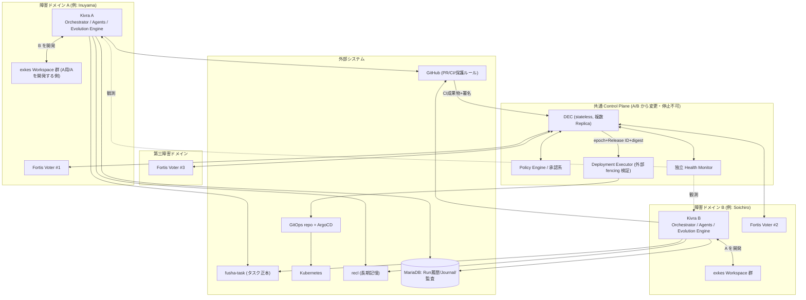
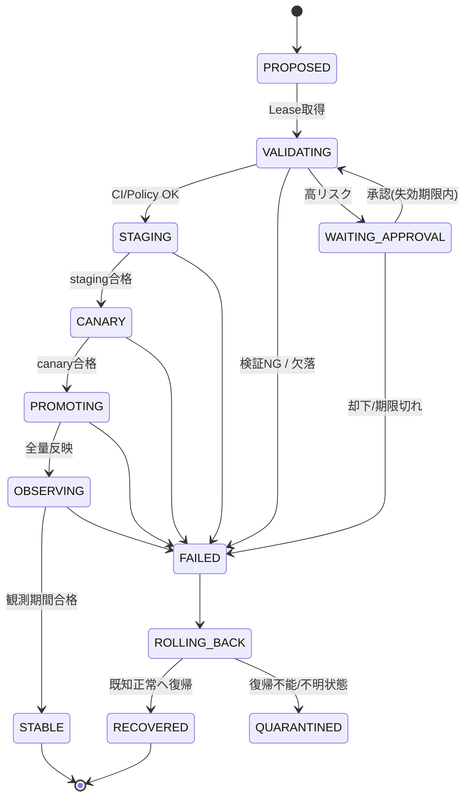

# 07. Dual Evolution Architecture: 二系統相互自己開発と自動デプロイ

- 対応 Issue: kigawa-net/kivra#7
- 状態: 設計ドラフト
- 関連: #1 Core / #2 fusha-task / #3 Agent Manager / #4 Agent協調 / #5 Model Gateway / #6 Memory / #8 DEC詳細 / #9 Pipeline / #10 Runtime・API契約 / #11 分散整合性 / #12 Fortis統合

本書は Kivra を二つの独立系統 (A/B) として運用し、互いを開発・検証・デプロイする構造の **上位アーキテクチャ** を定める。
DEC (Dual Evolution Controller) の詳細アルゴリズムは #8、パイプライン詳細は #9、永続化・API は #10、分散整合性は #11、Fortis 配置は #12 で扱い、本書はそれらが従う不変条件と境界を固定する。

## 0. 事実確認の範囲と表記

| 表記 | 意味 |
|---|---|
| (確認済) | ローカル clone を読んで確認した事実 |
| (Issue) | 関連 Issue 本文に書かれた設計方針。実装は未確認 |
| (要確認) | 現時点で確認できていない。実装前に調査必須 |

確認できた外部システム (2026-10-12 時点のローカル clone):

- **exkes** (`kigawa-net/exkes`): Workspace 実行基盤。`exkes-api` は K8s API を呼ばず desired state のみ書き、`exkes-controller` が K8s 権限を持つ唯一のプロセス。Control Plane と Sandbox Plane は別 namespace (`platform-exkes-{stg,main}` / `-sandbox`) (確認済)。ただし README 上 `runtime-agent` と terminal-gateway はスケルトン。Execution API は未提供 (確認済)。
- **Fortis** (`kigawa-net/fortis`): Raft + MVCC の強整合 KV。単一キーは linearizable、可用性は CP。`RaftRuntime.propose / linearizableRead` が実装済み (確認済)。一方 **Leader Election / Session / Lease / Fencing Token / Release Lock といった Coordination API は docs/architecture.md・roadmap.md に記載がなく、現状存在しない** (確認済: 記載なし)。Range Sharding の Runtime 配線、Transaction、Meta の複製は将来課題または非本番 (確認済)。エッジ対応は fortis#27 (Issue #12 の記述。未確認)。
- **fusha-task / recl / ai-scheduler**: 本書の範囲では API 詳細を読んでいない。(要確認) #2 / #6 で調査する。recl は Issue #6 でも「現行実装・API の存在は未確認」とされている。

## 1. 目的と非目標

目的:

1. A/B を同時に Active で運用し、A が B の、B が A のソフトウェアを開発する。
2. 低リスク変更は人手なしで本番まで反映する。ただし昇格判断は変更者・被変更者から独立した DEC が行う。
3. 同一原因による A/B 同時故障 (共有コード、共通依存、設定、共通 DB) を設計上防ぐ。
4. 両系統が故障しても、既知正常版へ戻れる独立した復旧経路を保つ。

非目標:

- DEC の詳細アルゴリズム (#8)、DevelopmentRun の状態機械・DBスキーマ (#9/#10)、Fortis 内部実装 (fortis リポジトリ側) は扱わない。
- 「全世界 exactly-once」は主張しない (#11 に従い、曖昧な副作用は照合・停止を優先)。

## 2. 設計の不変条件 (Invariants)

以降の全設計はこれらを破ってはならない。

| ID | 不変条件 |
|---|---|
| INV-1 | 系統 X は自分自身への本番昇格を承認・実行できない。X の改変案は X が提案できても、X を対象とする Release は他方 Y が開発し、DEC が昇格する。 |
| INV-2 | 本番昇格の権限は DEC のみが持つ。A/B の Service Account はデプロイ権限・GitOps 書込権限を持たない。 |
| INV-3 | 本番に影響する更新は常に最大1件 (グローバル Release Lease)。更新対象でない側が安定していることが開始条件。 |
| INV-4 | 昇格根拠は信頼できる CI 成果物・独立 Policy 判定・独立観測のみ。Agent 報告、PR 説明、相手系統の監視結果は根拠にしない。 |
| INV-5 | 判定に必要な値が欠落・不明・取得不能ならば fail-closed (昇格しない / 新規更新を止める)。既存サービスは維持。 |
| INV-6 | A/B から変更・停止できない共通 Control Plane (§4.3) が存在する。 |
| INV-7 | 高リスク変更 (Policy・認証認可・Secret・基盤・DEC 自身・共通 DB) は独立した人間承認なしに自動適用しない。 |
| INV-8 | 全リリースは immutable な artifact digest で固定し、ロールバック先も既知正常 digest で固定する。 |
| INV-9 | 外部副作用は冪等キー・実行世代 (fencing) を持つ。旧世代の実行は実行側で拒否される。 |

## 3. デプロイ構成と信頼境界

### 3.1 全体構成



(Issue #12 の配置案を踏襲した例示。最終配置は RTT とリソースで決定 = 要確認)

### 3.2 信頼境界と権限

| 主体 | 信頼 | 許可 | 禁止 |
|---|---|---|---|
| Kivra A / B (Agent含む) | 低〜中 (AI生成物は未検証入力) | fusha-task 更新(最小権限)、exkes Workspace 作成(自系統の開発用)、対象リポジトリへの PR 作成、recl 読書 | デプロイ、GitOps 書込、Policy/承認/Secret 変更、自系統への昇格、DEC 操作 (Release 要求の提出を除く) |
| DEC | 高 | Release 状態遷移、GitOps への digest 反映要求、Rollback、Quarantine | 昇格根拠の自己生成、Policy 自己変更、コード変更 |
| Policy Engine / 承認系 | 最高 (DEC 外に保護) | リスク分類、承認結果発行 | AI からの書込 |
| 独立 Health Monitor | 高 | 両系統と共通依存の観測 | 系統自身の自己申告を入力にしない |
| Deployment Executor | 高 | GitOps/K8s への適用 | 旧 epoch / 未署名 Release ID の実行 |
| 人間承認者 | 最高 | 高リスク承認、break-glass | - |

### 3.3 A/B の ID・権限・データ境界

- **ID / Service Account**: 系統ごとに別 SA (`kivra-a`, `kivra-b` の名称は仮)。DEC / Executor / Monitor はさらに別の SA で、A/B の SA とは namespace・RBAC・Secret ストアを共有しない。GitHub は系統ごと・役割ごと (PR作成 / DEC用CI検証) に別の Bot/App ID。
- **Workspace 境界**: exkes の Workspace は `(developer系統, target系統, runId)` で払い出す。X が Y を開発する Workspace に X の本番 Secret や X のデプロイ資格情報を持ち込まない。exkes 側の Sandbox/NetworkPolicy 分離 (確認済) を前提とするが、「呼び出し元系統ごとの Workspace 認可」が exkes に既存かは (要確認)。
- **データ境界**: 各系統は自系統の作業データ (Working Memory、チェックポイント) を持つ。共有するのは fusha-task / recl / MariaDB / Fortis 等の共通基盤のみで、これらは §6 の「共有コンポーネント」として更新制約を受ける。recl への書込は系統名の provenance を付与し、A が書いた記憶を B が無批判に事実扱いしない (Prompt Injection 対策、#6 に従う)。

## 4. 責務分担

### 4.1 サービス別正本 (Issue #8–#12 と整合)

| 対象 | 正本 |
|---|---|
| タスク定義・依存・進捗 | fusha-task (target/executor/release 等の追加メタは Kivra 側で紐づけ) |
| Workspace / Execution | exkes |
| PR / Commit / CI / Merge | GitHub |
| 本番 Release 状態・Production Release Lease・Fencing・DEC Leader | Fortis (DEC は Fortis の Coordination クライアント。Issue #8 確定事項) |
| DevelopmentRun 詳細・Operation Journal・Outbox・監査 | MariaDB (#11) |
| 長期記憶・改善根拠・設計判断 | recl |
| デプロイ実体 | GitOps repo / Kubernetes (Release 状態との照合対象) |

注: Release 状態の **正本は Fortis、責務主体は DEC** (DEC の RAM はキャッシュ) で確定。#8 / #12 と同じ表現に揃え、#10 もこれに合わせて修正する (U-1 解決済)。DEC はローカル DB を持たず、Journal 等の MariaDB 書込は Recorder 経由または専用 Audit Sink を通す (#8/#11/#12)。

### 4.2 Kivra 内の責務 (Evolution Engine との関係: 必須項目12)

Evolution Engine は **改善の発見・提案・実装計画・開発担当割当の提案** までを担い、昇格・排他・ロールバックは担わない。Issue #6 は Memory 設計であり、Issue 本文に「Evolution Engine の定義」は含まれていない。Evolution Engine の正式定義の参照先は **#9 (Self-Development Pipeline)** とする (#7 の旧記述「Issue #6に定義するEvolution Engine」は #9 に読み替える。U-2 解決済)。

| 責務 | Evolution Engine | Orchestrator (#3) | DEC (#8) |
|---|---|---|---|
| 改善候補の発見・優先度付け | ○ | - | - |
| fusha-task へのタスク起票・計画 | ○ (#2 Adapter経由) | ○ | - |
| 開発担当/対象系統の決定 | 提案 | 実行 | 検証 (INV-1 違反は拒否) |
| 実装・テスト・レビューの実行 | 指示 | ○ (Agent起動) | - |
| リスク分類 | 申告のみ (参考値) | - | 独立再計算 (確定) |
| 昇格・Rollback | ✕ | ✕ | ○ |
| 経験の recl 保存 | ○ | ○ | 結果通知のみ |

### 4.3 共通 Control Plane と「A/B から変更・停止できない」仕組み (必須項目11)

共通 Control Plane = DEC、Policy Engine、承認系、独立 Health Monitor、Deployment Executor、Fortis。

1. **別リポジトリ・別保護ルール**: Control Plane コードは A/B が開発する Kivra 本体リポジトリと分離し、変更は常に高リスク (人間承認必須)。A/B の Bot に Write 権限を与えない (PR 作成のみ可能な場合も承認不可)。
2. **別 namespace・別 RBAC・別 SA**: A/B の SA は Control Plane namespace に対する RBAC を持たない。NetworkPolicy で A/B → Control Plane は Release 要求 API (認証付き、読取+要求提出のみ) のみ許可。
3. **GitOps 保護**: Control Plane 用 Application/パスは A/B の GitOps パスと分離し、A/B 用パスへの書込は DEC 経由のみ。ArgoCD の Project 権限で A/B 管理対象外リソースの同期を拒否。
4. **停止不能性**: DEC は Stateless 複数 Replica (PDB / 別ノード配置)。Deployment を A/B が scale/delete できない。DEC が停止しても A/B の既存サービスは継続 (§9)。
5. **自己更新の特例**: Control Plane 自身の更新は INV-7 により人間承認+手動昇格とし、自動パイプラインに乗せない。

(これらは設計方針。実際の ArgoCD / RBAC 設定の現状は未確認 = 要確認)

## 5. 相互開発・昇格・担当交代

### 5.1 target / executor のチェック

fusha-task の改善タスクには Kivra 側メタデータ (fusha-task が任意フィールドを持つかは要確認、持たない場合は Kivra の DB に紐づけ) として `targetSystem`, `executorSystem(developer)`, `releaseId` を保持する。

DEC への Release 要求受付時のチェック:

1. `developer != target` (INV-1)。
2. PR の author / 最終コミット Bot ID が `developer` 系統のものであること (GitHub API で独立確認)。
3. `target` 系統が自分自身に関する承認・Merge 操作を行っていないこと (承認者・Merger の ID 照合)。
4. artifact が信頼できる CI で、PR の head SHA からビルドされ署名されていること。
5. もう一方 (`developer` 側) が STABLE であること (INV-3)。

### 5.2 相互開発フロー

```mermaid
sequenceDiagram
  autonumber
  participant FT as fusha-task
  participant EVA as Kivra A (developer)
  participant EX as exkes
  participant GH as GitHub/CI
  participant DEC as DEC
  participant PE as Policy Engine
  participant KB as Kivra B (target)
  EVA->>FT: タスク取得 (target=B)
  EVA->>EX: Workspace 作成 (A→B開発用)
  EVA->>EX: 実装・テスト
  EVA->>GH: PR 作成 (B のリポジトリ/ブランチ)
  GH->>GH: 独立 CI (単体/統合/回帰/セキュリティ) + 署名/digest
  EVA->>GH: 独立レビュー (Reviewer Agent; 必須チェックの一部)
  GH->>DEC: CI成果物参照 + Release 要求(idempotency key)
  DEC->>PE: リスク分類・承認条件
  PE-->>DEC: 判定 (低/中: 自動 / 高: 人間承認待ち)
  DEC->>DEC: Lease+Fencing 取得 (§7)
  DEC->>KB: staging → canary → production (digest 固定)
  DEC->>DEC: 独立評価・監視期間 (§8)
  DEC-->>FT: 結果反映 (STABLE / ROLLED_BACK)
  DEC-->>EVA: 通知 (結果のみ、判定根拠は DEC が保持)
```

### 5.3 状態遷移 (Release)

状態名は Issue #8 に従う。



WAITING_APPROVAL は Issue #8 の列挙に無く、#10 の Run 状態にある。DEC 側にも必要と判断して追加提案する (U-3)。

### 5.4 担当交代 (必須項目8)

通常: A が B を開発 → B 更新完了・STABLE 後に、次のタスクは B が A を開発。

「安全な交代」の規則:

1. Release が OBSERVING の間は developer 側 (A) の次の本番 Release 要求は受け付けない。A の開発 (PR作成まで) は継続可。
2. STABLE 到達後、target 側 (B) の「担当可能」条件 = DEC の独立ヘルスチェック合格 + 直近 N 件の Release 失敗率が閾値以下。満たすまで B は開発担当にならない (A が連続開発担当を続ける案もあるが、A の連続失敗上限で停止: §9)。
3. 片側が異常 (DEGRADED) の場合: 正常側が異常側の復旧タスクを担当できるが、デプロイは DEC が実行 (INV-2)。
4. 交代は状態 `developerRole` (Fortis保持の Role Lease) の CAS 更新で行い、更新はグローバル Lease 保持者のみ。

## 6. Release Track、artifact、互換性、共有コンポーネント (必須項目3)

### 6.1 Release Track

- 系統ごとに独立した Track: `track/A`, `track/B`。各 Track は現行の `stable` digest と `candidate` digest、`lastKnownGood` digest を持つ (Fortis 保持)。
- A/B は **異なるバージョンを保持できる**。ただし互換性窓 (§6.2) 内に限る。窓を超える乖離が発生したら、新規 Release を止めて先行系統を待たせる (またはロールバック)。
- 全デプロイは `image@sha256:...` 固定。tag 参照・latest 禁止 (INV-8)。GitOps 反映は DEC が digest を書く。

### 6.2 互換性ルール

- A/B 間の通信 (相互監視、共有データ、イベント) は **N / N-1 互換** (隣接バージョン互換) を必須。互換性テストを CI ゲートに含める。
- 設定: 設定スキーマは後方互換 (新キーはデフォルト付き)。設定変更もコード変更と同じ Release として digest/コミット固定で扱い、A/B 同時の設定一括変更は禁止 (共通設定は §6.3)。
- 互換性に違反する変更 (ロールバック不能) は事前に拒否 (Issue #8 に準拠)。

### 6.3 共有コンポーネントと DB migration (完了条件: 共有コンポーネント更新・DB migration の制約)

共有コンポーネント: MariaDB、Fortis、NATS JetStream (採用時)、recl/Qdrant、共通ライブラリ、共通 Helm chart、共通設定。

| 規則 | 内容 |
|---|---|
| S-1 | 共有コンポーネントの更新は「A/B の更新」とは別 Release 種別とし、同じ Lease を使って直列化する (A/B Release と同時進行しない)。 |
| S-2 | 共有コードは A/B で同一コミットを同時ビルドしない。A と B の更新は同一 PR・同一 digest で束ねない。共有ライブラリの変更は先に片側 (その Release の target 側) のみへ適用し、安定確認後に他方へ。 |
| S-3 | DB migration は expand → migrate → contract の三段階を別 Release に分割。expand は N-1 コードと互換、contract は両系統が新コードで STABLE になった後のみ。 |
| S-4 | 破壊的 migration (列削除、型変更) は高リスクで人間承認必須。ロールバック不能な場合は事前バックアップ確認 (fail-closed)。 |
| S-5 | migration は DEC が実行順序を制御し、A/B のアプリ起動時の自動 migrate は禁止 (shadowJar+Flyway で無音スキップした既知の落とし穴があるため、起動方式は `installDist` を使う。個人メモの知見)。 |
| S-6 | 共通 DB スキーマは系統接頭辞または別 schema で分離し、片系統の migration が他系統データに触れない。共通テーブルは S-3 に従う。 |
| S-7 | Fortis の更新は Quorum を維持できる 1 Voter ずつのローリング。Fortis 自身の更新は高リスク (Control Plane)。 |

## 7. 排他・Lease・Fencing・分断時の安全停止 (必須項目4)

本節は Issue #8 の「Stateless DEC + Fortis-managed Coordination」を前提とする。

### 7.1 三種の Lease (#11 と整合)

| Lease | 範囲 | 保持者 | 目的 |
|---|---|---|---|
| DEC Leader Lease | DEC 全体 | DEC Replica 1つ | 判断主体を単一化 |
| Production Release Lease | グローバル (A/B 共通)。**Session Lock (調整権限。Leader 交代で失効) と永続 Release Reservation (同時 Release 不可・対象・進捗。Session に紐づかない) の 2 層**で構成 (#8 §5.5 / #12 §6.3) | 実行中 Release | A/B 同時更新禁止 (INV-3) |
| Run Lease | DevelopmentRun 単位 | Orchestrator Worker | 開発作業の重複防止 |

各 Lease は `holder, epoch(単調増加), expiresAt, version` を持つ。DEC Leader Lease / Production Release Lease の更新は **Fortis の linearizable read + CAS** のみ (get+put の非原子実装は禁止。#12 に従う)。Run Lease は MVP では **MariaDB の LeaseStore** (条件付き更新) で実装し、Fortis 実装への差し替えは #12 Phase 3 で任意 (#10/#11/#12 と整合)。

### 7.2 Fencing

1. DEC は Release 開始時に Fortis から epoch (fencing token) を得て、Release ID と対応させる。
2. Deployment Executor は `((incarnation, epoch, token), releaseId, target, digest)` を、Executor 自身の**永続 maxSeen**で検証し、古い世代は拒否 (Fortis 非依存)。実行先への書込は Executor の単一 writer のみ。受理→実行→確定の順序・バリア・キャンセルは #8 §5.3 / #12 §5.3 の規範要件。バックアップ復元時の世代逆行は #12 §4.5 (Fortis 外の Incarnation Authority)。Fortis 内部の fencing だけでは、K8s/GitOps に届いた旧要求は止まらない (Issue #8)。
3. 検証手段 (候補): GitOps コミットに署名付き Release メタデータ (epoch, releaseId) を含め、ArgoCD / Admission Webhook / Executor が現在の epoch と比較。具体方式は未確定 (U-4)。

### 7.3 分断・障害時の挙動

| 事象 | 挙動 |
|---|---|
| Fortis Quorum 喪失 | 新規 Release・Lease 更新・権威状態更新を停止。既存 Pod/サービスは維持 (INV-5)。エッジキャッシュは参照のみ、Lease/本番判定には使わない。 |
| DEC Leader が Lease 再確認不能 | リリース実行を即停止 (自己 fencing)。進行中の K8s ロールアウトは「継続」でなく「現状維持」。 |
| 旧 Leader 復帰 | Fortis の epoch が進んでいるため状態更新は拒否。Executor も旧 epoch を拒否。 |
| 操作結果不明 (timeout 等) | 新 Leader は外部実態 (GitOps/K8s/GitHub) を照合してから再開。不明なら QUARANTINED で人間判断。 |
| DEC 全停止 | 新規昇格停止、既存維持 (§9)。 |

### 7.4 Fortis 依存の現実性チェック (重要)

Fortis の現行ドキュメントには Lease/Session/Leader Election/Fencing API の記載がない (確認済)。Raft の propose/linearizableRead は存在するため、**KV 上で CAS を用いて Lease を実装するか、Coordination API を Fortis に追加するか** を Fortis 側で決める必要がある (U-5)。Fortis が間に合わない間の暫定策は U-6 に記載。

## 8. 昇格ゲートと独立評価 (必須項目5, 6, 7)

### 8.1 パイプライン (PR → CI → staging → canary → production)

| 段階 | 入口条件 | 合格条件 |
|---|---|---|
| PR | 開発系統が PR 作成 | 必須 CI (単体/統合/回帰/セキュリティ/互換性)、独立レビュー、保護ブランチ Ruleset |
| Merge | CI 成功+Policy 判定 (低/中のみ自動) | head SHA 固定 (`merge(prRef, expectedHeadSha)`, #10) |
| Staging | Release Lease 取得 | smoke / E2E / スキーマ互換、digest が CI 成果物と一致 |
| Canary | staging 合格 | 小比率で一定期間、メトリクスが閾値内 |
| Production | canary 合格 | 段階的ロールアウト |
| Observing | 全量反映後 | 観測期間 (§8.4) を満たす |

Staging 環境の実体は (要確認)。exkes は stg/main の 2 環境ポリシー (確認済) だが、Kivra 自身の staging/canary をどう構成するか (A/B のどちらを staging とするか、専用環境か) は未決 (U-7)。

### 8.2 健全性判定 (必須項目6)

| 軸 | 指標例 | 備考 |
|---|---|---|
| system health | Readiness、再起動数、依存先健全性 | DEC の独立 Monitor が直接観測 |
| task success | 合成タスク (golden tasks) の成功率、本番タスク成功率 | 独立に実行する合成ジョブを含む |
| latency | p50/p95、キュー滞留 | |
| cost | トークン/ジョブ費用/時間 | 予算超過は異常 |
| error budget | SLO 消費率 | 閾値は Release Policy に明示 |

閾値は Release Policy (Policy Engine 管理、A/B 変更不可) に定義。値が欠落/取得不能なら fail-closed。具体的な数値は #8 / 運用で決定 (要確認)。

### 8.3 独立評価 (必須項目7)

- 相手系統が出すヘルス・メトリクス・テスト結果だけを信頼しない。DEC の Monitor が Prometheus 等の独立メトリクス (系統が書き換えられない経路) と合成プローブを取得する。
- 評価エージェントが AI を使う場合でも、判定は決定的ルール (閾値) とし、AI 評価は補助 (昇格を許可する根拠にはならず、停止の根拠にはなる非対称ルール)。
- メトリクスの収集経路が target 系統に改竄可能でないこと (ラベル偽装・自己申告 push の禁止) を要件とする。

### 8.4 プロモーション後の監視期間

- OBSERVING の最小期間を Release の risk 等級ごとに Policy で定義 (例: 低=1時間、中=24時間。数値は仮で要確認)。
- 観測中は developer 系統の次の本番 Release 要求は受け付けず、target 系統の開発担当化も保留 (§5.4)。
- 観測期間中の閾値違反は自動 Rollback。

### 8.5 Rollback 条件 (完了条件: CI/評価ゲートと GitOps による安全な Rollback)

自動 Rollback トリガ: Readiness 失敗の持続、エラーレート/レイテンシの閾値超過、合成タスク失敗、予算超過、依存先異常、Lease 喪失後の整合性不明。

Rollback 手順:

1. DEC が Release を FAILED にし ROLLING_BACK へ。
2. GitOps 上の対象 Track の digest を `lastKnownGood` に戻すコミット (署名付き) を DEC が作成 (実行は Executor、epoch 付き)。
3. ArgoCD の同期と K8s ロールアウト完了を独立 Monitor が確認。
4. 復帰確認後 RECOVERED。復帰不能・状態不明は QUARANTINED とし、新規 Release 停止、人間通知。

Rollback の前提: 互換性規則 (§6) により `lastKnownGood` に戻せること。戻せない変更は事前に拒否済み。DB は expand/contract 分割により、アプリのみのロールバックで整合を保つ。

## 9. 上限・自動停止・両系統故障 (必須項目9, 10)

### 9.1 上限と自動停止 (Circuit Breaker)

| 項目 | 上限 (値は要決定) | 超過時 |
|---|---|---|
| Run あたり再試行/レビューループ | N 回 | Run を FAILED、fusha-task に報告 |
| 単位時間あたり本番 Release 数 | M 件/日 | 新規 Release 要求を保留 |
| 連続 Rollback | K 回 | 自動開発停止 (Pause) + 人間通知 |
| 系統あたり費用 (トークン・ジョブ) | 日次/週次予算 | Evolution を一時停止 |
| 変更規模 | 差分行数/対象ファイル | 超過は高リスク扱い |

上限と停止状態 (Paused / Frozen) は DEC/Policy が保持し、A/B からは解除できない (解除は人間のみ)。

### 9.2 Controller 障害時

DEC 全 Replica 停止中も A/B の既存サービスは維持され、新規昇格は停止 (INV-5)。DEC 再起動後は Fortis から状態を再構築し、外部実態 (GitHub/GitOps/K8s) を照合してから未完 Release を再開 (Stateless DEC)。

### 9.3 両系統故障時の復旧パス (必須項目10)

1. **既知正常版**: Fortis の `lastKnownGood` に加え、冗長に GitOps リポジトリの `known-good/` タグ (digest 一覧) と、レジストリ側の保持ピン留めを持つ。Fortis 障害でも復旧できるよう、`lastKnownGood` の署名付きスナップショットを GitOps repo にも定期出力 (Fortis と二重)。
2. **復旧経路**: 人間 (または独立 runbook 自動化) が GitOps repo の A/B digest を known-good に戻し、ArgoCD で同期。AI 系統には依存しない。
3. **Fortis Quorum 喪失・復旧**: Snapshot/Backup からの復元 (Fortis 側の backup/restore 基盤 fortis#25 は進行中 = 確認済: commit 履歴に `backup/restoreドリル基盤`) を使い、復元順序は Fortis → DEC → A/B。
4. **break-glass** (§10.3)。

## 10. 権限・監査・break-glass

### 10.1 権限モデル (概要)

| 操作 | A/B Agent | DEC | 人間 |
|---|---|---|---|
| PR 作成 | ○ (開発担当のみ) | - | ○ |
| Merge | ✕ (Ruleset+DEC Policy 経由の自動マージ Bot のみ) | 条件付 | ○ |
| Release 要求 | 提出のみ | 受理・実行 | ○ |
| Rollback | 要求のみ | 実行 | ○ |
| Policy/承認/Secret/Control Plane 変更 | ✕ | ✕ | ○ (二人承認が望ましい) |
| break-glass | ✕ | ✕ | ○ |

### 10.2 監査

- すべての Release 判断を `PolicyDecision` として記録 (入力: CI 参照・digest・リスク分類・承認 ID、出力: 許可/拒否、理由、決定時刻、epoch)。
- 記録先: 権威的状態は Fortis、履歴・監査は MariaDB (#12 の分担)。監査ログは A/B から書換・削除不可 (append-only、別アカウント)。
- 承認は発行 ID・有効期限・対象 digest に束縛し、digest が変わったら失効。
- 相互開発の追跡性: タスク → PR → CI → Release → 結果を `taskId/runId/releaseId` で相関 (トレース ID 共通化)。

### 10.3 break-glass

- 発動主体は人間のみ (MFA + 二者承認が望ましい。要確認)。
- 範囲を絞った一時的な資格情報 (期限付き) で GitOps への直接書込・DEC 停止/再開・Lease 強制解放を可能にする。AI 系統の SA には付与しない。
- 使用は全て監査記録 (操作者、理由、前後の状態) し、事後に Fortis の状態と実態を再整合する手順を必須化。
- break-glass の資格情報は A/B/DEC から参照できない別ストア (Bitwarden 等の既存基盤の利用は要確認) に保管。

## 11. 起動・再起動復旧とポリシー評価 (完了条件: Controller の Lease とポリシー評価・再起動復旧)

再起動時の DEC (新 Leader) の手順:

1. Fortis に接続し Leader Election に campaign、成功時 epoch を取得 (Quorum 無なら待機)。
2. Fortis の未完了 Release 一覧を読み取り (linearizable read)。
3. 各 Release について GitHub (head SHA/CI)、GitOps (反映 digest)、K8s (実 digest/Ready) を照合。
4. 一致→再開、完了済→遷移反映、不一致/不明→QUARANTINED。
5. ポリシー評価は毎回再実施 (承認の有効期限・失効を再検証)。キャッシュされた旧判定を再利用しない。
6. 完了後に新規要求の受付を開始。

ポリシー評価 (Policy Engine) 入力: 変更ファイル/パス、リスク分類ルール、CI 成果物、署名/digest、承認 ID、Release Policy、現在の系統ヘルス。出力: `AUTO_APPROVE / REQUIRE_HUMAN / DENY`。リスク分類は Policy Engine が変更パスから決定的に計算し、PR 作成者の申告を使わない。

## 12. 障害モードと対策 (同時故障の防止)

| 同時故障要因 | 対策 |
|---|---|
| 共有コードのバグ | S-2: 先行適用+安定確認後に他方へ。A/B の同時デプロイ禁止 (INV-3)。 |
| 共通依存 (DB/Fortis/NATS) の障害 | 共有更新を別 Release 種別にして直列化 (S-1)。ヘルス Monitor は共通依存も独立監視。 |
| 設定の一括変更 | 設定も Release 化、片側ずつ。 |
| 同一 AI モデル・プロンプトの共通欠陥 | 検証を AI 以外の決定的 CI・Policy・メトリクスに置く (INV-4)。Model Gateway (#5) の設定変更は共有コンポーネントとして扱う。 |
| 共通 Secret | 系統別 Secret。共通 Secret の変更は高リスク。 |
| Fortis 障害 | fail-closed+既存維持、GitOps への署名付き lastKnownGood 二重化 (§9.3)。 |
| DEC のバグ | DEC 変更は高リスク (人間承認+手動昇格)。 |

## 13. MVP 実装 Issue への分割案

依存順。Fortis Coordination API が間に合わない場合は U-6 の暫定策で段階 2 を先行。

| # | 候補 Issue | 内容 | 依存 |
|---|---|---|---|
| M1 | A/B の ID・SA・namespace・NetworkPolicy・GitOps 分離 | §3.3, §4.3 の最小実装 | exkes/K8s |
| M2 | Release Track と digest 固定の GitOps 構造 | §6.1、known-good の置き場 | M1 |
| M3 | CI 成果物の署名・digest 出力と GitHub Ruleset | §8.1 の PR/CI ゲート | - |
| M4 | DEC 骨格 (Stateless, Release 状態機械, 手動昇格のみ) | §5.3 | M2, M3, Fortis or 暫定 |
| M5 | Lease/Fencing と Deployment Executor の外部 fencing | §7 | Fortis Coordination (U-5) or 暫定 (U-6) |
| M6 | 独立 Health Monitor と合成タスク | §8.2-8.3 | M1 |
| M7 | Policy Engine (リスク分類、承認束縛) | §11 | M4 |
| M8 | 自動 Rollback と lastKnownGood | §8.5, §9.3 | M4, M6 |
| M9 | 上限・Circuit Breaker | §9.1 | M4 |
| M10 | 相互開発フロー (target/executor チェック、担当交代) | §5 | #9 |
| M11 | DB migration 制約 (expand/migrate/contract) の CI 検査 | §6.3 | M3 |
| M12 | break-glass 手順・復旧 runbook と障害注入テスト | §9.3, §10.3 | 全般 |
| M13 | 両系統故障・Fortis Quorum 喪失・旧 Leader 復帰の障害注入 | §7.3 | M5 |

最初の動くスライス (推奨): 手動承認のみの DEC で A→B の 1 リリースを staging → production まで通し、自動 Rollback を確認 (M1-M4, M8 の最小版)。その後に自動昇格・担当交代を段階導入。

## 14. 要確認事項

1. fusha-task API が任意メタデータ (target/executor/release) を持てるか (#2)。
2. recl の API/実装の存在 (#6 でも未確認)。
3. exkes が呼び出し元系統ごとの Workspace 認可を持つか。Execution API (`runtime-agent` 実装) の時期 (README ではスケルトン)。
4. Fortis の Coordination API 提供有無・時期 (現行ドキュメントには無い)。fortis#27 (Edge) の内容。
5. ArgoCD/K8s で外部 fencing (旧 epoch 拒否) を実現する具体手段 (Admission Webhook 等)。
6. Kivra の staging/canary 環境構成。
7. OBSERVING 期間、各閾値、上限値 (N, M, K, 予算) の具体値。
8. break-glass の資格情報保管先と二者承認の運用。
9. 実際の拠点配置 (Inuyama/Soichiro/第三ドメイン) と RTT。

## 15. 未解決論点

- **U-1 (解決済)**: Release 正本は Fortis、責務主体は DEC。#10 を修正して統一。
- **U-2 (解決済)**: Evolution Engine の定義の参照先は #9。
- **U-3**: DEC 状態機械に WAITING_APPROVAL を追加するか (#8 に追記要)。
- **U-4**: 外部 fencing の具体方式 (署名付き Release メタデータ + Admission/Executor 検証 など)。
- **U-5**: Fortis に Coordination API を追加するか、KV+CAS で Lease を実装するか。
- **U-6**: Fortis が未提供の間の暫定 Lease 基盤 (例: Kubernetes Lease/etcd、MariaDB 条件付き更新)。ただし MariaDB 単一障害点と fail-closed の整合に注意。暫定を使う場合も、Fortis への移行を前提にインターフェース (LeaseProvider) で抽象化する。
- **U-7**: staging/canary の実体 (専用環境か、A/B のうち非 target 側か)。A/B のうち一方を canary に使う案は、INV-3 と「他方の安定確認」と相性が良いが、相互依存が増える。
- **U-8**: 小規模運用での「人間承認の頻度」と自動化範囲の線引き (低/中/高リスクの分類基準そのもの)。
- **U-9**: 同一 AI モデルを両系統が使う場合の共通原因故障を、モデル/プロンプトの Release 分離でどこまで防げるか (#5 と連携)。

## 16. 完了条件との対応

| 完了条件 | 本書の節 |
|---|---|
| デプロイ構成と責務・信頼境界 | §3, §4 |
| A/B 相互開発・昇格・担当交代の状態遷移・シーケンス | §5 |
| Controller の Lease・ポリシー評価・再起動復旧 | §7, §11 |
| CI/評価ゲートと GitOps による安全な Rollback 条件 | §8 |
| 共有コンポーネント更新・DB migration の制約 | §6.3, §12 |
| 権限・監査・break-glass | §10 |
| MVP 実装 Issue への分割 | §13 |
| 必須設計項目 1-12 | 1:§3.3 / 2:§5.1-5.2 / 3:§6 / 4:§7 / 5:§8.1,8.5 / 6:§8.2 / 7:§8.3 / 8:§5.4,8.4 / 9:§9.1 / 10:§9.3 / 11:§4.3 / 12:§4.2 |
