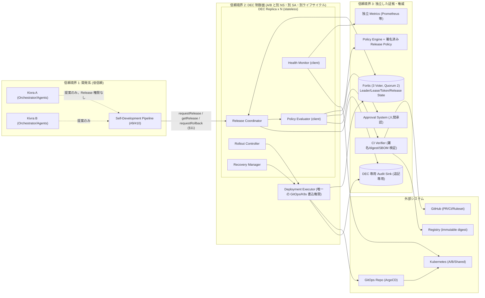
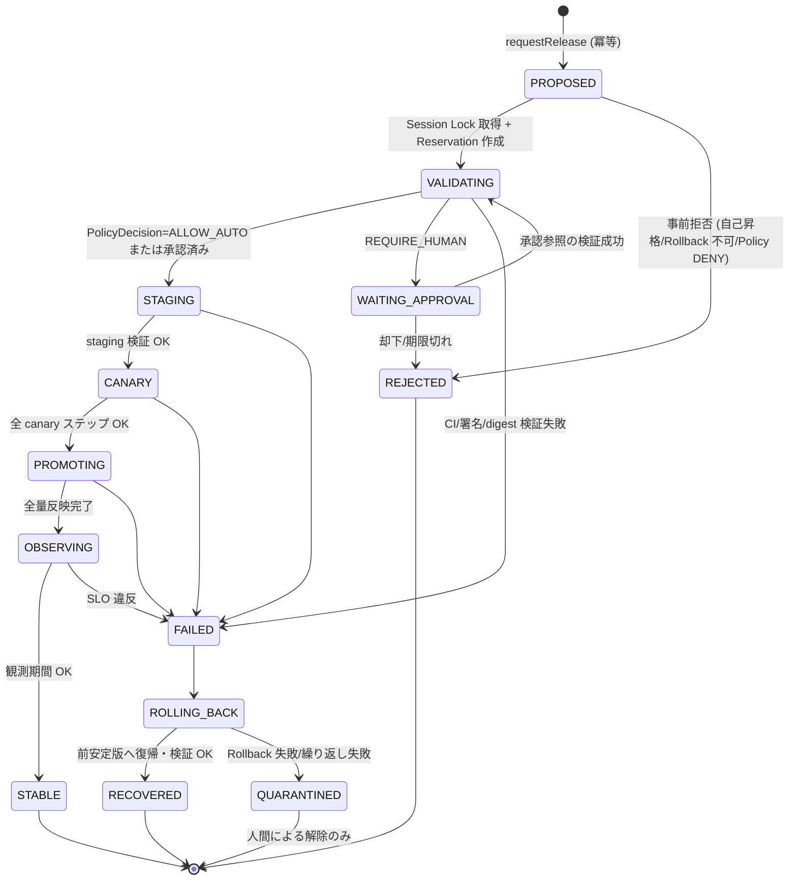
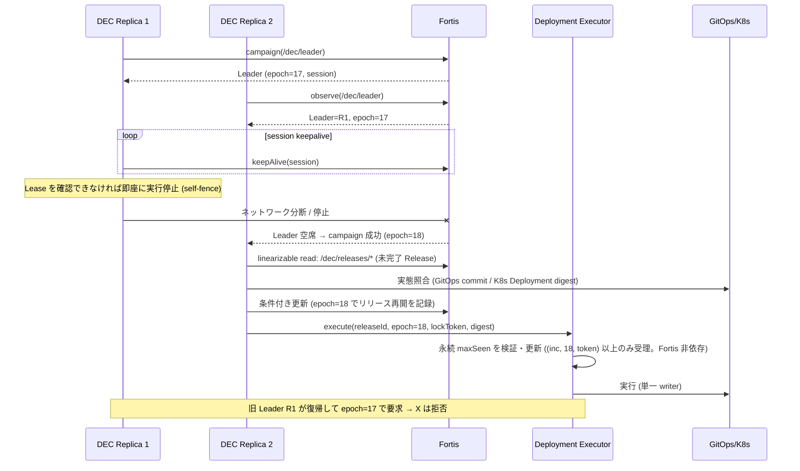
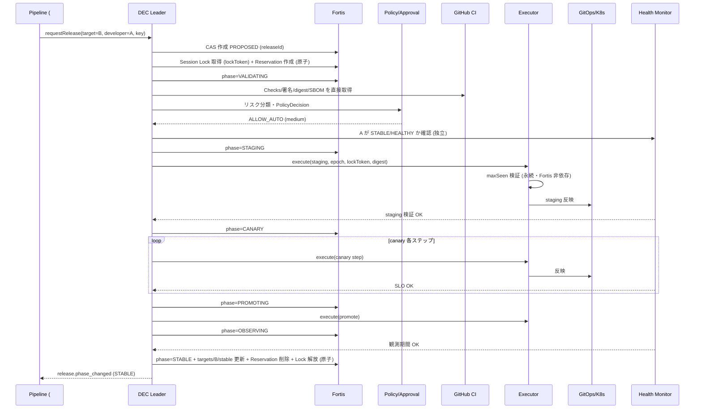
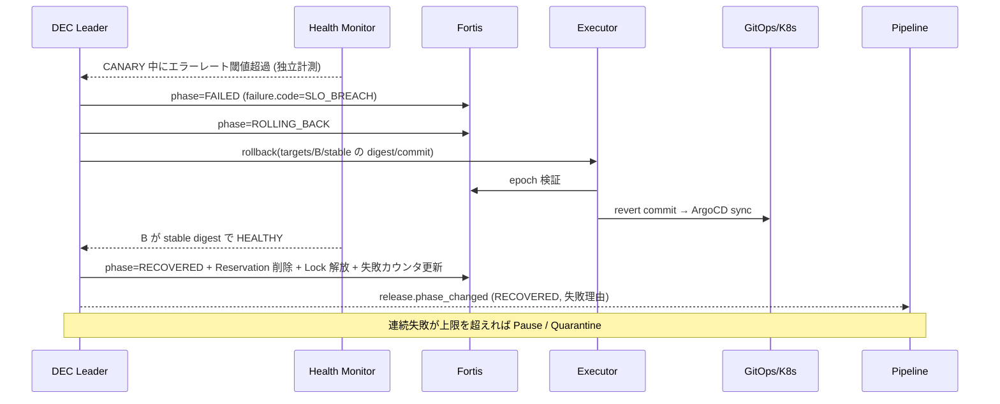
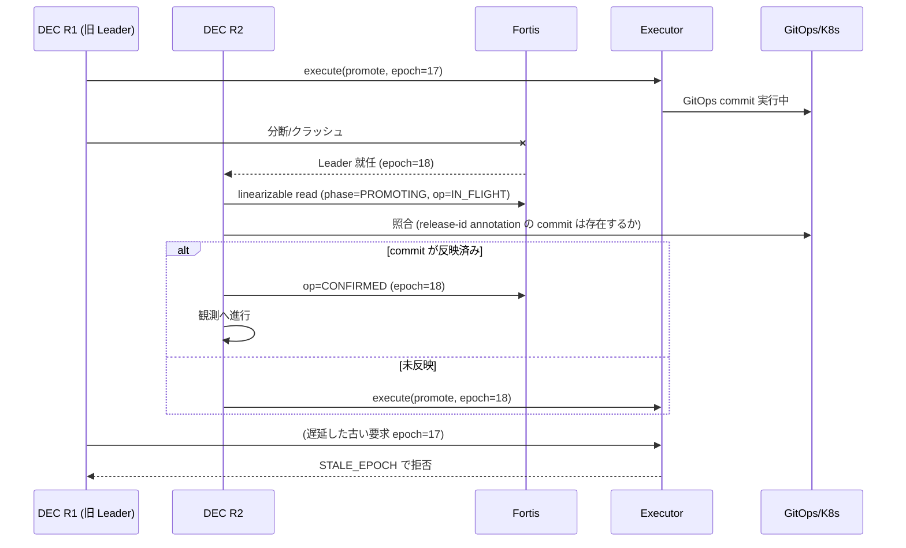

# 08. Dual Evolution Controller (DEC) 詳細設計

- 対象 Issue: kigawa-net/kivra#8
- 関連: #1 Core, #2 fusha-task, #3 Agent Manager, #4 Agent Coordination, #5 Model Gateway, #6 Memory, #7 Dual Evolution Architecture, #9 Self-Development Pipeline, #10 Runtime/API, #11 Distributed Consistency, #12 Fortis Integration
- ステータス: ドラフト (設計レビュー待ち)
- 表記: 「**要確認**」は外部システムの現行仕様を確認できていない/未決の事項。「**提案**」は本書の設計案であり確定ではない。

## 0. 本書の位置づけと確認済み事実

### 0.1 スコープ

#7 で「後続の設計タスク」とされた DEC の詳細 (責務、状態遷移、自動昇格、Rollback、障害復旧) を定義する。
#8 の「設計変更 (確定)」(Stateless DEC + Fortis-managed Coordination) を前提とする。

### 0.2 外部システムの確認状況

ローカル clone (`/home/kigawa/dev/kigawa-net/`) を読んで確認できた範囲のみ事実として扱う。

| システム | 確認できた事実 (出典) | 確認できていない事項 |
|---|---|---|
| Fortis (`fortis/docs/architecture.md`, `roadmap.md`, ソース) | Kotlin Multiplatform の Raft + MVCC 志向の強整合 KV。CP (多数派喪失で強整合操作停止)。`RaftRuntime` に `propose` / `linearizableRead` / `readIndex` が存在。QUIC + mTLS transport (JVM)。Raft log / term / vote の crash-safe 永続化、InstallSnapshot (チャンク転送・永続化の最小実装) あり。Public API (`batch` / `transaction` / compare-and-set / conditional write) は「計画」段階 | `compareAndSwap` / `putIfRevision` / Lease / Session / Fencing / Leader Election に相当するコードは**見つからなかった** (ソース grep)。クライアント API (ネットワーク越し) の形、Watch の有無、値サイズ上限、ACL/認証単位は **要確認**。本番利用不可 (fortis#27 本文の注意書き、#12) |
| exkes (`exkes/README.md`) | `exkes-api` (REST `/v1/workspaces`、K8s 権限なし) と `exkes-controller` (K8s 権限を持つ唯一のプロセス) を分離。Sandbox Plane と Control Plane を分離 | Execution API の詳細、DEC が exkes を使うか (本書では使わない方針) |
| GitHub / Kubernetes / ArgoCD | `/home/kigawa/dev/CLAUDE.md` により kigawa-net は ArgoCD GitOps (main マージで自動デプロイ、1 リソース 1 YAML) を採用 | Kivra A/B 用の ArgoCD Application 構成・ブランチ保護設定は未作成のため **要確認** |
| 承認系 / Policy Engine / 署名基盤 | #7, #8 に「独立したもの」とのみ記載 | 実装主体 (自前か既存 OIDC/Keycloak 等か)、署名方式 (cosign 等) は **要確認** |

Fortis の Coordination API (§5) は**現時点で存在しない API を前提とする設計**である。fortis#27 で追加される想定の要求仕様として §5.4 に列挙し、Fortis 側の合意が取れるまでは本書の「提案」とみなす。

### 0.3 他 Issue との整合上の注意 (矛盾の洗い出し)

| # | 論点 | 本書の扱い |
|---|---|---|
| a | #10 は「DEC は Release の正本」、#12/#8(確定) は「Release 状態の正本は Fortis、DEC は Reconciler/Executor」 | **Fortis を正本**とする (#8 確定版が最新)。「DEC が正本を管理する」は「DEC が Fortis 上の Release 状態を唯一更新できる主体」の意味で読み替える。#10 側の記述更新が必要 (§14 未解決論点) |
| b | #11 は Lease/Fencing の DB モデルを MariaDB 前提で記述、#12 は Release Lease を Fortis へ | Release/DEC Leader 系は Fortis。Run 系 Lease は #12 Phase 3 まで MariaDB。本書は Release 系のみ扱う |
| c | #8 は「ローカル DB を持たない」、#12 は MariaDB を「DevelopmentRun・監査/Outbox」とする | DEC はローカル DB を持たず、MariaDB に**直接接続しない**。Journal 等の MariaDB 書込みは **Recorder サービス経由**、または **専用 Audit Sink** (追記専用) 経由とする (§10.1、#11/#12 と整合。どちらを採るかは要確認) |
| d | #7 は「Controller の Lease」、#8 は「Leader Election は Fortis」 | #8 に従う |
| e | #10 の `requestRelease/getRelease/requestRollback` は「Kivra 内部の抽象契約」 | §11 で DEC 側の具体契約案を提示し、#10 Adapter と対応づける |

## 1. 設計原則

1. **Fail-closed**: 判定に必要な入力 (閾値、Health、Fortis Quorum、Policy) が欠落・不明・取得不能なら昇格しない。
2. **既存サービス維持**: DEC や Fortis の障害は「新規昇格の停止」にのみ作用し、稼働中の A/B を止めない。
3. **自己昇格の禁止**: 変更者 (developer) = 対象 (target) の Release は拒否する。AがBを、BがAを開発する。
4. **独立した証拠**: Agent の自己申告・PR 記述・Tool 出力は昇格根拠にしない。信頼できる CI 成果物 (署名付き)、独立 Health Monitor の計測、Policy 決定のみを根拠とする。
5. **Stateless DEC**: DEC はローカル永続状態・独自リーダー選出・独自の正本を持たない。再起動時は Fortis と外部実態から再構築する。
6. **外部 Fencing**: Fortis の epoch だけでは K8s への遅延リクエストを止められないため、Deployment Executor が世代 `(incarnation, epoch, lockToken)` を自前の永続 `maxSeen` で検証し、実行先への書込は Executor の単一 writer に限る。受理→実行→確定の順序規則・バリア・キャンセルは §5.3 の規範要件 (#12 §5.3 と同一)。
7. **Release の排他モデル**: Session Lock (調整権限。Leader 交代で失効) と永続 Release Reservation (同時 Release 不可・対象・進捗。Session に紐づかない) に分離する (§5.5。#12 §6.3 と同一)。
7. **ロールバック可能性の事前証明**: Rollback 不可能な変更 (非互換スキーマ等) は STAGING に入る前に拒否する。
8. **Exactly-once を主張しない**: 副作用は冪等キー + 照合 (reconcile) で対処する。曖昧なら停止して照合する。

## 2. コンポーネント構成と信頼境界

### 2.1 構成図



### 2.2 責務 (Issue 記載の 5 責務のモジュール分割)

| モジュール | 責務 | 主な入力 | 主な出力 | 書込権限 |
|---|---|---|---|---|
| Release Coordinator | 更新の直列化、対象 A/B の選定、Release Track、Lease/Fencing 取得、Release 状態遷移の唯一の更新者 | Release 要求、Fortis 状態 | Release 状態 CAS 更新、他モジュールへの指示 | Fortis (DEC namespace) のみ |
| Policy Evaluator | リスク分類、署名・digest・CI 成果物・承認の確認、PolicyDecision の発行 | Release 要求、CI 成果物、承認参照、Release Policy | PolicyDecision (署名付き) | なし (判定のみ) |
| Health Monitor | A/B と共通依存の**独立した** Health Check、SLO/エラーバジェット評価 | 独立 Metrics、Synthetic Probe | HealthSnapshot | なし |
| Rollout Controller | staging → canary → production の段階制御、観測期間管理 | Release 状態、HealthSnapshot | Executor への実行要求 | Executor 経由のみ |
| Recovery Manager | Rollback、Quarantine、両系統異常時の安全停止、復旧手順の起動 | 失敗イベント、HealthSnapshot | Rollback 要求、Quarantine 設定 | Executor 経由のみ |

論理モジュールは単一の DEC プロセス (複数 Replica) に同梱する。Policy Evaluator の「判定ロジック」と「ポリシー本体・承認」は DEC 外 (Policy Engine / Approval System) に置き、DEC は検証クライアントとして動く。

### 2.3 信頼境界と権限モデル

| 主体 | Fortis (DEC ns) | GitOps repo | K8s | 承認発行 | Policy 更新 | 備考 |
|---|---|---|---|---|---|---|
| Kivra A/B (Agent含む) | 読取不可 (Release 参照 API 経由の読取のみ) | PR 提案のみ (直 push 不可) | 自系統の Pod 権限のみ | 不可 | 不可 | 自身の本番昇格不可。DEC/Executor/Policy を変更する PR は高リスク |
| Pipeline (#9/#10) | 不可 (DEC API 経由のみ) | PR 作成/Merge (Ruleset 範囲内) | 不可 | 不可 | 不可 | `requestRelease` のみ |
| DEC Replica | DEC namespace の R/CAS | 不可 (Executor に依頼) | 読取のみ (Health 用) | 不可 | 不可 | Leader のみ状態遷移可 |
| Deployment Executor | 読取 (epoch 検証)、実行記録 CAS | Release 用ブランチ/パスへの書込のみ | ArgoCD 経由。直接書込は break-glass 時のみ | 不可 | 不可 | 唯一の本番書込主体。DEC と別 SA |
| Approval System | 承認参照の発行 (署名) | 不可 | 不可 | 可 | 不可 | 人間承認。A/B・DEC は承認を偽造不可 |
| Policy Engine | 不可 | 不可 | 不可 | 不可 | 署名付き Policy Bundle の公開 | Policy 変更は人間承認+別経路 |
| Break-glass 運用者 | 読取 + 限定書込 | 直接 | 直接 | - | - | §10.4。全操作を監査 |

要点:
- DEC は**デプロイ権限を持たない** (Executor に分離)。#8 の「片側異常時に他方が復旧タスクを担当しても、デプロイ権限は Controller に分離」を満たす。A/B が復旧「タスク」(原因調査・修正 PR) を担当しても、反映は同じ Release フローを通る。
- DEC と Executor は A/B とは別 Namespace、別 ServiceAccount、別デプロイ経路 (A/B 自身の GitOps Application から独立) とする。DEC/Executor 自身の更新は「高リスク」(§7) で人間承認必須。

## 3. データモデル

正本は Fortis。値は JSON (または Protobuf) とし、`schemaVersion` を持つ。キー構造は **提案** (Fortis 側の namespace/ACL 機能は **要確認**)。

### 3.1 Fortis キー空間 (`/dec/` prefix)

| キー | 内容 | 更新者 | 更新方式 |
|---|---|---|---|
| `/dec/leader` | 現 Leader の identity、`epoch` (Fortis 発行の単調増加)、sessionId | Fortis Election Service | campaign/resign |
| `/dec/release-lock` | **Session Lock** (調整権限、Session に紐づく): 保持 Session、`epoch`、`lockToken` (単調増加の Fencing Token)。#12 `locks/release/prod` | Leader | Lock API (Session 失効で無効化) |
| `/dec/release-reservation` | **Release Reservation** (同時 Release 不可・対象・進捗の所有者、Session に紐づかない): `releaseId`、`target`、`ownerEpoch`、`ownerToken`、`generation`。#12 `reservations/release-prod` | Leader | 条件付き batch (§5.5 の 4 種の CAS) |
| `/dec/targets/{A\|B}/token` | 対象系統ごとの Fencing Token (単調増加カウンタ)。#12 `locks/target/{A\|B}` の Fencing Counter | Leader | CAS increment |
| `/dec/releases/{releaseId}` | Release レコード (§3.2) | Leader | 条件付き更新 (expectedRevision) |
| `/dec/targets/{A\|B}/stable` | 対象系統の検証済み安定版 (`artifactDigest`、`releaseId`、確定時刻) | Leader | 条件付き更新 (STABLE 到達時のみ) |
| `/dec/pause` | 全体/対象別 Pause フラグ、理由、設定者 | Leader / 運用者 | CAS |
| `/dec/quarantine/{A\|B}` | Quarantine 状態と理由 | Leader / 運用者 | CAS |
| `/dec/budget/...` | 更新頻度・Rollback 回数・連続失敗数のカウンタ (期間窓) | Leader | CAS |
| `/dec/policy/active` | 有効な Policy Bundle の digest と署名検証結果の参照 (本体は Policy Engine) | Leader | CAS |
| `/dec/ops/{opId}` | 外部副作用の操作記録 (冪等キー、実行 epoch、結果、状態) | Leader / Executor | 条件付き更新 |

Release に紐づく履歴 (全遷移イベント) は Fortis に持たせず Audit Sink へ追記する (§10.1)。Fortis は「現在状態」のみ。

### 3.2 Release レコード

```json
{
  "schemaVersion": 1,
  "releaseId": "rel-01J...",            // ULID。requestRelease の冪等キーから決定的に導出
  "requestKey": "run-123:attempt-2",   // Pipeline 側の冪等キー (#10)
  "phase": "CANARY",                    // §4 の状態
  "target": "B",                        // 更新対象系統
  "developer": "A",                     // 変更者系統。target != developer
  "track": "standard",                  // Release Track (§3.3)
  "artifact": {
    "images": [{"name": "kivra-orchestrator", "digest": "sha256:..."}],
    "manifestCommit": "<gitops sha>",
    "sourceCommit": "<headSha>",
    "prRef": "kigawa-net/kivra#123"
  },
  "previousStable": {"releaseId": "rel-...", "digest": "sha256:...", "manifestCommit": "<sha>"},
  "incarnation": 3,                     // 発行時の Fortis incarnation (#12 §4.5。Fortis の外の Authority が権威)
  "epoch": 17,                          // この Release を最後に進めた DEC Leader epoch (Reservation.ownerEpoch と同値)
  "lockToken": 42,                      // Session Lock の Fencing Token (#12 の fencingToken。Reservation.ownerToken と同値)
  "generation": 5,                      // フェーズ遷移ごとに +1
  "risk": "medium",
  "policyDecisionRef": "pd-...",
  "approvalRefs": [],
  "rollbackPlan": {"mode": "gitops-revert", "targetManifestCommit": "<sha>", "compat": "verified"},
  "canary": {"stepIndex": 1, "trafficPercent": 5, "stepStartedAt": "..."},
  "observation": {"startedAt": "...", "minDuration": "PT30M"},
  "failure": {"code": "SLO_BREACH", "evidenceRef": "..."},
  "createdAt": "...", "updatedAt": "..."
}
```

### 3.3 Release Track

| Track | 対象 | 自動昇格 | 備考 |
|---|---|---|---|
| `standard` | A/B アプリ本体 (コード、非機密設定) の低・中リスク | 可 | 既定 |
| `shared` | 共通依存サービス、DB マイグレーション (expand–migrate–contract) | 条件付き (expand/contract は人間承認既定、MVP では不可) | §8 |
| `high-risk` | Policy Engine、権限、Secret、DEC/Executor 自身、共通 DB/基盤 | 不可 (人間承認必須) | §7 |
| `emergency` | break-glass 起点の修復 | 不可 (手動) | §10.4 |

### 3.4 PolicyDecision

Policy Evaluator が発行する、改ざん防止された判定記録 (Audit Sink と Fortis `policyDecisionRef` から参照)。

```json
{
  "decisionId": "pd-...",
  "releaseId": "rel-...",
  "policyBundleDigest": "sha256:...",
  "inputs": {"artifactDigests": [...], "ciRunRef": "...", "sbomRef": "...", "signatureVerified": true,
             "changedPaths": [...], "classification": "medium", "classificationRationale": [...]},
  "result": "ALLOW_AUTO | REQUIRE_HUMAN | DENY",
  "requiredApprovals": [{"role": "release-approver", "count": 1}],
  "missingInputs": [],
  "decidedAt": "...", "expiresAt": "...",
  "signature": "<Policy Evaluator signing key>"
}
```

`missingInputs` が空でない場合は `DENY` (fail-closed)。決定には有効期限があり、期限切れ・Policy Bundle 更新・artifact 差し替え時は再評価する。

### 3.5 HealthSnapshot

Health Monitor が算出し、Release の各ゲートで参照する。永続化は Audit Sink のみ (Fortis には最新の要約 digest/時刻のみ。鮮度判定用)。

```json
{
  "snapshotId": "hs-...", "capturedAt": "...", "source": "independent-monitor",
  "systems": {
    "A": {"status": "HEALTHY|DEGRADED|UNHEALTHY|UNKNOWN", "slo": {...}, "errorRate": 0.002,
          "latencyP95Ms": 420, "taskSuccessRate": 0.97, "costBurn": 0.4, "errorBudgetRemaining": 0.8,
          "runningDigest": "sha256:...", "generation": "..."},
    "B": {"...": "..."}
  },
  "shared": {"mariadb": "HEALTHY", "fortis": "HEALTHY", "nats": "HEALTHY", "modelGateway": "HEALTHY"},
  "stale": false
}
```

`status=UNKNOWN` や `stale=true` は「不健全」と同等に扱う (fail-closed)。

## 4. 状態遷移

### 4.1 Release 状態

通常経路: `PROPOSED → VALIDATING → STAGING → CANARY → PROMOTING → OBSERVING → STABLE`。
例外経路: 各状態 → `FAILED → ROLLING_BACK → QUARANTINED | RECOVERED`。



補足:
- `WAITING_APPROVAL` と `REJECTED` は Issue の状態列に無い**追加状態** (提案)。承認待ちを `VALIDATING` に押し込むと Lock 保持時間が不定になるため分離した。承認待ち中は Reservation を保持し Session Lock は手放してよい (§5.5。§14 論点 3)。
- **Pause** は状態ではなく `/dec/pause` フラグ。Pause 中は遷移を進めず (CANARY 保持など)、既存サービスを維持する。Pause からの復帰は運用者/Policy 条件で行う。
- 状態の遷移はすべて Fortis への条件付き更新 (`expectedRevision` + `epoch` 一致) で行い、成功した遷移のみが有効。失敗した CAS は Replica 側で破棄し再読込する。
- 各遷移は「遷移イベントの Audit 追記」→ または「Fortis CAS 成功後に Audit 追記 (at-least-once、`releaseId+generation` で重複排除)」とする。順序と欠損の扱いは §10.1。

### 4.2 遷移ごとのガード

| 遷移 | ガード (すべて満たす必要。1 つでも不明/取得不能なら遷移しない) |
|---|---|
| PROPOSED → VALIDATING | Leader である (Lease 有効、linearizable 読取成功)。Session Lock 取得成功かつ Release Reservation の作成 (空 → 作成、同一 batch。§5.5 開始)。`developer != target`。他の Release が未完了でない (Reservation が空)。対象系統が `Quarantine`/`Pause` でない。予算 (頻度/失敗回数) 内 |
| VALIDATING → STAGING | 必須 CI 全成功 (単体・統合・回帰・セキュリティ) で署名検証済み。image は immutable digest 固定、tag 参照なし。SBOM/出所確認 (採用時)。Rollback 可能性検証済み (§6.3)。PolicyDecision=ALLOW_AUTO か、必要な承認参照が全て有効 (§10.2) |
| STAGING → CANARY | staging でスモーク/統合テスト合格。staging の digest = 承認済み digest。**対象外系統が STABLE かつ HEALTHY** |
| CANARY → PROMOTING | 全 canary ステップで SLO/エラーレート/レイテンシ/依存健全性/予算が閾値内。各ステップ最短観測時間経過。閾値データ鮮度 OK |
| PROMOTING → OBSERVING | 全量反映後の実行中 digest = 期待 digest (Health Monitor が独立確認) |
| OBSERVING → STABLE | 観測期間 (Release Policy 定義) 経過、期間中に違反なし、対象外系統も HEALTHY。`/dec/targets/{t}/stable` を条件付き更新 |
| * → FAILED | 閾値違反、タイムアウト、検証失敗、実行失敗 (確認済み)、Lease 喪失以外の異常。**Lease 喪失は FAILED ではなく中断** (新 Leader が再開) |
| FAILED → ROLLING_BACK | 常に自動 (安定版が検証済みで Rollback 可能な場合)。Rollback 不可の場合は直接 QUARANTINED + 人間通知 |

### 4.3 閾値の扱い (fail-closed)

- 閾値は Release Policy (署名済み Policy Bundle) に定義する。Release Policy に項目が**無い・読めない・値が不正**なら自動昇格しない (`DENY`)。
- 具体的な閾値数値 (エラーレート上限、レイテンシ、観測時間、canary 割合/ステップ) は本書では決めない。**要確認**: kigawa のサービス特性に基づき運用者が Release Policy で定める (§14 論点 5)。参考の初期値案は §6.1 の表に「提案」として示す。

## 5. 排他・Fencing・冪等実行・多重化

### 5.1 基本方針

DEC は Fortis の Coordination API のクライアントであり、次を実装しない: Leader Election アルゴリズム、Lease 状態の永続化、リリース状態の独自正本。

### 5.2 DEC Replica のライフサイクル



- 全 Replica は同一コード。Leader のみが状態遷移・Executor 要求を行う。Standby は Fortis を observe し、キャッシュ (RAM) を温めるのみ (キャッシュは判断に使わない)。
- 自己 Fencing: Leader は各副作用の直前に、Lease 残存と epoch を Fortis から linearizable に再確認する。確認できなければ中断する。Lease 期限による**ローカル時計判断だけ**で継続しない (clock skew 対策)。ローカルタイマーは「早めに諦める」方向にのみ使う。

### 5.3 Fencing の 3 層と規範要件

| 層 | 何を | どこで | 止められるもの |
|---|---|---|---|
| L1: Fortis の条件付き更新 | Release 状態 CAS (`expectedRevision`、Reservation の `ownerEpoch`/`ownerToken` 条件。§5.5) | Fortis | 旧 Leader による**状態更新** |
| L2: Executor の永続 maxSeen 検証 | 要求の世代 `(incarnation, epoch, lockToken)` を Executor 自身の永続 `maxSeen` と比較・更新 (EX-1)。Fortis の linearizable read は補助 | Deployment Executor | 旧 Leader による**実行要求** (Fortis 断でも) |
| L3: 実行先の CAS | GitOps への書込を「期待する親 commit」条件付き (non-fast-forward 拒否) にし、マニフェストに `kivra.kigawa.net/release-id`、世代の annotation を埋める。ArgoCD は Executor の署名 commit のみ同期 (**要確認**: ArgoCD 設定での署名検証可否) | GitOps repo / ArgoCD | Executor 外からの書込・遅れて届いた古い書込の検出 |

Fortis 内部の epoch は L1 のみを守ることを明示する (fortis#27 の注意書き「Fortis が発行した Fencing Token は利用元でも検証すること」と一致)。

**規範要件 (MUST)。本節 (#8 §5.3) と #12 §5.3 は同一の記述とする。** 用語: 世代 = `(incarnation, electionEpoch, fencingToken)` (#8 の `lockToken` = #12 の `fencingToken`)。

- **EX-1 Executor の永続 maxSeen**: Executor は target ごと (`release/prod` を含む) に `maxSeen` 世代を、自前の耐久ストア (fsync、Fortis 非依存、DEC から書込不可) に持つ。受理判定は「`maxSeen` との比較」と「`maxSeen` の更新・永続化」を 1 つの原子操作とし、永続化完了後にのみ ACCEPTED を返す。Fortis の linearizable read は補助的な追加検証であり**必須判定ではない** (Fortis 断でも旧世代を拒否できること)。
- **EX-2 実行先の単一 writer**: GitOps リポジトリ / Kubernetes / ArgoCD への書込資格は Executor のみが持つ (DEC・A/B・通常運用者の書込権限は除去。break-glass は Executor を `FROZEN` にしてから行う)。Executor 内部では target ごとに直列化された**単一 worker** で実行し、target あたり同時に進行中の操作は最大 1。Executor 自体も MVP では単一インスタンス (多重化は maxSeen ストアの整合設計が前提)。
- **EX-3 受理 → 実行 → 確定の順序規則**: (1) 受理: 署名検証 → `maxSeen` 比較・更新を永続化 → Operation 記録 `ACCEPTED`。(2) 実行: `IN_FLIGHT` を記録し、**各外部書込の直前に** worker 内で「自 op の世代 == `maxSeen`」を再確認する。GitOps 書込は「期待する親 commit」付きの条件付き書込とし、manifest に `release-id` と世代の annotation を埋める。(3) 確定: 結果 (`CONFIRMED` / `UNKNOWN`) を永続化してから応答する。確定時点で自 op の世代 != `maxSeen` なら `SUPERSEDED` として「実際に何を書いたか」を返し、当該 Release の成功とは扱わない。
- **EX-4 バリア (新世代の最初の要求)**: 新世代の最初の要求 (照合完了時の `no-op apply` = barrier) は、`maxSeen` を引き上げた後、当該 target の旧世代 in-flight 操作が (i) 完了、(ii) 安全点で中止、(iii) 結果不明と確定、のいずれかになるまで worker 上で待機する (drain)。barrier 応答は `{drain 結果, 観測した GitOps/K8s 実態}` を返す。新 Leader は barrier 応答を受けるまで照合を完了させず、新世代の apply を発行しない。これにより、**新 Epoch の受理後に旧操作が書込を確定し得る窓は「受理 〜 drain 完了」に限られ、その間の書込結果は必ず新 Leader に報告され、新世代の操作はその後にしか始まらない**。
- **EX-5 キャンセル**: 新世代の受理時、旧世代の in-flight 操作へ cancel を通知し、次の安全点 (外部書込のステップ境界) で停止させる。すでに発行済みで取り消せない外部書込 (git push 等) は完了/失敗を待つ (上限タイムアウト付き。超過は `UNKNOWN`)。`UNKNOWN` を含む barrier 応答を受けた新 Leader は Release を `QUARANTINED` にして人手確認とする。`maxSeen` 更新後に旧世代の操作を新規開始・再開することは決してない。
- **EX-6 Executor 復旧**: 再起動時は `ACCEPTED` / `IN_FLIGHT` の操作を**再実行せず**、まず GitOps/K8s の実態と照合して結果を確定 (`UNKNOWN` 含む) してから新規受理を再開する。世代 < `maxSeen` の op は照合のみ。同一世代・同一 releaseId の再送は冪等に受理し、同一世代で別 digest は拒否する。`maxSeen` ストア消失時は #12 §4.5 INC-5 に従い fail-closed。
- **EX-7 要求の真正性**: 要求は署名付き `(releaseId, digest, 世代)` とし、Executor は要求パラメータではなく署名検証済みの値で実行する。

検証した競合窓と残余リスク:

| 窓 | 結果 |
|---|---|
| 旧 Executor 操作が新 Epoch 受理後に書込を確定 | EX-3 の直前再確認で大半は止まる。再確認通過後に発行済みの書込は取り消せないが、EX-4 の drain が完了するまで新世代の操作は開始されず、結果は barrier 応答で新 Leader に報告される。報告なしに書込が確定することはない |
| 旧 DEC の遅延 apply が maxSeen 更新後に到達 | EX-1 で拒否 (Fortis 断でも成立) |
| 旧世代 op の途中で Executor が再起動 | EX-6: 再実行せず照合してから再開 |
| Executor を経由しない書込 (ArgoCD の手動 sync、人手の kubectl 等) | EX-2 の権限除去が前提。残る場合は GitOps の「期待する親 commit」CAS と annotation で検出する。GitOps サーバ側 (pre-receive hook 等) での世代検証の可否は**要確認** |

(旧版の「L2 の check-then-act の残余窓は同一内容限定で許容」は撤回した。検証は EX-3〜EX-5 の単一 writer・直前再確認・バリアで行う。§14 論点 2 参照。)

### 5.4 Fortis への API 要求 (fortis#27 で合意が必要な契約)

Fortis 現行実装に存在しないため、以下を DEC からの**要求仕様**とする。

| # | 要求 | 用途 |
|---|---|---|
| F1 | Linearizable read (読取と同時に現在 revision を返す) | 全判定。STALE_READ/LOCAL_ONLY は判定に使用しない |
| F2 | 条件付き更新 `putIfRevision` / compare-and-swap、複数キーの条件付き batch (原子) | Release 状態、Lock、Token |
| F3 | Leader Election: `campaign` / `observe` / `resign`、成功時に単調増加する `epoch` を返す | DEC Leader |
| F4 | Session/Lease: 発行・更新・失効。Session 失効で紐づく Lock/Election が同一 Raft 適用で無効化される (**Reservation 等の通常 KV レコードは影響を受けない**) | Leader/Session Lock の自動解放 |
| F5 | 単調増加カウンタ (Fencing Token)。Quorum 喪失/再起動でも逆行しない。バックアップ復元後の世代逆行は #12 §4.5 の incarnation (Fortis 外の Authority) で扱う | `lockToken`、`targets/*/token` |
| F5b | Lock レコードと通常 KV レコード (Reservation / Release 状態) を**同一の条件付き batch で原子更新**できる (**要確認**: fortis#28/#31 のスコープか) | §5.5 の開始/引継ぎ/終了 |
| F6 | リクエスト ID と冪等な結果照合 (結果不明時の status 照会) | タイムアウト時の再照合 |
| F7 | 明示エラー: `QUORUM_LOST`、`STALE_EPOCH`、`NOT_LEADER`、`REVISION_MISMATCH`、`SESSION_EXPIRED` | DEC の fail-closed 分岐 |
| F8 | Watch (変更通知)。無ければ短周期 linearizable poll | Standby の追従。**要確認** (Fortis に Watch があるか不明。無い場合はポーリングで代替可能) |
| F9 | 認証 (mTLS) と namespace 単位の ACL: `/dec/` は DEC/Executor のみ書込可、A/B は書込不可 | 信頼境界 |

### 5.5 Release Lock (Session Lock と Release Reservation)

**所有モデル (確定案)。#8 §5.5 と #12 §6.3 は同一の記述とする。** Release の排他を、性質の異なる 2 つの状態に分離する。

| 状態 | 表すもの | Session との関係 | #8 のキー | #12 のキー |
|---|---|---|---|---|
| **Session Lock** (`release/prod`) | 調整権限: 「いま Release を進めてよい DEC Leader は誰か」 | **Session に紐づく**。Leader 交代・Session 失効で Fortis が同一 Raft 適用で無効化する。新 Leader が campaign 後に**新しい fencingToken で再取得**する | `/dec/release-lock` | `/kivra/v1/locks/release/prod` |
| **Release Reservation** (永続 Release State/予約) | 同時 Release 不可・対象 (A/B)・進捗の所有者: 「どの Release が進行中か」 | **Session に紐づかない**。終端状態への CAS でのみ解除する | `/dec/release-reservation` | `/kivra/v1/reservations/release-prod` |

Reservation は `{releaseId, target, ownerEpoch, ownerToken, generation}` を持つ。Release の phase・成果物などの進捗の正本は ReleaseState (#8 §3.2 / #12 §4.4) で、Reservation の `releaseId` が指す。Reservation が存在する間は**他の Release を開始できない** (A/B 同時更新・同一対象の複数 Release の禁止)。以下、「CAS」は Fortis の単一 Raft Group 内の `conditionalBatch` (複数キーの原子的条件付き更新) を指す。

**原子的に更新するもの (4 種):**

1. **開始**: [自 Session が Session Lock を保持 ∧ `target/{t}` Lock 取得 ∧ Reservation が空] → Reservation 作成 + ReleaseState を `PROPOSED → VALIDATING`。
2. **引継ぎ** (Leader 交代後): [自 Session が新 Token T' で Session Lock を保持 ∧ Reservation.releaseId == R ∧ Reservation.generation == g] → `ownerEpoch = E'`、`ownerToken = T'`、`generation = g+1`、ReleaseState の `electionEpoch` / `fencingToken` を同時更新。この CAS が成功するまで Reservation の owner は旧 Leader のまま。
3. **進行**: ReleaseState の**全ての更新**は、`expectedRevision` に加えて [Reservation.ownerEpoch == 自 E ∧ Reservation.ownerToken == 自 T ∧ 自 Session の Lock が有効] を条件に含める。
4. **終了**: [ReleaseState → 終端状態 (`STABLE` / `RECOVERED` / `QUARANTINED` / `REJECTED`) ∧ Reservation 削除 ∧ Session Lock 解放 (`target/{t}` Lock を含む)] を同一 batch で行う。中間状態のまま Reservation だけ・Lock だけが空になることを防ぐ。

**旧 Leader の遅延要求の遮断 (多層):**

- Fortis 側: Session 失効で Lock は無効化される。旧 Leader の状態更新は進行 CAS の `ownerToken` 条件で `STALE_EPOCH` / `REVISION_MISMATCH` となる。新 Token は旧 Token より厳密に大きい。
- Executor 側: 新 Leader は引継ぎ CAS の後、照合完了時に barrier apply (#8 §5.3 / #12 §5.3 EX-4) で Executor の `maxSeen` を新世代に引き上げる。以降、旧世代の要求は Fortis の可否に関係なく拒否される。**これが最終防衛**である。
- 旧 Leader の自己停止 (KeepAlive 失敗で全副作用を中断) は補助であり、安全性の根拠にしない。

**再取得後の継続:** 新 Leader は引継ぎ CAS の後、Executor の `適用済み releaseId` / Operation 状態と GitOps・Kubernetes の実態を、Reservation と ReleaseState に照合する (#8 §5.7 / #12 §6.2)。一致 → 継続。実態が先行 → ReleaseState を CAS で追従。不明・矛盾 → `QUARANTINED`。照合 (と barrier) が完了するまで、barrier 以外の外部副作用は行わない。

**乖離状態の扱い:** Session Lock のみ失効し Reservation が残る = 通常の Leader 交代 (新規 Release は Reservation により開始できない)。Reservation の上書きは開始 CAS の条件 (Reservation が空) により不可能。Reservation の強制解除は break-glass の管理者のみ (監査必須)。`WAITING_APPROVAL` 中は Reservation を保持し、Session Lock は手放してよい (Leader 交代・停止が人手待ちを妨げず、他 Release は Reservation で抑止される)。

**Fortis への要求・責務 (要確認を含む):** Fortis #31 の MVP は Session Lock と Fencing Counter (リソース単位・Snapshot/Restart 後も不逆行) を扱う。Reservation は Fortis の汎用 KV レコードとして Kivra が定義するが、(a) Lock レコードと KV レコードを**同一 conditionalBatch で原子更新できること**、(b) Session 失効が Lock のみを無効化し KV レコードに影響しないこと、は #28/#29/#31 のスコープに含まれるか**要確認**。#17 (Snapshot/Restart) はこれらの永続状態が再起動で失われないことのみを担い、バックアップ復元時の逆行は #12 §4.5 の incarnation で扱う。

- 保持単位: Reservation は **Release 全体** (PROPOSED→VALIDATING の開始 〜 STABLE/RECOVERED/QUARANTINED/REJECTED の終了)。

### 5.6 冪等な実行

全ての外部副作用は以下の形をとる。

1. `opId = hash(releaseId, generation, step)` を決定的に生成 (`/dec/ops/{opId}` を条件付きで `PREPARED` 作成)
2. 副作用を実行 (冪等キー = `opId`。GitHub/ArgoCD/K8s が冪等キーを受けない場合は 4 で代替)
3. 結果を `CONFIRMED` で記録 (条件付き更新)
4. 結果不明 (タイムアウト/Leader 交代) の場合は、`PREPARED/IN_FLIGHT` の op を**実態照合**してから再実行判断: GitOps commit の存在 (`release-id` annotation で検索)、K8s Deployment の digest/generation、ArgoCD Application の sync 状態

照合不能な操作は自動再試行せず、Release を保留 (Pause 相当) にして人間へ通知 (fail-closed)。

### 5.7 再起動・分断後の再開と整合性検証

新 Leader 確定後に行う **Reconcile 手順**:

1. Fortis から linearizable に全未完了 Release と `/dec/ops/*`、`/dec/pause`、`/dec/quarantine/*` を取得
2. 各未完了 Release について実態を照合: GitOps の `release-id` commit、ArgoCD sync/health、K8s の実行中 digest、canary の実トラフィック割合
3. 照合結果で分岐:
   - Fortis の `phase` と実態が一致 → 当該フェーズの監視を再開
   - 実態が先行 (操作が完了していたが記録前に Leader が落ちた) → Fortis を実態に合わせて CAS 更新
   - 実態が後退/不明/競合 (想定外の手動変更等) → Release を FAILED とし Rollback (安定版が確認できる場合) または Pause + 人間通知
4. 引継ぎ CAS (§5.5) を行い、barrier apply (§5.3 EX-4) の応答を受けて照合を完了する
5. すべて照合できてから新規 Release を受け付ける (Reconcile 完了まで `requestRelease` は受理のみ・処理保留)

## 6. 自動昇格・Rollback・Pause・Quarantine のポリシー

### 6.1 自動昇格条件 (Issue 記載条件の具体化)

自動昇格 (人間承認なし) は、次を**すべて**満たす場合のみ。

| 区分 | 条件 | fail-closed 時の扱い |
|---|---|---|
| CI | 必須 CI (単体・統合・回帰・セキュリティ) 成功。GitHub の Required Checks/Ruleset を通過し、DEC の CI Verifier が**GitHub API から直接**結果と headSha を取得して照合 (Pipeline の報告は信用しない) | 取得不能 → DENY |
| 成果物 | 署名検証済み、image は immutable digest 固定 (tag 禁止)、SBOM/出所確認 (採用時) | 検証手段不明 → DENY |
| SLO 等 | SLO・エラーレート・レイテンシ・依存先健全性・予算が閾値内 | 閾値欠落/データ欠落/stale → 昇格停止 |
| 対象外系統 | 対象外系統が STABLE かつ HEALTHY (観測中の前 Release が無い) | UNKNOWN → 昇格停止 |
| リスク | Release Policy が明示的に自動昇格を許す低・中リスク変更のみ | 未分類 → 高リスク扱い (REQUIRE_HUMAN) |
| 自己昇格 | `developer != target`、かつ変更を作った Agent 系統が target でない | 判定不能 → DENY |
| Rollback 可能 | §6.3 を満たす | 不明 → DENY |
| 予算 | 更新頻度・費用・直近の Rollback 回数・同時 Release 数が上限内 (#7 項目 9) | 超過 → 待機 / Pause |

閾値の**初期値案 (提案、確定は Release Policy で運用者が決める)**:

| 項目 | 案 |
|---|---|
| canary ステップ | 5% → 25% → 50% の 3 段 (トラフィック分割が実現できる場合)。分割不能なら対象系統の単一 Replica 先行 → 全 Replica |
| 各ステップ最短観測 | 10 分 (要調整) |
| 最終観測期間 (OBSERVING) | 30 分〜数時間 (リスク別) |
| 失敗判定 | ベースライン比でエラーレート/レイテンシ悪化が閾値超過、または SLO 燃焼率が閾値超過が連続 N 回 |

### 6.2 リスク分類

分類は Policy Evaluator が**変更パスと内容から機械的に**行う。Agent の自己申告は入力にしない。

| 分類 | 例 (変更パスの判定を Release Policy に記載) | 昇格方式 |
|---|---|---|
| 低 | ドキュメント、テスト、非機能的リファクタ、局所的バグ修正 (A/B アプリ内) | 自動 |
| 中 | A/B アプリの機能追加・設定 (非機密) 変更 | 自動 (対象外系統 STABLE 必須、観測期間長め) |
| 高 | Policy Engine、権限/RBAC、Secret、DEC/Executor 自身、Fortis/共通 DB/基盤、NetworkPolicy、Release Policy 自体、CI 定義、署名鍵 | 独立した人間承認必須 (自動適用不可) |
| 不明 | 分類規則に当てはまらない/複数分類にまたがる/大きな変更範囲 | 高と同等 |

複合変更は最も高いリスクで分類。1 PR に高リスクと低リスクが混在する場合は PR 分割を促す (DENY ではなく REQUIRE_HUMAN)。

### 6.3 Rollback 可能性の事前検証

STAGING に入る前に `rollbackPlan.compat = verified` が必要。検証項目:

- 前安定版 (`previousStable`) の image digest/manifest commit が存在し、署名検証可能
- 新バージョンが行う永続スキーマ・メッセージ形式変更が前バージョンと**後方互換** (expand のみ。contract を同 Release に含めない)
- 設定/Secret 形式の互換 (前バージョンが新設定を読めるか)
- A/B 間のプロトコル互換 (A と B が異なるバージョンで共存できる、#7 の要求)
- 互換性の証拠は CI 成果物 (互換性テストの結果、署名付き) として提示。Agent の宣言は不可

不可と判定された変更は REJECTED (または `shared` Track で人間承認 + 手順書添付)。

### 6.4 Rollback ポリシー

- **トリガー**: FAILED 遷移 (SLO 違反、digest 不一致、Executor 実行失敗確定、観測期間中の違反、人間の手動要求)
- **対象**: `previousStable` (検証済み安定版) へ。**Rollback 先は常に Fortis の `/dec/targets/{t}/stable`** を使い、Release 記載値でなく安定版の正本を信用する
- **方法**: GitOps の revert commit (`release-id`/epoch 付き) → ArgoCD 同期 → digest 照合。K8s への直接書込は行わない
- **検証**: Rollback 後に HealthSnapshot が HEALTHY かつ実行中 digest が安定版であることを確認 → RECOVERED
- **失敗時**: Rollback が検証できない、または同対象で連続失敗が上限を超えた → QUARANTINED
- **Rollback 自体も Lease/Fencing/冪等/ガード対象**。Rollback 要求は Pipeline (#10 `requestRollback`) からも受け付けるが、DEC が Fortis 状態と照合して実行可否を決める
- **Quorum 喪失中の Rollback**: Fortis に書けないため DEC は自動実行不可。対策案は §9.3 (提案: Executor の canary ウォッチドッグ)

### 6.5 Pause

- `/dec/pause` (全体) / `/dec/pause/{target}` で設定。設定者・理由・時刻を記録
- 自動 Pause 条件: 連続失敗 N 回、Rollback 回数上限超過、予算超過、Health の UNKNOWN 継続、Fortis Quorum 喪失、監査シンク書込不能
- Pause 中の挙動: 新規 Release は受理のみ (PROPOSED で保留)。進行中 Release は現フェーズで停止 (CANARY の段階を戻すかは §14 論点 6)。**既存サービスは維持**
- 解除: 自動条件解消 (一部) または運用者の明示操作。自動 Pause 要因が人間判断を要するもの (連続失敗など) は人手解除のみ

### 6.6 Quarantine

- 対象: 系統 (A/B) 単位、または Release/artifact 単位 (`digest` を拒否リストへ)
- 契機: Rollback 失敗、反復する失敗、セキュリティ上の疑い (署名不一致、想定外の digest 実行、不正な手動変更)
- 効果: 当該 digest の再 Release 禁止。当該系統への新規 Release 禁止。当該 Agent 系統の開発担当割当を Pipeline 側で停止要求 (DEC は通知、Pipeline が従う契約。強制力は A/B 側ポリシー **要確認**)
- 解除: 独立した人間承認のみ。DEC/A/B は自動解除不可

## 7. 高リスク変更の扱い

- 高リスク Track は `PolicyDecision.result = REQUIRE_HUMAN` となり、`requiredApprovals` を満たす承認参照 (§10.2) が揃うまで `WAITING_APPROVAL`。
- 承認は変更者・対象系統の Agent では発行できない。承認者が複数名必要か (四眼) は Release Policy で定義 (**要確認**: 運用人数的に現実的か、kigawa 1 名なら 1 名承認で良いか)。
- DEC/Executor 自身の更新は、**DEC が自分自身を更新できない** (自己昇格禁止の一般化) ため、Executor が DEC の Deployment を更新する形とし、DEC の Leader 交代を伴うローリングを許可する。Executor 自身の更新は別経路 (人間による手動 apply、または 2 つ目の Executor 実体 = §14 論点 7) が必要。
- Policy Engine/Release Policy の変更は DEC が評価する側自体の変更になるため、Policy Bundle の署名鍵は DEC/A/B の外で管理し、更新は常に人間承認 (§10.2) を要する。

## 8. 共有依存サービスと DB マイグレーション

共有コンポーネント (Fortis、MariaDB、NATS、Model Gateway 等) は A/B 両方が依存するため、A/B 片系統の更新のように「もう一方が生き残る」安全網が使えない。

- `shared` Track は MVP では**自動昇格しない** (REQUIRE_HUMAN)。MVP 後に expand 段階のみの自動化を検討。
- **expand–migrate–contract** を別 Release に分割する:
  1. expand: 追加のみ (カラム追加、新トピック追加)。旧バージョンが無視できること。Rollback 可能
  2. migrate: データ移行・アプリ切替 (A/B を直列に更新)。移行は冪等・再開可能であること
  3. contract: 旧スキーマ削除。**Rollback 不能**のため、旧バージョンが全系統から消え、安定観測期間を経た後に、人間承認のみで実施
- 互換性検証: 旧バージョン × 新スキーマ、新バージョン × 旧スキーマの両方を CI で検証 (互換性マトリクスを成果物として署名)。
- 段階更新: A 系 → STABLE 確認 → B 系。共有サービス自体は 1 インスタンスずつ (Replica ローリング) か、新旧並走で切替。
- DB マイグレーションの Flyway 等の適用主体は Executor か Job。**Fat-jar で Flyway がスキップされる問題** (shadowJar) が過去に確認されているため、マイグレーションが実際に走ったことを Release の検証ゲートに含める (スキーマバージョンの独立確認)。

## 9. 障害時の挙動

### 9.1 障害パターン別の挙動

| 障害 | DEC の挙動 | 既存サービス | 復旧 |
|---|---|---|---|
| DEC Leader Pod 障害 | Standby が campaign、Reconcile (§5.7) 後に再開 | 影響なし | 自動 |
| 全 DEC Replica 停止 | 新規昇格停止 | 維持 | Replica 復旧後に Reconcile。進行中 Release は CANARY で停止のまま (§9.3 の watchdog に依存) |
| Fortis Quorum 喪失 | 全ての権威的状態更新・昇格を停止 (fail-closed)。旧 Leader も Lease 再確認不能で実行禁止 | 維持 | Quorum 復旧後に Reconcile |
| 単独拠点 (分断) | エッジ Cache は参照可能だが Lease/Release に使用不可。DEC は少数派側では停止 | 維持 | 分断解消後 Reconcile |
| 旧 Leader 復帰 | L1/L2/L3 で拒否。Replica として Standby へ | - | 自動 |
| Deployment Executor 停止 | 実行要求は保留、Pause | 維持 | 復旧後に `ops` を照合 |
| Health Monitor 取得不能/stale | 昇格停止 (fail-closed)。進行中 Release は「失敗」ではなく Pause で保留 (閾値データ無しで進めない・戻さない) | 維持 | 復旧後に再評価 |
| Audit Sink 書込不能 | 新規遷移を停止 (監査なき昇格をしない)。Rollback 等の安全側操作は例外とするか §14 論点 8 | 維持 | 復旧後に未記録遷移を補完 |
| 片系統 (A) 異常 | B が復旧**タスク**を担当可能 (修正 PR 作成)。反映は A への通常 Release (developer=B、target=A)。A が Quarantine なら人間承認で解除後 | A の既存分 + B | 通常フロー |
| 両系統異常 | 新規 Release 全停止。§9.2 | 可能な範囲 | §9.2 |

### 9.2 両系統異常時の独立回復経路

- **既知正常 image と GitOps 状態**: `/dec/targets/{A|B}/stable` に加え、DEC/Fortis から独立した場所 (オフライン/別リポジトリ/別クラスタ。**要確認**) に「ゴールデンスナップショット」(digest リストと manifest commit) をバックアップ。
- **break-glass 手順**: 運用者が (1) ゴールデンスナップショットへ GitOps ref を戻す、(2) ArgoCD sync、(3) Health の手動確認、(4) DEC に「手動介入」を記録 (`emergency` Track)。A/B の Agent は関与しない。
- A/B が全停止でも復旧できるよう、復旧手順書・鍵・アクセス経路は A/B・DEC・Fortis のいずれにも依存しない場所に置く (**要確認**)。

### 9.3 Quorum 喪失時の canary 取り残し対策 (提案)

Fortis が使えないと DEC は canary を Rollback できず、問題のあるバージョンが canary 割合で残り続ける懸念がある。対策案: Executor に **canary ウォッチドッグ**を設ける。canary 反映時に TTL (例: 各ステップ最大時間) を設定し、DEC Leader の生存を Executor が定期確認する。TTL 内に進行/延長が来なければ、Executor は **安定版へのトラフィック復帰** (canary 比率 0 に戻す、のみ。Fortis 状態は変えない) を実行する。これは新規昇格ではなく安全側の縮退のため Fortis に書かず実行可能とする。採否は §14 論点 1。

## 10. 監査・承認・失効・復旧手順

### 10.1 監査ログ

- 記録対象: Release 要求、全状態遷移 (誰/どの epoch/どの根拠)、PolicyDecision、承認の参照と失効、Executor の全実行 (opId)、Health 判定、Pause/Quarantine/設定変更、break-glass 全操作、Leader 交代
- 追記専用・改ざん検知 (ハッシュチェーン等)。DEC/Executor は追記のみ、A/B は読取のみ (または不可)
- DEC は MariaDB (Run 履歴用、A/B と共通依存) に**依存しない** (#8 のステートレス要件と、#7 の「共通基盤の同時故障防止」より)。DEC の記録書込みは、**Recorder サービス経由 (Recorder が MariaDB へ書く)** または **DEC 専用の Audit Sink (例: 別ストレージの追記専用ログ)** のいずれかとし、DEC 自身はローカル DB・DB ドライバを持たない。具体基盤は **要確認** (§14 論点 8)。#12 の「他の DB には監査/履歴のみ」は、Recorder 経由の書込みまたは本 Audit Sink を指すと解釈する
- 監査は「遷移前に PREPARED、遷移後に確定」の順で追記し、遷移が Fortis に記録されたが監査が欠けた場合は Reconcile 時に補完 (`releaseId+generation` で重複排除)

### 10.2 承認と失効

- 承認は Approval System が発行する**署名付き承認参照** (`approvalRef`): 承認者 identity、対象 `releaseId`、`artifactDigest`、承認範囲 (リスク/Track)、有効期限、nonce。DEC は署名を検証して `approvalRefs` に記録 (承認そのものは DEC が持たない、#12 と整合)
- **束縛**: 承認は特定の digest・Release に結びつく。digest が変わる/PR が更新されると失効 (再承認)
- **失効**: 期限切れ、承認者の権限剥奪、取消操作。失効一覧を Approval System が公開し、DEC は各ゲートで確認 (確認不能 → 進行しない)
- 変更者/対象系統の Agent は承認者になれない。承認 identity は A/B の Service Account と別

### 10.3 復旧手順 (Runbook 概要)

| 状況 | 手順 |
|---|---|
| Quarantine 解除 | 原因調査 (Audit/Health) → 修正 Release (通常フロー) or 人間による解除承認 → `/dec/quarantine` 解除 (承認参照つき) |
| Fortis 全損 | #12 §4.5 INC-1〜INC-5 に従う: 旧 Cluster の隔離 → DEC 停止・Executor `FROZEN` → Fortis の外の Incarnation Authority / 管理者署名 Recovery Manifest で `incarnation` を増加 → Backup 復元 (fortis#25/#35/#36)。新 Epoch 確定前は Executor が fail-closed で、管理者認証付き `advance incarnation` 後に DEC を人間承認で再開。`incarnation` はバックアップ内の値に依存せず、辞書順 tuple の比較だけで安全性を保証しない。Reservation/Release 状態は GitOps/K8s 実態から再構築 (**要確認**) |
| DEC 全 Replica 損失 | stateless のため再デプロイのみ。Reconcile 後再開 |
| Executor 異常 | 実行記録 (`/dec/ops`) を照合し、手動で状態確認 |

### 10.4 break-glass

- 目的: DEC/Fortis/Executor のいずれかが利用不能、または DEC が誤判定を続ける場合の人間による直接介入
- 権限: kigawa 等の運用者のみ。A/B・DEC・Pipeline は不可。認証は A/B/DEC と独立 (**要確認**)
- 全操作を DEC 外の記録 (Audit Sink 不達時はローカル記録→事後取込) に残す。使用後は事後レビュー必須
- 利用時は DEC を Pause にし、`emergency` Track として記録。終了時に Reconcile で状態を整合させる

## 11. Self-Development Pipeline (#9/#10) との API 境界

DEC は Fortis 正本の Release 状態の**唯一の更新者**として、Pipeline に以下を公開する (HTTP/gRPC いずれか、認証は mTLS + 呼出元 SA。具体プロトコルは **要確認**)。#10 の Adapter 抽象 (`requestRelease/getRelease/requestRollback`) への対応を示す。

### 11.1 API

| API | 概要 | 冪等性 |
|---|---|---|
| `requestRelease(request, idempotencyKey)` | PROPOSED を作成。重複キーは既存 Release を返す。**受理 ≠ 昇格決定** | `requestKey`→`releaseId` を決定的に導出し、Fortis で条件付き作成 |
| `getRelease(releaseId)` | 現在の phase、generation、失敗理由、PolicyDecision 要約、承認待ち内容を返す (Fortis linearizable read) | 読み取り |
| `listReleases(filter)` | 対象/状態で一覧 | 読み取り |
| `requestRollback(releaseId, reason)` | Rollback を要求。DEC が可否を判定 (権限・状態)。Rollback は DEC 自身の判断でも発生 | `releaseId+generation` で冪等 |
| `cancelRelease(releaseId)` | 実行前 (PROPOSED/VALIDATING/WAITING_APPROVAL) のキャンセルのみ。途中 (STAGING 以降) は Rollback 扱い | 冪等 |
| イベント (Webhook/NATS) | `release.phase_changed` 等の通知。**判定には使わず、状態確認は常に `getRelease`** (#12 の「NATS は権威的決定に使わず Fortis へ照合」と整合) | at-least-once、`releaseId+generation` で重複排除 |

### 11.2 `requestRelease` の入力

```json
{
  "idempotencyKey": "run-123:attempt-2",
  "target": "B",
  "developer": "A",                    // DEC は PR の作成者 identity と突き合わせて検証 (自己申告のみ不可)
  "source": {"repository": "kigawa-net/kivra", "pullRequest": 123, "headSha": "...", "mergeCommit": "..."},
  "artifacts": [{"name": "...", "digest": "sha256:..."}],
  "track": "standard",
  "metadata": {"runId": "...", "taskId": "fusha-task:..."}
}
```

- DEC は `source`・`artifacts` を信用せず、GitHub API・CI Verifier・Registry で再取得して照合する (Pipeline の報告 ≠ 証拠)
- `developer`/`target` の妥当性: PR 作成 Agent の系統は DEC が GitHub 側 identity (A/B それぞれ別 GitHub App/bot アカウント想定。**要確認**) から独立に確認する
- `requestKey` が同じで内容が異なる場合は拒否 (`IDEMPOTENCY_CONFLICT`)

### 11.3 `getRelease` の応答 (抜粋)

`phase`, `generation`, `target`, `developer`, `policyDecision.result`, `waitingFor` (承認 or 観測期間), `failure`, `rollback`, `artifact`, `updatedAt`。Pipeline は `RELEASING` 中の Run に対し、これを根拠に `VERIFYING` へ進める (#10 の状態遷移)。`STABLE` → Run の VERIFYING、`RECOVERED`/`QUARANTINED`/`REJECTED` → Run の FAILED/対応分岐。

### 11.4 エラー分類

| 区分 | 例 | Pipeline の扱い |
|---|---|---|
| 恒久拒否 | `SELF_PROMOTION`、`ROLLBACK_INCOMPATIBLE`、`POLICY_DENIED`、`IDEMPOTENCY_CONFLICT` | 再試行しない。Run を FAILED/修正ループへ |
| 一時的 | `NOT_LEADER` (DEC 内部でリダイレクト)、`FORTIS_UNAVAILABLE`、`PAUSED`、`BUSY` (他 Release 進行中) | 同一冪等キーで再試行 (backoff)。DEC は `Retry-After` を返す |
| 保留 | `WAITING_APPROVAL` | 待機。Run は WAITING_APPROVAL |
| 不明 | タイムアウト | `getRelease` で `requestKey` から照合してから再試行判断 |

### 11.5 Release 状態の参照権限

A/B (Agent を含む) は Release 状態を `getRelease`/`listReleases` 経由で**読取のみ**。Fortis の `/dec/` を直接読み書きしない (§5.4 F9 の ACL)。これにより #12 の「A/B の権限境界・Release 状態参照」の要件を満たす。

## 12. 主要シーケンス

### 12.1 成功 (A が B を開発し、B を昇格)



### 12.2 失敗と Rollback



### 12.3 復旧 (Leader 切替中のリリース)



## 13. 運用上の考慮

- **Controller 自体の可観測性**: Leader 交代回数、Reconcile 所要時間、Fortis エラー率、Release 滞留時間、Health 取得鮮度、Executor 拒否数 (`STALE_EPOCH`) をメトリクス化し、DEC とは別系で監視 (DEC 自身が自身の死活を判断しない)
- **共通原因故障の抑制** (#7 項目 11): DEC/Executor は A/B と別 Namespace・別 SA・別 Image リポジトリパス・別 CI パイプライン (A/B の Agent が DEC のコードを変更できない) を基本とする。共通コード (`common/` 相当) を共有する場合はそれ自体を高リスク扱い
- **Fortis の 3 拠点配置** (#12): Voter 配置 (Inuyama / Soichiro / 第 3 拠点) と WAN RTT の影響 (RTT は kigawa-net 全体の別ドキュメントで測定。ここでは未確認) → Lease/keepAlive 間隔は RTT 実測後に決定 (**要確認**)

## 14. 未解決論点・要確認事項

| # | 論点 | 選択肢/提案 | 依存 |
|---|---|---|---|
| 1 | Quorum 喪失時の canary 取り残し (§9.3): Executor ウォッチドッグを採用するか | 採用 (提案) / 運用者の手動介入のみ | Executor の設計 |
| 2 | 外部 Fencing の競合窓 (§5.3 EX-1〜EX-7)。確定済み: 永続 maxSeen・単一 writer・バリア。残: GitOps サーバ側での世代検証 (pre-receive hook 等) の可否、Executor 多重化 | 規範要件として #12 §5.3 と同一 (確定案) | Fortis#27/#31、ArgoCD/GitOps サーバの機能 |
| 3 | WAITING_APPROVAL 中の排他 | Reservation を保持し Session Lock は手放す (確定案。§5.5) | 運用フロー |
| 4 | DEC は Fortis の Watch を使えるか。値サイズ・キー数の上限 | Watch 無しならポーリング | fortis#27 (現状コードで確認不能) |
| 5 | Release Policy の具体閾値 (エラーレート、レイテンシ、観測時間、canary 割合) | §6.1 の案を叩き台に運用者が決定 | 実トラフィックと SLO の定義 (#7 項目 6) |
| 6 | Pause 時に進行中 canary を戻すか維持か | 維持 (提案、Health 不明のため進めも戻しもしない) / 一定時間後に戻す | §9.3 と連動 |
| 7 | Executor 自身の更新経路と、Executor が単一障害点になる問題 | 手動 apply (MVP) / Executor 2 実体 | 運用負荷 |
| 8 | DEC 専用 Audit Sink の基盤 (MariaDB 非依存)。Audit 不達時に Rollback を許すか | 別ストレージ追記専用。安全側操作 (Rollback) は Audit 不達でも許可し事後補完 (提案) | インフラ選定 |
| 9 | 承認の人数・承認者 identity、Approval System の実装主体 | 既存 OIDC (Keycloak 等) 利用か自前か | 要確認 |
| 10 | 変更者 (developer) 系統の独立検証方法 (GitHub App/bot 分離) | A/B 別 GitHub App | #3/#9 との整合 |
| 11 | #10 の「DEC が Release の正本」記述と #12 の「Fortis が正本」の整合 (§0.3 a) | #10 を更新 | #10 の改訂 |
| 12 | Quarantine の強制力 (Pipeline/A/B が割当停止に従うか) | Pipeline の契約として必須化 | #9/#10 |
| 13 | Fortis の本番利用可否 (現状本番不可)。移行までの暫定制御手段 | Fortis 採用までは「単一 DEC Replica + 手動承認 + Executor」の暫定構成とし、自動昇格は低リスクのみ検証環境で試験 (**提案**、#12 の「既存の安全な制御手段を維持」と整合) | #12 Phase 1-5 |
| 14 | Fortis 全損後の世代逆行防止 | #12 §4.5 の Incarnation Authority / Recovery Manifest 連鎖 + 旧 Cluster 隔離 + Executor fail-closed (INC-1〜5)。Authority の実体と、#35/#36 の Backup/Manifest への `incarnation` 追加は**要確認** | fortis#25/#35/#36 |

## 15. テスト計画

### 15.1 機能テスト
- 状態遷移ごとのガード (正常/各 fail-closed 入力欠落)
- 自己昇格拒否、リスク分類 (パス別)、Rollback 不可の事前拒否、閾値欠落時の DENY
- 承認の束縛 (digest 変更で失効)、失効一覧の確認不能時の停止
- `requestRelease` の冪等性 (同一キー/内容違い)

### 15.2 Stateless DEC 試験 (Issue 追加完了条件)
- Replica 再起動、Replica 交換、スケールアウト (1→3→2)。ローカル永続状態が無くても各段階で Reconcile 後に Release が継続すること (ローカルボリューム無しでデプロイして検証)
- 全 Replica 同時再起動後の再開

### 15.3 障害注入
| 注入 | 期待 |
|---|---|
| Fortis Lease 失効 (keepAlive 停止) | 旧 Leader が自己停止。新 Leader が Reconcile |
| Fortis Quorum 喪失 (Voter 2 台停止) | 昇格・状態更新停止。既存サービス維持。復旧後再開 |
| 旧 Leader 復帰 (遅延要求) | L1/L2/L3 で拒否、二重リリース無し |
| 切替中のリリース | op の照合で重複 commit/重複 rollout が発生しない |
| ネットワーク分断 (少数派に旧 Leader) | 旧 Leader は書込・実行不可 |
| Executor クラッシュ (commit 後・記録前) | 新 Leader が照合して CONFIRMED に補正 |
| Health 欠落/stale | 昇格停止・進行保留 |
| Audit Sink 停止 | 新規遷移停止 (Rollback は方針に従う) |
| 両系統異常 | 全 Release 停止。break-glass 手順で復旧 (ドリル) |
| 負荷 | 多数の requestRelease 同時投入で直列化 (Lock) されること、Fortis 呼出し頻度 |

### 15.4 E2E
- 旧 Leader 遅延要求、Lease 喪失、分断、切替中のリリース (#12 追加完了条件) の E2E

## 16. MVP と Issue 分割案

Fortis が本番利用不可 (#12) のため、MVP は Fortis 非依存の「Coordination 抽象」に対して実装し、Fortis 実装は差し替え可能にする。ただし単一 Replica の暫定 Coordination は**本番昇格に使わない** (検証環境/手動昇格まで)。

| Issue 案 | 内容 | 依存 |
|---|---|---|
| DEC-1 | Coordination 抽象 (Election/Lease/Lock/Token/Release State/CAS) のインタフェースと、テスト用の in-memory 実装 | なし |
| DEC-2 | Release/PolicyDecision/HealthSnapshot のデータモデルと状態機械 (純粋ロジック + 遷移ガード) | DEC-1 |
| DEC-3 | Policy Evaluator: リスク分類、Release Policy 読込 (署名検証)、fail-closed | DEC-2 |
| DEC-4 | CI Verifier (GitHub API 直接取得、署名/digest 検証) | DEC-3 |
| DEC-5 | Health Monitor (独立 Metrics 取得、SLO 評価、stale 検知) | #7 項目 6 の定義 |
| DEC-6 | Deployment Executor: GitOps 書込 (L3 CAS/annotation)、epoch 検証 (L2) | DEC-1 |
| DEC-7 | Rollout Controller + Recovery Manager (canary、観測、Rollback、Quarantine、Pause) | DEC-2,5,6 |
| DEC-8 | Reconcile (再起動・Leader 交代後の再開) | DEC-6,7 |
| DEC-9 | DEC API (requestRelease 等) と #10 Adapter 契約の結合 | DEC-2、#10 |
| DEC-10 | 承認参照の検証と失効 | #12 承認系 |
| DEC-11 | Audit Sink とログ | インフラ選定 |
| DEC-12 | Fortis Coordination 実装 (F1〜F9) | fortis#27 の完了、Fortis 受入試験 |
| DEC-13 | Stateless 試験 (Replica 再起動/交換/スケール) | DEC-8 |
| DEC-14 | 障害注入 (Lease 失効、Quorum 喪失、旧 Leader、external fencing) | DEC-12 |
| DEC-15 | break-glass Runbook・ゴールデンスナップショット・復旧ドリル | DEC-6 |
| DEC-16 | `shared` Track (expand–migrate–contract) | MVP 後 |

MVP の範囲 (提案): DEC-1〜9、13 (インメモリ/暫定 Coordination)。自動昇格は staging/検証用 A/B のみ。本番 A/B は Fortis 受入試験 (DEC-12, 14) 完了後。
