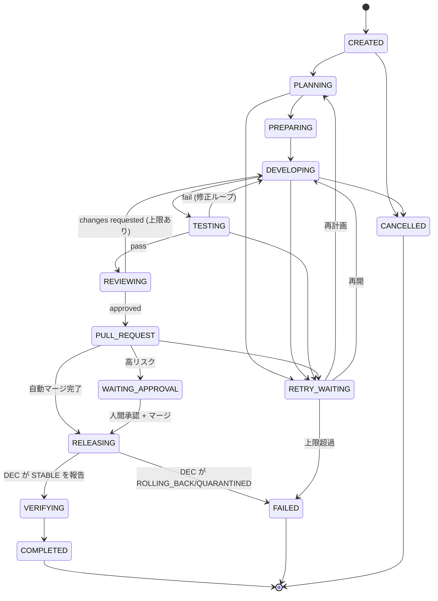

# 09. Self-Development Pipeline 設計

- 対象 Issue: kigawa-net/kivra#9
- 関連 Issue: #2 (fusha-task), #3 (Agent Manager), #4 (Agent 協調), #6 (Memory/recl), #7 (Dual Evolution), #8 (DEC), #10 (Runtime/API 契約), #11 (分散整合性), #12 (Fortis)
- 状態: ドラフト(レビュー待ち)

## 0. 本書の位置づけと事実確認の範囲

本書は「Kivra A/B が互いを開発し、fusha-task から取得したタスクを実装・レビュー・マージ・段階的デプロイ・評価記憶化まで一貫して実行する」パイプラインの **ステージ構造・責務・契約・安全条件** を定める。

他 Issue との分担(矛盾を避けるための境界):

| 論点 | 本書の扱い | 詳細の正本 |
|---|---|---|
| Run/Stage/Attempt/Checkpoint の論理モデルと遷移 | 定義する(§3) | 永続化スキーマ・CAS・Lease は #10 / #11 |
| 外部サービスとの契約 | 論理契約と確認済みの事実を定義(§5) | Adapter の細部(エラー分類等)は #10 |
| Release 内部状態(STAGING〜STABLE) | 入出力契約のみ(§8) | #8 |
| Release 状態・Lease・Leader の正本 | Fortis(#8, #12 の確定事項)。本書は参照のみ | #8 / #12 |
| タスク状態同期の詳細 | 書き込み規則のみ(§5.1) | #2 |

事実の確認状況(2026-10-12 時点、ローカル clone を直接読んだもの):

| 外部システム | 確認方法 | 結果 |
|---|---|---|
| exkes | `/home/kigawa/dev/kigawa-net/exkes`(HEAD `002c438`)のルート定義と `docs/implementation-plan.md` | 確認済み。ただし Execution の実処理(runtime-agent)は未実装(第3MS)。§5.2 |
| fusha-task | `/home/kigawa/dev/san/fusha-task`(HEAD `dfbfe5c`)の Hono コントローラ | 確認済み。§5.1 |
| GitHub | 一般仕様(Branch protection / Rulesets)。本書では具体 API 呼び出しは固定しない | 一部は「要確認」 |
| DEC | ローカルに実装 clone なし。Issue #8 の記述のみ | **全て「要確認」**(#8 の設計成果物待ち) |
| recl | ローカルに clone なし | **全て「要確認」** |
| Fortis | `/home/kigawa/dev/kigawa-net/fortis` は存在するが、Leader Election/Lease API は kigawa-net/fortis#27 で追加予定と #8/#12 に記載。本書では未参照 | 「要確認」 |

「要確認」は、未確認のため仮置きした記述であり、事実として扱わない。

## 1. 目的・非目的

目的:

1. fusha-task の改善タスクを起点に、人手を介さず(低・中リスク変更に限り)本番反映まで到達する。
2. 「変更者が自身の本番昇格を行わない」「AI の自己申告を承認根拠にしない」を、パイプライン構造として強制する。
3. 再起動・障害・重複実行に対して安全(曖昧なら止まる)である。

非目的:

- DEC 内部のアルゴリズム、Fortis の協調プロトコル(#8, #12)。
- fusha-task 上のタスク管理機能の再実装(#2。タスク状態の正本は常に fusha-task)。
- 全世界 Exactly-Once の主張(#11 の方針に従い、曖昧な副作用は再試行より照合・停止を優先)。

## 2. 全体像と責務・信頼境界

```mermaid
flowchart LR
  subgraph Kivra["Kivra (開発担当 X が実行)"]
    ORC[Evolution / Orchestrator]
    RUN[(DevelopmentRun<br/>MariaDB: #11)]
    ADP[Adapters<br/>fusha / exkes / GitHub / DEC / recl]
  end
  FT[fusha-task<br/>タスク定義・依存・進捗の正本]
  EX[exkes<br/>隔離 Workspace / Execution]
  GH[GitHub<br/>PR / CI / Ruleset / Merge]
  POL[独立 Policy Evaluator<br/>(DEC 側, #8)]
  DEC[DEC<br/>Release の実行・Rollback]
  RC[recl<br/>評価・改善履歴]
  ORC --> RUN
  ORC --> ADP
  ADP <--> FT
  ADP <--> EX
  ADP <--> GH
  ADP <--> DEC
  ADP --> RC
  GH -- CI 成果物/署名 --> POL
  POL --> DEC
  DEC -- GitOps --> TGT[対象系統 Y の Deployment]
```

信頼境界:

- **信頼しない入力**: Agent の報告、PR 本文、Tool 出力、コミットメッセージ。これらは承認根拠にならない。
- **信頼できる根拠**: GitHub の Required Checks 結果(独立した CI Runner が生成)、署名付き成果物の digest、独立 Policy Evaluator の決定(`policyDecisionRef`)、DEC の Release 状態。
- 開発担当系統 X は「提案(PR)」までを行える。対象系統 Y への本番昇格は X からは実行不可(DEC が X の権限と無関係に実行。#7/#8)。

状態の正本(#10 と一致):

| 事象 | 正本 |
|---|---|
| タスク定義・依存・進捗 | fusha-task |
| DevelopmentRun / Stage / Attempt / Checkpoint | Kivra DB(MariaDB) |
| Workspace / Execution | exkes |
| PR / Commit / CI / Merge | GitHub |
| Release 状態(RELEASING 内部) | 正本は Fortis、責務主体は DEC(#8/#12) |
| 評価・経験記憶 | recl |

## 3. 状態モデル

### 3.1 用語

- **DevelopmentRun**: 1 タスクを 1 つの target 系統に対して実装〜検証まで進める 1 実行単位。
- **Stage**: Run 内の工程(§3.3)。
- **Attempt**: ある Stage の 1 回の試行(Stage ごとに採番、再試行で増える)。
- **Checkpoint**: 再開可能地点と、その時点の外部参照(commit SHA、artifact digest、PR 番号等)。
- **generation**: Run 所有権の世代番号。Run の Lease を取得するたびに増加し、旧 Worker の更新を拒否するために使う(CAS / Fencing の実装は #10/#11)。

### 3.2 DevelopmentRun のフィールド

Issue #9 の案に、本書で意味を確定したものを加える。

| 区分 | フィールド | 説明 |
|---|---|---|
| 識別 | `runId`, `taskId` | `taskId` は fusha-task の整数 ID。(`task.id` は `number` 型: 確認済み) |
| 系統 | `developerInstance`, `targetInstance` | A/B。**`developerInstance != targetInstance` を作成時に検証**し DB 制約でも強制 |
| 対象 | `repository`, `branch`, `baseSha` | branch 名は決定的に `kivra/run-{runId}`(再試行でも同一にして重複作成を防ぐ) |
| 進行 | `stage`, `attempt`, `planRevision`, `lastTransitionAt`, `checkpoint`, `generation`, `version` | `version` は楽観ロック用 |
| 実行環境 | `exkesSessionRef`, `workspaceRef`, `artifactRefs` | §5.2 |
| 変更 | `pullRequestRef`, `headSha`, `ciResultRef`, `signedArtifactDigest` | `headSha` が以降の全検証の対象(§6) |
| 判定 | `riskClassification`, `policyDecisionRef` | |
| リリース | `releaseId` | Release の詳細状態は持たず参照のみ |
| 制限 | `budget`, `limits`, `tracing` | §10 |

Run は fusha-task のタスク状態を複製しない(Issue #9 の方針)。fusha-task に書くのは §5.1 の要約情報のみ。

### 3.3 Stage と遷移

Stage は #10 の実行状態名に対応づける。

| 本書の Stage | #10 の状態 | 主な責務 |
|---|---|---|
| DISCOVER/PLAN | CREATED, PLANNING | 候補発見、計画、割当(A/B、target) |
| DEVELOP | PREPARING, DEVELOPING | exkes Workspace 作成、実装 |
| TEST/REVIEW | TESTING, REVIEWING | 回帰・セキュリティテスト、独立レビュー |
| PR/CI | PULL_REQUEST | PR 作成、CI 結果のひも付け |
| MERGE | PULL_REQUEST → WAITING_APPROVAL(必要時) | Policy 判定、人間承認、自動マージ |
| RELEASE | RELEASING | DEC へ依頼し、結果を監視(内部状態の正本は Fortis、更新責務は DEC) |
| VERIFY/LEARN | VERIFYING → COMPLETED | 運用評価、fusha-task 更新、recl 保存 |

終端・分岐: `FAILED`, `CANCELLED`, `RETRY_WAITING`(#10 の定義に従う)。



遷移規則:

1. 遷移は「Run の `version` を条件にした CAS 更新」+「`development_events` と outbox への同一トランザクション書き込み」で行う(#10/#11)。
2. 後退遷移は DEVELOPING への差し戻し(テスト失敗・レビュー指摘)と RETRY_WAITING のみ。**PULL_REQUEST 以降で `headSha` が変化したら、CI・レビュー・Policy 判定をすべて無効化**し TESTING へ戻す(§6)。
3. RELEASING に入った後の Run は Kivra から Release 内容を変更しない。中止は `requestRollback` / 取消依頼のみ(§8)。
4. 終端状態からの遷移はない。再挑戦は新しい Run を作成する(旧 Run を `supersededBy` で連結)。

### 3.4 Attempt と Checkpoint

- Attempt は `(runId, stage, attemptNo)` で一意。`attemptNo` は Stage 内で単調増加。レビュー修正ループでは DEVELOP/TEST/REVIEW を回るたびに Stage ごとの Attempt が増える。
- Checkpoint は Stage の **完了時** にのみ作成する(途中状態は作らない)。内容:

| Stage 完了 | Checkpoint に含める参照 |
|---|---|
| PLAN | `planRevision`, 割当(developer/target)、対象リポジトリ・`baseSha` |
| DEVELOP | `workspaceRef`, ブランチ名, push 済み `headSha`, 差分統計 |
| TEST | `headSha` に対するテスト実行(`executionRef`)と結果アーティファクト |
| REVIEW | レビュー Execution 参照、レビュー対象 `headSha`、判定 |
| PR/CI | `pullRequestRef`, `headSha`, `ciResultRef` |
| MERGE | merge commit SHA、`policyDecisionRef`、(人間承認時)承認記録 |
| RELEASE | `releaseId`, 固定した artifact digest |

再開は「最後の Checkpoint の次の Stage から」。Stage の内部(例: exkes Execution の途中)は再開せず、**外部の実状態を照合したうえで** 継続か再実行かを決める(§9)。

## 4. 各ステージの設計

### 4.1 DISCOVER/PLAN

- 入力: fusha-task の候補タスク(Orchestrator がポーリング等で取得。取得方式は #2)。Evolution Engine が新規発見した改善案は、まず fusha-task にタスクとして作成し、**Run は必ず既存 `taskId` を持つ**(タスク定義の正本を一本化)。
- 出力: 割当。`developerInstance` / `targetInstance` を決定し、同一でないこと、その target に対する進行中 Run 数(上限は §10)を検証。
- 高リスク分類(§6.3)は **PLAN 時の暫定分類**と **PR 時の確定分類(実差分ベース)** の 2 回行う。確定分類が暫定より高ければ、確定分類を採用する。
- 計画変更は `planRevision` を増やす。依存タスクが未完了なら Run を作らない(fusha-task の `nextTaskIds` / `relatedTaskIds` を参照。意味づけは #2 で確定。**要確認**)。

### 4.2 DEVELOP

- 対象系統とは分離された exkes Workspace(開発担当系統の権限境界内)で実装する。Workspace から Kivra 本体・MariaDB・Kubernetes API・他 Runtime へ到達できないことは exkes のサンドボックス設計に依存(§5.2)。
- 成果は Workspace 内で commit し、**Kivra の Adapter が GitHub へ push する**(Workspace 内に GitHub 書き込み資格情報を置かない方針案。**要確認**: exkes から外部へ git push する経路・資格情報の持たせ方は未決)。
- ブランチは `kivra/run-{runId}` 固定。既存ブランチがあれば再作成せず、その `headSha` を照合して再利用する。

### 4.3 TEST/REVIEW

- テスト: 回帰・セキュリティテストを exkes Execution(COMMAND)として実行し、**同じ検証は GitHub CI でも必ず実行**する(§6)。Workspace 内の結果は修正ループの高速フィードバック用であり、承認根拠にはしない。
- 独立レビュー: Reviewer は Developer と別の Execution(別 Workspace、別セッション)で動かす。Reviewer は diff と CI 成果物を入力とし、PR 本文・Developer の説明は入力に含めない(または信頼しない参考情報として分離)。
- 反復上限: レビュー修正ループは `limits.maxReviewRounds`(初期値案 3)。超過で RETRY_WAITING → 人間エスカレーション。
- レビュー結果は GitHub の PR レビュー(または Check)として記録し、承認根拠は §6 に従う。**Kivra の Reviewer Agent が GitHub 上の必須承認を代替するかは「要確認」**(Reviewer が PR の著者と同一 GitHub アカウントだと GitHub 自身が承認を数えない点に注意。別アカウント/App が必要)。

### 4.4 PR/CI

- PR 作成は `headSha` を明示し、PR 本文に `runId`・`taskId`・`headSha` を機械可読(例: トレーラ/ラベル)で埋め込む。重複検出は「同一 head ブランチの open PR を検索」で行う(§5.3)。
- CI 結果は `(pullRequestRef, headSha)` に対して取得。**`headSha` が一致しない結果は無視**する。

### 4.5 MERGE

§6 で詳述。

### 4.6 RELEASE

§8 で詳述。Kivra の責務は「DEC に Release を依頼し、結果を購読/ポーリングして Run に反映する」こと。

### 4.7 VERIFY/LEARN

- DEC が OBSERVING → STABLE を報告した後、**Kivra 自身ではなく独立した指標**(DEC/Health Monitor の観測値、運用メトリクス)を取得して評価する。対象系統 Y の自己申告は用いない(#7「相手の監視結果だけを信頼しない独立評価」)。
- fusha-task へ結果を追記(§5.1)。recl へ経験を保存(§5.5)。いずれも失敗しても Run の COMPLETED は取り消さない(副作用は後続 Outbox で再試行)。

## 5. 外部システム間の API 契約

> 本節の「確認済み」は §0 の clone を読んだ結果。「Kivra 抽象」は #10 の Adapter 抽象であり、外部の現行 API ではない。

### 5.1 fusha-task(確認済み: Hono / Cloudflare Workers 構成)

確認できた事実(`src/presentation/controllers/tasks.ts`, `src/index.ts`, `middleware/auth.ts`, `domain/entities/Task.ts`):

- Base: `/api/v1`(`apiV1` に `/tasks` がマウントされている。プレフィックス全体は `src/index.ts` 参照)。
- `GET /tasks`(`assigneeId`, `viewId` 絞り込み)、`GET /tasks/:id`、`POST /tasks`(`title` 必須)、`PATCH /tasks/:id`、`DELETE /tasks/:id`、`GET|POST /tasks/:id/comments`。
- 認証: `Authorization: Bearer <OIDC ID トークン>`。`verifyIdToken` で検証後 `users` を UPSERT。**サービスアカウント/API キー/Webhook の仕組みはコード上確認できず**。
- `Task`: `id:number`, `title`, `description`, `assigneeId`, `customFields: Record<string,unknown>`, `relatedTaskIds`, `nextTaskIds`, `groupId`, `viewerGroupId`, `updatedAt` 等。
- PATCH 時、`customFields` はバリデーションされ(`validateCustomFields`)、閲覧のみ権限者は 403。**PATCH に `If-Match`/`updatedAt` による楽観ロックはコントローラ上確認できない**(サービス層実装は未精読。**要確認**)。また customFields の更新が「マージ」か「全置換」かは Service 実装を未確認のため、**全フィールドを読み出して全量を書き戻す read-modify-write** を前提に設計する(他の fusha-task 利用実績でも全置換の挙動が報告されている)。

Kivra の利用方針:

| 操作 | 契約 |
|---|---|
| タスク取得 | `GET /tasks`, `GET /tasks/:id`(Kivra 用ユーザー/ロールで認証) |
| 進捗の反映 | **コメント追加(`POST /tasks/:id/comments`)を主手段**とし、状態は Run の主要遷移(開始・PR 作成・マージ・リリース結果・完了/失敗)のみ。コメントには `runId` と遷移 ID を含め、同一遷移の重複投稿は「同じ遷移 ID のコメントが既に存在するか」を検索して抑止(コメントは冪等キーを受け付けないため) |
| 状態フィールド更新 | `customFields` の特定キー(例: `kivraRunId`, `kivraStage`)を更新する場合は read → 全量マージ → PATCH。競合検出が弱いため、**1 タスクを更新する Kivra 側の書き込み主体を 1 つに制限**(Run 所有者のみ) |
| 依存関係 | 読み取りのみ(`nextTaskIds`, `relatedTaskIds`)。Kivra 側で変更しない |
| 完了 | タスク完了はステータス系 customField の更新で表現(フィールド名・値は fusha-task の運用定義に依存。**要確認**) |

要確認(#2 で確定):

1. Kivra 専用の認証主体(サービスアカウント相当)を OIDC で用意できるか。現状は人間ユーザー向けの ID トークン前提に見える。
2. 変更通知(Webhook/イベント)は確認できず、**当面ポーリング**前提。
3. AI による破壊的操作(DELETE)の禁止は Kivra 側の Adapter で強制(Adapter に DELETE を実装しない)。

### 5.2 exkes(確認済み: `exkes-api`)

確認できた REST(`WorkspaceRoutes.kt`, `RuntimeRoutes.kt`):

| メソッド・パス | 応答 | 備考 |
|---|---|---|
| `POST /v1/workspaces` (`name`, `storageSizeBytes`, `labels`) | 202 Accepted | desired state のみ書き、実体作成は controller が非同期に実施 |
| `GET /v1/workspaces`, `GET /v1/workspaces/{id}` | 200 | `status`, `limit`, `offset` で一覧絞り込み |
| `DELETE /v1/workspaces/{id}` | 202 | 削除中の再呼び出しは冪等に 202 |
| `POST /v1/workspaces/{wid}/runtimes` (`templateId`, `resourcesJson`, `envJson`, `ttlSeconds`, `labels`) | 202 | |
| `GET .../runtimes[/{id}]`, `POST .../{id}/start`, `/stop`, `DELETE .../{id}` | 200/202 | |
| `POST /v1/runtimes/{rid}/executions` (`type`=COMMAND/AGENT, `commandJson`, `agentConfigJson`) | 202 | |
| `GET /v1/runtimes/{rid}/executions[/{id}]` | 200 | ステータス列挙の値は未精読(**要確認**) |

事実上の制約(Adapter 設計に影響):

- **Idempotency-Key を受け付ける実装は確認できない**(リポジトリ内の idempotent 言及は Workspace の内部状態遷移の冪等性のみ)。よって `createWorkspace(spec, idempotencyKey)` は exkes 側に鍵がなく、**`labels` に `kivra.runId` / `kivra.operationId` を付与し、タイムアウト後は `GET /v1/workspaces` を検索(label 検索のクエリが API にあるか未確認。無ければ一覧取得して絞る。要確認)して照合**する。
- API はすべて非同期受理(202)。「作成完了」は `GET` のポーリングで確認する。
- **認証は未実装**(`implementation-plan` では Keycloak OIDC は MVP 後続フェーズ、issue #13)。**Kivra が exkes を本番利用する前提条件**として認証導入を置く。
- Execution の実処理(`runtime-agent`、AGENT type で Claude Code を起動、ログ/成果物の Ceph RGW 保存)は **第3〜5マイルストーンで未実装**(`implementation-plan` 記載)。ログ取得(`GET /v1/executions/{id}/logs` 相当)は現行ルートに存在しない。→ MVP の最初のマイルストーンは「exkes の該当機能の完成待ち」に依存する。
- Execution の `cancel` API は現行ルートに確認できない。`cancelExecution` は Runtime の `stop` で代替できるか **要確認**。

Kivra 抽象(#10)との対応:

| Kivra 抽象 | exkes 実 API | ギャップ |
|---|---|---|
| `createWorkspace` | `POST /v1/workspaces` | 冪等キーなし → label + 照合 |
| `startAgent` | `POST /v1/workspaces/{id}/runtimes` + `POST /v1/runtimes/{id}/executions`(AGENT) | 2 段階。AGENT 実行は未実装 |
| `getExecution` | `GET /v1/runtimes/{rid}/executions/{id}` | 実行ログ・成果物取得は未実装 |
| `cancelExecution` | (確認できず) | 要確認 |

### 5.3 GitHub

(本節は一般的な GitHub の仕様に基づく設計であり、組織の実設定は **要確認**。)

| 抽象 | 方針 |
|---|---|
| `createPullRequest(spec, idempotencyKey)` | GitHub は冪等キーを受けない。**head ブランチ `kivra/run-{runId}` で既存 open PR を検索し、あれば再利用**。PR 作成のレスポンス喪失(タイムアウト)時も同じ検索で照合 |
| `getChecks(prRef)` | `headSha` に対する Check Runs / Commit Status を取得。取得した SHA が Run の `headSha` と一致することを検証 |
| `merge(prRef, expectedHeadSha)` | `sha` 引数付きのマージ API を使い、head が変わっていれば拒否させる(GitHub 側で原子的に保証される) |
| 認証 | Kivra 専用の GitHub App(最小権限: contents/pull_requests/checks 読取、PR 作成・マージ)。**トークンは exkes Workspace に渡さない**(§4.2) |

保護ブランチ(Ruleset)の必須設定(リポジトリ側の前提条件。未設定なら MERGE へ進めない=fail-closed):

1. 必須ステータスチェック(§6.1)かつ「最新の base に対して up-to-date」。
2. 直接 push 禁止、force push 禁止。
3. 必須レビュー(§6.2)と CODEOWNERS(高リスクパス)。
4. バイパス権限者に Kivra の App を含めない。

### 5.4 DEC(全面的に要確認)

DEC の API は #8 の成果物待ちでありローカルに実装もない。本書では **Kivra が必要とする最小の論理契約**だけを定義し、#8 との整合で確定させる(Issue #8 に「Self-Development Pipeline との API 境界」が成果物として列挙されている)。

`requestRelease` の入力:

| フィールド | 説明 |
|---|---|
| `releaseRequestId` | Kivra 側で決定的に生成(`runId` + `releaseSeq`)。**DEC が重複受理を検出する冪等キー**(DEC が受け付けるか要確認) |
| `targetInstance` | A/B(`developerInstance` と異なること) |
| `repository`, `mergeCommitSha` | マージ済みの不変参照 |
| `artifact` | `digest`(immutable)、署名参照、SBOM 参照(採用時) |
| `ciResultRef` | 信頼できる CI 成果物への参照(PR 本文ではない) |
| `riskClassification`, `policyDecisionRef`, `humanApprovalRef?` | |
| `requestedBy` | `developerInstance`、`runId`、`generation` |
| `rollbackCompat` | ロールバック可否の宣言(DEC が独立に再検証。#8「ロールバック不可の非互換変更を事前に拒否」) |

出力: `releaseId`、受理/拒否(理由コード)。以降 `getRelease(releaseId)` で `phase`(#8 の PROPOSED〜STABLE/FAILED/ROLLING_BACK/QUARANTINED)を参照。

DEC が自前で Policy を評価する(Kivra が渡した `policyDecisionRef` は参照情報であり、DEC が再検証する)。**Policy Evaluator と DEC の配置、Kivra が Policy 決定を事前に取得する経路は #8 で確定(要確認)**。

### 5.5 recl(全面的に要確認)

ローカルに clone が見つからないため API・認証・データモデルは未確認。論理契約のみ:

- 書き込み: 改善の根拠、結果、評価指標、失敗原因を Run 単位で保存。キーは `runId` + `eventSeq`(書き込みを冪等にできるか要確認)。
- 読み取り: PLAN/DEVELOP/REVIEW の文脈取得(類似過去事例)。
- 書き込みの失敗は Run をブロックしない(Outbox で非同期再試行)。
- 保存禁止: Secret、Workspace 内の機密ファイル内容。

### 5.6 データ参照の方針(横断)

- 外部オブジェクトは **参照(ID, SHA, digest, URL)を保存**し、本文の複製をしない。
- 参照には「いつの時点のものか」を持たせる(`headSha`, `observedAt`)。
- すべての外部呼び出しは Operation Journal(#11)に `PREPARED → IN_FLIGHT → CONFIRMED/…` を記録してから行う。

## 6. PR・CI・独立レビュー・自動マージの条件

### 6.1 CI

自動マージ可能となる必須チェック(すべて `headSha` に紐づく結果):

1. 単体・統合・回帰テスト。
2. セキュリティ: 依存脆弱性スキャン、Secret スキャン、静的解析(具体ツールはリポジトリごと。**要確認**)。
3. ビルド成果物の生成と、**署名・immutable digest の記録**(SBOM/出所は採用時)。
4. 差分サイズ・変更パスの検査(§6.3 の高リスクパス検出)。

CI は **Kivra/Agent が編集可能な設定(ワークフロー、テスト定義)で自己改変できない** こと。ワークフロー/テスト基盤を変更する PR は高リスク(§6.3)。

### 6.2 独立レビュー

- AI レビュー(Reviewer Agent)は「独立」を、**別 Execution・別 Workspace・Developer の説明を入力に含まない・別のモデル構成(可能なら)** で定義。
- AI レビューの判定は **自動マージの十分条件にしない**。マージ可否は CI + 独立 Policy 決定で決め、AI レビューは Policy 入力の 1 要素(指摘の未解決数が 0 であること等)とする。
- 低リスクのみ AI レビューのみで可、中リスクは「別系統(target 以外の第三者または他方系統)の AI レビュー + Policy」、高リスクは人間承認必須。**この線引きは Policy の初期値案であり、確定は #8 の Release Policy と合わせる(要確認)**。

### 6.3 リスク分類

| リスク | 例(初期案) | 自動マージ | 自動デプロイ |
|---|---|---|---|
| 高 | 認可/認証、Secret、Policy Engine、Controller(DEC)自身、共通 DB・基盤、CI/ワークフロー、マイグレーション、権限設定 | 不可(人間承認 + マージ) | 不可(人間承認が必須。#7/#8) |
| 中 | 通常の機能変更(外部公開 API 変更を含む) | Policy 次第 | Release Policy で明示されたもののみ |
| 低 | ドキュメント、テスト追加、内部リファクタの一部 | 可 | 可 |

- パスベースのルール(CODEOWNERS 相当)と差分内容の分類器の **高い方** を採用。分類不能・失敗は高リスク(fail-closed)。
- 分類結果は `riskClassification` に保存し、`policyDecisionRef` とともに監査対象。

### 6.4 自動マージ条件(全て AND)

1. `headSha` に対する必須チェックがすべて成功し、結果が `headSha` と一致。
2. base ブランチに対し最新(up-to-date)。
3. 独立 Policy 決定が `ALLOW`(決定は `headSha` と `riskClassification` に束縛され、有効期限付き)。
4. 未解決のレビュー指摘が 0。
5. 高リスクなら人間承認記録があり、承認対象 `headSha` が一致。
6. `developerInstance != targetInstance`、Run の `generation` が現行(旧 Worker でない)。
7. マージ呼び出しは `merge(prRef, expectedHeadSha)`。head が動いたら失敗 → TESTING に戻す。
8. 予算・同時実行・変更範囲の上限内(§10)。

いずれかの情報が欠落・取得不能 → マージせず RETRY_WAITING または WAITING_APPROVAL(fail-closed)。

## 7. ステージごとの再試行・タイムアウト・冪等性・補償操作

初期値は設計案(運用で調整)。再試行は指数バックオフ + ジッタ。「分類」は #10 のエラー分類に従う(一時的/恒久的/不明)。**不明(タイムアウト等)は再試行より先に照合**する。

| Stage | タイムアウト(案) | 再試行 | 冪等性の確保 | 補償操作 |
|---|---|---|---|---|
| PLAN | 10 分 | 3 回 | 計画は `planRevision` で追記のみ | なし(Run を CANCELLED に) |
| DEVELOP: Workspace 作成 | 5 分(ポーリング) | 3 回 | label `kivra.runId` による既存照合(§5.2) | `DELETE /v1/workspaces/{id}` |
| DEVELOP: 実装 Execution | 60 分(案) | 2 回(同一 Checkpoint から) | Execution 作成前に Journal に記録。不明時は既存 Execution を列挙して照合 | Execution 取消(API 要確認、無ければ Runtime stop) |
| TEST | 30 分 | 2 回 | 結果は `headSha` に束縛 | なし |
| REVIEW | 20 分 | 2 回 | 結果は `headSha` に束縛 | なし |
| ブランチ push | 2 分 | 3 回 | ブランチ名固定。同一 SHA の push は no-op | 未マージならブランチ削除 |
| PR 作成 | 1 分 | 3 回 | head ブランチで既存 PR 検索(§5.3) | PR を close |
| CI 待ち | 60 分 | ポーリング(再 trigger は 1 回まで) | `headSha` 一致検証 | PR を close |
| MERGE | 1 分 | 不明時は照合のみ(再実行しない) | `merge(prRef, expectedHeadSha)`。再実行時は PR の merged 状態/merge commit を確認 | **revert PR を新 Run として起票**(履歴の書き換えはしない) |
| RELEASE 依頼 | 1 分 | 不明時は `releaseRequestId` で照合、無ければ再依頼 | `releaseRequestId`(DEC の受理仕様は要確認) | `requestRollback(releaseId, reason)` |
| RELEASE 待ち | DEC 側のタイムアウトに従う + Run 側の上限(案 24 時間) | ポーリング継続 | `getRelease` は読み取り | DEC が実施 |
| VERIFY | 観測期間 + 1 時間 | 3 回 | 読み取りのみ | なし |
| fusha-task 更新 | 1 分 | 5 回(Outbox) | 遷移 ID を含むコメントの重複検出(§5.1) | 追加コメントで訂正(削除しない) |
| recl 保存 | 1 分 | 5 回(Outbox) | `runId`+`eventSeq`(要確認) | なし |

共通ルール:

- すべての副作用は **Outbox + Operation Journal 経由**(#11)。Run 状態の確定と Journal の PREPARED を同一トランザクションで書く。
- 再試行上限超過 → RETRY_WAITING → 上限超過で FAILED と **補償**(Workspace 削除、未マージブランチ・PR の close)を実施。ただし RELEASING 以降は DEC に委ね、Kivra は Rollback 依頼と通知のみ。
- 補償は「作ったものだけを消す」。label/ブランチ名の `runId` が一致するものに限定し、他 Run の資源は触らない。

## 8. 自動デプロイと Rollback の入力・検証・通知契約

### 8.1 入力(Kivra → DEC)

§5.4 の `requestRelease` を参照。検証は二重化する。

| 検証 | Kivra(依頼前) | DEC(受理時、権威) |
|---|---|---|
| `developerInstance != targetInstance` | 検証 | 検証 |
| artifact が `mergeCommitSha` から CI で生成されたもの | CI 成果物の参照を確認 | 署名/digest/出所を独立検証 |
| Policy | `policyDecisionRef` を確認 | 再評価 |
| 排他(A/B 同時更新禁止、グローバル Lease、Fencing Token) | **関与しない** | DEC + Fortis(#8/#12) |
| ロールバック可能性・DB migration 互換性 | 宣言 | 独立検証(expand–migrate–contract) |

Kivra は **Release の Lease/Fencing を自前で持たない**。Release 状態の正本は Fortis(#8/#12)であり、Kivra DB には `releaseId` と最後に観測した `phase` のキャッシュのみを保存する。

### 8.2 検証(昇格・Rollback の判断主体)

- 昇格・Rollback の**判断**は DEC(Health Monitor / Rollout Controller / Recovery Manager)。Kivra は判断しない。
- Kivra は DEC の観測から `phase` が STABLE/FAILED/ROLLING_BACK/QUARANTINED/RECOVERED のいずれかになるまで RELEASING に留まる。
- DEC が Quorum 喪失等で `getRelease` に応答しない場合: Kivra は **新規 Release 依頼を停止**し、既存の `releaseId` の問い合わせを継続(fail-closed)。

### 8.3 Rollback の起点

1. DEC 自動(ヘルス閾値違反等)。Kivra は通知を受けて Run を FAILED(`reason=ROLLED_BACK`)にし、fusha-task に反映。
2. 人間による Rollback 指示(break-glass 含む)。
3. Kivra 起点の `requestRollback(releaseRef, reason)`: Run のキャンセルや VERIFY で品質劣化を検知したとき。**これは「依頼」であり DEC が実行可否を判断する**。

### 8.4 通知契約

Run 状態遷移ごとに Outbox イベント(`eventId`, `runId`, `taskId`, `fromStage`, `toStage`, `generation`, `headSha`, `releaseId?`, `occurredAt`)を発行(at-least-once、消費側が `eventId` で重複排除。#11)。

| 事象 | 通知先 | 内容 |
|---|---|---|
| 人間承認が必要(WAITING_APPROVAL) | 人間(通知手段は要確認)+ fusha-task コメント | 差分要約、リスク分類理由、CI 結果リンク、承認期限 |
| Release 開始/昇格/完了 | fusha-task コメント | `releaseId`、phase |
| Rollback / Quarantine | 人間(緊急)+ fusha-task + recl | 理由、影響範囲、自動停止状態 |
| 両系統異常・Controller 停止 | 人間(最優先) | Kivra は新規 Run 開始を停止 |

## 9. 復旧(再起動後の整合)

#10 の復旧フローを本パイプラインに適用する。

1. DB から未完了 Run を列挙し Lease を取得(`generation` を増加)。
2. Stage 別に **外部実状態を照合**:

| 最終 Stage | 照合先 | 判定 |
|---|---|---|
| DEVELOP | exkes: label `kivra.runId` の Workspace/Execution | 実行中なら監視再開、完了なら成果(push 済み SHA)を確認、不明なら隔離 |
| PR/CI | GitHub: `kivra/run-{runId}` の PR と `headSha` | PR あり → 再利用、無し → 作成 |
| MERGE | GitHub: PR の merged 状態 | merged なら merge SHA を記録して RELEASE へ。head 不一致なら TESTING |
| RELEASE | DEC: `releaseRequestId` | 受理済みなら `releaseId` 取得・監視再開。不明・競合は保留して人間エスカレーション |

3. 照合結果で Checkpoint を前進/保持。副作用が不明な操作は **自動再実行せず UNKNOWN → RECONCILIATION_REQUIRED**(#11)。
4. 旧 Worker が復帰しても、`generation` 不一致で Run の更新が CAS により拒否される(外部への副作用は Journal の `generation` を確認、外部がフェンシング非対応の場合は §7 の照合で防ぐ)。

## 10. 監査・評価指標・実行制限

### 10.1 監査

- `development_events`(Run/Stage 遷移)、Operation Journal(外部副作用)を **追記専用**で保存。各エントリに `runId`, `actor`(系統・Worker・人間)、`generation`、`headSha`、`traceId`。
- Policy 決定・人間承認・Rollback は、決定時の入力(CI 結果参照、`riskClassification`、`headSha`、digest)とともに参照可能にする。
- Agent の実行ログは exkes 側(将来 Ceph RGW)の参照を保持。保管期間は要確認。
- Secret はログ・recl・fusha-task コメントに出さない(出力前マスク)。

### 10.2 評価指標

| 指標 | 用途 |
|---|---|
| Run 成功率、所要時間(Stage 別)、再試行回数、レビュー往復数 | パイプライン効率 |
| CI 初回通過率、差し戻し率 | 実装品質 |
| 自動マージ率、人間承認までの待ち時間、リスク分類の事後訂正数 | Policy 妥当性 |
| デプロイ後 Rollback 率、変更失敗率、復旧時間 | 本番品質(DEC 観測値を使用) |
| 費用(LLM/トークン、exkes 資源)/ Run | コスト制御 |
| UNKNOWN/RECONCILIATION_REQUIRED の件数、人間エスカレーション数 | 整合性・運用負荷 |

評価は VERIFY ステージで取得し recl に保存。指標の定義変更は fusha-task 上のタスクとして管理。

### 10.3 実行制限(初期案)

| 制限 | 初期値案 | 超過時 |
|---|---|---|
| 同時実行 Run 数(全体) | 3 | 新規 Run を待機 |
| 同一 target 系統の進行中 Run 数 | 1(本番 Release は DEC が別途直列化) | 待機 |
| 1 Run の再試行総数 | Stage 別上限 + 合計 10 | FAILED |
| レビュー修正ループ | 3 | 人間エスカレーション |
| 1 Run の費用上限 | **要決定**(Model Gateway #5 と整合) | 停止 |
| 変更範囲 | 変更ファイル数・行数の上限(案: 20 ファイル / 800 行) | 分割または高リスク扱い |
| 更新頻度 | 同一 target への本番 Release 間隔の下限(DEC Policy、#8) | 待機 |
| 連続失敗 | 同一リポジトリで 3 連続 FAILED/Rollback | **自動停止**し人間通知 |

- 両系統の異常、DEC 応答不能、Fortis Quorum 喪失の観測時は **新規 Run の RELEASE 到達を停止**(開発・PR までは継続可)。
- Kill switch(全 Run 一時停止)を人間が操作できる独立経路を持つ(配置は #7/#8 の break-glass と整合。要確認)。

## 11. MVP の実装 Issue 分割(案)

依存順。各項目は 1 Issue を想定。

| # | 実装 Issue(案) | 内容 | 前提 |
|---|---|---|---|
| 1 | DevelopmentRun ドメインとスキーマ | Run/Stage/Attempt/Checkpoint、状態遷移、CAS、events/outbox 雛形 | #10/#11 の設計確定 |
| 2 | Operation Journal と Recovery の最小実装 | UNKNOWN 照合の枠組み、`generation` 検証 | #1 |
| 3 | FushaTaskAdapter | タスク取得、コメント投稿、customFields の read-modify-write | #2、認証主体の確定 |
| 4 | ExkesAdapter | Workspace/Runtime/Execution、label 照合 | exkes の認証と Execution(第3MS)の完成 |
| 5 | GitHubAdapter と Ruleset 整備 | PR 検索/作成、Checks 取得、SHA 指定マージ、GitHub App | 対象リポジトリの Ruleset 設定 |
| 6 | DEVELOP〜TEST/REVIEW パイプライン(Release なし) | 実装 Agent と独立 Reviewer、修正ループ、上限 | #3〜#5 |
| 7 | PR/CI/Policy ゲートと自動マージ(低リスクのみ) | リスク分類、Policy 入力、`expectedHeadSha` マージ | #5、#8 の Policy 仕様 |
| 8 | DecAdapter(モック → 実 DEC) | `requestRelease`/`getRelease`/`requestRollback`、DEC のモックで先行 | #8 の API 確定 |
| 9 | RELEASE/VERIFY と通知 | 観測、fusha-task/recl 反映、Outbox 配送 | #8 |
| 10 | reclAdapter | 保存・文脈取得 | recl の API 調査 |
| 11 | 監査ログ・指標・実行制限・自動停止 | §10 | #1 |
| 12 | 障害注入 E2E | Worker crash、旧 Worker 復帰、PR/Release 応答喪失、DEC 停止 | #1〜#9 |

最初の縦切り(Walking skeleton)案: ドキュメント変更のみ(低リスク)の Run を、fusha-task 取得 → exkes → PR → CI → 自動マージまで通す(Release は人手で代替)。DEC が未完成の間はここまでを MVP とする。

## 12. 要確認事項・未解決論点

要確認(外部の事実未確認):

1. **DEC**: API、冪等キーの受理、Policy 評価の配置、Kivra への通知方式(push/pull)。#8 の成果物待ち。
2. **recl**: 存在するリポジトリ・API・認証・冪等書き込み。ローカルに clone なし。
3. **fusha-task**: Kivra 用の認証主体、Webhook の有無、PATCH の楽観ロックと `customFields` 更新セマンティクス(Service 層の精読)、完了を表すフィールド。
4. **exkes**: 認証(OIDC 導入は未実装)、Execution のログ・成果物・取消 API、Execution のステータス列挙、label による一覧絞り込みの可否。**Execution 自体が第3〜5MS で未実装**であり、MVP のブロッカー。
5. **GitHub**: Kivra 用 GitHub App と Ruleset の実運用設定、Reviewer Agent の承認の扱い(§4.3)。
6. Workspace 内から GitHub へ変更を渡す経路(§4.2)。

設計上の未解決論点:

1. リスク分類の初期ルールと、中リスクの自動マージ/デプロイ可否(Release Policy: #8)。
2. 1 Run 1 タスク 1 target で良いか(複数リポジトリにまたがるタスクの扱い)。
3. fusha-task への進捗反映を「コメント中心」にする方針の妥当性(状態は customFields、コメントは履歴)。
4. 費用上限と Model Gateway(#5)との責務分担。
5. 人間承認の通知経路・承認 UI・承認期限(失効時の扱い)。
6. Kill switch / break-glass の配置(A/B から変更・停止不能な Control Plane: #7/#8)。
7. DEC 未完成期間の本番反映の扱い(人手デプロイで代替する場合の監査)。
