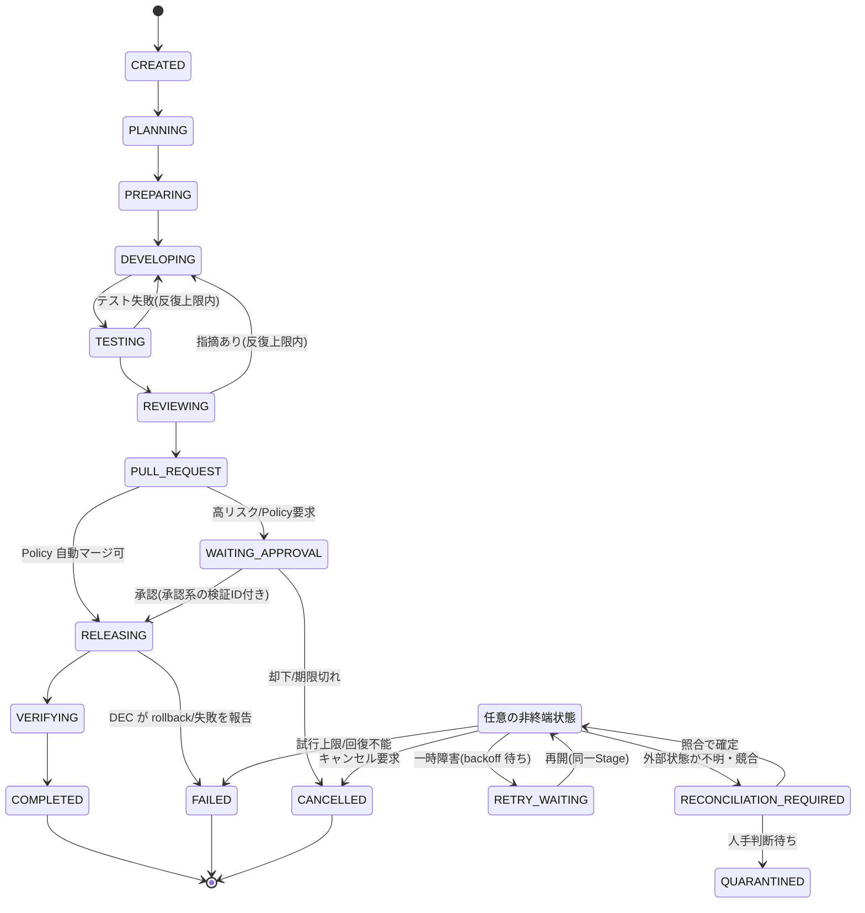
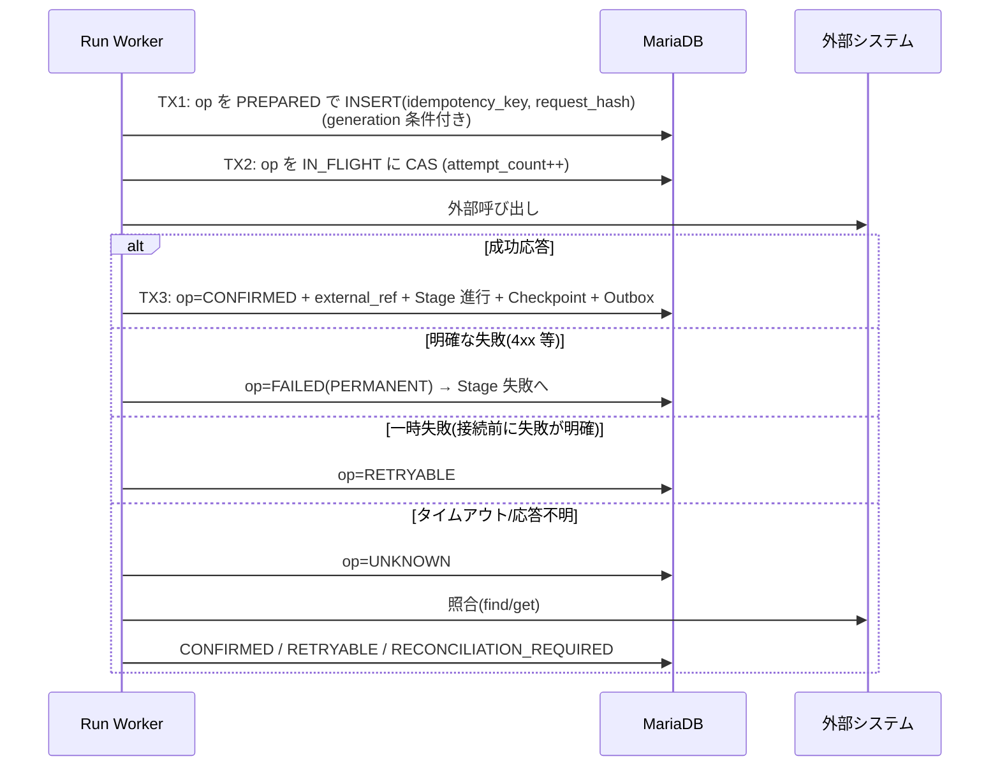
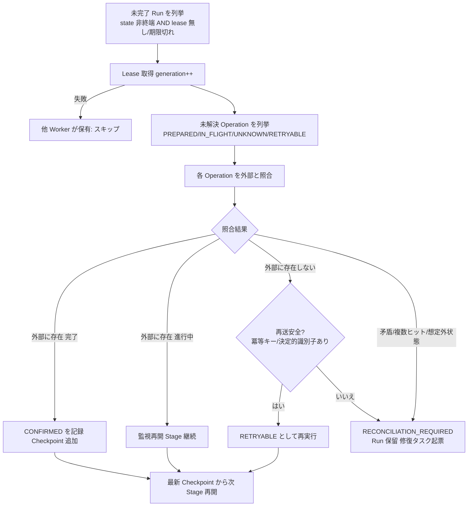

# Self-Development Runtime と外部API契約の設計 (Issue #10)

- 対象 Issue: kigawa-net/kivra#10
- 関連: #1 Core / #2 fusha-task / #3 Agent Manager / #4 Agent協調 / #7 Dual Evolution / #8 DEC / #9 Pipeline / #11 Recovery / #12 Fortis
- ステータス: ドラフト(設計のみ。実装なし)
- 作成日: 2026-10-12

## 0. 本書の位置づけと事実確認の方針

本書は Self-Development Pipeline (#9) を「長時間・障害耐性付き」で実行するための **Runtime(永続化・状態遷移・排他・外部API契約・復旧)** を定義する。

事実として書くのは次のものに限る。

| 区分 | 内容 |
|---|---|
| 確認済み | 関連 Issue 本文 (#1,#2,#3,#7,#8,#9,#10,#11,#12)、および `kigawa-net/exkes` のローカル clone (`exkes-api` のルート/DTO/状態 enum、`docs/implementation-plan.md`) |
| 未確認 | GitHub の現行 REST/GraphQL 挙動(公知仕様に基づく記述は「要確認」を付す)、DEC(#8 は設計中で実体なし)、fusha-task、Fortis(Coordination API は fortis#27 で追加予定、本書では契約案のみ) |

実在しない API を前提にしない。未確認・未実装の部分は **「要確認」** または **「提案」** と明記する。

### 0.1 Issue 間の整合方針(矛盾の解消)

| 論点 | #10 | #11 / #12 | 本書での扱い |
|---|---|---|---|
| DevelopmentRun の正本 | Kivra DB | MariaDB | **MariaDB**。一致している |
| Run実行Lease/generation | Run所有権としてDB | #12: Fortis が権威的に保持(Phase 3 で移行) | `LeaseStore` 抽象を置き、**MVP は MariaDB 実装、Fortis 実装は #12 の Phase 3 で差し替え**。Fortis は「本番採用不可」前提 (#12) なので既存の安全な手段を維持する |
| Release の正本 | DEC | #8/#12: DEC はステートレス、Release状態の正本は Fortis | Kivra から見た Release の**参照先は DEC の API**(`getRelease`)。DEC の裏側が Fortis か否かは Kivra の契約に影響させない |
| 状態の重複保持 | fusha-task の進捗は正本ではない | #9: fusha-task状態を重複して持たない | Run は Kivra 内部の実行状態のみ。fusha-task には**投影(project)**するだけ |
| DEC と Release Lease | #11: Run / 変更対象 / Production Release の Lease は別管理 | 同 | Run Lease は本書、変更対象・本番Release Lease は DEC/Fortis 側。Kivra は Release Lease を**保持しない** |

## 1. 設計原則

1. **Durable Execution**: Run の進捗は MariaDB に確定してから外部副作用を起こす。再起動後は DB から再構築する。
2. **Explicit Ownership**: 各データの正本を一つに決め、他は「照合対象 / キャッシュ / 投影」とする(§2)。
3. **自己申告を信用しない**: Agent の報告・PR 記述・Tool 出力は完了根拠にしない。GitHub CI 結果・exkes Execution の状態・DEC の Release 状態など**外部の観測可能な結果**を照合して再開する (#9, #7)。
4. **Exactly Once を主張しない**: At-least-once + 冪等 + 照合 + 曖昧なら停止 (#11)。
5. **Fail-closed**: 判断材料が欠落・不明・取得不能なら進めずに保留(`RECONCILIATION_REQUIRED`)。
6. **変更者 ≠ 対象**: `developerInstance != targetInstance` を Run 作成時と Release 要求時の両方で検証し、自己デプロイを禁止する (#7)。

## 2. 正本の割当(Source of Truth)

```mermaid
flowchart LR
  subgraph Kivra["Kivra (A or B)"]
    Orch[Orchestrator / Run Executor]
    Rec[Recovery Worker]
    Pub[Outbox Publisher]
    DB[(MariaDB<br/>runs / stages / journal / outbox)]
  end
  FT[fusha-task<br/>タスク/依存/進捗の正本]
  EX[exkes<br/>Workspace/Runtime/Execution の正本]
  GH[GitHub<br/>PR/Commit/CI/Merge の正本]
  DEC[DEC<br/>Release の正本]
  FO[Fortis<br/>Lease/epoch 将来]
  Orch --> DB
  Rec --> DB
  Pub --> DB
  Orch -->|ExkesAdapter| EX
  Orch -->|GitHubAdapter| GH
  Orch -->|DecAdapter| DEC
  Pub -->|TaskProvider 投影| FT
  Orch -.->|LeaseStore(将来)| FO
  DEC -.-> FO
```

| データ | 正本 | Kivra の保持物 |
|---|---|---|
| タスク定義・依存・進捗 | fusha-task | `taskId` 参照のみ。進捗は Outbox 経由で投影 |
| DevelopmentRun / Stage / Attempt / Checkpoint / Operation Journal / 監査 | **Kivra MariaDB** | 全部 |
| Workspace / Runtime / Execution | exkes | 参照ID、最後に観測した状態 |
| Branch / PR / CI / Merge | GitHub | PR番号、headSha、観測した check 結果 |
| Release(状態・段階・rollback) | DEC | `releaseId`、最後に観測した phase |
| Run 実行Lease(将来) | Fortis (#12 Phase 3 以降) | `generation` のローカルコピー |

「最後に観測した状態」は**キャッシュ**であり、判断(特に不可逆操作)の前に必ず外部を再取得する。

## 3. ドメインモデル

### 3.1 用語

| 用語 | 定義 |
|---|---|
| Run | 1 つの改善タスクに対する自己開発の 1 回の実行(`DevelopmentRun`) |
| Stage | Run の工程(PLANNING, PREPARING, ...)。Run は Stage を順に進む |
| Attempt | Stage の 1 回の試行(`stage_executions` の 1 行)。再試行で増える |
| Checkpoint | 復帰可能地点と、そこまでの成果物参照(スナップショットではなく**参照**) |
| Operation | 外部副作用 1 件(`external_operations`)。冪等キーを持つ |
| generation | Run の所有世代。Lease 取得のたびに単調増加するフェンシングトークン |
| developer / target | 変更を作る系統 / 変更される系統(A/B) |

### 3.2 Run 状態遷移

#10 の実行状態をそのまま採用し、分岐状態を追加する。Run の `state` は「現在どの Stage にいるか」と「終端/待機の別」を表す。



補足:

- **MERGE の位置**: #10 の状態列には MERGE がなく、#9 のパイプラインには MERGE がある。本書では `PULL_REQUEST` Stage の内部サブステップ(`PR_OPENED → CI_PASSED → MERGED`)として扱い、Run 状態は増やさない。サブステップは `execution_checkpoints` と `external_operations` で追跡する。
- **RELEASING 内部の進行は DEC が正本**: Kivra の Run は `RELEASING` に居る間、DEC の `getRelease` を観測するだけで、staging/canary 等の内部状態を自前で遷移させない。DEC の phase は Run 側に `releasePhaseObserved` として記録するのみ(#8 の STAGING/CANARY/PROMOTING/OBSERVING/STABLE/ROLLING_BACK/QUARANTINED は参照用。#8 が確定していない間は**要確認**)。
- `RECONCILIATION_REQUIRED` と `QUARANTINED` は #11 の Operation 状態と区別する(Run 状態 vs Operation 状態)。
- 終端: `COMPLETED / FAILED / CANCELLED`。`QUARANTINED` は人手操作でのみ出る(修復タスクを fusha-task に起票)。

遷移は `RunStateMachine` の許可表で検証し、DB の `UPDATE ... WHERE version = ? AND generation = ? AND state = ?` で確定する(§5)。許可表に無い遷移は例外(コード上のバグ検出)。

### 3.3 Stage / Attempt

Stage 種別と `Stage` ごとのポリシー:

| Stage | 主な外部副作用 | 既定タイムアウト(案) | 最大Attempt(案) | 補償操作 |
|---|---|---|---|---|
| PLANNING | fusha-task 更新 | 10 分 | 3 | なし |
| PREPARING | exkes Workspace/Runtime 作成 | 10 分 | 3 | Workspace/Runtime 削除(Run が作成したもののみ) |
| DEVELOPING | exkes Execution(AGENT) 起動 | 60 分 | 3 | Execution 停止(要確認: exkes に cancel API なし) |
| TESTING | exkes Execution(COMMAND) | 30 分 | 3 | 同上 |
| REVIEWING | 独立 Reviewer Agent 実行 | 30 分 | 反復上限(DEVELOPING↔REVIEWING 往復) 3 | なし |
| PULL_REQUEST | branch push, PR 作成, merge | 30 分(CI待ち除く) | 3 | PR close(merge 前のみ)。**merge 後の補償は revert PR を新 Run で作成。DEC rollback ではない** |
| WAITING_APPROVAL | なし | 承認期限 7 日(案) | - | なし |
| RELEASING | DEC release 要求 | DEC のSLOに従う | 要求は 1 回(冪等) | DEC `requestRollback` |
| VERIFYING | メトリクス確認、fusha-task/recl 更新 | 24 時間(観測窓、DEC準拠) | 3 | なし |

数値はすべて**初期案**で、`run_policies`(設定)で上書き可能にする。反復上限・費用上限・変更範囲上限は #9 の「実行制限」に対応し、超過時は `FAILED(reason=LIMIT_EXCEEDED)`。

`stage_executions` は Attempt を表す。同一 Stage の再試行は新しい行を足し、古い行は不変の履歴とする。

### 3.4 Checkpoint

Checkpoint は「どこから再開できるか」を表す。内容は**参照**(コミットSHA、PR番号、exkes ID、Artifact URI)であり、Workspace 全体のコピーではない。

| checkpoint kind | 再開可能になる条件 | 保持する参照 |
|---|---|---|
| `PLAN_FIXED` | 計画が確定 | planRevision, subtask 一覧 |
| `WORKSPACE_READY` | exkes Workspace/Runtime が READY/RUNNING | workspaceId, runtimeId |
| `COMMIT_PUSHED` | ブランチに commit が push 済み | branch, headSha |
| `TESTS_PASSED` | テスト Execution が SUCCEEDED | executionId, ログ/成果物参照 |
| `REVIEW_PASSED` | 独立レビュー合格 | reviewRunRef, headSha |
| `PR_OPENED` | PR が存在 | prNumber, headSha |
| `CI_PASSED` | 必須 check が headSha で成功 | check 結果参照, headSha |
| `MERGED` | PR が merge 済み | mergeCommitSha |
| `RELEASE_REQUESTED` | DEC が release を受理 | releaseId |
| `RELEASE_STABLE` | DEC が STABLE を報告 | releaseId |

Checkpoint は Stage 完了時に**Stage 完了の同一トランザクション**で書く。外部で観測した事実から書く(例: `PR_OPENED` は GitHub で PR を実際に取得できた後)。`headSha` が変わったら以降の Checkpoint(`TESTS_PASSED` 以降)は無効化(`superseded=true`)する。**CI 結果や承認は headSha に紐付ける**。

## 4. DBスキーマ(MariaDB)

正本は MariaDB (#11)。DDL は初期案で、型・インデックスは実装 Issue で確定する。時刻は UTC、`DATETIME(6)`。

```sql
CREATE TABLE development_runs (
  run_id              CHAR(26)     NOT NULL PRIMARY KEY,           -- ULID
  task_id             VARCHAR(128) NOT NULL,                       -- fusha-task 側ID
  developer_instance  ENUM('A','B') NOT NULL,
  target_instance     ENUM('A','B') NOT NULL,
  repository          VARCHAR(255) NOT NULL,
  branch              VARCHAR(255) NOT NULL,                       -- 決定的: kivra/run-<runId>
  state               VARCHAR(32)  NOT NULL,
  current_stage       VARCHAR(32)  NULL,
  attempt             INT          NOT NULL DEFAULT 0,             -- Run 通算
  plan_revision       INT          NOT NULL DEFAULT 0,
  generation          BIGINT       NOT NULL DEFAULT 0,             -- フェンシングトークン(Lease取得で++)
  version             BIGINT       NOT NULL DEFAULT 0,             -- 楽観ロック(更新ごとに++)
  lease_owner         VARCHAR(128) NULL,
  lease_expires_at    DATETIME(6)  NULL,
  workspace_ref       JSON NULL,       -- {workspaceId, runtimeId}
  pr_ref              JSON NULL,       -- {number, headSha, url}
  release_id          VARCHAR(128) NULL,
  risk_class          VARCHAR(16)  NULL,
  policy_decision_ref VARCHAR(255) NULL,
  budget_json         JSON NULL,
  trace_id            VARCHAR(64)  NULL,
  state_reason        VARCHAR(64)  NULL,
  next_retry_at       DATETIME(6)  NULL,
  created_at          DATETIME(6)  NOT NULL,
  updated_at          DATETIME(6)  NOT NULL,
  CONSTRAINT ck_not_self CHECK (developer_instance <> target_instance),
  UNIQUE KEY uk_active_task (task_id, active_flag),                -- 同一 task の同時 active Run を1つに(active_flag は生成列: 終端なら NULL)
  KEY ix_runs_recover (state, lease_expires_at),
  KEY ix_runs_retry (state, next_retry_at)
);

CREATE TABLE stage_executions (
  stage_exec_id  CHAR(26)    NOT NULL PRIMARY KEY,
  run_id         CHAR(26)    NOT NULL,
  stage          VARCHAR(32) NOT NULL,
  attempt_no     INT         NOT NULL,                  -- Stage 内の試行番号
  generation     BIGINT      NOT NULL,                  -- 実行した Worker の世代
  status         VARCHAR(16) NOT NULL,                  -- RUNNING/SUCCEEDED/FAILED/ABANDONED
  error_class    VARCHAR(32) NULL,
  error_detail   TEXT NULL,
  started_at     DATETIME(6) NOT NULL,
  finished_at    DATETIME(6) NULL,
  UNIQUE KEY uk_stage_attempt (run_id, stage, attempt_no),
  FOREIGN KEY (run_id) REFERENCES development_runs(run_id)
);

CREATE TABLE execution_checkpoints (
  checkpoint_id  CHAR(26)    NOT NULL PRIMARY KEY,
  run_id         CHAR(26)    NOT NULL,
  stage_exec_id  CHAR(26)    NOT NULL,
  kind           VARCHAR(32) NOT NULL,
  refs_json      JSON        NOT NULL,                  -- 参照(sha, prNumber, executionId ...)
  head_sha       CHAR(40)    NULL,
  superseded     BOOLEAN     NOT NULL DEFAULT FALSE,
  created_at     DATETIME(6) NOT NULL,
  KEY ix_ckpt_run (run_id, created_at)
);

CREATE TABLE external_operations (
  op_id            CHAR(26)     NOT NULL PRIMARY KEY,
  run_id           CHAR(26)     NOT NULL,
  stage_exec_id    CHAR(26)     NOT NULL,
  system           VARCHAR(16)  NOT NULL,              -- EXKES/GITHUB/DEC/FUSHA
  kind             VARCHAR(48)  NOT NULL,              -- CREATE_WORKSPACE, CREATE_PR, MERGE, REQUEST_RELEASE ...
  idempotency_key  VARCHAR(128) NOT NULL,              -- §7.1
  status           VARCHAR(32)  NOT NULL,              -- PREPARED/IN_FLIGHT/UNKNOWN/CONFIRMED/RETRYABLE/FAILED/RECONCILIATION_REQUIRED
  request_hash     CHAR(64)     NOT NULL,              -- 同一キー同一内容の検出
  external_ref     VARCHAR(255) NULL,                  -- 確定した外部ID
  generation       BIGINT       NOT NULL,
  attempt_count    INT          NOT NULL DEFAULT 0,
  last_error       TEXT NULL,
  created_at       DATETIME(6)  NOT NULL,
  updated_at       DATETIME(6)  NOT NULL,
  UNIQUE KEY uk_op_idem (system, kind, idempotency_key)
);

CREATE TABLE development_events (        -- 追記専用の監査履歴
  event_id    CHAR(26)    NOT NULL PRIMARY KEY,
  run_id      CHAR(26)    NOT NULL,
  seq         BIGINT      NOT NULL,                   -- run 内の単調連番
  type        VARCHAR(48) NOT NULL,
  from_state  VARCHAR(32) NULL,
  to_state    VARCHAR(32) NULL,
  actor       VARCHAR(128) NOT NULL,                  -- worker id / recovery / human
  generation  BIGINT      NOT NULL,
  payload     JSON NULL,
  created_at  DATETIME(6) NOT NULL,
  UNIQUE KEY uk_event_seq (run_id, seq)
);

CREATE TABLE outbox_events (
  outbox_id     CHAR(26)    NOT NULL PRIMARY KEY,     -- = eventId(消費側の重複排除キー)
  run_id        CHAR(26)    NOT NULL,
  run_version   BIGINT      NOT NULL,                 -- 順序・古さ検査用
  topic         VARCHAR(64) NOT NULL,
  payload       JSON        NOT NULL,
  status        VARCHAR(16) NOT NULL DEFAULT 'PENDING', -- PENDING/PUBLISHED/DEAD
  attempts      INT NOT NULL DEFAULT 0,
  next_attempt_at DATETIME(6) NOT NULL,
  created_at    DATETIME(6) NOT NULL,
  KEY ix_outbox_pending (status, next_attempt_at)
);

CREATE TABLE inbox_events (                -- Kivra が受信する側(Webhook/NATS)の重複排除
  source     VARCHAR(32)  NOT NULL,
  event_id   VARCHAR(128) NOT NULL,
  received_at DATETIME(6) NOT NULL,
  PRIMARY KEY (source, event_id)
);
```

設計メモ:

- `uk_active_task` は「同一タスクの二重 Run」を防ぐ。実装は MariaDB の生成列(`active_flag = IF(state IN ('COMPLETED','FAILED','CANCELLED'), NULL, 1)`)で行う想定。MariaDB の部分ユニーク制約の扱いは**要確認**(NULL を重複許容するユニーク挙動に依存)。
- `ck_not_self` により、DB レベルで自己開発を拒否する(アプリ検証の二重化)。
- Run 状態更新・`development_events` 追記・`outbox_events` 追記は**同一トランザクション**(Transactional Outbox, #11)。
- `branch` は `kivra/run-<runId>` と決定的に決める。これが GitHub 側の照合キーになる(§6.2)。

## 5. Lease / CAS / Fencing Token と Run 所有権

詳細は #11 の担当だが、Run Runtime が成立する最小仕様をここで定義する。

### 5.1 所有権モデル

- Run を実行できるのは `lease_owner` を持つ Worker 1 つだけ。
- Lease 取得ごとに `generation` を +1 する。`generation` が **Fencing Token** で、Run に対する全ての書き込み(状態更新・Operation 記録・Checkpoint 追加・Outbox 追記)が `WHERE generation = :myGeneration` を要求する。旧 Worker が復帰しても、世代が進んでいればローカル更新は全て 0 行更新で失敗する。
- Lease は Run 単位。**変更対象の排他と本番 Release Lease は別物**(後者は DEC/Fortis)。Kivra は変更対象への開発着手の排他(`target_instance` の同時 DEVELOPING 数制限)のみ `target_locks` で管理する案だが、詳細は #11 に委ねる(**未解決論点**)。

### 5.2 Lease 取得・更新(疑似コード)

```sql
-- 取得(期限切れまたは未保有の Run のみ)
UPDATE development_runs
   SET lease_owner = :worker, lease_expires_at = NOW(6) + INTERVAL :ttl SECOND,
       generation = generation + 1, version = version + 1
 WHERE run_id = :run
   AND state NOT IN ('COMPLETED','FAILED','CANCELLED','QUARANTINED')
   AND (lease_owner IS NULL OR lease_expires_at < NOW(6));
-- affected rows = 1 なら成功。SELECT generation で新世代を取得。

-- 更新(heartbeat)
UPDATE development_runs
   SET lease_expires_at = NOW(6) + INTERVAL :ttl SECOND
 WHERE run_id = :run AND lease_owner = :worker AND generation = :gen;
-- 0 行なら Lease 喪失: 直ちに全ての外部操作を中断し、Run から手を引く

-- 状態遷移(CAS)
UPDATE development_runs
   SET state = :to, current_stage = :stage, version = version + 1, updated_at = NOW(6)
 WHERE run_id = :run AND generation = :gen AND version = :ver AND state = :from;
```

- 期限判定は **DB サーバ時刻(`NOW(6)`)**のみ使う。Worker のローカル時計は使わない(clock skew 対策)。
- Worker は自身の Lease 残り時間が `ttl/3` を下回ったら外部副作用を新規に開始しない(Lease 失効後に旧 Worker が副作用を出す窓を縮める)。
- TTL 初期案: 60 秒、heartbeat 20 秒。長い Stage(Agent 実行 60 分)中は**外部 Execution を待つだけ**で heartbeat を継続する。Worker crash 時は TTL 後に Recovery Worker が引き継ぐ。

### 5.3 外部APIに対する Fencing の限界

DB の generation は**ローカル更新**しか守らない。Lease 失効後に旧 Worker が既に送出済みの HTTP リクエストは止められない。外部副作用は §7 の方法で守る。

- exkes / GitHub は generation を理解しない。**Fencing 非対応**として扱い、冪等キー相当の決定的識別子 + 既存オブジェクト照合で重複を抑止する。
- DEC は #8/#12 で epoch / Release ID による外部 Fencing を持つ設計。Kivra は `requestRelease` に `runId`, `generation`, `targetInstance`, `artifactDigest`, `policyDecisionRef` を渡し、DEC 側で検証する(契約案。DEC が確定するまで**要確認**)。

### 5.4 Fortis への将来移行

`LeaseStore` インターフェースを置く(`acquire(runId, owner) -> Lease(gen)`, `renew`, `release`, `validate(gen)`)。MVP は MariaDB 実装。#12 の Phase 3 で Fortis 実装(linearizable read + CAS)に差し替える。その場合でも `development_runs.generation` は Fortis 発行値をローカルにコピーして更新条件に使う(DB 側で単調増加を検証し、巻き戻りは拒否)。Fortis は本番採用不可(#12)なので、移行は #12 の採用ゲートを通過するまで行わない。

## 6. Adapter 契約

### 6.1 共通仕様

```kotlin
sealed interface AdapterResult<out T> {
  data class Ok<T>(val value: T) : AdapterResult<T>
  data class Failure(val kind: ErrorKind, val cause: String, val retryAfter: Duration? = null) : AdapterResult<Nothing>
}
enum class ErrorKind {
  TRANSIENT,        // 5xx/接続失敗/429: backoff 再試行可
  TIMEOUT_UNKNOWN,  // 送信済みかもしれない: 再送の前に必ず照合
  CONFLICT,         // 409/既存あり: 照合して既存を採用するか判断
  NOT_FOUND,
  PERMANENT,        // 400/422 など入力不正: 再試行しない
  AUTH,             // 401/403: 再試行せず運用アラート
  UNAVAILABLE_CONTRACT, // 想定した API が存在しない(要確認事項)
}
```

- **エラー分類の原則**: 書き込み系でレスポンスを受け取れなかった(タイムアウト・接続断)ものは `TIMEOUT_UNKNOWN` とし、**自動再送しない**。まず `find/get` で外部を照合し、結果で `CONFIRMED` / `RETRYABLE` / `RECONCILIATION_REQUIRED` を決める(§7)。
- **タイムアウト(初期案)**: 読み取り 10 秒、書き込み 30 秒、長時間待機はポーリングで行い 1 回の HTTP を長くしない。
- **再試行**: `TRANSIENT` のみ。指数 backoff(1s→2s→4s … 上限 60s)+ ジッタ、最大 5 回、その後 Run を `RETRY_WAITING`。`Retry-After` があれば優先。
- 全 Adapter メソッドは `OperationContext(runId, generation, opId, idempotencyKey)` を受け取り、ログ・トレースに付与する。
- 読み取りは冪等なので常に再試行可。

### 6.2 exkes Adapter

#### 確認できた現行 API(`kigawa-net/exkes` の `exkes-api` ソースより)

| メソッド | パス | 備考 |
|---|---|---|
| POST | `/v1/workspaces` | body: `name`, `storageSizeBytes?`, `labels?`。202 Accepted(desired state を書くのみ、PVC 作成は controller が非同期) |
| GET | `/v1/workspaces`, `/v1/workspaces/{id}` | list は `status`, `limit`, `offset` のみ。**labels での絞り込みなし** |
| DELETE | `/v1/workspaces/{id}` | 202。DELETING 済みなら冪等に 202(コメントより) |
| POST | `/v1/workspaces/{workspaceId}/runtimes` | body: `templateId`, `resourcesJson?`, `envJson?`, `ttlSeconds?`, `labels?`。202 |
| GET | `/v1/workspaces/{workspaceId}/runtimes[/{id}]` | |
| POST | `/v1/workspaces/{workspaceId}/runtimes/{id}/start` / `/stop` | |
| DELETE | `/v1/workspaces/{workspaceId}/runtimes/{id}` | |
| POST | `/v1/runtimes/{runtimeId}/executions` | body: `type`(COMMAND/AGENT/SYSTEM), `commandJson?`, `agentConfigJson?`。**labels なし、冪等キーなし** |
| GET | `/v1/runtimes/{runtimeId}/executions[/{id}]` | list は `status`, `limit`, `offset` |

- Workspace 状態: CREATING / READY / ARCHIVED / DELETING / DELETED / ERROR。Runtime 状態: CREATING / STARTING / RUNNING / STOPPING / STOPPED / FAILED / DELETING / DELETED / EXPIRED。Execution 状態: QUEUED / STARTING / RUNNING / SUCCEEDED / FAILED / CANCELLED / TIMED_OUT(終端: SUCCEEDED/FAILED/CANCELLED/TIMED_OUT。遷移表に CANCELLED が存在する)。
- 共通エラー形式 `{"code","message"}`。コード: `NOT_FOUND`(404), `CONFLICT`(409), `VALIDATION_ERROR`(400), `INTERNAL`(500)。
- 認証: **現行は無認証**(Keycloak OIDC + JWKS は後続フェーズ。第1マイルストーンは ClusterIP のみ、`docs/implementation-plan.md` 記載)。
- Workspace 名は DB で **UNIQUE**(`uk_workspaces_name`)。
- 実装状況の注記: clone 時点で `runtime-agent` はスケルトン、Execution の実行(第3MS〜)・ログ/Artifact API は未実装の可能性が高い。**Execution の実際の実行可否・`GET /executions/{id}/logs` は要確認**(implementation-plan にはあるが `exkes-api` のルートに無かった)。

#### 現行 API と #10 の提案契約のギャップ

| 提案契約 | 現行 exkes | 対処 |
|---|---|---|
| `createWorkspace(spec, idempotencyKey)` | 冪等キーなし。ただし `name` が UNIQUE | **`name = kivra-run-<runId>`(決定的)を冪等キーとして使う**。再送時は `GET /v1/workspaces` で name 一致を検索(list に name フィルタが無いため全件走査になる。**name フィルタ追加を exkes に要望**)。重複作成は 409 CONFLICT の可能性が高い(**Workspace 重複 name の応答は要確認**)。 |
| `startAgent(workspace, spec, idempotencyKey)` | Execution 作成に冪等キー/labels なし | Runtime を **Run 専用(1 Runtime = 1 Run)**にし、Runtime の `labels` に `kivra.runId`/`kivra.opId` を付ける。Execution は Runtime 内の `type=AGENT` を list して `agentConfigJson` に埋めた `opId` で照合する(`agentConfigJson` を Kivra が自由に拡張できる前提。**要確認**)。**exkes への要望: Execution に labels もしくは `Idempotency-Key`/`clientRequestId`、list での検索** |
| `getExecution(ref)` | `GET /v1/runtimes/{runtimeId}/executions/{id}` あり | ref は `(runtimeId, executionId)` の複合参照 |
| `cancelExecution(ref)` | **cancel エンドポイントなし**(状態遷移に CANCELLED はある) | 現状は Runtime `stop` / `DELETE` で代替できるが、Run 専用 Runtime でのみ許容。`cancelExecution` の追加を exkes に要望。それまでは `UNAVAILABLE_CONTRACT` |

#### Kivra 側のインターフェース(案)

```kotlin
interface ExecutionPlatform {  // 実装: ExkesAdapter
  fun createWorkspace(spec: WorkspaceSpec, ctx: OperationContext): AdapterResult<WorkspaceRef>
  fun findWorkspaceByName(name: String): AdapterResult<WorkspaceRef?>
  fun createRuntime(ws: WorkspaceRef, spec: RuntimeSpec, ctx: OperationContext): AdapterResult<RuntimeRef>
  fun startAgent(rt: RuntimeRef, spec: AgentSpec, ctx: OperationContext): AdapterResult<ExecutionRef>
  fun findExecutions(rt: RuntimeRef, opId: String): AdapterResult<List<ExecutionObservation>>
  fun getExecution(ref: ExecutionRef): AdapterResult<ExecutionObservation>
  fun cancelExecution(ref: ExecutionRef, ctx: OperationContext): AdapterResult<Unit>
}
```

認証: 現行なし。Keycloak OIDC 導入後は Kivra A/B それぞれの Service Account で client-credentials。**A の Service Account は B 用 Workspace を作れるが、A 自身のデプロイ権限は持たない**(§9)。NetworkPolicy で Kivra namespace からのみ到達可とする運用制御が前提(exkes 側の既存リスク記載と同じ)。

### 6.3 GitHub Adapter

GitHub は公知の REST API を使う。**以下は公知仕様に基づく記述で、ローカル確認はしていない。実装時に現行ドキュメントと照合すること(要確認)。**

| Kivra 契約 | GitHub API(想定) | 冪等/照合 |
|---|---|---|
| `createBranch/push` | git refs / Contents API / git push | ブランチ名 `kivra/run-<runId>` が決定的。存在確認 → 既に同一 SHA なら成功扱い |
| `createPullRequest(spec, key)` | `POST /repos/{o}/{r}/pulls` | 冪等キー非対応。`GET /pulls?head={owner}:kivra/run-<runId>&state=all` で既存を検索し、あれば採用。無ければ作成。PR 本文に `kivra-run: <runId>` マーカー |
| `getChecks(prRef)` | Checks API / Commit statuses を `headSha` で取得 | 常に `headSha` を指定し、PR の現在の head と一致する結果だけを採用 |
| `merge(prRef, expectedHeadSha)` | `PUT /pulls/{n}/merge` の `sha` パラメータ | `sha` 不一致は 409 → 失敗(head が動いた)。merge 済みは `GET /pulls/{n}` の `merged`/`merge_commit_sha` で確認 |

- **自動マージ可否の判断は GitHub に委ねる**: 保護ブランチの Required Checks / Ruleset を満たさなければ GitHub 自体が merge を拒否する(#9)。Kivra はそれに加えて独立 Policy(§9.2)を評価してから `merge` を呼ぶ。Kivra が Required Checks を迂回できる管理者権限を持たないこと。
- merge は**不可逆**。`MERGE` Operation は呼ぶ前に必ず `getPullRequest` で `head.sha == expectedHeadSha` かつ checks 成功を再取得して確認する。レスポンス不明(`TIMEOUT_UNKNOWN`)なら `GET /pulls/{n}` の `merged` を照合し、merge 済みなら `CONFIRMED`、そうでなければ状態に応じ `RETRYABLE`。
- **認証**: GitHub App(インストールトークン、短命)を推奨。権限は `contents:write`(ブランチのみ)、`pull_requests:write`、`checks:read`、`statuses:read`。保護ブランチへの直接 push、Ruleset のバイパスは不可。App は A 用・B 用で分離(Run の `developer_instance` に対応する App を使う)。トークンは Bitwarden 等の既存 Secret 管理経由(**運用基盤は要確認**)。
- **レート制限**: 429/`403 + rate limit` は `TRANSIENT`(`Retry-After`/`x-ratelimit-reset` に従う)。
- CI 結果は Agent 自己申告ではなく GitHub の check から直接取得する。`headSha` と一致しない古い結果は無視する。

### 6.4 DEC Adapter

**DEC (#8) は設計中で現行 API は存在しない(要確認)。以下は Kivra が要求する契約案であり、#8 と同期して確定する。**

```kotlin
interface ReleaseController {  // 実装: DecAdapter
  fun requestRelease(req: ReleaseRequest, ctx: OperationContext): AdapterResult<ReleaseRef>
  fun getRelease(ref: ReleaseRef): AdapterResult<ReleaseObservation>
  fun findReleaseByRequestKey(key: String): AdapterResult<ReleaseRef?>   // タイムアウト後の照合用
  fun requestRollback(ref: ReleaseRef, reason: String, ctx: OperationContext): AdapterResult<Unit>
}

data class ReleaseRequest(
  val requestKey: String,          // 冪等キー: "run:<runId>:release"
  val runId: String,
  val generation: Long,            // Run の世代(DEC 側の記録・拒否判断用)
  val repository: String,
  val mergeCommitSha: String,
  val artifactDigest: String,      // CI が生成した署名済み immutable digest
  val targetInstance: Instance,    // A or B
  val developerInstance: Instance, // 参考値。DEC は認証主体から独自に決定する
  val policyDecisionRef: String?,  // 独立 Policy の決定参照
  val riskClass: RiskClass,
)
data class ReleaseObservation(
  val ref: ReleaseRef, val phase: String, // #8: PROPOSED/VALIDATING/STAGING/CANARY/PROMOTING/OBSERVING/STABLE/FAILED/ROLLING_BACK/QUARANTINED/RECOVERED
  val epoch: Long?, val artifactDigest: String, val reason: String?
)
```

- **冪等性**: DEC は `requestKey` に対して同一内容なら既存 Release を返し、異なる内容なら 409 を返す(提案)。DEC が冪等キーを受け付けない場合の代替は `findReleaseByRequestKey` または `artifactDigest + targetInstance` での照合。いずれも無理なら**fail-closed**(要求を再送せず `RECONCILIATION_REQUIRED`)。
- **本番デプロイの権限は Kivra に無い**: Kivra は「要求」を出すだけ。昇格可否・排他・Lease・staging/canary・rollback の判断は DEC。Kivra が Kubernetes/GitOps に直接書く経路は存在させない。
- **観測**: `RELEASING` Stage は `getRelease` をポーリング(Webhook/イベントが DEC 側に出来れば併用、Inbox で重複排除)。DEC が応答不能でも Run は `RELEASING` のまま待機し、**新規リリース要求を出さない**。
- `requestRollback` は DEC が自動で行う rollback とは別の「Kivra からの任意要求」で、承認/Policy が必要な場合は DEC が拒否できる。Kivra は Rollback の可否判断を持たない。
- 認証: DEC は呼び出し元の Service Account から `developerInstance` を**自分で決定**し、リクエスト body の自己申告と一致しない場合は拒否する(§9.1)。方式(mTLS / OIDC client credentials)は **要確認**(#7/#8 の信頼境界に従う)。

### 6.5 補助: fusha-task / recl

fusha-task は本 Issue の主題外(#2)。Run 状態の fusha-task への反映は **Outbox 経由の投影**に限定し、`TaskProvider` インターフェース(#2 で確定)を呼ぶ。fusha-task の状態を読んでも Run の判断(Stage 進行)には使わない。ただし**キャンセル要求/優先度変更**は fusha-task 側が正本なので、Orchestrator が Run 境界で参照して `CANCELLED` 遷移の根拠にする(取得できなければ継続し、次の境界で再確認)。recl への保存は VERIFYING 後の Outbox 配送(失敗しても Run の完了判定に影響しない)。

## 7. Operation Journal / Outbox / Recovery

### 7.1 Operation Journal(外部副作用の二相記録)

外部副作用は次の手順で必ず記録する。



- **冪等キーの設計**(決定的に導出できること。ランダムにしない):

| Operation kind | idempotency_key | 外部での識別子(照合キー) |
|---|---|---|
| CREATE_WORKSPACE | `run:<runId>:workspace` | Workspace name `kivra-run-<runId>` |
| CREATE_RUNTIME | `run:<runId>:runtime` | Runtime labels `kivra.runId` |
| START_AGENT / START_TEST | `run:<runId>:stage:<stage>:attempt:<n>` | Execution の `agentConfigJson/commandJson` 内 opId(要確認) |
| PUSH_BRANCH | `run:<runId>:push:<headSha>` | ブランチ `kivra/run-<runId>` の SHA |
| CREATE_PR | `run:<runId>:pr` | head ブランチでの PR 検索 + 本文マーカー |
| MERGE | `run:<runId>:merge:<headSha>` | PR の merged / merge_commit_sha |
| REQUEST_RELEASE | `run:<runId>:release` | DEC の requestKey |
| REQUEST_ROLLBACK | `run:<runId>:rollback:<releaseId>` | DEC |

- 「Attempt を跨いで同じ外部リソースを使い回すか、新しく作るか」を Operation kind ごとに固定する: Workspace/Runtime/PR/Release は **Run につき 1 つ**(再試行で再利用)、Execution は **Attempt ごとに新規**(キーに attempt を含む)。
- `request_hash` が同一キーで異なる場合は**コードのバグ**として `FAILED` にし、再送しない。
- 外部識別が不可能な操作(照合手段が無い)は **fail-closed**: `RECONCILIATION_REQUIRED` → 保留 → 修復タスク(fusha-task)起票。

### 7.2 Transactional Outbox / Inbox

- Run 状態遷移・`development_events`・`outbox_events` を**同一トランザクション**で確定する。fusha-task への進捗投影・recl への経験保存・メトリクスはすべて Outbox 経由(DB 更新後に外部通知を直接呼ばない)。
- **Outbox Publisher**: `SELECT ... WHERE status='PENDING' AND next_attempt_at <= NOW() ORDER BY run_id, run_version LIMIT n FOR UPDATE SKIP LOCKED` で取得し配送。重複配送は許容(At-least-once)。失敗は backoff、上限超過で `DEAD`(アラート)。
- **順序**: Run 内は `run_version` 昇順で配送し、受信側は `eventId` 重複排除と `run_version` 逆行検査(古いイベントを無視)を行う。
- **Inbox**: 受信する Webhook/イベント(GitHub, DEC, NATS)は `(source, event_id)` を先に INSERT し、重複なら処理しない。
- NATS JetStream の採否は #11 で既存基盤と併せて判断(**未解決論点**)。MVP は「DB ポーリング配送」でも成立する。
- イベントを**状態の根拠にしない**: GitHub/DEC の Webhook は「照合を急ぐトリガー」で、状態確定は常に API 再取得で行う。

### 7.3 Recovery Worker

起動時および定期(例: 30 秒)に実行する。



再開ルール:

1. 照合は**外部に副作用を出さない読み取り**のみで行う。
2. 再開点は「最新の有効 Checkpoint(`superseded=false`)」。Checkpoint の参照先(SHA、PR、Execution)を**外部で再確認してから**使う(Checkpoint を信用しない)。
3. `UNKNOWN` の Operation が残る間は、その Operation より後の Stage に進まない。
4. 照合不能(外部サービス長時間断)は `RETRY_WAITING` を維持し、上限超過で `QUARANTINED`。
5. 再試行上限・backoff・キャンセル・監査ログ(`development_events`)は必須。保留 Run は fusha-task に修復タスク化する(Outbox 経由)。

#### 照合マトリクス

| 状況 | 照合対象 | 判定 | 結果 |
|---|---|---|---|
| Workspace 作成後に crash | exkes: name=`kivra-run-<runId>` を検索 | 存在し READY/CREATING | `CONFIRMED`、READY まで監視 |
| 同上 | 同上 | 存在せず | 再送(name が決定的) |
| Agent Execution 起動後に crash | exkes: Runtime の Executions を list し opId 照合 | RUNNING | 監視継続 |
| 同上 | 同上 | SUCCEEDED/FAILED | 結果を採用して Stage 終了(ログ/成果物は exkes から取得) |
| 同上 | 同上 | 該当なし | 再送(Attempt の新 opId で) |
| Execution 状態が取得不能 | exkes 障害 | - | `RETRY_WAITING`。再送しない(二重起動防止) |
| PR 作成後 crash | GitHub: head=`kivra/run-<runId>` の PR | 1 件 | 採用 |
| 同上 | 同上 | 0 件 | 再送 |
| 同上 | 同上 | 2 件以上 | `RECONCILIATION_REQUIRED` |
| merge タイムアウト | GitHub: PR merged? | merged=true | `CONFIRMED`(mergeCommitSha 取得) |
| 同上 | 同上 | open かつ head 不変 | `RETRYABLE`(再度 checks 確認後に `sha` 指定で merge) |
| 同上 | 同上 | head が変化 | 以降の Checkpoint を無効化し TESTING 以降へ戻す |
| release 要求タイムアウト | DEC: requestKey で検索 | 存在 | `CONFIRMED`、`getRelease` を監視 |
| 同上 | 同上 | 存在しない | 冪等キー対応が確認済みなら再送、未確認なら `RECONCILIATION_REQUIRED` |
| DEC 応答不能 | - | - | 待機。新規要求は出さない |

## 8. 復旧フロー全体(#10 の 5 手順との対応)

| #10 の手順 | 本書 |
|---|---|
| 1. DB で未完了 Run を列挙 | §7.3 Recovery Worker 起点 |
| 2. Lease と generation を確認 | §5.2 取得 CAS |
| 3. exkes/GitHub/DEC の実状態と照合 | §7.3 照合マトリクス |
| 4. 完了済み副作用を記録、継続中は監視、不明・競合は保留 | CONFIRMED / 監視 / RECONCILIATION_REQUIRED |
| 5. 冪等性確認後に限り未実行 Stage を再試行 | §7.1 の決定的キー + `request_hash` |

## 9. 権限境界(A/B と DEC)

### 9.1 信頼境界

```mermaid
flowchart LR
  subgraph A["Kivra A (SA: kivra-a)"]
    A1[Orchestrator/Worker]
  end
  subgraph B["Kivra B (SA: kivra-b)"]
    B1[Orchestrator/Worker]
  end
  subgraph CP["独立 Control Plane (A/B から変更・停止不可)"]
    POL[Policy Engine / 承認系]
    DEC[DEC (SA: dec)]
    GOPS[GitOps / K8s Deploy Executor]
  end
  A1 -- "requestRelease(target=B)" --> DEC
  B1 -- "requestRelease(target=A)" --> DEC
  DEC --> POL
  DEC --> GOPS
  A1 -. 禁止 .-> GOPS
  B1 -. 禁止 .-> GOPS
```

- Kivra A/B は DEC に**要求を出すだけ**。GitOps/Kubernetes への書き込み権限を持たない。
- DEC は呼出元の認証主体(Service Account)から `developerInstance` を決定し、`targetInstance == developerInstance` なら拒否する。body の値は参考情報。Kivra 側でも Run 作成時・`requestRelease` 直前に `developer != target` を検証する(二重化、DB の `ck_not_self` も)。
- Run の「開発者 A / 対象 B」の組は Orchestrator が決める。A の Worker が B の Run を勝手に自分の Run として取得しないよう、Lease 取得時に `developer_instance == 自系統` を条件にする(**この条件は Recovery でも維持**。A が停止している場合の B による引継ぎは、#7/#8 の「片側異常時の復旧タスク担当」に従い別途明示操作とし、本書では扱わない=**未解決論点**)。
- Release 状態参照: Kivra は DEC の `getRelease` を read-only で参照する。Kivra から DEC の状態を書き換える手段は `requestRollback` のみ。
- **高リスク変更**(認可/Secret/Controller自身/共通基盤/Policy 等、#7/#9)は人間承認必須。Kivra は `riskClass` を算出して要求に載せるが、**分類の最終判断は独立 Policy Engine**。Kivra(特に Agent)が低リスクと自己申告しても、Policy が決定を上書きする。承認は信頼できる承認系が発行した**検証 ID**(`policyDecisionRef`)で参照し、PR 記述・Agent 出力は根拠にしない。
- break-glass は DEC/Control Plane 側の独立手順であり、Kivra Runtime には実装しない(#7/#12)。

### 9.2 自動マージ前の独立 Policy 評価(最小)

Kivra は次の全てを**外部取得した値**で確認してから `merge` を呼ぶ。

1. PR の `head.sha == expectedHeadSha` かつ必須 check が当該 SHA で成功。
2. 独立レビュー(REVIEWING の Reviewer Agent。Developer と別 Agent・別コンテキスト)が当該 SHA で合格。
3. 変更範囲が Release Policy で自動昇格可能な範囲(低/中リスク)。
4. 予算・反復上限内。
5. `policyDecisionRef` が有効(Policy Engine が発行)。

いずれかが欠落・取得不能なら **fail-closed**(merge しない)。

## 10. セキュリティ・監査・制限

- すべての状態遷移・外部操作・Lease 取得を `development_events` に記録(append-only、アプリ用 DB ユーザーは UPDATE/DELETE 不可にする案)。
- ログ・イベントにトークン・Secret を含めない(Operation の request は `request_hash` のみ保存し、本文は保存しないか Secret をマスク)。
- 費用・Attempt・変更範囲・同時実行数の上限は `budget_json` / `run_policies` で保持し、超過は `FAILED(LIMIT_EXCEEDED)`。同時実行数は target ごとに制限(詳細は #3/#11)。
- Run 専用 Workspace/Runtime は Run の終端後に回収する(孤立資源回収ジョブ: `labels.kivra.runId` を持つが Run が終端のものを削除)。

## 11. テスト計画(障害注入・E2E)

テスト基盤: 外部 Adapter はフェイクサーバ(WireMock 等)で応答遅延・切断・重複・順序入替を注入できること。DB は実 MariaDB(Testcontainers 想定)。

| ID | 種別 | シナリオ | 期待 |
|---|---|---|---|
| T1 | E2E | 正常系: 全 Stage → COMPLETED(フェイク exkes/GitHub/DEC) | 全 Checkpoint 記録、Outbox 配送、fusha-task 投影 |
| T2 | 障害注入 | Worker が各 Stage の各ステップ(外部呼び出し前/後、TX 前/後)で kill | 再起動後に重複副作用なく完了(Workspace 1 つ、PR 1 つ、Release 要求 1 つ) |
| T3 | 並行 | 旧 Worker が Lease 失効後に復帰し状態更新を試みる | generation 不一致で全更新が 0 行、副作用は新 Worker のもののみ |
| T4 | Lease | DB 時刻のみで期限判定。Worker 時計を前後にずらす | 挙動不変 |
| T5 | タイムアウト | exkes createWorkspace 応答を落とす(作成は成功) | `UNKNOWN` → 照合で CONFIRMED、再作成されない |
| T6 | タイムアウト | GitHub PR 作成応答を落とす | 既存 PR を検索して採用、PR 重複なし |
| T7 | タイムアウト | merge 応答を落とす(merge は成功/失敗の両パターン) | merged 照合で正しく分岐、二重 merge なし |
| T8 | 競合 | merge 直前に head SHA を進める | `sha` 不一致で拒否、TESTING 以降へ戻る、古い CI 結果を採用しない |
| T9 | DEC | requestRelease 応答喪失(冪等対応あり/なし) | あり: 照合 CONFIRMED。なし: RECONCILIATION_REQUIRED、再送なし |
| T10 | DEC | DEC 停止中に Run が RELEASING | 待機、新規要求なし、復旧後に観測再開 |
| T11 | 自己デプロイ | developer==target の Run 作成/Release 要求 | Kivra・DB・DEC で拒否 |
| T12 | A/B | A,B 同時に本番昇格要求 | DEC が片方を拒否/待機(DEC 側テスト。Kivra は拒否応答で待機) |
| T13 | Outbox | Publisher 重複配送・順序逆転・DLQ | 受信側で重複排除・古いイベント無視、DEAD でアラート |
| T14 | DB断 | MariaDB 断・復旧 | 全 Worker が停止(Lease 更新不可)、復旧後に Recovery が再開、副作用重複なし |
| T15 | exkes断 | exkes 長時間断 | RETRY_WAITING、再送なし、上限で QUARANTINED |
| T16 | 外部不一致 | GitHub に PR が 2 件ヒット | RECONCILIATION_REQUIRED、修復タスク起票 |
| T17 | Policy | CI 成功・承認欠落/取得不能 | merge/release しない(fail-closed) |
| T18 | キャンセル | 各 Stage でキャンセル要求 | 外部リソースの補償(可能な範囲)と CANCELLED、merge 後は補償せず通知 |
| T19 | 二重 Run | 同一 task で Run を二重作成 | `uk_active_task` で拒否 |
| T20 | Fortis(将来) | LeaseStore を Fortis 実装に差替え、Quorum 喪失・旧 Leader | #12 の試験に統合 |

## 12. 実装 Issue 分割(案)

依存順。各 Issue は小さく独立にマージ可能にする。

1. **domain-model**: Run/Stage/Attempt/Checkpoint の型、`RunStateMachine` 許可表、単体テスト
2. **db-schema**: MariaDB マイグレーション(§4)、Repository、`ck_not_self`/`uk_active_task`
3. **lease-cas**: `LeaseStore`(MariaDB 実装)、generation 付き CAS、heartbeat、擬似コード → テスト T3/T4
4. **operation-journal**: 二相記録、冪等キー生成、`request_hash`、状態遷移、T5 の基盤
5. **outbox-inbox**: Outbox Publisher、`SKIP LOCKED` 取得、Inbox、DLQ、T13
6. **adapter-core**: `AdapterResult`/`ErrorKind`、タイムアウト・backoff・ジッタ共通部、フェイクサーバ基盤
7. **exkes-adapter**: ギャップ対処(name 決定、Runtime 専用運用)、`UNAVAILABLE_CONTRACT` 扱い。**並行して exkes 側へ要望 Issue**(Execution の labels/冪等キー、cancel API、name フィルタ、認証)
8. **github-adapter**: GitHub App 認証、PR 検索・作成、checks 取得、`sha` 付き merge、T6-T8
9. **dec-adapter**: #8 の API 確定後に実装。それまでフェイク。T9-T12
10. **run-executor**: Stage 実行ループ、Checkpoint、Policy 評価(§9.2)、キャンセル
11. **recovery-worker**: §7.3、照合マトリクス、T2/T14-T16
12. **fusha-projection**: Outbox → TaskProvider 投影、修復タスク起票(#2 の TaskProvider 確定後)
13. **audit-observability**: `development_events`、メトリクス、アラート、孤立資源回収
14. **fortis-lease-store**: #12 の採用ゲート通過後に `LeaseStore` Fortis 実装(T20)

MVP は 1-6, 8, 10, 11(exkes は 7 の暫定対処で、DEC は 9 のフェイクで E2E T1/T2 を通す)。

## 13. 要確認事項と未解決論点

### 要確認(外部事実)

1. **exkes**: Execution の実行機能・ログ/Artifact 取得 API の実装状況(実装計画上は第3〜4マイルストーン。`exkes-api` のルートには Execution の作成/取得のみで logs/cancel が無い)。
2. **exkes**: Workspace 名重複時の応答コード(409 想定)、`agentConfigJson`/`commandJson` に Kivra 独自の識別子(opId)を入れてよいか、list での検索手段。
3. **exkes**: Keycloak OIDC 導入時期と Kivra A/B の Service Account 設計(現行は無認証)。
4. **GitHub**: Ruleset/Required Checks で Kivra の GitHub App が bypass されない構成、`merge` API の `sha` 挙動、PR 検索のレート・遅延(作成直後の検索で見えない一貫性遅延の有無)。
5. **DEC**: API 形態・認証方式・`requestKey` 冪等対応・`findRelease` の有無・Release phase の最終値(#8 確定待ち)。epoch/Fencing を Kivra が渡すべきか。
6. **MariaDB**: 部分ユニーク(生成列 + NULL)による `uk_active_task` の実装可否、`SKIP LOCKED` 対応バージョン、本番 MariaDB の構成(HA/レプリケーション)。
7. **Secret 運用基盤**(GitHub App 鍵等の配布方法)。

### 未解決論点

1. **Run Lease の正本の移行時期**: #12 は Fortis に移す前提だが、Fortis は本番不可。MariaDB 実装を恒久の fallback として残すか、Fortis 採用後に廃止するか。
2. **変更対象(target)の開発排他**: 同一 target への複数 Run の並行 DEVELOPING を許すか(#11 の「変更対象の Lease」)。本書では制限のみ示し、モデルは #11 に委ねる。
3. **片側系統停止時の Run 引継ぎ**: A が停止している間の「A 開発者の Run」を B が実行してよいか(#7/#8 の復旧タスク担当との関係)。
4. **merge 後の失敗**: merge は成功したが DEC release が失敗した場合の扱い(main には既に入っている)。Run を FAILED にして revert PR を別 Run にするか、DEC の rollback で GitOps だけ戻すか。**main と本番のずれ**を許容する期間と通知。
5. **Execution のキャンセル**: exkes に cancel が無い間は Runtime stop/delete で代替(Run 専用 Runtime が前提)。Runtime 再利用(Workspace 内の複数 Execution)を許す場合の扱い。
6. **Stage タイムアウト数値・Lease TTL**: 初期案であり、実測(Agent 実行時間、exkes/GitHub のレイテンシ)で調整が必要。
7. **fusha-task 側キャンセル/優先度変更の取り込みタイミング**(#2 のイベント方式確定待ち)。
8. **NATS JetStream の採否**(#11)。本書は DB ポーリングでも成立するよう、イベント配送を抽象化した。
9. **Reviewer の独立性の担保方法**(別モデル/別コンテキスト/別系統)は #3/#4 に依存。
