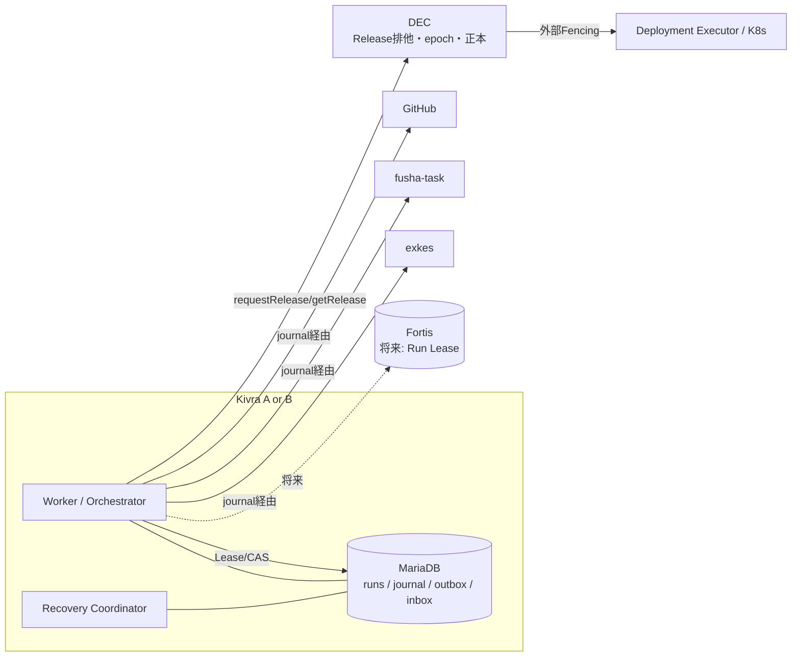
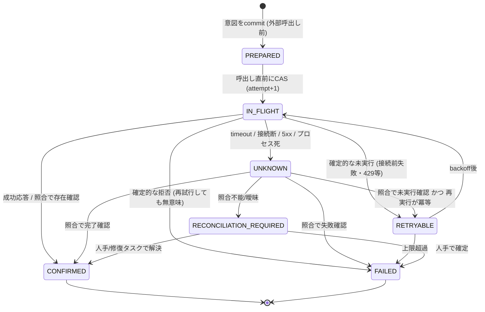
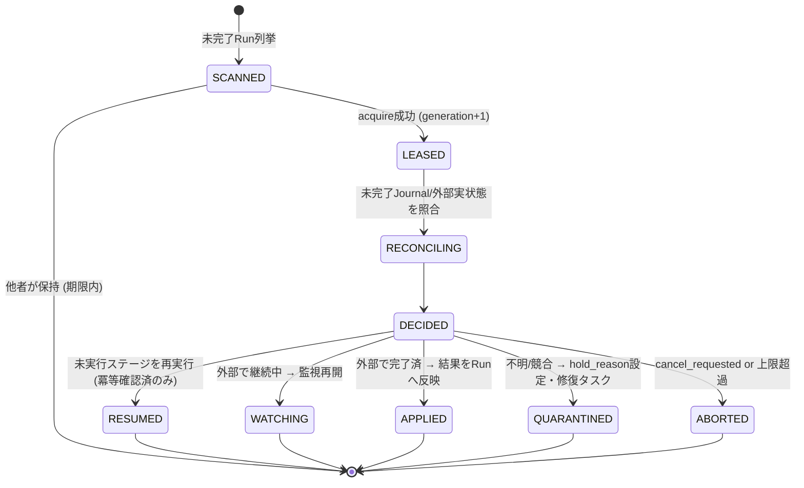
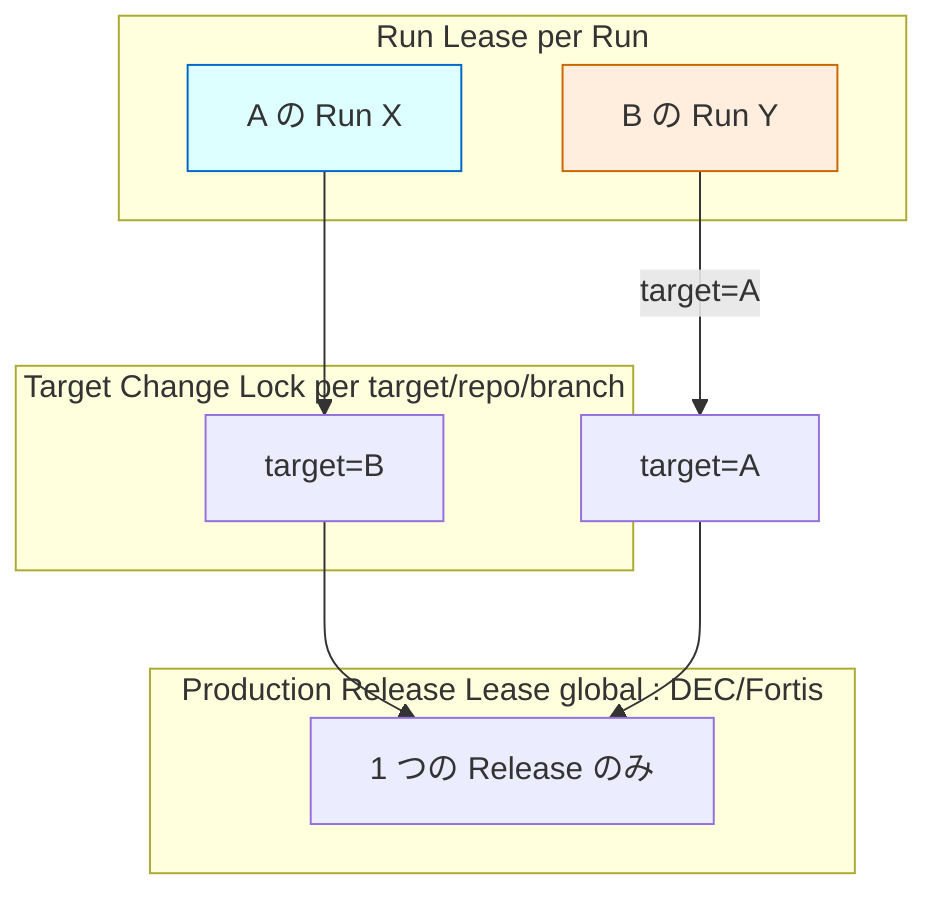

# Execution Recovery & Distributed Consistency 設計 (Issue #11)

- 対象 Issue: kigawa-net/kivra#11
- 関連: #1 Core, #2 fusha-task, #3 Agent Manager, #4 Agent協調, #7 二系統, #8 DEC, #9 Pipeline, #10 Runtime/API, #12 Fortis
- ステータス: 設計案 (レビュー前)
- 表記: 「確認済」= ローカル clone のソースで確認した事実。「要確認」= 未確認・未決定。外部 API の現行仕様はこの文書では断定しない。

## 0. 目的とスコープ

Kivra A/B・複数 Orchestrator/Worker が、exkes・fusha-task・GitHub・DEC を跨いで DevelopmentRun を実行する際の次の 5 点を定義する。

1. 実行所有権 (Lease / Fencing)
2. 外部副作用の記録と照合 (Operation Journal)
3. イベント配送と重複排除 (Outbox / Inbox)
4. 障害後の安全な再開 (Recovery Coordinator)
5. A/B 分散運用時の本番更新排他との境界

**非目標**: 全世界の Exactly Once。外部 API 呼び出しは「少なくとも 1 回試行され得る」「結果が不明になり得る」ものとして扱い、曖昧な場合は自動再試行より照合・停止を優先する (fail-closed)。

## 1. 前提と他 Issue との整合

### 1.1 正本 (Source of Truth) 一覧

| 情報 | 正本 | 備考 |
| --- | --- | --- |
| タスク定義・進捗・依存関係 | fusha-task | #2, #9 |
| Workspace / Runtime / Execution | exkes | 確認済: exkes 自身が MariaDB を正本とする (`exkes-common` の V1〜V3 migration) |
| PR / Commit / CI / Merge | GitHub | #9 |
| Release 状態・Release 排他・DEC Leader | DEC / Fortis (#8, #12 の「設計変更(確定)」) | Kivra は参照・要求のみ。正本を持たない |
| DevelopmentRun 詳細・Stage・Operation Journal・Outbox・監査 | Kivra MariaDB | #10, #11, #12 |
| Run 実行 Lease・owner/generation | 移行期は Kivra MariaDB、Fortis 受入試験後に Fortis (#12 Phase 3) | 3.4 の LeaseStore 抽象で両対応 |

### 1.2 Issue 間の食い違いと本書の扱い

- **#11 本文は「Run/Journal の正本は MariaDB」「Production Release の所有権を管理」と書くが、#8/#12 の確定変更で Release 状態・排他の正本は Fortis/DEC に移った。** 本書は #8/#12 を優先する。Kivra は Production Release Lease を発行・保持しない。Kivra が持つのは `releaseId` と `requestRelease` の journal だけで、排他の強制は DEC と外部 Fencing (Deployment Executor) が行う。
- **#12 は「Fortis の現行開発状況では本番移行不可」とする。** ロードマップ (`fortis/docs/roadmap.md`) でも MVCC/Transaction/Meta は部分実装で、`fortis/docs/architecture.md` §6 に Lease/TTL API は無く、compare-and-set は「必要に応じて追加」、Idempotency Key も「別途定義」とされる (確認済)。したがって Run Lease は MariaDB 実装で先行し、Fortis へは差し替え可能な抽象 (3.4) で備える。
- **#10 の状態名は変更しない。** 本書が追加する「隔離 (quarantine)」は Run の状態ではなく `hold_reason` 列 (NULL でなければ自動進行を停止) で表す。
- #4 は NATS JetStream を Coordination Bus の「評価して決定する候補」としている。本書は NATS 無しでも成立する設計 (Outbox/Inbox は DB 完結) とし、NATS は配送最適化として後付け可能にする。

## 2. 全体像



原則:

1. 外部 API を呼ぶ前に必ず Journal に意図を commit する (write-ahead)。
2. 外部 API の結果が不明なら、結果を推測せず「照合」してから次へ進む。
3. ローカル DB 更新は必ず Fencing 条件付き (CAS)。旧 Worker のローカル更新を拒否する。
4. 外部副作用は旧 Worker からも発生し得る。Fencing で防げない部分は「安定した識別子」と「照合」で吸収する。
5. 自動で安全に判断できないものは止めて人 (または修復タスク) に回す。

## 3. Lease / Fencing

### 3.1 所有権の種類 (別管理)

| 種類 | 対象 | 管理主体 | 目的 |
| --- | --- | --- | --- |
| Run Lease | 1 DevelopmentRun | Kivra (移行期 MariaDB → 将来 Fortis) | 同一 Run を同時に進める Worker を 1 つに限定 |
| Target Change Lock | 変更対象 (`targetInstance` + `repository` + 対象ブランチ系列) | Kivra (同上) | 同一対象への並行変更 Run を制限 (競合 PR・並行 merge の抑止) |
| Production Release Lease | 本番昇格 | **DEC / Fortis (Kivra は持たない)** | A/B 同時昇格禁止・全体直列化 (#7, #8, #12) |

Release Lease の token/epoch は Kivra が `requestRelease` に **伝播するだけ** (DEC が発行する値を保持する場合のみ)。Kivra が自前で Release の可否を決めない。

### 3.2 DB モデル (MariaDB)

Run Lease は `development_runs` (#10) の行に同居させる。Run 状態更新と Lease 検証を 1 文で原子的に行うため。

```sql
-- #10 の development_runs に追加する列
ALTER TABLE development_runs
  ADD COLUMN lease_owner       VARCHAR(64) NULL,        -- Worker インスタンス ID (例: <instance>/<pod>/<boot-uuid>)
  ADD COLUMN lease_generation  BIGINT      NOT NULL DEFAULT 0,  -- Fencing Token。所有者交代でのみ増加。減らない
  ADD COLUMN lease_expires_at  DATETIME(6) NULL,        -- DB 時刻基準
  ADD COLUMN hold_reason       VARCHAR(64) NULL,        -- NULL でなければ自動進行停止 (隔離)
  ADD COLUMN cancel_requested  TINYINT(1)  NOT NULL DEFAULT 0,
  ADD COLUMN version           BIGINT      NOT NULL DEFAULT 0;  -- 楽観ロック (全更新で +1)

-- 変更対象の排他 (行は消さない。generation を単調に保つため)
CREATE TABLE resource_leases (
  scope_type      VARCHAR(32)  NOT NULL,                -- 'TARGET_CHANGE'
  scope_key       VARCHAR(255) NOT NULL,                -- 例: '<targetInstance>/<repo>/<baseBranch>'
  owner_run_id    VARCHAR(36)  NULL,
  generation      BIGINT       NOT NULL DEFAULT 0,
  expires_at      DATETIME(6)  NULL,
  version         BIGINT       NOT NULL DEFAULT 0,
  PRIMARY KEY (scope_type, scope_key)
);
```

型の意味:

| フィールド | 型 | 意味 |
| --- | --- | --- |
| owner | string | 現在の保持者。NULL は未保持 |
| generation | uint64 | Fencing Token。acquire(所有者交代)でのみ +1。renew では変えない |
| expiresAt | datetime(6) | **DB サーバ時刻**で評価。Worker の時計は期限判定に使わない |
| version | uint64 | 行更新ごとに +1。CAS の第二条件 |

### 3.3 疑似コード

```text
acquire(runId, me, ttl, grace):
  -- 期限切れ猶予 (grace) を超えて初めて奪取可能。LAST_INSERT_ID(expr) で採番値を同一文内で取得
  n = exec("UPDATE development_runs
              SET lease_owner = :me,
                  lease_generation = LAST_INSERT_ID(lease_generation + 1),
                  lease_expires_at = NOW(6) + INTERVAL :ttl SECOND,
                  version = version + 1
            WHERE run_id = :runId
              AND state NOT IN (terminal states)
              AND hold_reason IS NULL
              AND (lease_owner IS NULL OR lease_expires_at < NOW(6) - INTERVAL :grace SECOND)")
  if n == 0: return NOT_ACQUIRED
  gen = exec("SELECT LAST_INSERT_ID()")
  return Lease(runId, me, gen, localMonotonicDeadline = t_before_request + ttl - margin)

renew(lease):
  n = exec("UPDATE development_runs
              SET lease_expires_at = NOW(6) + INTERVAL :ttl SECOND, version = version + 1
            WHERE run_id = :runId AND lease_owner = :me AND lease_generation = :gen
              AND lease_expires_at >= NOW(6)")          -- 期限切れ後の復活 renew は禁止
  if n == 0: lease.markLost(); abortLocalWork()          -- 以降このLeaseで書かない
  else lease.localMonotonicDeadline = t_before_request + ttl - margin

fencedUpdate(lease, expectedVersion, changes):           -- Run 状態更新はすべてこの形
  n = exec("UPDATE development_runs SET <changes>, version = version + 1
            WHERE run_id = :runId AND lease_generation = :gen AND lease_owner = :me
              AND version = :expectedVersion")
  if n == 0: reload(); if generation/owner が変わった: lease.markLost() else: VersionConflict (再読込して再判断)

release(lease):  -- 正常終了時。generation は変えない
  UPDATE development_runs SET lease_owner = NULL, lease_expires_at = NULL, version = version + 1
   WHERE run_id = :runId AND lease_owner = :me AND lease_generation = :gen
```

Worker の自己 Fencing: Worker は **自分の単調時計** で `localMonotonicDeadline` を超えたら外部 API 呼び出しと DB 書き込みを開始しない。renew は `ttl/3` 間隔。`margin` は「許容する時計ドリフト率 × ttl + GC/停止猶予」以上とし、初期値案: ttl=30s, margin=10s, grace=5s (要調整)。ただし**正しさは時計に依存させない**。時計が壊れても `fencedUpdate` の generation 検査でローカル DB は守られる。

`resource_leases` も同じ形 (`scope_key` 単位、generation 単調) で acquire/renew/release する。Run が TARGET_CHANGE を取得できない場合は Run を `RETRY_WAITING` (#10) に置いて待機する。

### 3.4 LeaseStore 抽象 (Fortis 移行の備え)

```text
interface LeaseStore {
  acquire(scope, owner, ttl): Lease?        // Lease { owner, generation(token), expiresAt }
  renew(lease): Boolean
  release(lease)
}
```

- 実装 1 (MVP): MariaDB (上記)。
- 実装 2 (Fortis 受入試験後): Fortis の Lease/CAS API。Fortis 側の API・TTL 機能は現時点で存在しないため、契約は #12 側で確定する (要確認)。
- **どちらの実装でも、Run 行に `lease_generation` を書き戻し、`fencedUpdate` は「受け取った token ≥ DB に記録済みの token」かつ「owner 一致」で受理する。** こうすれば Lease の発行元が変わってもローカル DB の拒否ロジックは不変。Fortis の MVCC version は「グループローカルでグローバル順序は仮定しない」(`fortis/docs/architecture.md`) ので、token は同一 Lease キー内で単調であることだけを要求する。

### 3.5 障害ケース

| ケース | 挙動 |
| --- | --- |
| clock skew | 期限判定は DB 時刻のみ。Worker は自分の単調時計で deadline を持ち、DB 時刻との比較をしない |
| network partition (Worker↔DB) | renew 失敗で deadline 到達 → Worker は自己停止。外部 API の in-flight 呼び出しは完了し得るため Journal 上 UNKNOWN になり、後続の所有者が照合する |
| lease expiry (Worker 停止中) | Recovery Coordinator が grace 超過後に acquire。generation +1 |
| 旧 Worker 復帰 | 次の `fencedUpdate`/renew が 0 行 → `markLost`。ローカル更新不可。外部 API 呼び出しは直前の deadline 検査で止まるが、検査〜呼び出し間のレースで 1 回発生し得る → 識別子の安定化で吸収 (4 章) |
| DB 切替 (フェイルオーバ) | 非同期レプリケーションで generation が巻き戻る可能性があるため、フェイルオーバ後は全 Lease を失効扱いにし、全 Run を Recovery 経由で再取得 (6.4) |

### 3.6 DEC 本番リリースの排他 (Kivra 側の責務)

- Release 排他・epoch の発行と強制は DEC/Fortis (#8, #12)。Deployment Executor が旧 epoch / 署名済み Release ID を拒否する (#12 確定事項。Kivra 側には実装しない)。
- Kivra の責務は: (a) `requestRelease` に決定的な `releaseId` を付ける、(b) 応答が不明なら `getRelease` で照合する、(c) DEC が「拒否/保留」を返したら再試行せずに Run を `WAITING_*`/`RETRY_WAITING` に置く、(d) 自分が開発者である系統への Release を要求しない (#7/#9: 自己昇格禁止。要求時にも `developerInstance != targetInstance` を検査)。
- Kivra 側の事前チェック (A/B 同時昇格の疑い等) は**助言的**で、最終判断は DEC。DEC が正と矛盾した場合は DEC を採用する。

## 4. Operation Journal

### 4.1 状態



`IN_FLIGHT` のまま Worker が死んだ行は、Recovery が `UNKNOWN` として扱う (IN_FLIGHT は「外部に出た可能性がある」の意味)。

### 4.2 テーブル (#10 の `external_operations` を具体化)

```sql
CREATE TABLE external_operations (
  op_id            VARCHAR(64)  NOT NULL,   -- 決定的: sha256(runId|stageKey|opType|logicalSeq) の先頭 32hex 等
  run_id           VARCHAR(36)  NOT NULL,
  stage_execution_id VARCHAR(36) NULL,
  op_type          VARCHAR(48)  NOT NULL,   -- EXKES_CREATE_WORKSPACE / ... (4.4)
  logical_key      VARCHAR(128) NOT NULL,   -- 同じ意図の再試行は同じ値。論理的に別の操作(レビュー差戻し後の再実行等)は logicalSeq を上げる
  external_system  VARCHAR(16)  NOT NULL,   -- EXKES / FUSHA_TASK / GITHUB / DEC
  stable_ref       VARCHAR(255) NOT NULL,   -- Kivra が事前に決める外部識別子 (名前/ブランチ名/releaseId 等)
  external_ref     VARCHAR(255) NULL,       -- 外部が採番した ID (判明後に記録)
  request_hash     CHAR(64)     NOT NULL,   -- 同一 op_id で内容が変わっていないことの検査
  status           VARCHAR(32)  NOT NULL,
  attempt          INT          NOT NULL DEFAULT 0,
  max_attempts     INT          NOT NULL,
  lease_generation BIGINT       NOT NULL,   -- 最後に遷移させた Worker の generation (識別子には入れない: 4.3)
  deadline_at      DATETIME(6)  NULL,
  next_action_at   DATETIME(6)  NULL,
  last_error_class VARCHAR(32)  NULL,
  reconcile_attempts INT        NOT NULL DEFAULT 0,
  version          BIGINT       NOT NULL DEFAULT 0,
  created_at       DATETIME(6)  NOT NULL,
  updated_at       DATETIME(6)  NOT NULL,
  PRIMARY KEY (op_id),
  UNIQUE KEY uk_run_op (run_id, op_type, logical_key),
  KEY idx_status_next (status, next_action_at)
);
```

遷移はすべて「Run Lease の generation 一致」を条件に含める (`UPDATE external_operations o JOIN development_runs r ... WHERE r.lease_generation = :gen AND o.version = :v`)。旧 Worker は Journal も更新できない。

実行手順 (共通テンプレート):

```text
execute(op):
  1. tx: INSERT external_operations(PREPARED) ON DUPLICATE (uk_run_op) → 既存行を採用 (再入可能)
  2. status in (CONFIRMED, FAILED) → 結果を返す
  3. status == UNKNOWN / IN_FLIGHT(自分以外の古い試行) → reconcile(op) を先に実行。結果に応じ分岐
  4. lease.isValidLocally() でなければ中止
  5. CAS: PREPARED|RETRYABLE → IN_FLIGHT, attempt+1  (fenced)
  6. 外部 API 呼び出し (stable_ref を必ず付与)
  7. 結果分類 → CAS で CONFIRMED / FAILED / RETRYABLE / UNKNOWN (fenced)
     ※ 7 が fence で拒否された = 自分は旧 Worker。結果は捨てる (新所有者が照合して回収)
```

### 4.3 識別子の設計原則

- 識別子は `runId` と論理操作から**決定的に**導出し、再試行・Worker 交代・Recovery をまたいで同一にする。`attempt` や `lease_generation` は識別子に入れない (入れると新所有者が旧 Worker の成果物を発見できず二重作成になる)。generation は監査用のラベル/メタデータにのみ記録する。
- 外部オブジェクトには必ず Kivra 管理を示すマーカー (ラベル/ブランチ接頭辞/本文マーカー `kivra-op:<op_id>`) を付ける。これにより「Journal に無い Kivra 管理オブジェクト」(孤児) を後から検出できる (6.4)。

### 4.4 外部 API 別: 識別子・冪等・照合

外部 API の列は、ローカルで確認できたもののみ「確認済」と記す。GitHub は clone が無いため公開仕様に基づく想定で、実装時に API で再確認する (要確認)。

| 操作 | 安定識別子 | 冪等性の根拠 | タイムアウト後の照合 | 識別不能時 |
| --- | --- | --- | --- | --- |
| exkes Workspace 作成 `POST /v1/workspaces` | `name = kivra-<runId 短縮>-<logical_key>`。`labels` に `kivra.op=<op_id>`, `kivra.run=<runId>` | 確認済: `workspaces.name` に UNIQUE 制約 (`uk_workspaces_name`)。重複作成は名前衝突で検出できる (衝突時の HTTP ステータスは要確認) | 確認済: `GET /v1/workspaces?status=` は status/limit/offset のみで **name 検索は無い**。→ 全件走査 or exkes へ `name` フィルタ追加を要望 (要確認)。`GET /{id}` は ID 既知の場合 | 名前衝突かつ labels の `kivra.op` が自分のものでなければ RECONCILIATION_REQUIRED |
| exkes Runtime 作成/起動 | Workspace 配下で `labels`/名前に op_id (Runtime の名前/ラベル項目は要確認) | 確認済: Workspace 削除は DELETING 中の再要求を冪等に受理する (`WorkspaceService.requestDeletion`)。Runtime の start/stop・作成の冪等性は要確認 | `GET /v1/workspaces/{id}/runtimes` (list あり・確認済) で op_id を検索 | 作成が識別不能なら fail-closed |
| exkes Execution 作成 (`POST /v1/runtimes/{id}/executions`、AGENT 実行) | **1 op = 1 Runtime** とし、その Runtime 内の Execution を数える | 確認済: **Idempotency Key 機構は exkes に無い** (全文検索で未検出)。重複作成を exkes 側で拒否できない | `GET /v1/runtimes/{id}/executions` (list あり・確認済) で 0 件/1 件/複数を判定。専用 Runtime なので曖昧さが無い | 1 Runtime に複数 Execution があれば隔離。**exkes への Idempotency Key 追加を要望 (要確認)** |
| exkes Execution 取消 | executionId | 確認済: 終端状態は SUCCEEDED/FAILED/CANCELLED/TIMED_OUT (`ExecutionStatus`)。取消エンドポイントはルート定義上見当たらない (要確認) | `GET /executions/{id}` で状態確認 | 取消できない場合は Runtime 停止/削除で代替 (要確認) |
| GitHub ブランチ push | `kivra/<runId 短縮>/<logical_key>` | ref 更新は期待 SHA 付き (force-with-lease 相当) | ref の現在 SHA を取得し、期待 SHA と比較 | SHA 不一致なら隔離 |
| GitHub PR 作成 | head ブランチ名が一意キー | 同一 head/base のオープン PR は GitHub 側で重複不可の想定 (要確認) | `head=<branch>` でオープン/クローズ PR を検索。PR 本文に `kivra-op:<op_id>` を入れ照合 | 同一 head に自分のマーカーでない PR があれば隔離 |
| GitHub merge | `prRef` + `expectedHeadSha` | `sha` 指定付き merge は head 不一致で拒否される想定 (要確認)。merged 済み PR への再 merge は無害 | PR の `merged` と `merge_commit_sha`、base ブランチ履歴で確認 | merged かつ head SHA が期待と異なる → RECONCILIATION_REQUIRED (**自動で巻き戻さない**) |
| DEC `requestRelease` | `releaseId = rel-<runId 短縮>-<digest 先頭12>` (targetInstance・artifact digest・Run から決定的) | **DEC は未実装/未確認。DEC に「releaseId を冪等キーとし、同一キーで内容が違えば拒否」を契約として要求する (要確認)** | `getRelease(releaseId)`。DEC が正本 | DEC が照会不能なら Run を保留 (fail-closed) |
| DEC `requestRollback` | `rollbackId = <releaseId>:rb` | 同上 (DEC 契約) | `getRelease` の phase | 自動 Rollback 判断は DEC が主。Kivra の要求は補助 |
| fusha-task 更新 `PATCH /tasks/:id` | taskId (「期待値」を保存) | 確認済: PATCH は read-modify-write で**楽観ロックも冪等キーも無い** (`MariaDbTaskRepository.update`)。同値の再適用は無害だが、並行更新は後勝ちで上書き (Lost Update) | 取得して期待値と比較。同値なら CONFIRMED | 他者が変更した形跡があれば上書きせず保留 |
| fusha-task コメント `POST /tasks/:id/comments` | 本文に `kivra-op:<op_id>` を埋め込む | 冪等ではない | コメント一覧からマーカー検索してから投稿 | 検索〜投稿間のレースで重複はあり得る (閲覧上の重複のみ。許容) |
| fusha-task タスク作成 (修復タスク等) | タイトル/本文に `kivra-op:<op_id>` | 冪等ではない | 一覧から検索 (検索条件・API は要確認) | 同上 |

fusha-task については、確認できた範囲で Webhook/イベント配信の実装は見当たらない (ソース内に `webhook` の出現なし)。変更検知は Polling が前提 (#2 で決定)。

### 4.5 エラー分類

| クラス | 例 | Journal の遷移 |
| --- | --- | --- |
| 確定的拒否 | 400/403/404(対象が元々無い)/409(識別子衝突で他人所有) | FAILED (409 は照合で自分の物か確認) |
| 確定的未実行 | 接続確立前の失敗、429/503 (Retry-After 付き)、DNS 失敗 | RETRYABLE (backoff) |
| 結果不明 | リクエスト送信後の timeout、接続リセット、5xx、応答破損、プロセス死 | UNKNOWN → 照合 |
| 認証/認可 | 401/403 | FAILED + Run を `hold_reason=AUTH` で隔離 (再試行しても無意味) |

### 4.6 fail-closed 規則

- 識別不能 (4.4 の「識別不能時」列) かつ副作用が不可逆/高コスト (AGENT 実行、merge、release) → `RECONCILIATION_REQUIRED`。自動再実行しない。
- 照合 API 自体が失敗 → UNKNOWN を維持し backoff。上限 (`reconcile_attempts`) 超過で RECONCILIATION_REQUIRED。
- RECONCILIATION_REQUIRED は Run に `hold_reason=RECONCILE:<op_id>` を立て、修復タスクを fusha-task に作成 (journal 経由で冪等)。

## 5. Transactional Outbox / Consumer Deduplication

### 5.1 目的の切り分け

- **外部副作用 (exkes/GitHub/DEC への要求) は Outbox 経由にしない。** それらは Operation Journal を Worker が直接実行する (順序・結果の同期的な把握が必要なため)。
- **Outbox は「確定した状態変更の通知」用**: fusha-task への進捗投影の起動、recl への記憶化、メトリクス、他 Orchestrator への通知。権威的な制御判断 (Lease、Release) には使わず、必要なら正本を再照会する (#12 方針と同じ)。

### 5.2 スキーマ

```sql
CREATE TABLE outbox_events (
  event_id          CHAR(26)     NOT NULL,   -- ULID。重複排除キー
  aggregate_type    VARCHAR(32)  NOT NULL,   -- 'RUN'
  aggregate_id      VARCHAR(36)  NOT NULL,   -- runId
  aggregate_version BIGINT       NOT NULL,   -- 発行時の development_runs.version。Run 単位で連続
  event_type        VARCHAR(64)  NOT NULL,
  schema_version    INT          NOT NULL,
  payload           JSON         NOT NULL,   -- 大きな成果物は参照IDのみ (#4)
  trace_id          VARCHAR(64)  NULL,
  status            VARCHAR(16)  NOT NULL DEFAULT 'PENDING',  -- PENDING/PUBLISHED
  publish_attempts  INT          NOT NULL DEFAULT 0,
  created_at        DATETIME(6)  NOT NULL,
  published_at      DATETIME(6)  NULL,
  PRIMARY KEY (event_id),
  UNIQUE KEY uk_agg_ver (aggregate_type, aggregate_id, aggregate_version, event_type),
  KEY idx_pending (status, created_at)
);

CREATE TABLE inbox_events (
  consumer_name  VARCHAR(64) NOT NULL,
  event_id       CHAR(26)    NOT NULL,
  aggregate_id   VARCHAR(36) NOT NULL,
  aggregate_version BIGINT   NOT NULL,
  processed_at   DATETIME(6) NOT NULL,
  PRIMARY KEY (consumer_name, event_id)
);

CREATE TABLE consumer_cursors (        -- Run 単位の処理済みバージョン
  consumer_name VARCHAR(64) NOT NULL,
  aggregate_id  VARCHAR(36) NOT NULL,
  last_version  BIGINT      NOT NULL,
  PRIMARY KEY (consumer_name, aggregate_id)
);

CREATE TABLE dead_letters (
  consumer_name VARCHAR(64) NOT NULL, event_id CHAR(26) NOT NULL,
  reason VARCHAR(255), payload JSON, failed_at DATETIME(6), resolved_at DATETIME(6) NULL,
  PRIMARY KEY (consumer_name, event_id)
);
```

### 5.3 発行側

```text
transition(run, lease, newState):
  BEGIN
    fencedUpdate(lease, run.version, state=newState)          -- 0 行なら ROLLBACK (旧 Worker は Outbox も作れない)
    INSERT outbox_events(event_id=ulid(), aggregate_version = run.version + 1, ...)
    INSERT development_events(...)                            -- 監査履歴 (#10)
  COMMIT
```

Outbox Publisher (別プロセス/スレッド):

1. `SELECT ... WHERE status='PENDING' ORDER BY aggregate_id, aggregate_version LIMIT n FOR UPDATE SKIP LOCKED`。
2. 配信 (NATS を採用する場合 `Nats-Msg-Id = event_id` を付与し JetStream の重複排除も併用。ただし期待はしない)。
3. 成功後に `status='PUBLISHED'`。2 と 3 の間で死ねば再配信される (= at-least-once)。複数 Publisher の同時稼働を許容する (重複は Consumer が吸収)。
4. 同一 Run のイベントは `aggregate_version` 昇順で配信する (Run 単位の順序のみ保証。全体順序は保証しない)。
5. PUBLISHED は N 日 (初期値案 7 日) 後に削除。

### 5.4 受信側 (Consumer)

```text
handle(consumer, ev):
  BEGIN
    if exists(inbox, consumer, ev.event_id): COMMIT; ack; return          -- 重複
    cur = cursor(consumer, ev.aggregate_id).last_version (無ければ 0)
    if ev.aggregate_version <= cur:  record inbox; COMMIT; ack; return     -- 古い/再配送
    if ev.aggregate_version >  cur + 1 and consumer が順序必須:            -- 欠番
         ROLLBACK; park(ev); requestReplayFromOutboxTable(ev.aggregate_id, from=cur+1); return
    apply(ev)                                                              -- 副作用が外部なら Journal に op を積むだけ
    INSERT inbox; UPDATE cursor = ev.aggregate_version
  COMMIT; ack
```

- Consumer の副作用が外部 API (fusha-task 更新等) の場合、`apply` では Journal の `PREPARED` を作るだけにし、実行は 4.2 の手順で行う (Inbox と外部呼び出しを同一 tx に入れられないため)。
- 欠番は MariaDB の outbox (正本) から再取得して埋める。順序必須でない Consumer (メトリクス等) は `last-writer` 方式で最新 version のみ採用。
- 処理失敗は NATS `max_deliver` または DB 側 `attempt` の上限で `dead_letters` へ。DLQ 蓄積は自動停止条件 (8.2) に含める。
- NATS JetStream 採用可否: 既存基盤での稼働有無は未確認 (要確認)。**MVP は NATS 無しで DB ポーリング Consumer とし、NATS は #4 の評価結果に従い後から差し替える。** どちらでも Inbox/Outbox 契約は同じ。

## 6. Recovery Coordinator

### 6.1 責務と実行形態

- 各 Kivra 系統 (A/B) の Orchestrator 内で動作する周期タスク (複数 Replica で同時稼働可)。単一障害点を避けるため、リーダー選出は不要で、**Run ごとの Lease 取得 (3.3) だけで排他**する。
- 担当: (1) 孤立 Run の発見と Lease 取得、(2) 未完了 Journal の照合、(3) 再開/監視継続/結果反映/隔離の決定、(4) 孤児リソースの検出、(5) 監査と修復タスク化。

### 6.2 状態遷移 (1 Run あたり)



### 6.3 決定表

| 照合結果 | 決定 |
| --- | --- |
| Journal CONFIRMED のみ・Run 状態が古い | APPLIED: 結果を反映して次ステージへ |
| exkes Execution が RUNNING (自分の op_id) | WATCHING: 監視を再開 (新規起動しない) |
| exkes Execution が終端 | APPLIED (SUCCEEDED/FAILED を Run へ。ログ/成果物参照を記録) |
| 外部に該当オブジェクト無し + 操作が冪等 | RESUMED (RETRYABLE として再実行) |
| 外部に該当オブジェクト無し + 非冪等 + 識別子が一意に引ける | RESUMED |
| 重複/複数ヒット、他者所有、head SHA 不一致 | QUARANTINED |
| DEC が Release を保持 (phase 進行中) | WATCHING: DEC が正本。Kivra は `getRelease` を監視するのみ |
| DEC 照会不能 / Fortis quorum 喪失 | 保持 (Lease は維持しつつ進行停止)。上限時間超過で QUARANTINED |
| `cancel_requested=1` | ABORTED: 取消可能な外部操作を取消 (取消も Journal 経由) |

### 6.4 再起動手順 (Orchestrator / DB を含む)

1. **起動時の自己 Fencing**: 新プロセスは新しい `boot-uuid` を `lease_owner` に使う。以前の自分は別 Worker として扱う (Lease の再取得は generation +1)。
2. DB 接続確認と `SELECT NOW(6)` の健全性検査。DB 時刻と自ノード時刻の差が閾値超なら警告し、Recovery は続行 (判定は DB 時刻のみのため)。
3. 未完了 Run の列挙: `state NOT IN terminal AND hold_reason IS NULL AND (lease_owner IS NULL OR lease_expires_at < NOW(6) - grace)`。`ORDER BY` + `LIMIT` + 乱数オフセットで複数 Replica の衝突を減らす。
4. Run ごとに 6.2 の遷移を実行。同時処理数を制限 (外部 API への雷同を避ける)。
5. **DB 復旧/フェイルオーバ後の追加手順**: (a) 全 `lease_*` を失効扱いにして再取得、(b) `external_operations` が巻き戻っている可能性があるため、Kivra マーカー付き外部オブジェクト (exkes ラベル `kivra.run`、GitHub ブランチ接頭辞 `kivra/`、PR 本文マーカー) を列挙し Journal に無いものを孤児として QUARANTINED + 修復タスク化。
6. 起動完了条件: 全 Run の Lease 状態が確定するまで新規 Run を開始しない (Recovery 完了フラグ)。

### 6.5 障害シナリオ別の扱い

| 障害 | 検知 | 対処 |
| --- | --- | --- |
| Worker crash | Lease 失効 | Recovery が奪取。IN_FLIGHT 行を UNKNOWN として照合 |
| Orchestrator 全体再起動 | 起動時 Recovery | 6.4 |
| MariaDB 断 | 接続/書き込み失敗、renew 失敗 | Worker は deadline で自己停止。新規副作用は開始しない。復旧後に Recovery。外部で進行中だった操作は復旧後の照合で回収 |
| NATS 重複/欠落 | Inbox 重複、version 欠番 | 5.4 の重複排除と outbox テーブルからの再取得 |
| exkes 断 | 照合/呼び出し失敗 | 操作は UNKNOWN/RETRYABLE のまま backoff。上限で `hold_reason=EXKES_DOWN`。Workspace/Execution を新規作成しない |
| GitHub timeout | 呼び出し timeout | UNKNOWN → 4.4 の照合 (PR 検索・merged 判定)。merge は SHA 検証付きのみ |
| DEC 再起動 | `getRelease` 失敗/epoch 変化 | DEC が状態を再構築 (#8 ステートレス DEC)。Kivra は `releaseId` で再照会。新規 `requestRelease` は DEC 応答確認まで出さない |
| Fortis quorum 喪失 (導入後) | Lease/CAS 失敗 | 新規 Lease 取得・Release 要求を停止 (#12)。移行期は影響なし (MariaDB 実装) |
| fusha-task 断 | 呼び出し失敗 | 進捗投影は遅延可。Run 進行は止めない。長時間なら投影の欠落を記録し復旧後に再投影 |

### 6.6 再試行・キャンセル・監査

- **再試行**: 指数 backoff + full jitter。初期値案: base 2s, 上限 5min, 操作種別ごと `max_attempts` (外部副作用が重いものほど小さく: AGENT 実行=1 (自動再実行なし)、PR 作成=5、照合=10)。Run 単位の総試行バジェット/費用上限 (#9) を超えたら QUARANTINED。ステージ再試行・レビュー反復の上限は #9/#10 に従う (本書は上限値を定めない)。
- **キャンセル**: `cancel_requested` を CAS で立てる。Worker は次の安全点で停止。外部取消は Journal 経由 (取消操作にも op_id)。merge 済み・Release 要求済みは取消不能 → DEC へ rollback 要求 (補償) か人手判断。
- **監査**: `development_events` に Lease 取得/喪失、Journal 遷移、Recovery の決定 (`decision`, `evidence`) を Fencing generation 付きで記録。監査書き込み失敗は自動停止条件 (8.2)。
- **修復タスク**: QUARANTINED 時に fusha-task へタスクを作成 (本文に Run/op_id/照合結果/推奨手順。作成自体も Journal 経由)。AI による自動解除は不可 (権限昇格禁止: #1)。人または独立した承認経路で `hold_reason` を解除する。

## 7. A/B 分散運用

### 7.1 排他の層



- 開発 Run Lease と Target Change Lock は Kivra の責務、本番 Release Lease は DEC の責務。**3 層は独立し、上位の取得は下位の取得を代替しない。**
- Run は「自系統が developer、他系統が target」のものだけを実行する。Run の記録と Lease は developer 系統の DB が持つ。
- A/B 同時本番昇格禁止・他方系統の健全性の独立確認・両系統異常/quorum 喪失時の新規本番変更停止は **DEC の責務** (#7, #8)。Kivra は「DEC が拒否/凍結を返した場合に従う」「DEC 状態不明なら要求しない」を担う。

### 7.2 Kivra 側の安全規則

1. DEC/Fortis の状態が取得できない間、`requestRelease` を出さない。
2. 自系統が target の Release を要求しない (自己昇格禁止の二重検査)。
3. merge の扱い: merge 後に DEC が本番昇格を開始し得るため、DEC が「Release 凍結中」を返している間は merge 前で保留 (WAITING)。この凍結状態の取得 API は DEC 設計 (#8) 依存のため要確認。
4. 他系統のヘルス結果は信頼根拠にしない (#7)。DEC が独立に確認した結果のみ参照する。

### 7.3 共通依存の連鎖故障

- A/B が **同一の MariaDB** を使うと、DB 障害で A/B の Run が同時停止する。各系統に別 DB (別インスタンス/別スキーマ+別障害ドメイン) を持たせる案を推奨するが、実際の構成は未決定 (要確認、#7 の「共有コード・共通依存基盤による同時故障の防止」に関連)。
- exkes / fusha-task / GitHub は A/B 共通の外部依存。共通依存の停止時は両系統とも新規副作用を止めるだけで、既存サービスは維持される (Kivra は本番稼働の制御主体ではないため)。
- Fortis 導入後は Fortis が A/B 共通の制御依存になる (#12 の 3 Voter/第三拠点)。Fortis 障害時は 3.5 と同様に新規 Lease/Release を止め、既存稼働は維持する。

## 8. DEC との排他・自動停止条件の検証

DEC は現時点でローカルにコードが存在せず (`/home/kigawa/dev/kigawa-net` 配下に該当リポジトリなし)、本節は #8/#12 の確定仕様と本書の設計の**整合性検証**である。DEC 実装での実測は各テスト (9 章 T-DEC-*) で行う。

### 8.1 不変条件の検証

| # | 不変条件 | 保証する仕組み | 本書での検証結果 |
| --- | --- | --- | --- |
| I1 | 同時に有効な本番 Release は高々 1 つ | DEC/Fortis の Release Lease + 外部 Fencing (#8/#12) | Kivra は Release Lease を持たず要求のみ → Kivra 側の欠陥で破れない。強制点は DEC 側 (T-DEC-1) |
| I2 | 旧 Worker/旧 DEC の要求は適用されない | DEC: Executor が epoch/Release ID を検証 (#12)。Kivra: Run generation で `fencedUpdate` 拒否 | 層ごとに独立。Kivra の Fencing は DEC の epoch を代替しない (3.6) |
| I3 | 自己昇格不可 | Kivra: `developerInstance != targetInstance` 検査 / DEC: 独立検査 (#7) | 二重化済み。DEC 側未実装のため要確認 |
| I4 | `requestRelease` の再送で二重 Release にならない | `releaseId` 決定的 + DEC 側の冪等契約 | **DEC 契約が前提 (未確認)**。不成立なら Kivra は再送せず `getRelease` 照合のみとする |
| I5 | 状態不明では進めない | fail-closed (4.6, 7.2) | 設計済み |
| I6 | 自動 Rollback 判断は DEC が持つ | #8 | Kivra は補助要求のみ |

### 8.2 自動停止条件 (Kivra 側; 値は初期案・要調整)

| レベル | 条件 | 動作 |
| --- | --- | --- |
| L1 新規 Release 要求停止 | DEC 照会不能が 60s 超 / Fortis quorum 喪失 / DEC が freeze を通知 / `UNKNOWN` の Release 操作が存在 | `requestRelease` 禁止。進行中 Run は WAITING |
| L2 新規 Run 開始停止 | RECONCILIATION_REQUIRED が N 件以上 / 同一 Run 群で連続失敗率超過 / Outbox PENDING の滞留遅延超過 / DLQ 蓄積超過 / 孤児検出 | 既存 Run は継続可、新規 Run は開始しない |
| L3 全凍結 | 監査書き込み失敗 / DB 時刻異常 (DB↔ノードで閾値超 + renew 異常) / 認証失敗の連続 (権限事故の疑い) | 外部副作用を全停止。人手で解除 |

停止は即時に有効で、解除は人手 (または独立承認経路) とする。AI が停止条件や閾値を変更できないこと (#1 の安全制御解除禁止) を設定の保護範囲に含める。

## 9. テストケース

記法: 注入手段は 10.1 のテストハーネスで実現する。期待結果は Run 状態・Journal・外部実状態の**不変条件**で記述する。

### 9.1 split-brain / 旧 Worker 復帰

| ID | シナリオ | 注入 | 期待 |
| --- | --- | --- | --- |
| T-SB-1 | Worker W1 が停止 (SIGSTOP/GC 停止) → Lease 失効 → W2 が奪取 → W1 再開 | プロセス停止、ttl 超過 | W1 の `fencedUpdate`/Journal 更新/Outbox 挿入が 0 行。generation は W2 > W1。Run 状態は W2 の遷移のみ |
| T-SB-2 | W1 が外部呼び出し中に Lease 失効し W2 が同操作を開始 | 呼び出し遅延 | 外部オブジェクトは 1 つ (決定的識別子)。W1 の結果記録は拒否され、W2 が照合して CONFIRMED |
| T-SB-3 | Worker↔DB 分断 (外部とは疎通) | DB への接続遮断 | Worker は deadline で自己停止し新規外部呼び出しをしない。分断解除後に旧 Worker の書き込みは拒否 |
| T-SB-4 | Recovery Coordinator 2 台が同一 Run を同時に奪取 | 並行 acquire | 成功は 1 台のみ。generation が +1 ずつ連続 |
| T-SB-5 | clock skew (Worker 時計を ±数分) | 時刻改変 | Lease 判定に影響しない (DB 時刻基準)。Worker の自己停止判定は単調時計のため安全側 |
| T-SB-6 | Fencing token 逆転 (LeaseStore 差替え検証) | 古い token を送信 | token < 記録済 → 拒否 |
| T-SB-7 | A/B 両方が同一 Target に Run を開始 | 同時 acquire | Target Change Lock で片方 `RETRY_WAITING` |

### 9.2 外部 API タイムアウト

| ID | シナリオ | 注入 | 期待 |
| --- | --- | --- | --- |
| T-API-1 | exkes Workspace 作成が要求受理後に timeout | 応答破棄 | UNKNOWN → 名前/ラベル照合 → CONFIRMED。Workspace は 1 つ |
| T-API-2 | exkes Execution 作成が timeout (AGENT) | 応答破棄 | 専用 Runtime の Execution 数で判定 (0→再作成可 / 1→CONFIRMED / 2以上→隔離)。自動再実行しない設定が既定 |
| T-API-3 | GitHub PR 作成が timeout | 応答破棄 | head 検索で既存 PR を採用。PR は 1 つ |
| T-API-4 | GitHub merge が timeout | 応答破棄 | merged と SHA を照合。head SHA 不一致なら RECONCILIATION_REQUIRED |
| T-API-5 | merge 応答前に base ブランチが進んだ | 外部 push | `expectedHeadSha` 不一致で拒否される/再レビューへ |
| T-API-6 | DEC `requestRelease` が timeout | 応答破棄 | `getRelease` 照合。二重 Release なし (T-DEC-2 と対) |
| T-API-7 | fusha-task PATCH が timeout / 他者が同時更新 | 応答破棄 + 並行更新 | 期待値比較。他者変更は上書きしない |
| T-API-8 | 照合 API も失敗し続ける | 全断 | UNKNOWN 維持 → 上限で RECONCILIATION_REQUIRED + 修復タスク。副作用の追加発行なし |
| T-API-9 | 401/403 | 認証失敗 | FAILED + `hold_reason=AUTH`。再試行しない |

### 9.3 Outbox / Inbox / Recovery

| ID | シナリオ | 期待 |
| --- | --- | --- |
| T-OB-1 | Publisher が publish 後・PUBLISHED 更新前に死亡 | 再配信される。Consumer は重複を無視 (Inbox) |
| T-OB-2 | 状態更新と Outbox の原子性 (commit 直前に kill) | 状態だけ/Outbox だけが残る状態が存在しない |
| T-OB-3 | Consumer へ順不同/欠番配送 | cursor で古いものは無視、欠番は outbox から再取得して順序適用 |
| T-OB-4 | 処理が常に失敗する毒メッセージ | 上限後 DLQ。他 Run の処理は継続 |
| T-RC-1 | 全 Orchestrator 再起動 | 全未完了 Run が再開/監視/隔離のいずれかに収束。二重作成なし |
| T-RC-2 | MariaDB を古いバックアップへ巻き戻し | 孤児検出で QUARANTINED。Journal に無い外部オブジェクトを自動削除しない |
| T-RC-3 | Recovery 中に Recovery が再度クラッシュ | 冪等に再実行。Journal/Run の矛盾なし |
| T-RC-4 | 取消要求と Recovery の競合 | `cancel_requested` を尊重。外部取消も Journal 経由 |

### 9.4 DEC 連携 (DEC 実装後に実測。Kivra 単体はモック DEC で先行)

| ID | シナリオ | 期待 |
| --- | --- | --- |
| T-DEC-1 | A と B が同時に別 Release を要求 | DEC が片方を拒否/待機。同時に本番へ適用されるのは 1 つ |
| T-DEC-2 | 同一 `releaseId` の再送・並行送信 | DEC 上の Release は 1 つ |
| T-DEC-3 | 旧 epoch の DEC/Worker 由来の実行要求 | Deployment Executor が拒否 (#12) |
| T-DEC-4 | 他方系統が異常/DEC が freeze 通知 | Kivra は新規 Release 要求を停止 (L1)。merge 保留 (7.2) |
| T-DEC-5 | DEC 再起動中に Release 進行 | Kivra は `getRelease` で追従。二重要求なし |
| T-DEC-6 | 自系統を target とする Release 要求 | Kivra 側で拒否 (I3) |

## 10. 障害注入テストと実装 Issue 分割

### 10.1 障害注入ハーネス

- 各 Adapter (exkes/GitHub/DEC/fusha-task) を `FaultInjectingAdapter` でラップ: 「要求前に失敗」「要求受理後に応答破棄」「遅延」「重複応答」「5xx」を決定的 (シード/スクリプト) に注入。
- 時計とスケジューラを差し替え可能にした決定論的シミュレーション (仮想時計) で Lease/Recovery の競合を再現。
- DB: 接続遮断 (プロキシ)、commit 直前の kill、古いスナップショットへの復元。
- 実 exkes を使う結合試験は docker compose スタック (exkes 側 `docker-compose.yml` で API/controller/MariaDB が起動可能。確認済) を再利用できる見込み (要確認)。

### 10.2 実装 Issue 案 (依存順)

| # | Issue 案 | 内容 | 依存 |
| --- | --- | --- | --- |
| 1 | DB スキーマ: runs 拡張・journal・outbox/inbox・leases | 3.2/4.2/5.2 の migration | #10 のスキーマ確定 |
| 2 | LeaseStore (MariaDB) と Fencing ライブラリ | 3.3 + 3.4 の抽象 + fenced update ヘルパ | 1 |
| 3 | Operation Journal 実行基盤 | 4.2 のテンプレート、エラー分類、Fault Adapter 基盤 | 1,2 |
| 4 | exkes Adapter (識別子/照合) | 4.4。exkes への `name` フィルタ/Idempotency Key 要望 Issue も別途 | 3 |
| 5 | GitHub Adapter (PR/merge/SHA 照合) | 4.4 | 3 |
| 6 | fusha-task Adapter (期待値照合・マーカー) | 4.4 | 3 |
| 7 | DEC Adapter 契約とモック DEC | `releaseId` 冪等契約、`getRelease`、freeze 通知。DEC (#8) と契約合意 | 3 |
| 8 | Outbox Publisher / Inbox Consumer 基盤 | 5 章 (NATS 無しで開始) | 1 |
| 9 | Recovery Coordinator | 6 章 (列挙・照合・決定表・孤児検出) | 2,3,4-7 |
| 10 | 自動停止 (L1-L3) と修復タスク化 | 8.2、監査 | 9 |
| 11 | 障害注入テストスイート | 9 章 (T-SB, T-API, T-OB, T-RC)。T-DEC は 7 の後 | 2-9 |
| 12 | Fortis LeaseStore 実装 | #12 の契約確定・受入試験後 | 2, #12 |

MVP は 1→2→3→(4,5,6)→8→9→11 (DEC 未確定なら 7 はモック)。

## 11. 要確認事項

1. **exkes**: (a) Workspace 重複名の応答ステータス、(b) `name`/label での検索 API の有無 (現状 list は status/limit/offset のみ)、(c) Runtime の名前/ラベル項目と作成冪等性、(d) Execution の Idempotency Key (無い)・取消 API、(e) API 認証方式 (ルート定義上は未確認)。
2. **fusha-task**: タスク更新に楽観ロック/ETag が無い (確認済)。Kivra 更新用の最小権限トークン、コメント/タスクの検索 API の仕様、Webhook は無し (Polling 前提) の確定。
3. **GitHub**: ローカル clone 無し。merge の `sha` 条件、同一 head の PR 重複可否、ブランチ保護/Ruleset と自動 merge の挙動は実装時に API で確認。
4. **DEC**: 実装/API が未確認。`requestRelease` の冪等契約 (`releaseId`)、`getRelease`、freeze 通知、epoch の Kivra への公開有無。
5. **Fortis**: Lease/TTL/CAS/Election API は未実装 (#12 の `fortis#27` 依存)。Idempotency Key 方針も未定。
6. **NATS JetStream** の既存基盤での提供有無 (#4 で評価)。
7. 各系統の MariaDB 配置 (A/B 共有か分離か)、DB フェイルオーバ方式 (非同期/同期レプリケーション)。
8. 本書の初期値 (ttl/grace/margin、backoff、停止閾値) は未検証の叩き台。

## 12. 未解決論点

1. **A が停止している間の A の Run の扱い**: Run は developer 系統の DB が持つため、B が引き継げない。引き継ぎを許すなら Run 記録の共有/複製が要り、#7 の共通基盤故障防止と衝突する。MVP は「引き継がない (A 復帰まで凍結)」を提案。
2. **merge と Release の境界**: merge が DEC の昇格起点となる場合、merge 時点で「Release 可能か」を確認すべきか (7.2 の 3)。DEC 側のトリガ仕様 (#8/#9) に依存。
3. **Lease を MariaDB から Fortis へ移す際の切替**: 同一 Run で実装 1→2 の移行を安全に行う手順 (ドレイン後に generation を引き継ぐ等) は #12 Phase 3 と合わせて詰める。
4. **Run Lease を Fortis に置く価値**: MariaDB 単一障害ドメインでの Fencing で足りる場合、Run Lease は MariaDB のまま据え置くという選択もある (Fortis は DEC の Release/Leader に限定)。#12 の Phase 3 を実施するか再評価が必要。
5. **Execution (AGENT) の「自動再実行」可否**: 副作用が重く、既定は自動再実行なしとしたが、コスト/可用性のバランスは運用で調整が必要。
6. **孤児リソースの回収方針**: 検出は自動、削除は人手承認とした。TTL 付き自動回収を許すかは Policy (#1) 次第。
7. **Kivra の MariaDB 論理バックアップ復元時の外部整合**: 6.4 の 5 は検出のみ。自動修復は対象外。
