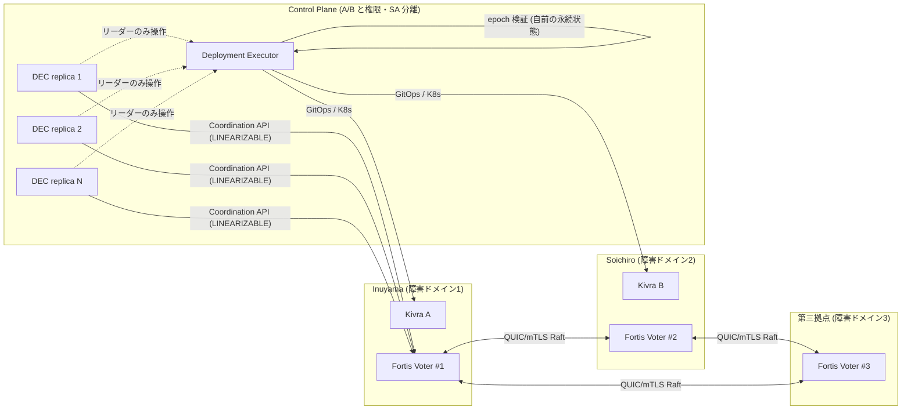
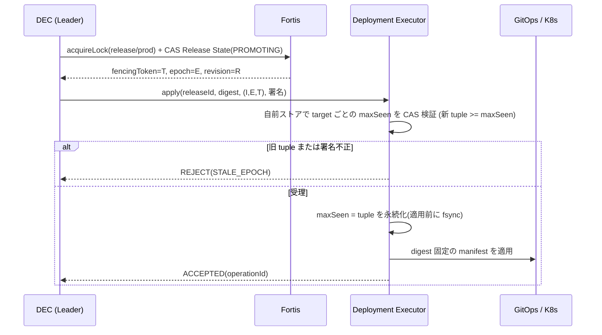
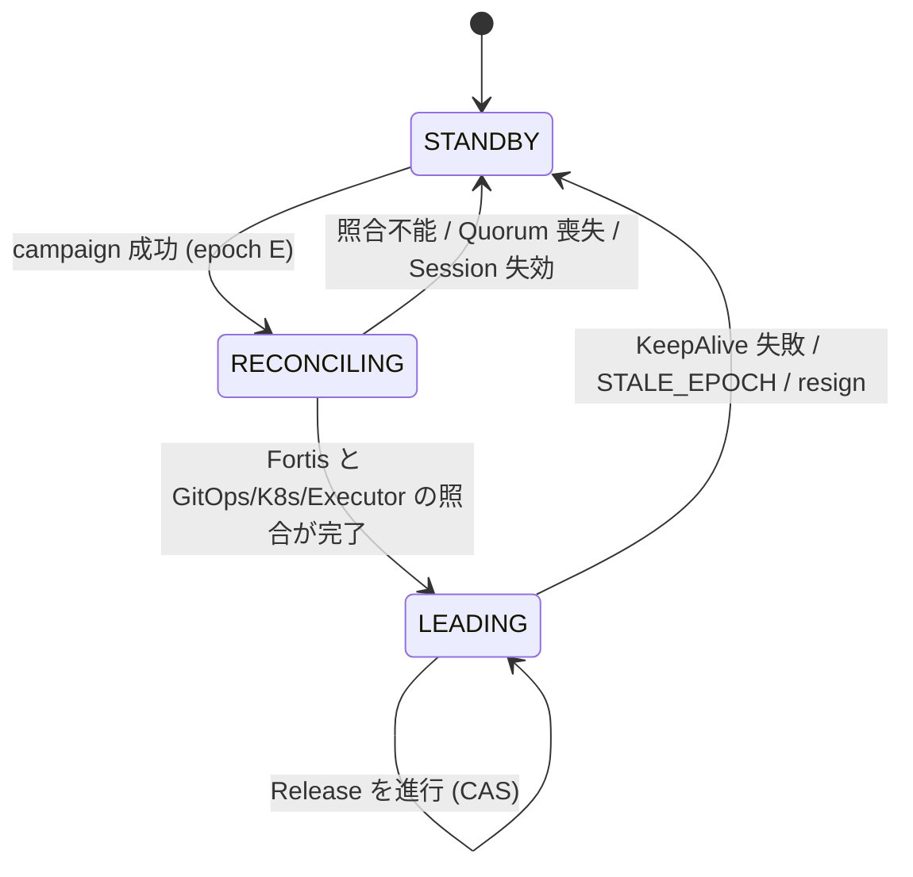
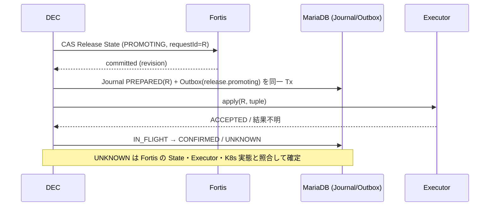

# 設計: Fortis Integration & Control Plane HA(エッジ強整合制御)

- 対象 Issue: kigawa-net/kivra#12
- 関連(Kivra): #1 Core, #7 Dual Evolution Architecture, #8 DEC, #9 Pipeline, #10 Runtime/API, #11 Consistency
- 関連(Fortis): kigawa-net/fortis#27(Edge), #28〜#34(Coordination 設計群), #17/#18(Raft/Recovery), #21(MVCC), #25(Hardening)
- 状態: 設計案(ドラフト)。本書の「要確認」は未確定事項で、実装前にレビューで確定する
- 調査基準日: 2026-10-12(Fortis は `feature/raft` 先頭 `db9c5e3` を参照)

## 0. 要約

1. Fortis は **Coordination Control Plane** として、DEC のリーダー選出・Session/Lease・Release Lock・Fencing Token・Release State の**権威的ストア**を担う。DEC はステートレスな Reconciler で、リーダー選出を自前実装しない(#12 / #8 の確定事項)。
2. Fortis 単独では旧 DEC の遅延要求を止められない。**Deployment Executor が (electionEpoch, fencingToken) を自前の永続状態で検証して拒否する**(外部 Fencing)。これを本設計の中心的安全機構とする。
3. Fortis の Quorum を失ったら新規 Release・Lease 更新・権威的状態変更を全停止(fail-closed)。既存の A/B サービスは動かし続ける。
4. Fortis の **現状は本番不可**(§2)。Coordination API(Session/Lease/Election/Lock/Fencing)は設計 Issue 段階でコードは存在しない。受入ゲート(§11)を通るまで Fortis を本番の依存にしない。それまで DEC は「人手承認 + 単一 Executor 排他」の暫定運用(§12 Phase 0)で動かす。
5. Fortis をバックアップから復元すると Fencing Token が巻き戻り得る。**cluster incarnation を Token に含める**ことを Fortis への要求事項とする(§4.5)。

## 1. 責務分担(権威ストアの一覧)

Issue #12 / #8 / #10 / #11 の記述を突き合わせた結果を下表に示す。矛盾点は §13 に列挙。

| 情報 | 正本 | 備考 |
| --- | --- | --- |
| DEC Leader・election epoch | Fortis | Election API |
| Production Release Lock・generation | Fortis | Lock API |
| A/B 更新対象ごとの Fencing Token | Fortis | リソース単位で単調増加 |
| Release State(phase / target / artifactDigest / epoch / policyDecisionRef) | Fortis | 条件付き更新。#8 確定 |
| DevelopmentRun 実行 Lease | **MVP は MariaDB の LeaseStore**(#10/#11)。Fortis 実装への差替えは Phase 3 で任意(§13-1) | #11 の LeaseStore 抽象で両対応 |
| A/B ヘルスの観測結果 | 監視系 | Fortis は稼働世代・参照のみ保持 |
| 高リスク変更の承認 | 承認系(DEC 外) | Fortis は検証 ID の参照のみ |
| DevelopmentRun 詳細・Operation Journal・Outbox・監査 | MariaDB | #11。Release の正本にはしない |
| タスク / Workspace・Execution / PR・CI・Merge / 記憶 | fusha-task / exkes / GitHub / recl | |
| イベント配送 | NATS JetStream | 権威的決定は必ず Fortis と照合 |
| デプロイ実態 | GitOps / Kubernetes | 照合対象。正本は Release State |

原則: **Fortis には「小さな制御状態」だけを置く**。Run 履歴・ログ・成果物は置かない(Fortis 側の値サイズ上限も未決: fortis docs/roadmap.md「未決定事項」)。

## 2. Fortis の実体と現状(根拠)

### 2.1 何であるか

- リポジトリ: `/home/kigawa/dev/kigawa-net/fortis`(GitHub: kigawa-net/fortis)。Kotlin Multiplatform の分散 KV。SQL は持たない(#19、`docs/architecture.md`)。
- 現在のブランチは `feature/raft`(origin/feature/raft と同期)で、**PR #8「Add raft module with multiplatform support」が OPEN**。main には Storage 系(WAL/DiskStorageEngine, PR #1〜#7)までしか入っていない。
- 調査時点の作業ツリーには未コミット変更(`RaftRuntime.kt`, `TxnCoordinator.kt`)がある。本書は HEAD `db9c5e3` の記述に基づく。

### 2.2 コードとロードマップから確認できた実装状況

`docs/roadmap.md`(feature/raft 上)および `raft/src/**` の調査結果:

| 領域 | 状況 | Kivra にとっての意味 |
| --- | --- | --- |
| 選挙・複製・永続(term/vote/log)・NoOp・提案完了 | 実装済み | Raft の骨格はある |
| ReadIndex(線形化 Read) | 実装済み(#15、`runtime/RaftReadIndex.kt`、`RaftReadIndexTest`) | Lock 判定の前提 |
| QUIC + mTLS | 実装済み(Netty QUIC、`NettyQuicRaftRpc*`、統合テスト) | 拠点間通信の前提。**WAN での性能・分断耐性は未評価** |
| Snapshot / InstallSnapshot | Runtime 配線まで。チャンク転送・Snapshot の永続化は直近コミットで追加、base-index 前方圧縮・restart 復旧は残件(#17) | Recovery 不十分 |
| MVCC(#21) | 最小実装。HLC・intent・GC safe-point は残件 | CAS に直接は不要だが Snapshot 整合に影響 |
| Sharding / Meta / Txn(#22〜#24) | 非本番のシミュレーション。Txn は「一部グループのみ可視の部分適用が起こり得る」と明記 | **MVP では使わない**(単一 Raft Group) |
| Hardening(#25) | メトリクスと backup/restore ドリル基盤のみ。認証認可・証明書ローテーション・障害注入・ベンチは残件 | 本番不可 |
| **Coordination API(Session/Lease/Election/Lock/Fencing/CAS)** | **未実装**。`raft/src` を `compareAndSwap\|putIfRevision\|lease\|fencing\|session` で検索しても該当は transport/txn の無関係な語のみ(調査時点) | 本設計の契約は Fortis 側で新規実装が必要 |
| 外部 API(Public Protocol)・認証認可 | 未決(roadmap「未決定事項」、#33/#34 が設計中) | 契約の物理形式は Fortis 側で確定待ち |

Fortis 側の設計 Issue(2026-10-11 作成、すべて OPEN): #28 Coordination Service、#29 Session & Lease Engine、#30 Session Expiration & Logical Clock、#31 Lock & Fencing、#32 Watch、#33 Client SDK & Protocol、#34 Security & Multi-Tenancy。#27 は「PR #8 に未解決指摘が残り、本番制御プレーンで利用不可」と明記している。

**結論:** Issue #12 の「前提: Fortis の現行開発状況では本番移行不可」は正しい。本書の API 契約は Fortis #28〜#31 の案と整合させた**要求仕様**であり、Fortis の実装済み API の説明ではない。

## 3. 全体アーキテクチャ

### 3.1 構成と障害ドメイン



- DEC replica は 2 以上。配置先(どの拠点・クラスタか)は **要確認**。A/B のどちらの障害にも巻き込まれない配置が必要(#7「共通 Control Plane を A/B から変更・停止できない」)。
- 3 Voter / Quorum 2。1 拠点喪失は許容、2 拠点喪失で Quorum 喪失。
- 第三拠点は Issue 上「最終配置は RTT とリソースで調整」。参考として別件(Karmada 3 拠点 HA 計画)の実測値がある: Inuyama↔Soichiro 約 12ms(Oracle 経由が本線)、Inuyama↔IONOS 平均 157ms、IONOS VPS は 2vCPU / RAM 約 1.8GB / fsync 約 0.18 秒。これらは別プロジェクトの実測で Kivra 用の測定ではない。**第三拠点を IONOS にするか・Voter を載せる余力があるか(JVM 前提なら RAM が厳しい可能性)は要確認**。

### 3.2 Raft リーダー配置の方針

- Quorum 書込みの遅延は「Raft Leader と最寄り Voter の RTT」で決まる。Inuyama–Soichiro が近いなら、Raft Leader はその 2 拠点のどちらかに寄せたい(Fortis に leader preference 機能があるかは **要確認**。なければ election timeout の拠点別設定で代替)。
- 第三拠点が遠い場合、election timeout は最大 RTT・jitter より十分大きく取る(Karmada 側 etcd は heartbeat 500ms / election 5000ms を採用した実績。Fortis の値は §8 のベンチで決める)。
- 第三拠点 Voter が落ちても A/B 2 Voter で Quorum は維持される。「遠い第三拠点 = 低速な予備」として許容できるかを §8 で検証する。

## 4. Fortis/Kivra 間の契約

以下は Kivra が Fortis に要求する契約(Fortis #28〜#31 の案を前提とする)。ワイヤ形式(gRPC/HTTP 等)は Fortis #33 に委ねる。

### 4.1 Namespace(キー空間)

| prefix | 内容 | 書込み主体 |
| --- | --- | --- |
| `/kivra/v1/dec/election/` | DEC Leader 選出(election 名 `dec-leader`) | DEC replica(Election API 経由) |
| `/kivra/v1/locks/release/prod` | Production Release のグローバル Lock | Leader DEC |
| `/kivra/v1/locks/target/{A\|B}` | A/B 更新対象ごとの Lock と Fencing Counter | Leader DEC |
| `/kivra/v1/releases/{releaseId}` | Release State(後述) | Leader DEC(CAS) |
| `/kivra/v1/runs/{runId}/lease` | DevelopmentRun 実行 Lease(Phase 3 で任意の差替え。MVP は MariaDB の LeaseStore。§13-1) | Kivra Worker |
| `/kivra/v1/refs/health/{A\|B}` | 稼働世代・ヘルス観測への参照(値は監視系が正本) | Health Monitor |
| `/kivra/v1/refs/approval/{id}` | 高リスク変更の承認検証 ID | 承認系の ID を DEC が記録 |

- Namespace ごとに principal を分離する(Fortis #34 の RBAC/mTLS が前提): DEC Service Account のみ `dec`/`locks`/`releases` に書込み可、A/B の Service Account は**書込み不可**(読取りのみ)。A/B が Control Plane 状態を変更できないことは #7 の必須要件。
- Fortis 内部の Raft Leader と DEC の election leader は別概念(Fortis #28/#29 明記)。本書で単に「Leader」と言う場合は DEC Leader を指す。

### 4.2 API 契約(Kivra が必要とする操作)

| 区分 | 操作 | 必要な保証 |
| --- | --- | --- |
| Session | `createSession(ttl, requestId)` / `keepAlive` / `revoke` / `getSession(LINEARIZABLE)` | 失効後の Session ID 再利用禁止。失効と Lock/Election 解放は同一 Raft 適用で原子的 |
| Election | `campaign(name, sessionId, candidateId, requestId)` → `leaderId, electionEpoch, revision` / `observeLeader` / `resign(epoch)` | epoch は単調増加。Session 失効で自動 resign。結果不明時は requestId で再照合 |
| Lock | `acquireLock(resource, sessionId, requestId)` → `lockId, fencingToken` / `releaseLock(resource, lockId, token)` | Token はリソース単位で単調増加し、解放・削除・Snapshot/復元後も再利用しない。同一 requestId は同じ結果を返す |
| KV | `getLinearizable(key)` / `compareAndSwap(key, expectedRevision, value)` / `conditionalBatch` | 単一 Raft Group 内で原子的。応答に現 revision を含む。get+put の非原子的実装は禁止 |
| Watch | `watch(prefix, fromRevision)` | 通知用。所有権の証明には使わない(Fortis #29)。compaction gap は検出できること |
| 状態照合 | `getOperationStatus(requestId)` | タイムアウト後 UNKNOWN の確定に使う |

エラー契約(Kivra クライアントが区別して扱う): `QUORUM_UNAVAILABLE`、`NOT_LEADER`(Fortis 内部)、`STALE_EPOCH`、`LOCK_BUSY`、`SESSION_EXPIRED`、`REVISION_MISMATCH`、`OUTCOME_UNKNOWN`。`OUTCOME_UNKNOWN` は「失敗」と扱わず requestId で照合する。

### 4.3 読取り整合性

- Election/Lock/Release State の判定は **常に LINEARIZABLE**。Fortis の ReadIndex(#15)に依存する。
- `STALE_READ` / `LOCAL_ONLY` / エッジ Cache は **Election・Lease・Release Lock・本番デプロイの判断に使用しない**(#12 / #27)。使ってよいのは、ダッシュボード表示や「現在の Leader 名の表示」等の非権威的用途に限る。
- クライアント側のローカル時計で Lease 有効性を判定しない。TTL は Fortis の論理 Tick で進み、**実時間の上限を保証しない**(Fortis #30 明記)。したがって「Lease が切れていないと思う」だけで副作用を実行せず、副作用の直前に Lock/epoch を再確認し、最終防衛は §5 の外部 Fencing とする。

### 4.4 Release State のデータモデル

```
ReleaseState {
  releaseId        : 一意 ID(冪等キーを兼ねる)
  target           : A | B
  phase            : PROPOSED | VALIDATING | STAGING | CANARY | PROMOTING | OBSERVING | STABLE
                     | FAILED | ROLLING_BACK | QUARANTINED | RECOVERED   // #8 の状態遷移に準拠
  artifactDigest   : immutable digest
  policyDecisionRef: Policy 判定の参照 ID
  approvalRef?     : 高リスク変更の承認検証 ID
  electionEpoch    : この Release を最後に進めた DEC Leader の epoch
  lockToken        : 取得した Release Lock の Fencing Token
  generation       : 状態更新ごとに +1(CAS 用。Fortis revision とは別に論理世代を持つ)
  rollbackTo?      : 検証済み安定版の digest
}
```

- 更新は必ず CAS(`expectedRevision`)で行い、**#8 の遷移表に反する遷移は DEC 側で拒否**したうえで Fortis に送る。
- 巨大な履歴は持たず、遷移履歴は MariaDB の監査へ Outbox 経由で出す(§7)。

### 4.5 epoch / Fencing Token の定義

| 名称 | 発行元 | 単位 | 用途 |
| --- | --- | --- | --- |
| `incarnation` | Fortis(cluster 初期化・**バックアップからの復元ごと**に増加) | クラスタ | Token 巻き戻り防止(下記) |
| `electionEpoch` | Election API | election 名 | DEC Leader の世代 |
| `fencingToken` | Lock API | リソース(`release/prod`, `target/A`, `target/B`) | 副作用の順序づけ |

- Executor に渡す「世代」は **`(incarnation, electionEpoch, fencingToken)` の辞書順タプル**とする。
- **Fortis への要求事項:** 障害復旧でスナップショット/バックアップから復元した場合、復元前に発行済みの Token が再発行され得る(Executor が既に大きい Token を見ている)。これを防ぐため、復元時は `incarnation` を必ずインクリメントする、もしくは Counter を安全マージン分だけジャンプさせる。この要件は Fortis #29/#31 には明記がないため、**Fortis 側へのフィードバック Issue が必要**(§14)。
- Release 本文にも `releaseId + digest + (incarnation, epoch, token)` を含め、署名する(署名主体・鍵管理は **要確認**: DEC の外側にある Secret 管理に置く)。

## 5. 外部 Fencing(Deployment Executor)

Fortis の Token は、Executor 側で検証されて初めて効力を持つ。

### 5.1 Executor の検証手順



- Executor は **自前の永続ストア(Fortis に依存しない)** に `target ごとの maxSeen tuple` と `適用済み releaseId` を持つ。これにより、Fortis 全断時も旧 DEC の遅延要求を拒否できる。
- 同一 tuple・同一 releaseId の再送は冪等に受理する(結果を返す)。同一 tuple で別 digest は拒否。
- Executor が maxSeen を失った場合(ストア消失)は、**Fortis から現在の epoch/token を LINEARIZABLE 読みして再構築するまで全要求を拒否**する(fail-closed)。
- 入口の一点でしか Fencing できない構成は迂回に弱い。Executor 以外に K8s/GitOps へ書込み可能な主体は、DEC の Service Account から除去する(§9)。GitOps 側(ArgoCD / リポジトリ保護ルール)が Executor 以外からの変更を拒否する構成は **要確認**。
- Kubernetes/GitHub は Fencing 非対応のため、ここで述べた Executor ゲートが唯一の Fencing となる(#11「Fencing 非対応の外部 API は照合・隔離で対処」と整合)。

### 5.2 Executor 自体の可用性

Executor は単一障害点になり得る。当面は単一インスタンス + 永続ボリュームとし、Executor 停止時は新規リリースが止まるだけ(既存サービスは影響なし)。多重化する場合は maxSeen ストアの整合が必要になるため、MVP では多重化しない(**要確認**)。

## 6. DEC Leader Election・Release Lock・復旧

### 6.1 DEC replica のライフサイクル

DEC は完全ステートレス(#8)。起動時の動作:

1. Fortis へ `createSession` し、`campaign(dec-leader)` で候補参加する。
2. Leader にならなかった replica は `observeLeader` で待機する(スタンバイ。副作用なし)。
3. Leader になったら「**復元フェーズ**」を完了するまで一切の外部操作を行わない(下記)。
4. KeepAlive が失敗/`SESSION_EXPIRED` なら、**即座に全副作用を中断**し、Leader 権限を捨ててスタンバイに戻る(自分が Leader かを疑う側に倒す)。

### 6.2 新 Leader の復元フェーズ



照合の内容:

- 未完了 Release(phase が STABLE/QUARANTINED/RECOVERED 以外)を Fortis から列挙する。
- 各 Release について GitOps の宣言、Kubernetes の実稼働 digest、Executor の `適用済み releaseId` を読む。
- 判定: 実態が Release State と一致 → 継続。実態が先行(Executor は適用済みだが State が未更新)→ State を CAS で追いつかせる。実態が不明/矛盾 → **Release を `QUARANTINED` にし、新規リリースを停止して人手確認**(自動再試行より停止を優先: #11 の方針)。
- 照合の完了時に、Leader 自身が新しい epoch で Executor の maxSeen を引き上げる(`no-op apply`)。これで旧 Leader の遅延要求が以後確実に拒否される。

### 6.3 Release Lock の取扱い

- 本番昇格は `release/prod` Lock を取得した Leader のみが実行可能。A/B 同時昇格禁止(#7/#11)はこの Lock で直列化し、さらに `target/{A|B}` Lock で更新対象を排他する。
- Lock と Release State は Session に紐づく。Leader 交代時に Lock は Session 失効で解放されるが、**Release State は残る**。新 Leader は復元フェーズで Lock を再取得し、新しい Token で続行する。
- Lock 解放と Release State 更新を同時に行いたい場合は、`conditionalBatch`(単一 Raft Group)を使う。複数 Group をまたぐ操作は設計しない(Fortis の Txn は本番不可)。
- 切替中リリース(Leader 交代の瞬間に PROMOTING 途中): 新 Leader は §6.2 の照合に従う。Executor が旧 Token で受理済みで途中なら、結果を `operationId` で照合して継続/ロールバックを判断する。

### 6.4 障害時の振る舞い

| 事象 | DEC / Executor の動作 |
| --- | --- |
| Quorum 喪失(Fortis 読み書き不可) | 新規 Release・Lease 更新・Release State 更新を停止。進行中の外部操作は新規発行しない。A/B の既存サービスは継続。復旧後に §6.2 で照合 |
| Leader DEC の Pod 障害 | Session 失効(TTL)後にスタンバイが昇格。**TTL 分(仮 30 秒相当、Fortis #30 の仮値)の昇格遅延は許容**(リリースは緊急性が低い) |
| 旧 Leader が分断から復帰 | KeepAlive/CAS が `SESSION_EXPIRED`/`STALE_EPOCH` となり副作用を停止。それ以前に送った遅延要求は Executor が拒否 |
| 操作結果不明(タイムアウト) | `OUTCOME_UNKNOWN`。`getOperationStatus` と実態で照合。確定できなければ QUARANTINED |
| Fortis 全断・データ喪失 | §10 の復旧手順。復旧完了まで新規 Release なし |

### 6.5 DEC 側のコードと永続状態の廃止

追加完了条件「DEC のリーダー選出コード/永続状態を廃止し、Fortis-managed 方式を検証」について。Kivra リポジトリには現時点で DEC 実装がなく(README のみ)、廃止対象の既存コードはない。したがって「廃止」は **DEC を最初からローカル DB・自前選出なしで実装し、その旨を CI で検査する**こととして扱う。検査項目: DEC のコンテナに永続 Volume なし、DB ドライバ依存なし(監査用 Outbox 送信は別コンポーネント)、選出アルゴリズムの独自実装なし(**要確認**: これで完了条件を満たすとみなしてよいか)。

## 7. MariaDB / Outbox / Operation Journal との整合

前提: MariaDB と Fortis のクロスストア分散トランザクションは行わない(#12 / #11)。

### 7.1 書込み順序の原則

1. **権威的決定は Fortis が先**(Lock 取得・Release State CAS)。
2. 確定後に、MariaDB へ監査/履歴を記録する。MariaDB への書込み失敗は Release の巻き戻し理由にしない(履歴は後から再構築できるため)。
3. 外部副作用(Executor 呼出し)の前に Operation Journal へ `PREPARED` を記録できない場合は、副作用を実行しない(Journal が冪等性・再照合の足場)。



- 各ステップは `releaseId + step` から決定的に作る `requestId` を使い、再実行しても二重適用しない。
- Journal が書けないまま Fortis だけ更新された場合(DEC が間に落ちた): 新 Leader の復元フェーズで「Fortis 上に未完了 Release があるが Journal に記録がない」を検出し、Journal を補完(`RECONCILIATION_REQUIRED`)してから続行する。
- Outbox は MariaDB トランザクション内で書き、NATS へは at-least-once で配信、消費側で重複排除する(#11)。NATS のイベントは「通知」であり、受信側が権威的な状態を必要とするなら Fortis を LINEARIZABLE 読みで照合する(#12)。
- Operation Journal の状態名は #11 に準拠(`PREPARED / IN_FLIGHT / UNKNOWN / CONFIRMED / RETRYABLE / FAILED / RECONCILIATION_REQUIRED`)。DEC の Journal と Run の Journal を同一テーブルにするかは **要確認**(#8 の「DEC は DB を持たない」と衝突するため、DEC は Journal 等の MariaDB 書込みを Recorder サービス経由、または専用 Audit Sink 経由とし、DEC 自身はローカル DB を持たない。#8/#11 と整合)。

### 7.2 再照合マトリクス

| 不整合 | 検出 | 対処 |
| --- | --- | --- |
| Fortis=PROMOTING, Journal=なし | 復元フェーズ | Journal 補完。実態(K8s digest)を確認 |
| Fortis=PROMOTING, 実態=新 digest 適用済み | 復元フェーズ | State を OBSERVING へ CAS |
| Fortis=PROMOTING, 実態=旧 digest | 同上 | Executor の `適用済み releaseId` を確認し、未適用なら再送(同一 releaseId・新 tuple)。不明なら QUARANTINED |
| Journal=CONFIRMED, Fortis に記録なし | 定期照合 | 異常。Fortis 復元(Backup)の影響を疑い QUARANTINED + アラート |
| Outbox 重複配信 | Consumer の Inbox | eventId で重複排除 |

## 8. QUIC/WAN 通信と failure domain の検証

完了条件「A/B、第三拠点での QUIC/WAN 通信と failure domain を検証」は、検証設計として定義する(実測は Fortis の Coordination 実装後)。調査時点でのコード上の前提: QUIC + mTLS は実装済み(`NettyQuicRaftRpcChannel` 等)で、再接続・タイムアウト・分断復旧の統合テスト(Fortis #11/#12)は Issue 上 OPEN。

### 8.1 測定項目

| 項目 | 方法 | 判定基準(初期案・**要確認**) |
| --- | --- | --- |
| 拠点間 RTT/jitter/loss | 24 時間以上の常時 ping + QUIC 往復 | 実測を election timeout 設計に反映 |
| Quorum Commit 遅延(p50/p99) | CAS を連続実行し Leader 位置を変えて測定 | p99 が KeepAlive 間隔(仮 5 秒)より十分小さい |
| Leader 位置別の影響 | Raft Leader を各拠点に移して測定 | 最悪位置でも Lock 取得が許容時間(例: 数秒)以内 |
| 再接続 | 各リンクを数十秒〜数分遮断して復旧 | 手動介入なしで復帰、Raft の不要な再選挙頻発なし |
| Snapshot 転送 | 十分な状態量で遅いリンクの Voter を遅延追従させる | 帯域制約下でも完了、本線に影響しない |
| 障害ドメイン独立性 | 電源・ネットワーク・管理主体・Secret/CA の依存を表で確認 | 3 Voter が同一障害要因を共有しない |

### 8.2 failure domain 分析(現計画)

- 2 Voter を A/B と同居させると、「A 拠点障害 = Voter 1 + Kivra A 同時喪失」になる。Quorum は残るが、**A/B 双方が同時に落ちる障害**(共通 ISP・同一時期のメンテ等)と Voter 2 台喪失が重なると、Control Plane も止まる。共通要因の洗い出しが必要。
- Soichiro 拠点は担当者・運用主体が別で、別件 Karmada 計画でも Inuyama との経路は Oracle 経由が本線。Voter #2 が管理外のネットワークに依存する点を許容できるかは **要確認**。
- 3 Voter の CA・証明書・Secret を単一の Secret 基盤に依存させると、そこが共通障害要因になる。証明書失効時の復旧手順を §10 に含める。
- エッジ(小型端末)は非 Voter の Cache/クライアントに限る。Voter は 3 に固定し、エッジを Voter にしない(Fortis #27)。

## 9. 独立 Deployment Controller と break-glass の権限モデル

### 9.1 主体と権限

| 主体 | Fortis | Executor | GitOps / K8s | MariaDB | 承認系 |
| --- | --- | --- | --- | --- | --- |
| Kivra A / B(開発 AI) | 読取りのみ(`refs`) | なし | なし | 自系統の Run 履歴のみ | なし |
| DEC Leader | `dec/locks/releases` 書込み | apply 要求 | **なし**(直接書込み不可) | Journal/Outbox | 検証結果の参照のみ |
| DEC Standby | 読取り + Campaign | なし | なし | なし | なし |
| Deployment Executor | 読取り(Token 再構築) | maxSeen 管理 | digest 固定の適用 | なし | なし |
| Policy Engine / 承認系 | 参照 ID の検証元(DEC の外) | なし | なし | なし | 発行 |
| break-glass 運用者 | 管理者(限定) | 管理(freeze/override) | 直接 | 読取り | — |

- A/B は自身の昇格を承認・実行できない(#7)。DEC / Executor / Policy Engine / 承認系は A/B の Service Account・Namespace・デプロイ権限から分離し、A/B のコードから変更できない(別リポジトリ・別 CI・別 Secret)。
- DEC Service Account には GitOps リポジトリへの直接書込み・`kubectl apply` 権限を与えない。変更は Executor 経由のみ。

### 9.2 break-glass

目的: Fortis や DEC が使えない状況でも、既知の正常版へ戻せる。**Fortis 非依存**で成立すること。

- 前提: 各系統の「既知正常 digest」と GitOps 状態をリポジトリ/レジストリに保持(Fortis に置かない)。
- 手順(骨子): (1) 人間が break-glass 認証(別 IdP・多要素・時限、**要確認**)。(2) Executor を `FROZEN` にし、DEC からの要求を全拒否。(3) GitOps で既知正常版へ手動ロールバック。(4) 実施内容を MariaDB/別媒体に記録。(5) Fortis 復旧後、該当 Release を `MANUAL_OVERRIDE` として Release State に反映し、DEC の照合で実態と一致させてから `FROZEN` を解除する。
- Executor の freeze/override 管理 API は A/B・DEC から到達不可なネットワーク/認証に置く。
- break-glass の使用は常時アラート・事後レビュー対象。

## 10. Fortis 障害時の復旧

### 10.1 復旧順序

1. 状況判定: Quorum 喪失(一時的分断/ Voter 障害) か データ喪失か。
2. DEC: 全 replica を停止もしくはスタンバイ固定(`new release disabled` モード)。A/B の既存サービスは稼働継続。
3. **一時的 Quorum 喪失**: Voter を復旧(または Voter を 1 台再構築して Raft に再参加)。Quorum 回復後、DEC が復元フェーズ(§6.2)を実施。
4. **データ喪失**: 直近 Snapshot/Backup から復元し、**`incarnation` を増加**(§4.5)。復元点以降の Release/Lock 状態は失われているため、MariaDB の Journal と GitOps/K8s/Executor の実態から Release State を再構築。確定できないものは QUARANTINED。
5. Executor の maxSeen(新 incarnation を下回る要求を拒否する)を更新し、DEC の再開は人間が承認して行う。
6. 再発防止のレビューを実施。

### 10.2 Backup 要件

- Fortis の `RaftBackup`(roadmap: backup/restore ドリル基盤の最小実装)を土台とし、**定期取得 + 取得先の別拠点・別障害ドメイン保管 + 定期復元ドリル**を必須化する。Fortis 側は「Disaster Recovery 手順の実装」が #25 に残件。
- Quorum を恒久的に失う場合(2 拠点喪失)の Voter 再構成(membership 変更。Fortis #23 で手順は未決)は、break-glass 手順に含めるべき Fortis 側成果物で、**未解決**。

## 11. 試験計画と本番採用ゲート

### 11.1 障害注入テスト(完了条件: Quorum 喪失・旧 Leader・partition・二重リリース)

| ID | シナリオ | 期待結果 |
| --- | --- | --- |
| T1 | Voter 1 台停止 | Lock/CAS 継続。遅延が基準内 |
| T2 | Voter 2 台停止(Quorum 喪失) | `QUORUM_UNAVAILABLE`。新規 Release・Lease 更新・State 更新が全停止。A/B サービス継続 |
| T3 | Quorum 喪失中に Edge Cache から読取り | Cache 値で Lock/Release 判断を行わない(コード上不可) |
| T4 | Leader DEC Pod 強制停止 | TTL 後にスタンバイが昇格。復元フェーズ後に未完了 Release を継続/QUARANTINED |
| T5 | 旧 Leader を分断(Fortis へ到達不可)し、新 Leader が昇格後に復帰 | 旧 Leader の副作用停止。遅延送信した apply は Executor が `STALE_EPOCH` で拒否 |
| T6 | 旧 Leader の apply が長時間遅延して Executor に到達(Tick 停止で Lease 切れを自覚できないケース含む) | Executor が拒否 |
| T7 | 切替中(PROMOTING 途中)に Leader を落とす | 二重適用なし。照合で継続/ロールバック |
| T8 | A/B 同時昇格を要求 | 後続は `LOCK_BUSY`。Release は直列 |
| T9 | 二重リリース: 同一 Release を 2 Leader が実行 | Executor が片方のみ受理 |
| T10 | Fortis 内部 Raft Leader 交代中の CAS | 結果 `OUTCOME_UNKNOWN` を requestId で正しく照合 |
| T11 | Fortis をバックアップから復元 | `incarnation` 増加、Executor が旧 Token を拒否、新 Token が受理される |
| T12 | Executor の maxSeen ストア消失 | Fortis から再構築するまで全拒否 |
| T13 | MariaDB 停止/復帰 | Journal を書けない間は副作用を実行しない。復帰後に再照合 |
| T14 | クロックスキュー(DEC・Executor・Fortis 各ノード) | 安全性が時計に依存していないことを確認 |
| T15 | Network partition: DEC(A 側)が Fortis 多数派側と隔離 | 隔離された DEC は昇格・更新不可 |
| T16 | DEC replica のスケールアウト/ローリング更新 | Leader が不必要に頻繁に交代せず、Release 継続 |
| T17 | break-glass 実行後の再統合 | `MANUAL_OVERRIDE` として実態と一致 |

E2E は T4〜T9, T15(追加完了条件「旧 Leader 遅延要求・Lease 喪失・分断・切替中リリースの E2E」)。T1〜T3, T10, T11 は Fortis 側の障害注入(#25)と共通化する。整合性検査には Jepsen 系の履歴検証(線形化チェック)を使うかは **要確認**。

### 11.2 本番採用ゲート(すべて満たすまで本番制御プレーンとして使わない)

1. Fortis の Raft 基盤(#17/#18)が完了し、PR #8 のレビュー指摘(Raft bypass・MVCC GC・Meta revision・Durable Transaction 等)が解消されて main にマージ済み。
2. Coordination API(Session/Lease/Election/Lock/Fencing/CAS)の実装と、Fortis 側の障害注入・整合性検査が通過。
3. `incarnation`(復元後の Token 単調性)が Fortis に実装されている。
4. 認証認可・mTLS・証明書ローテーション(#25/#34)が有効。
5. §11.1 の T1〜T17 が全て合格。
6. WAN ベンチ(§8)で KeepAlive/TTL/election timeout の値が確定。
7. Backup/Restore ドリルを少なくとも 2 回、実際の別拠点で成功(RTO/RPO の目標値は **要確認**)。
8. 監視・アラート(Quorum、Leader 交代頻度、Lock 保持時間、Executor 拒否数)が稼働し、運用手順書とオンコール体制がある。
9. break-glass 訓練を 1 回以上実施。
10. シャドー運用(§12 Phase 2)で一定期間(例: 4 週間・**要確認**)、既存手段と判断が食い違わない。

## 12. 段階導入・移行・切戻し計画

Issue の Phase 1〜5 を踏襲し、「Phase 0」を追加する。

| Phase | 内容 | 切戻し |
| --- | --- | --- |
| 0 | **現行手段**: Fortis なし。DEC は単一 replica、Production 昇格は人手承認 + Executor の maxSeen による単純な単調検査(ローカル永続)で排他する。**Kivra 側に既存の安全な制御手段の実装は調査時点で見当たらない**(リポジトリは README のみ)ため、Phase 0 を先に定義する必要がある(**要確認**) | — |
| 1 | Fortis 単一 Raft Group の線形化 Read/CAS/永続化/Recovery を検証(Fortis 側作業) | Kivra は未依存なので影響なし |
| 2 | **シャドー運用**: DEC が Fortis へ Lock/Release State を書くが、Executor の受理判断には使わない。Phase 0 の判断と差分を記録 | Fortis 書込みを停止するだけ |
| 3 | **Executor の判断を Fortis Token に切替**(Release Lease/Fencing)。Phase 0 の人手承認は継続 | Executor を Phase 0 のローカル検査に戻す。Fortis の Release State は参照のみに降格 |
| 4 | DevelopmentRun 実行 Lease の移行(§13-1 の結論に従う) | Run Lease を MariaDB CAS に戻す |
| 5 | 拠点分散・フェイルオーバー・エッジ Cache・WAN 評価、障害注入と復旧ドリル、採用判定(§11.2) | 判定で不合格なら Phase 3 の状態に留める |

- 切戻しの共通原則: Executor が Fortis に依存しない maxSeen を持つため、Fortis を外してもフェンスが消えない構成にする。切戻し時は「Executor の maxSeen を現行の最大 tuple に固定し、以後ローカル採番(Phase 0)に切替える」。逆方向(Phase 0 → 3)では、Fortis の Token が Executor の maxSeen を必ず上回るよう初期値を設定する。
- Phase 間の移行ごとに、DEC replica の入替え手順(ローリング)と、Release が進行中でないタイミング(Release freeze 期間)を明示する。

## 13. 既存 Issue との整合・矛盾と未解決論点

### 13.1 Issue 間の矛盾(要確認)

1. **DevelopmentRun の Lease の正本(確定)**: Run の状態遷移・履歴・実行 Lease の MVP 実装は MariaDB の LeaseStore(#10/#11)。Fortis 実装への差替えは Phase 3 で**任意(オプション)**とする。Run Lease の消失が起こす被害(重複実行)は本番障害(Release の二重適用)より軽いため、Phase 3 を実施するかは Fortis 採用判定後に再評価する。
2. **Release State の正本と DEC のステートレス性(確定)**: Release 状態の正本は Fortis、責務主体は DEC(DEC の RAM はキャッシュ、ステートレス)。#10/#9/#7/#11 の文言は本方針に修正済み。
3. **Journal の置き場所(確定)**: DEC はローカル DB を持たない。DEC の Journal 等の MariaDB 書込みは Recorder サービス経由、または専用 Audit Sink 経由とする(§7.1。#8/#11 と整合)。Recorder と Audit Sink のどちらを採るかは実装 Issue で決める。
4. **#12 本文の旧記述**: 配置案の「DEC は複数 Replica + Leader Election」は DEC 内選出を示唆するが、「設計変更(確定)」で Fortis の Election API を使う方式に上書きされている。本書は後者に従う。

### 13.2 未解決論点・要確認(一覧)

- 第三拠点の場所と Voter の資源(JVM を載せる RAM)。Soichiro 拠点の運用主体・経路の信頼性。
- DEC replica と Deployment Executor の配置クラスタ(A/B と独立であること)。
- Executor の実装主体・多重化・maxSeen ストアの置き場所。GitOps/ArgoCD 側で Executor 以外の変更を拒否する方式。
- Release の署名主体と鍵管理(Fortis・DEC の外側のどこか)。
- Fortis の外部 API 形式(gRPC/HTTP 等、#33)と Kivra クライアントの言語・ライブラリ(Kivra の実装言語は #1 では未決)。
- Raft Leader の拠点優先指定の可否。KeepAlive/TTL/election timeout の最終値(Fortis #30 の仮値: tick 100ms、TTL 30 秒相当、heartbeat 5 秒)。
- Tick ベース TTL は実時間を保証しないため、「Lease が切れていることを前提にした安全性」は不可。**Leader が Quorum を失った後、Session が実時間でどれだけ生き延びるか**の上限を運用で許容できるか(§6.4 の外部 Fencing で吸収する前提)。
- Fortis への要求(`incarnation`、requestId 照合、`getOperationStatus`)が Fortis #28〜#31 のスコープに入るか。
- 採用ゲートの RTO/RPO・シャドー期間などの数値目標。
- 完了条件「DEC のリーダー選出コード/永続状態の廃止」の読み替え(§6.5)の可否。
- Jepsen 相当の線形化検査の導入可否。
- break-glass の認証手段(別 IdP・オフライン手段)と運用体制。

## 14. 実装 Issue への分割案

Kivra リポジトリ(kigawa-net/kivra)側と Fortis リポジトリ側に分ける。依存順に番号を付ける。

### Fortis 側(kigawa-net/fortis へ起票。既存 #28〜#34 に紐づけ)

- F1. Coordination API(Session/Election/Lock/CAS)の Raft State Machine 実装(#28〜#31)
- F2. `incarnation`・Fencing Counter の復元耐性(バックアップ復元後の Token 単調性)
- F3. `getOperationStatus` / requestId 冪等・OUTCOME_UNKNOWN の契約
- F4. Quorum 喪失 fail-closed・Leader 優先配置・WAN 向けタイマー設定
- F5. Namespace RBAC/mTLS(#34)とクライアント SDK(#33)の Kivra 要件反映
- F6. 障害注入・線形化検査・WAN ベンチ(#25 と共通)

### Kivra 側(本リポジトリ)

- K1. Fortis Coordination クライアント層と契約テスト(モック Fortis 付き)
- K2. DEC: Leader Election 統合・スタンバイ・復元フェーズ(ローカル永続状態なしを CI で検査)
- K3. DEC: Release Lock・Release State(CAS)・状態遷移(#8 の遷移表に準拠)
- K4. Deployment Executor: epoch/Token 検証・maxSeen ストア・freeze 機能・署名検証
- K5. Operation Journal/Outbox 連携・再照合(#11 と調整。Recorder 案の判断)
- K6. 権限モデル(Service Account/Namespace/GitOps 保護)と break-glass 手順・訓練
- K7. 障害注入 E2E(§11.1 T4〜T9, T15〜T17)と Chaos 基盤
- K8. WAN/failure domain 実測(§8)と配置確定
- K9. 段階導入: Phase 0 制御手段、シャドー運用、切替・切戻し手順、採用ゲート判定
- K10. (任意)DevelopmentRun 実行 Lease の Fortis 移行(§13.1-1 の結論次第)
- K11. #10 の文言修正(Release State の正本)など、関連 Issue の整合更新

依存: F1,F2,F3 → K1 → K2,K3,K4 → K5 → K7 → K9。F4,F6 と K8 は並行。採用判定(§11.2)は K9 が担当する。

## 15. 完了条件との対応

| 完了条件 | 本書の節 |
| --- | --- |
| KV namespace・CAS/Lease API・epoch/fencing の契約 | §4, §5 |
| DEC Leader Election・Release Lock・障害時復旧 | §6, §10 |
| A/B・第三拠点の QUIC/WAN・failure domain 検証 | §8(検証設計。実測は Fortis 実装後) |
| Quorum 喪失・旧 Leader・partition・二重リリース試験 | §11.1 |
| MariaDB/Outbox/Operation Journal との整合・再照合 | §7 |
| 独立 Deployment Controller と break-glass の権限モデル | §9 |
| 本番採用ゲートと移行/切戻し計画 | §11.2, §12 |
| 実装 Issue への分割 | §14 |
| Election/Session/Lease/Lock/Fencing/Release-State の API 契約とデータモデル | §4 |
| DEC のリーダー選出コード/永続状態の廃止と Fortis-managed 方式の検証 | §6(§6.5 は読み替え要確認) |
| 旧 Leader 遅延要求・Lease 喪失・分断・切替中リリースの E2E | §11.1(T4〜T9, T15) |

注: QUIC/WAN の実測・障害注入の実行そのものは、Fortis の Coordination 実装に依存するため本書(設計)では**検証計画の定義まで**で、実行は §14 の K7/K8 で行う。
